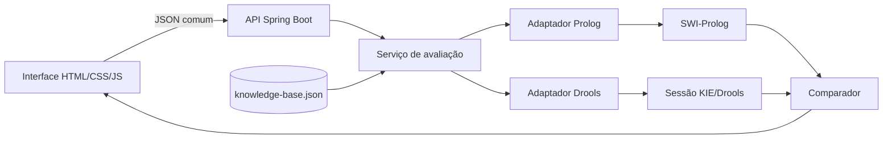
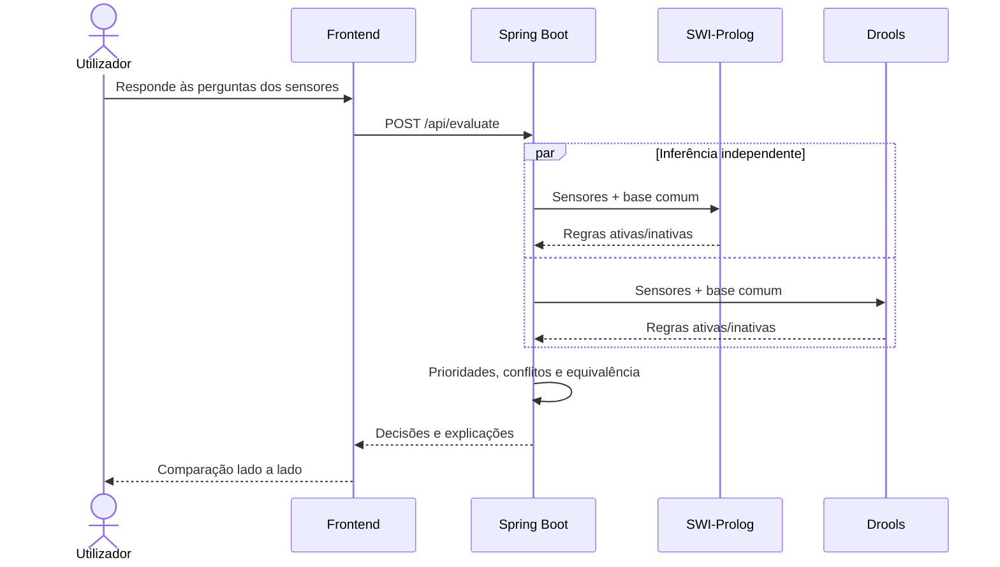

# Arquitetura do protótipo

## Diagrama de componentes

O ficheiro `knowledge-base.json` é a única fonte das dezoito regras de domínio. O
Drools recebe cada definição como facto e aplica meta-regras DRL. O Prolog recebe
o mesmo JSON pela entrada padrão e interpreta as condições declarativas.

## Sequência de uma avaliação

## Sensores simulados

| Dispositivo | Variável lógica | Unidade/tipo |
|---|---|---|
| Câmara frontal | `obstaculoNaFaixa` | booleano |
| Câmara frontal | `faixaEsquerdaLivre`, `faixaDireitaLivre`, `chuvaIntensa`, `visibilidadeReduzida` | booleano |
| Câmara e mapa | `numeroFaixas`, `faixaAtual` | inteiro (1 a 6) |
| Câmara e radar | `peaoNaTrajetoria`, `distanciaPeao` | booleano e metros |
| Radar | `distanciaObstaculo` | metros |
| GPS | `limiteVelocidade` | km/h |
| IMU | `pisoInstavel` | booleano |
| Sensores das rodas | `velocidade` | km/h |
| Câmara do condutor | `condutorDistraido`, `nivelFadiga` | booleano e nível |
| TPMS | `estadoPressaoPneus` | `NORMAL`, `BAIXA` ou `CRITICA` |
| Autodiagnóstico | `sensoresOperacionais`, `falhaSensorCritico` | booleano |
| Bancos | `cintosColocados` | booleano |

## Política de decisão

Todas as condições de uma regra formam uma conjunção lógica. Podem existir
várias regras ativas; vence a de prioridade numérica superior. Num empate vence
o menor identificador, tornando o resultado determinístico. Decisões incompatíveis
continuam visíveis como conflito, mesmo depois de escolhida a vencedora.
