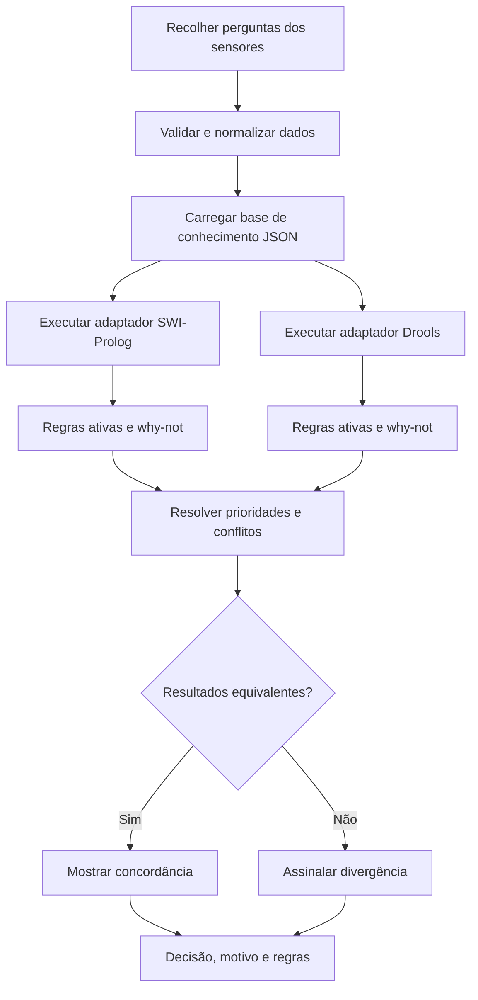

# Fluxo focado do protótipo

O diagrama original em `first_diagram.md` representa uma visão funcional extensa.
Este fluxo reduz o âmbito às variáveis efetivamente implementadas na primeira versão.

