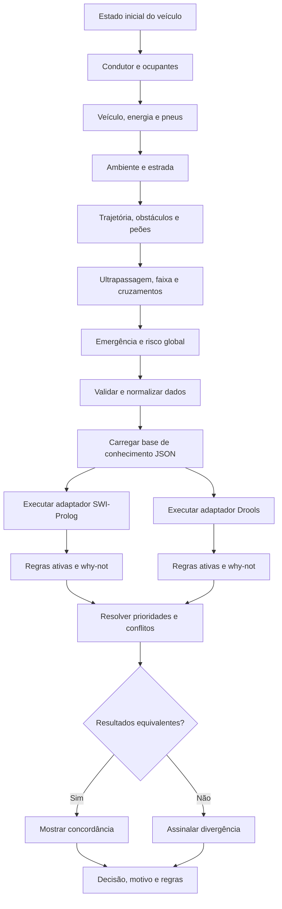

# Fluxo implementado

O diagrama original em `first_diagram.md` está representado na consulta por perguntas
condicionais. Os blocos de estado inicial, condutor, veículo, ambiente, trajetória,
ultrapassagem, faixa, cruzamentos, emergência e risco alimentam a mesma base comum.

