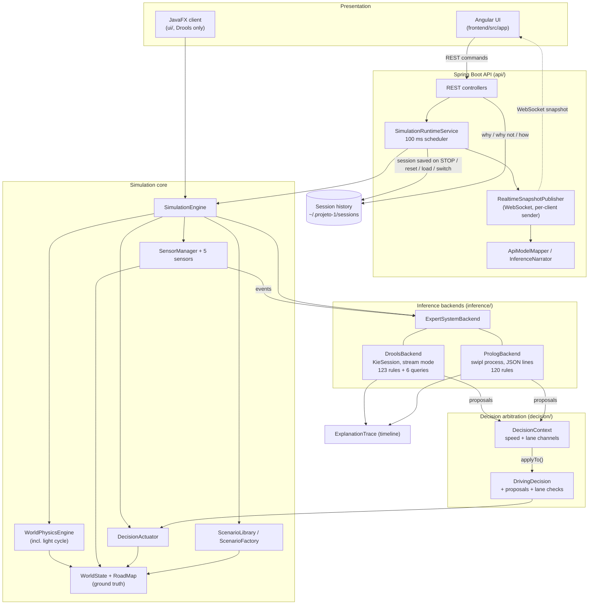
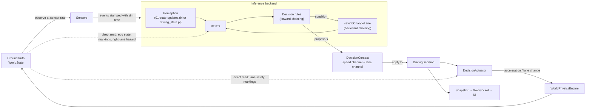
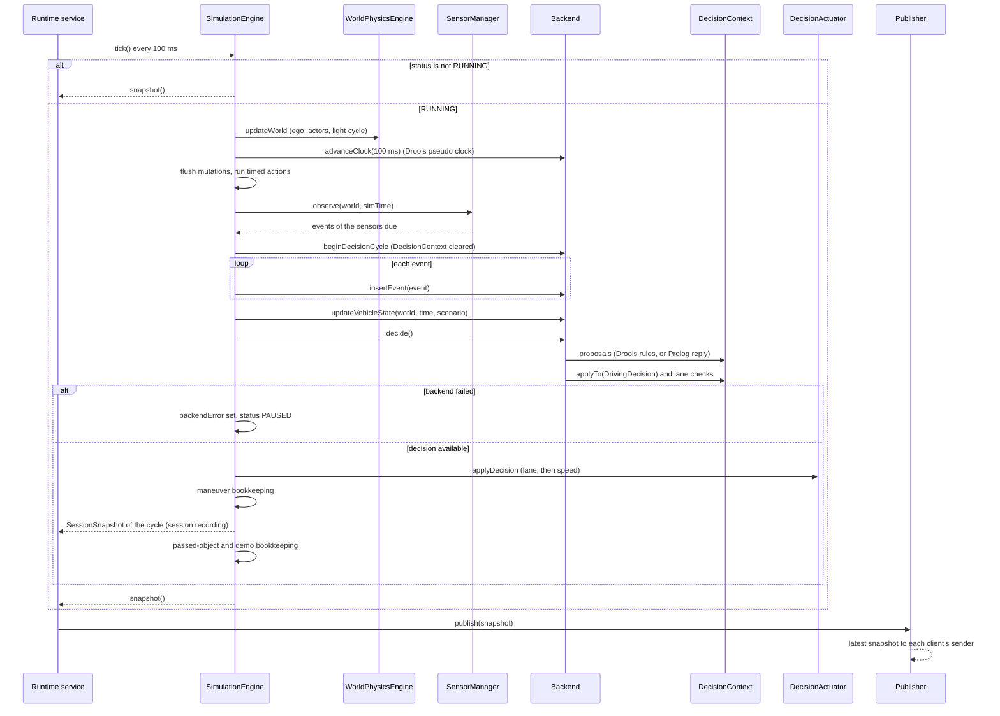

# Architecture

**Audience:** developers, maintainers and evaluators who need to understand how the system is built, how information flows through it, how a driving decision is selected, and where the architecture is weak.

**Related documents:** [PROJECT_STRUCTURE.md](PROJECT_STRUCTURE.md) (files and build), [EXECUTION_FLOW.md](EXECUTION_FLOW.md) (one tick in chronological order), [BUSINESS_RULES.md](BUSINESS_RULES.md) (rule catalogue and rule-level audit).

> **Evidence levels used in this document.**
> - *Confirmed (static)*: follows directly from the cited code.
> - *Confirmed (execution)*: observed by running code, either the project's own tests or exploratory probes executed on a copy of the repository ([TESTING.md §5](TESTING.md#5-exploratory-verification-probes)).
> - *Potential*: plausible from the code but not demonstrated.
>
> Version: working tree as of 2026-10-21. SWI-Prolog 9.2.9 is now installed on the analysis machine and the Prolog tests run (Surefire reports of 2026-10-21); the exploratory probes were run on 2026-10-18 with Drools only.

---

## 1. Architectural Overview

The system is a **closed-loop driving simulator with a rule-based decision core**. Each 100 ms tick:

1. a simulated world (the "ground truth") is observed by simulated sensors;
2. their observations become events for an **inference backend**;
3. production rules turn the events into beliefs and **propose** driving actions;
4. a Java arbitration object combines the proposals into a **speed decision** and a **lane decision**;
5. an actuator turns the decision into acceleration and lane changes;
6. the physics engine moves the world.

```text
WORLD ─▶ SENSORS ─▶ EVENTS ─▶ INFERENCE BACKEND (Drools or SWI-Prolog) ─▶ PROPOSALS ─▶ ARBITRATION ─▶ DECISION ─▶ ACTUATOR ─▶ WORLD
```

Two interchangeable backends implement the same knowledge:

- **Drools** (default): a forward-chaining production-rule engine for Java (algorithm *Phreak*, a successor of Rete) in stream mode with complex event processing. It also uses **backward chaining** through queries for one goal, "is it safe to change lane?" ([§4.1](#41-drools-backend)).
- **SWI-Prolog**: the project's own forward-chaining production-rule interpreter written in Prolog, with a meta-interpreter for backward chaining, run as a separate `swipl` process ([§4.2](#42-swi-prolog-backend)).

The architecture has six layers:

| Layer | Implementation | Responsibility |
|---|---|---|
| Presentation | Angular app (`frontend/`), legacy JavaFX client (`ui/`) | Visualise snapshots, send commands. No driving policy (verified: only rendering and form validation in TypeScript) |
| Service / API | Spring Boot (`api/`) | REST commands, WebSocket snapshot channel, 100 ms scheduler, DTO mapping, backend switch, session history and historical why / why not / how |
| Simulation core | `simulation/`, `sensors/`, `scenario/`, `domain/`, `config/` | World model, physics, traffic-light cycle, sensors, actuator, tick orchestration, scenarios |
| Inference abstraction | `inference/` | `ExpertSystemBackend` interface: the same five calls per tick for every backend |
| Knowledge layer | `drools/` + `src/main/resources/rules/*.drl`; `prolog/` + `src/main/prolog/*.pl` | Drools: stateful session, 123 rules, 6 queries. Prolog: persistent process, 120 rules |
| Decision arbitration | `decision/` | Priority levels, per-channel arbitration of all proposals, stopping figures, why-not checks |

---

## 2. Main Components and Responsibilities

| Component | Class / file | Responsibility | Depends on |
|---|---|---|---|
| Simulation engine | [`SimulationEngine`](../src/main/java/com/one2drive/projeto1/simulation/SimulationEngine.java) | Owns the world, the active backend, sensors and actuator; runs `tick()`; lifecycle (start, pause, stop, reset); `switchBackend`; pauses with `backendError` when the backend fails; queues world mutations; builds snapshots, and hands a `SessionSnapshot` of each decided cycle to the session recorder | all core components |
| Inference interface | [`ExpertSystemBackend`](../src/main/java/com/one2drive/projeto1/inference/ExpertSystemBackend.java), [`ExpertBackendType`](../src/main/java/com/one2drive/projeto1/inference/ExpertBackendType.java), [`DecisionInput`](../src/main/java/com/one2drive/projeto1/inference/DecisionInput.java), [`ExpertSystemException`](../src/main/java/com/one2drive/projeto1/inference/ExpertSystemException.java) | Per tick: `advanceClock`, `beginDecisionCycle`, `insertEvent` (per event), `updateVehicleState`, `decide`; plus decision, trace, working-memory views, limit in force | — |
| Drools backend | [`DroolsBackend`](../src/main/java/com/one2drive/projeto1/drools/DroolsBackend.java), [`KnowledgeSession`](../src/main/java/com/one2drive/projeto1/drools/KnowledgeSession.java), [`EventRouter`](../src/main/java/com/one2drive/projeto1/drools/EventRouter.java) | Creates the `KieSession` (pseudo or realtime clock), seed facts, `droolsSupport` global, listeners, live query; routes events to six entry points; writes `VehicleStateFact`; fires rules (cap 5000 per tick); arbitrates; asks the why-not queries | Drools/KIE |
| Prolog backend | [`PrologBackend`](../src/main/java/com/one2drive/projeto1/prolog/PrologBackend.java), [`PrologKnowledgeSession`](../src/main/java/com/one2drive/projeto1/prolog/PrologKnowledgeSession.java), [`PrologProcess`](../src/main/java/com/one2drive/projeto1/prolog/PrologProcess.java) | Starts `swipl -q -g main -t halt server.pl` once per session (executable from `-Dprolog.executable`, `PATH`, or the usual Windows/macOS install folders); per tick sends `prepareCycle` and one `tick` request (vehicle input, the tick's events, previous decision); reads proposals, working memory, why-not sub-goals and engine statistics; any error, timeout (2 s) or dead process → `PrologEngineException` | SWI-Prolog 9.x (external) |
| Rule bases | [`rules/*.drl`](../src/main/resources/rules), [`prolog/*.pl`](../src/main/prolog) | Drools: 33 perception rules, 1 control rule, 22 state/intermediate rules, 67 proposing rules, 6 queries. Prolog: `driving_state.pl` (perception state), `driving_rules.pl` (120 rules), `engine.pl` (interpreter), `server.pl` (protocol) | facts, events |
| Arbitration | [`DecisionContext`](../src/main/java/com/one2drive/projeto1/decision/DecisionContext.java), [`DecisionProposal`](../src/main/java/com/one2drive/projeto1/decision/DecisionProposal.java), [`DecisionPriority`](../src/main/java/com/one2drive/projeto1/decision/DecisionPriority.java), [`DecisionChannel`](../src/main/java/com/one2drive/projeto1/domain/DecisionChannel.java) | Keeps every proposal of a cycle; arbitrates the speed and lane channels separately; records each proposal's outcome ([§5](#5-action-selection-and-priority-resolution)) | — |
| Decision | [`DrivingDecision`](../src/main/java/com/one2drive/projeto1/decision/DrivingDecision.java), [`LaneChangeCheck`](../src/main/java/com/one2drive/projeto1/decision/LaneChangeCheck.java) | Published result: speed action and lane action with their reasons, rules, evidence; all proposals with outcomes; the why-not answer for both sides. Also a fact in the Drools session | — |
| Stopping figures | [`StoppingPolicy`](../src/main/java/com/one2drive/projeto1/decision/StoppingPolicy.java), [`SpeedIntent`](../src/main/java/com/one2drive/projeto1/decision/SpeedIntent.java) | Shared constants and formulas: decelerations, reaction time, stop-line, obstacle and barrier offsets, following gap, lane-change and lane-exit times, `requiredDistanceMeters`, `approachSpeedKmh`, `roomToFollow`; sent to Prolog at reset. `SpeedIntent` says whether a speed decision speeds up, holds or slows the car, as the actuator would apply it (used by the explanations) | `SimulationConfig` |
| Actuator | [`DecisionActuator`](../src/main/java/com/one2drive/projeto1/simulation/DecisionActuator.java) | Applies the lane decision (refuses unsafe or illegal maneuvers, A-02) and the speed decision (acceleration, indicators, driving state) | `WorldState`, `config` |
| World state | [`WorldState`](../src/main/java/com/one2drive/projeto1/simulation/WorldState.java), [`RoadMap`](../src/main/java/com/one2drive/projeto1/simulation/RoadMap.java), [`MapLegend`](../src/main/java/com/one2drive/projeto1/simulation/MapLegend.java) | Ground truth: ego, actors, road elements in a looping 3-lane matrix of 5 m blocks; nearest-object queries; side-lane occupancy | `domain` |
| Physics | [`WorldPhysicsEngine`](../src/main/java/com/one2drive/projeto1/simulation/WorldPhysicsEngine.java) | Longitudinal motion, lateral lane-change motion (1.2 m/s, smoothstep), actor motion, traffic-light cycle (yellow 3 s → red; red → green after the ego has waited 5 s at the line) | `domain`, `config` |
| Sensors | [`sensors/`](../src/main/java/com/one2drive/projeto1/sensors) | Speed (100 ms); front radar (100 ms, ≤ 130 m: own lane with noise, plus left, right and far-left lanes); camera (200 ms, 120 m × visibility); blind spot (200 ms, both sides); environment (400 ms) | `WorldState`, `drools.events` |
| Explanation | [`ExplanationTrace`](../src/main/java/com/one2drive/projeto1/explanation/ExplanationTrace.java), [`listeners/`](../src/main/java/com/one2drive/projeto1/drools/listeners), [`SensorSignificance`](../src/main/java/com/one2drive/projeto1/simulation/SensorSignificance.java), [`InferenceNarrator`](../src/main/java/com/one2drive/projeto1/api/service/InferenceNarrator.java), [`DecisionFlowchart`](../src/main/java/com/one2drive/projeto1/explanation/DecisionFlowchart.java) | Timeline (unbounded per backend session; the snapshot carries the last 160 entries) of perception changes, rule firings, fact changes, decisions, actuator and maneuver events; narrative for the UI. For Prolog, `PrologBackend` writes equivalent entries from the cycle result. `DecisionFlowchart` maps every proposing rule (both engines, by base name) to a question of the decision flowchart (`docs/fluxogramas/fluxogramas_apresentar/99-sistema-completo.md`) | backends |
| Runtime service | [`SimulationRuntimeService`](../src/main/java/com/one2drive/projeto1/api/service/SimulationRuntimeService.java), [`RealtimeSnapshotPublisher`](../src/main/java/com/one2drive/projeto1/api/service/RealtimeSnapshotPublisher.java) | Single-thread scheduler at a fixed 100 ms calling `tick()` (exceptions logged, loop kept alive); WebSocket publishing through one sender per client that only keeps the latest snapshot; [`RealtimeWebSocketHandler`](../src/main/java/com/one2drive/projeto1/api/controller/RealtimeWebSocketHandler.java) registers each session at `/api/ws/simulation` | engine, mapper |
| Session history | [`SessionHistoryStore`](../src/main/java/com/one2drive/projeto1/history/SessionHistoryStore.java), [`SimulationSession`](../src/main/java/com/one2drive/projeto1/history/SimulationSession.java), [`SessionExplanationService`](../src/main/java/com/one2drive/projeto1/api/service/SessionExplanationService.java), `FlowchartPathBuilder`, `AlternativeExplainer`, [`SessionHistoryController`](../src/main/java/com/one2drive/projeto1/api/controller/SessionHistoryController.java) | `SimulationRuntimeService` records a session from START: vehicle samples, timeline events and a `SessionSnapshot` of each cycle with a `DECISION` entry (perception, working memory, proposals and outcomes, lane checks, the decision as the actuator left it). STOP, reset, scenario load and engine switch save it as one JSON file under `history.directory` (default `~/.projeto-1/sessions`). The why endpoint explains a recorded decision per channel from the saved cycle (nothing is re-evaluated): why, why not each alternative, and the path through the flowchart | Jackson, `explanation` |
| Scenario subsystem | [`ScenarioLibrary`](../src/main/java/com/one2drive/projeto1/scenario/ScenarioLibrary.java), [`ScenarioFactory`](../src/main/java/com/one2drive/projeto1/scenario/ScenarioFactory.java) | Loads `scenarios.json` (14 scenarios; read with Java comments allowed, and S15 is commented out); builds a `WorldState` (default lane RIGHT; rain = visibility 0.7, grip 0.65) | Jackson |

### 2.1 Component diagram



---

## 3. Information Flow and Data Representation

### 3.1 Representation levels

| Level | Meaning | Classes | Lifetime |
|---|---|---|---|
| Ground truth | What really exists in the simulated world | `EgoVehicleState`, `OtherVehicle`, `Pedestrian`, `SpeedLimitSign`, `TrafficLight`, `StopSign`, `Crosswalk`, `Pothole`, `StaticObstacle`, `Barrier`, `WeatherState` (`domain/`), stored in `WorldState`/`RoadMap` | Whole run |
| Observation | What a sensor measured at a simulation time | 24 event classes in `drools/events/` (e.g. `TTCEvent`, `LeftLaneVehicleEvent`), also sent to Prolog as JSON | Drools: until `@expires` (3–30 s). Prolog: kept in `driving_state.pl` windows |
| Belief | The current view of one topic | 27 classes in `drools/facts/` (e.g. `FrontVehicleState`, `PendingSpeedLimit`, `TrafficLightStateFact` with commitment, `BoxedInFact`, fuzzy memberships, `SafeLaneSide` inserted logically while `safeToChangeLane` holds for a side); Prolog: `driving_state.pl` state predicates loaded as facts each cycle | Whole session (Drools facts updated in place; Prolog working memory rebuilt each cycle from the state) |
| Proposal | Candidate actions of one cycle | `DecisionProposal` (all kept, with outcome) | One tick |
| Decision / command | Selected speed and lane actions and the resulting control | `DrivingDecision`; ego `accelerationMps2`, `laneChangeState`, indicator | Until the next tick |
| Recorded cycle | What a decision was made on, for later questions | `SessionSnapshot` inside a `SimulationSession` (`history/`) | Saved to disk with the session |

### 3.2 Information-flow diagram



The dotted arrows are deviations from the intended "world → sensor → belief" separation (finding A-01).

### 3.3 Separation of concerns

| Concern | Where it happens | Notes |
|---|---|---|
| Data representation | `domain/` (truth), `drools/events/` (observations), `drools/facts/` (beliefs) | Clear separation by package; Prolog receives the same events as JSON |
| Perception | `sensors/` | Sensors decide what is "seen": range, rate, own-lane preference, pedestrian in-path and crossing state |
| Belief maintenance | `01-state-updates.drl` (Drools, agenda group `perception`) / `driving_state.pl` (Prolog) | Newest reading wins; stale beliefs reset after 250 ms (vehicles), 400 ms (lights), 1 s (pedestrians, hazards, pending sign), 1.5 s (stop sign, lane-change request) |
| Rule evaluation | Drools session / Prolog engine | Forward chaining over beliefs and event windows; backward chaining for lane-change safety |
| Decision generation | Rules propose → `DecisionContext` | Arbitration is Java code shared by both backends, not Drools or Prolog conflict resolution |
| Execution | `DecisionActuator`, `WorldPhysicsEngine` | The actuator also refuses unsafe or illegal lane changes (A-02) |
| Presentation | `api/`, `frontend/` | Read-only views and commands; engine toggle; trip questions dialog on STOP (why / why not / how over the saved session) |

---

## 4. Role of the Inference Engine

### 4.1 Drools backend

- **Knowledge base and session.** [`kmodule.xml`](../src/main/resources/META-INF/kmodule.xml) declares kbase `drivingKbase` (`eventProcessingMode="stream"`) and a stateful ksession. `KnowledgeSession.create` builds a new `KieSession` for every engine instance, reset and backend switch.
- **Clock.** The XML says `realtime`, but the code overrides it:
  - The Spring server and all tests use a **pseudo clock**, advanced by exactly 100 ms per tick, so event timestamps (simulation milliseconds) and CEP windows share one time base.
  - The JavaFX client uses a realtime clock (A-07).
- **Session and the realtime channel.** The session is stateful because beliefs and event windows must survive from tick to tick. It is only touched through `synchronized` `SimulationEngine` methods (scheduler tick, REST commands), never by the WebSocket threads; the snapshot built after each tick is what the browser receives. Lifecycle table and push flow: [README, Realtime communication and the Drools session](../README.md#realtime-communication-and-the-drools-session).
- **Phases.** Every rule belongs to the agenda group `perception` (33 rules), `decision` (87) or `fallback` (2), except the control rule, which is alone in group `control`. `KnowledgeSession.beginDecisionCycle` stacks the focus every cycle so that `control`, `perception`, `decision` and `fallback` run in that order; the control rule "Control: perceive, then decide, then fall back" (salience 10000, `no-loop`) fires first and marks the `DecisionContext` as dispatched. Its comment labels this "Meta-knowledge".
- **Forward chaining.**
  - Inserting or updating a fact re-evaluates the affected rule conditions; within a group, rules fire in salience order.
  - Consequences `update`/`modify`/`insert`/`delete` facts, which can activate further rules in the same `fireAllRules` call.
  - `no-loop` prevents self-retriggering.
  - `DroolsBackend.decide` caps a tick at 5000 firings and logs a "possible rule loop" entry if the cap is hit.
- **Backward chaining.** [`lane-safety.drl`](../src/main/resources/rules/lane-safety.drl) defines the goal `safeToChangeLane(side)` as four sub-goal queries:
  - `maneuverIdle`;
  - `noContinuousLine`;
  - `sideClear`;
  - `roomToFollow`.

  Avoidance, barrier, overtaking and lane-request rules call the goal from their conditions without `?`, so the rule reacts when a sub-goal becomes true later. Where a rule needs "this side is not safe" (or "no side is safe"), it tests the absence of a `SafeLaneSide` fact, which the perception rule "Derive the sides that are safe to change lane to" (salience 800) inserts logically for each side the goal proves, instead of negating the query. After the rules fire, `DroolsBackend.laneCheck` asks each sub-goal for both sides and builds the why-not answer (`LaneChangeCheck`).
- **Truth maintenance.** The fuzzy weather rules use `insertLogical`: memberships and conclusions are retracted automatically when the weather reading that justified them changes.
- **Complex event processing (CEP).**
  - 24 event types are declared with `@role(event)`, `@timestamp(timestamp)` and `@expires` (3–30 s).
  - Seven rules read streams directly:
    - `window:time(2s)` with `accumulate` (persistent TTC, rain + TTC, approaching trend and its hold variant);
    - `window:time(200ms)` (immediate TTC);
    - `window:time(300ms)` (obstacle emergency);
    - the Allen operators `coincides[400ms]` (rain + TTC) and `after[1200ms]` (stop-sign full stop).
  - There is no `window:length` rule.
- **Entry points.** Six named streams (`EventRouter`): `VEHICLE_STREAM`, `PERCEPTION_STREAM`, `ROAD_STREAM`, `TRAFFIC_STREAM`, `ENVIRONMENT_STREAM`, `COMMAND_STREAM`. They are created implicitly, not declared in `kmodule.xml`.
- **Global helper.** `droolsSupport` (`DroolsSupport.proposeDecision`) forwards each proposal to `DecisionContext.propose`.
- **Queries and live query.** `queries.drl` defines "Current Driving Decision", opened as a live query (`DecisionLiveQueryListener`); the server passes a no-op consumer.
- **Listeners.** `RuleRuntimeTraceListener` (activation, cancellation, firing) and `WorkingMemoryTraceListener` (insert, update, delete) write the explanation timeline.

### 4.2 SWI-Prolog backend

Read from the sources; the Prolog tests (rule tests, Drools/Prolog equivalence, dual-backend E2E) run with SWI-Prolog installed. The exploratory probes of 2026-10-18 used Drools only; the invariant sweep of 2026-10-20 ([dated report](invariant-sweep-2026-10-20.md)) drove both engines.

- **Process and protocol.**
  - `PrologProcess` copies `server.pl`, `engine.pl`, `driving_state.pl` and `driving_rules.pl` from the classpath folder `prolog/` to a temporary directory and starts `swipl -q -g main -t halt server.pl`. `PrologProcess.executable()` takes `-Dprolog.executable` if set, else `swipl` on `PATH`, else the usual install folders (Windows: `SWI_HOME_DIR\bin`, Program Files, `%LOCALAPPDATA%\Programs`, Scoop; macOS: Homebrew, MacPorts, the app bundle).
  - Requests and replies are single JSON lines on stdin/stdout ([§6](#6-interfaces-and-external-dependencies)).
  - A reply with `ok:false`, a closed stream, a dead process or a reply later than 2 s raises `PrologEngineException`. The engine then pauses the simulation and shows the error.
- **State between cycles.**
  - `driving_state.pl` plays the role of the Drools perception rules. It keeps the latest reading of each sensor, the limit in force and the pending sign, TTC and distance windows, the light commitment, the stop-sign timer, the move-off, pedestrian-braking and overtaking states, and the boxed-in fact.
  - Each tick `prepareCycle` drops the previous cycle's fuzzy facts, `load_cycle_facts/0` turns this state into the initial facts of a fresh working memory, and `store_conclusions/0` saves what must persist.
- **Rule engine (`engine.pl`).**
  - Production rules have the form `rule(Id, Precedence, Conditions, Actions)`.
  - Conditions are patterns, `not(...)`, `test(Goal)` and `prove(Goal)`; actions are `assert(Fact)`.
  - `run_rules/0` matches all rules, then repeatedly fires the best activation: highest precedence, then rule order, then match order.
  - Refraction: an instantiation fires at most once per cycle. Facts are never retracted within a cycle.
  - A **dependency index** (`rule_reads/2`), derived by static analysis of the rules and their helper predicates (transitively), limits re-matching to the rules that read a new fact type. It can be switched off (`dependencyIndex` request) for the benchmark `DependencyIndexBenchmarkTest`.
  - The index and the control knowledge (`rule_precedence/2`, `rule_rank/2`, refraction through `fired/2`) are labelled "Meta-conhecimento" in the comments of `engine.pl`, where they are declared, built and used.
  - A guard throws after 5000 firings.
- **Backward chaining.**
  - `prove(Goal)` runs a small meta-interpreter (`prove_goal/2`) over helper predicates down to working-memory facts, and records the facts it read as evidence.
  - `safe_to_change_lane/1` mirrors the Drools queries; `subgoal_results/2` gives the why-not answer for each side.
- **Explanations.**
  - `explain/2` builds a proof tree for any fact.
  - `why_not/2` reports the blocking condition of a rule's furthest partial match, then the later conditions that fail too. It is reachable through `PrologKnowledgeSession.whyNot` (the `whynot` request) and used only by tests; the API and UI use the lane checks and the recorded proposals.
  - Every proposal carries as evidence the facts it rests on, each with the rule that concluded it.
- **Equivalence with Drools.**
  - Precedences equal the Drools saliences.
  - 75 Prolog rule names equal a Drools rule name; 16 Drools rules with branching consequences have one Prolog rule per branch (43 variants, named `'Name (outcome)'`); 2 Prolog rules are the intermediate conclusion `pedestrian_conflict/1` ([BUSINESS_RULES.md §2.4](BUSINESS_RULES.md#24-prolog-counterpart)).
  - `RuleNameParityTest` (reads the sources, needs no `swipl`) fails if a Drools decision rule has no Prolog rule of the same base name, or the other way round, apart from the listed one-sided rules (the control rule, "Forget the stop when the stop sign is re-armed", the pedestrian-conflict rule). `DecisionFlowchartTest` checks that every proposing rule of both engines answers one flowchart question of its channel.
  - `StoppingPolicy` figures and `DecisionPriority` values are sent by Java at reset; the other thresholds are duplicated literals (A-14).

### 4.3 Concepts from logic programming

- **Drools.** Rule conditions are matched against objects by field constraints and variable bindings (`$speed : speedKmh`). This is pattern matching, not Prolog *unification*.
  - Forward inference is data-driven: every rule whose conditions hold is activated, and all activations fire.
  - The `safeToChangeLane` queries add goal-directed evaluation of one goal. Drools evaluates queries without Prolog-style *backtracking* over alternative clauses.
- **Prolog backend.** The interpreter is itself forward-chaining.
  - Its matching uses real Prolog unification (`wm_fact(Id, Pattern)`).
  - Alternative matches are enumerated with `findall/3`, a form of backtracking.
  - `prove/1` proves a goal by resolving it against the clauses of helper predicates (backward chaining).

---

## 5. Action Selection and Priority Resolution

### 5.1 Priority levels

[`DecisionPriority`](../src/main/java/com/one2drive/projeto1/decision/DecisionPriority.java) defines seven integer levels. Every action belongs to one channel (`DrivingAction.channel()`): `KEEP_LANE`, `CHANGE_LANE_LEFT`, `CHANGE_LANE_RIGHT` and `RETURN_RIGHT` are **lateral**; all others are **longitudinal**. Counts of Drools rules proposing at each level:

| Level | Value | Role in the speed channel | Speed rules | Lane rules |
|---|---|---|---|---|
| `EMERGENCY_SAFETY` | 70 | Override | 5 (emergency brakes, incl. a pedestrian beyond comfortable braking) | — |
| `LEGAL_MANDATORY_STOP` | 60 | Override | 10 (red/yellow light, stop sign, pedestrian, closed barrier stop) | — |
| `COLLISION_AVOIDANCE` | 50 | Ceiling | 11 (front vehicle, obstacle and barrier stops in the lane, rain + TTC, fall back) | 9 (obstacle and barrier avoidance, keep right lane when blocked) |
| `ROAD_HAZARD` | 40 | Ceiling | 2 (pothole slow-down, fuzzy weather) | 4 (pothole avoidance) |
| `MANEUVER_SAFETY` | 30 | Release base | 3 (move off, resume on green, proceed after stop) | 13 (overtaking, returns, keep-right, driver requests, maneuver continuation) |
| `SPEED_COMPLIANCE` | 20 | Ceiling | 5 (limit, limit ahead, cruise build-up, no passing on the right of a left or far-left vehicle) | — |
| `COMFORT_PROGRESS` | 10 | Comfort base | 5 (baseline, compliant, green light, open barrier, acceleration request) | — |

### 5.2 Arbitration algorithm

At the start of every tick, `beginDecisionCycle` clears the `DecisionContext` (and, for Drools, notifies the session). Each rule that proposes adds a `DecisionProposal` (action, speed, risk, priority, reason, rule, evidence, firing order). After inference, `DecisionContext.applyTo` builds the decision.

**Speed channel** (longitudinal proposals):

```text
if any proposal has priority ≥ 60:
    winner = highest priority, then lowest speed, then first proposed
    cap    = lowest ceiling (priority 50/40/20) with a speed strictly below the winner's
    if cap exists: decision speed = cap speed (cap marked CAPPED)
else:
    base    = lowest-speed priority-30 proposal, or else lowest-speed priority-≤10 proposal
    ceiling = lowest-speed proposal of priority 50, 40 or 20
    winner  = ceiling if it is strictly below base, else base (if one exists), else ceiling
no proposal at all → MAINTAIN_SPEED at the current speed, "Default base decision"
```

**Lane channel** (lateral proposals): the highest priority wins, then `RETURN_RIGHT` before `CHANGE_LANE_*` before `KEEP_LANE`, then firing order. With no proposal the decision is `KEEP_LANE`, "Default lane decision".

**Veto:** a winning lane maneuver becomes `KEEP_LANE` ("Arbitration veto", outcome `VETOED_BY`) when all three of these hold:

- the speed winner has priority ≥ 60;
- the maneuver's priority is lower;
- the speed action is braking (`BRAKE`, `STOP`, `WAIT`, `EMERGENCY_BRAKE`).

On the approach to a stop (still `REDUCE_SPEED` or `MAINTAIN_SPEED`) a maneuver may go ahead (`FarStopNearObstacleE2ETest`).

Consequences:

1. **All ceilings bind together.** No rule can lift the speed above the legal limit by having a higher priority (the baseline defect R-01 is fixed).
2. **Speed and lane do not compete.** An overtake can start in the same cycle as a speed reduction.
3. **Every proposal has an explanation.** Outcomes (`WON`, `LOST_TO rule`, `VETOED_BY rule`, `CAPPED`, `REJECTED_BY actuator`) answer "why not this rule?", and the lane checks answer "why not change lane?".
4. **Salience still matters in exact ties** (same priority and speed): the first proposal wins. This is how "Hold at red traffic light" shadows "Red traffic light requires full stop and hold" (R-13), and how a mandatory `STOP` hides an emergency-brake ceiling at the same speed (R-11).
5. **Risk level plays no part** in arbitration.
6. **The headline action** (`DrivingDecision.getAction()`) is the lane maneuver while one is decided, otherwise the speed action.

### 5.3 Post-processing by the actuator

Verified in [`DecisionActuator.applyDecision`](../src/main/java/com/one2drive/projeto1/simulation/DecisionActuator.java). The lane decision is applied first, then the speed decision.

| Decision | Actuator behaviour |
|---|---|
| Lane maneuver while another maneuver is moving | Ignored; the running maneuver continues and cannot be aborted (A-12) |
| Lane maneuver to the lane the ego is already in | Refused: `rejectLane`, outcome `REJECTED_BY` |
| Lane maneuver into a lane `WorldState.isLaneSafe` rejects, or across a `CONTINUOUS` marking | Refused. If the speed decision is not already braking or reducing, it is replaced by `REDUCE_SPEED` to current − 10 km/h, priority 50, source "Actuator safety guard" (A-02) |
| Accepted lane maneuver | `requestLaneChange`; indicator and steering set |
| Speed priority ≥ 60 | `STOP`, `WAIT` and `REDUCE_SPEED` → 2.8 m/s² until < 0.6 km/h, then 0. `EMERGENCY_BRAKE` → 8.5 m/s². `BRAKE` → 2.8 m/s². Other actions (`MAINTAIN_SPEED`, `RESUME`, `CONTINUE`) keep their own acceleration (0 or +1.6 m/s²) unless a lower cap requires slowing |
| Speed priority < 60, numeric recommendation, not `EMERGENCY_BRAKE` | **Tracks the recommendation as a target.** Above it: −2.8 m/s², or proportional within 2 km/h. More than 0.5 km/h below it: **accelerates** (1.6 m/s² for `ACCELERATE`/`RESUME` or below 5 km/h, else 0.8 m/s²), except under `BRAKE`/`STOP`/`WAIT`/`EMERGENCY_BRAKE`, which hold instead. Within the ±0.5 km/h dead band: the speed is set to the target |
| `EMERGENCY_BRAKE` | 8.5 m/s² and hazard lights |
| `STOP`/`WAIT` below 2 m/s | Speed set to 0 |

Because non-braking reductions still track targets, a "reduction" whose target lies above the current speed accelerates the car (A-04; R-02, R-23 in [BUSINESS_RULES.md §17](BUSINESS_RULES.md#17-consistency-audit)).

---

## 6. Interfaces and External Dependencies

| Interface | Direction | Description |
|---|---|---|
| REST API (`/api/...`) | UI → backend | Lifecycle, scenarios, world mutations, environment, inspection, backend switch; full list in [PROJECT_STRUCTURE.md §9.4](PROJECT_STRUCTURE.md#94-rest-and-websocket-interface). `ExpertSystemException` → HTTP 503 |
| History API (`/api/history/sessions`) | UI → backend | List saved sessions, get one, and `POST /{id}/why` with a `timestampMillis` for the why / why not / how of the recorded decision at (or last before) that time |
| WebSocket (`ws://…/api/ws/simulation`) | backend → UI | JSON frame `{"event":"snapshot","payload":…}` (`ApiSnapshotPayload`) with `ApiSimulationSnapshot`: ego, environment, decision (both channels, all proposals with outcomes, lane checks), sensor telemetry, world objects, working memory, timeline, road map, lane safety, demo phases, active backend and its error. The last one is sent on connect, then one every tick and after each command; slow clients skip frames; only the `http://localhost:4200` origin may connect from a browser |
| Drools API | engine ↔ session | `insert`/`update`, `getEntryPoint().insert`, `fireAllRules(5000)`, pseudo clock `advanceTime`, `getQueryResults` (why-not), `openLiveQuery`, listeners |
| Prolog process | engine ↔ `swipl` | One JSON request and one JSON reply per line (UTF-8), 2 s timeout:<br>• `{"cmd":"reset", cruiseTargetKmh, params, priorities}`<br>• `{"cmd":"prepareCycle"}` (drops the previous cycle's fuzzy facts; sent before every tick)<br>• `{"cmd":"tick", timestamp, speedKmh, positionMeters, lane, laneChangeState, targetLane, leftMarking, rightMarking, leftAdjacentLaneSafe, rightAdjacentLaneSafe, rightLaneBlockedAhead, presentationDemo, laneSettledAtMillis, physicalLane, prepareCycle, events[], previousDecision{action, laneAction, rule, priority}}` → `{ok, proposals[], facts[], speedLimitKmh, laneChecks[], engineStats}`<br>• `{"cmd":"whynot", rule}`<br>• `{"cmd":"dependencyIndex", enabled}`<br>Errors → `{"ok":false,"error":…}`; Prolog warnings go to stderr |
| Scenario file | classpath → engine | `scenarios/scenarios.json`, read once by Jackson |
| Configuration | file → server | `application.properties`: `server.port=8080`, `expert.backend=drools` (or `prolog`); `history.directory` (not in the file; default `${user.home}/.projeto-1/sessions`) |
| Session files | server → disk | One JSON file per saved session (`<uuid>.json`), read back for the history API |
| JavaFX | desktop | Direct in-process use of `SimulationEngine` (Drools, realtime clock) |

External runtime dependencies:

- Drools/KIE 8.44.0.Final, Spring Boot 3.3.4, Jackson 2.17.2;
- JavaFX 21.0.2 (JavaFX client only);
- **SWI-Prolog 9.x** as an external program, only when the Prolog backend is selected.

No database, network service or credentials are used; the only files written are the session history.

---

## 7. Sequence of One Simulation Tick



The step-by-step description, with the responsible methods, is in [EXECUTION_FLOW.md](EXECUTION_FLOW.md).

---

## 8. Architectural Decisions and Rationale

Only decisions with evidence in the repository are listed.

| Decision | Evidence | Rationale given |
|---|---|---|
| Driving policy lives only in the knowledge bases; Angular is presentation-only | README "Separation of concerns"; verified in `frontend/src/app` | Keep the expert policy in a rule engine, not in UI conditions |
| One interface, two interchangeable backends | `ExpertSystemBackend` Javadoc; README "Rule engines" | Both feed the same arbitration, actuator, timeline and working-memory views |
| Persistent Prolog process with JSON lines | `PrologProcess` Javadoc | One process per request is too slow at one decision every 100 ms, and the Prolog side must keep perception state between cycles |
| Fail closed when a backend fails | `ExpertSystemException` Javadoc; `SimulationEngine.tick` | "The simulation must stop deciding rather than carry on with a default decision nobody inferred" |
| Proposals arbitrated per control channel, all kept | `DecisionContext` and `DecisionProposal` Javadoc | A lane change and a speed reduction never compete; the explanation can say why a rule did not decide |
| Speed proposals below 60 are ceilings combined by minimum | `DecisionContext` Javadoc; README "Adding Rules" | The vehicle must respect all ceilings; priorities name the kind of rule, not a value chosen to beat another rule |
| Phases as agenda groups | `control.drl` comment | Perceive, then decide, then fall back, in every cycle |
| Lane-change safety as a backward-chained goal | `lane-safety.drl` comment | One definition replaces conditions the rules used to repeat; the engine can say which sub-goal fails |
| Room to follow proved from the radar, not checked by the actuator | `lane-safety.drl` comment | The actuator used to check it against the world, with no range and no noise |
| Fuzzy weather controller | `fuzzy-weather.drl` comment | Visibility and grip are vague; one ceiling replaces three crisp rules |
| Pseudo session clock advanced once per tick (server, tests) | `SimulationCoreConfig`; `SimulationEngine.tick` | Deterministic CEP windows across pause, reset and slow clients |
| One "current state" fact per topic, with stale clearing | `01-state-updates.drl` comments | Rules reason on a stable belief; a perception is valid only while readings keep arriving (two missed radar samples = gone) |
| A speed-limit sign takes effect at the sign, not on sight | Comment above "Track the speed limit sign ahead as pending" | Making it current on sight slowed the car too early and ignored higher limits behind lower ones |
| Traffic-light decision taken once (commitment) | Comment in `traffic-lights.drl` | The decision cannot swing between stopping and driving on as speed and distance change |
| Adjacent lanes start as *occupied* | Comment in `KnowledgeSession.create` | "A vehicle must never steer into a lane that has simply not been sensed yet" |
| Lane changes executed progressively, never reversed | `LaneChangeState`, `DecisionActuator.requestLaneChange` | No teleporting, no oscillation between lanes |
| Stop-sign approach recommends the current speed | Comment in `traffic-signs.drl` | Let the actuator's constant deceleration run; avoid repeated hard-brake bursts |
| WebSocket with a non-blocking per-client sender | `RealtimeSnapshotPublisher` Javadoc | A slow browser must not freeze the simulation thread |
| Snapshot pushed after the tick, not from the live query | [README](../README.md#how-decisions-reach-the-browser) | The live query fires before the actuator applies (or refuses) the decision; the snapshot after the tick is consistent |
| Reset and backend switch rebuild the session | `SimulationEngine.reset`, `switchBackend` | No perception state leaks between runs or engines |
| Historical explanations from the saved cycle, not re-inferred | `SessionExplanationService` Javadoc | "Everything comes from the saved cycle …; nothing is re-evaluated", so the answer is the same for both engines and after the engine has moved on |
| Flowchart map checked against both rule bases | `DecisionFlowchart`, `DecisionFlowchartTest` Javadoc | "A rule added to the rules without a place in the flowchart fails here" |

---

## 9. Architectural Limitations and Audit Findings

### 9.1 Confirmed limitations (by design)

- **Single in-memory simulation.** One `SimulationEngine` per server; the running state is not persisted (only finished sessions, as JSON files for the history); all clients share and control the same simulation; no authentication. CORS and the WebSocket origin check allow `http://localhost:4200` only.
- **Simplified world.** Three fixed lanes (centres −3.5, 0, +3.5 m); a looping road of 5 m blocks (500 m by default); point-like vehicles; constant accelerations; no oncoming traffic, intersections, cyclists or emergency vehicles.
- **Reactive traffic lights.** A light turns from yellow to red after 3 s. A red light turns green only once the ego has waited 5 s at rest at its stop line. Green never turns yellow by itself. The cycle therefore reacts to the ego, which simplifies the scenarios but is not a fixed-time signal.
- **Idealised sensors.** No failures, no confidence values, no sensor fusion. Only the own-lane radar distance has noise (σ 0.7 m, fixed seed 42). The camera range shrinks with visibility.
- **Weather model.** Only `CLEAR` and `RAIN`. "Low visibility" and "low grip" are `RAIN` with factors.
- **Crosswalks are perceived but not used by rules.** Pedestrians are handled on their own.
- **The JavaFX client uses only Drools,** with a realtime clock (A-07).

### 9.2 Audit findings

Severity scale used in all documents:

| Severity | Meaning |
|---|---|
| High | Produces unsafe or illegal simulated driving, or disables a safety function, in reachable situations |
| Medium | Incorrect or unintended behaviour that degrades function, explainability, maintainability or resource use, without direct safety impact in common situations |
| Low | Inconsistency, redundancy or maintainability issue with little behavioural impact |
| Info | Observation; no correction strictly needed |

Status is given for the working tree as of 2026-10-21, re-checked statically; probe evidence dates from 2026-10-18. IDs are stable; fixed and obsolete findings are kept for traceability.

| ID | Finding | Location | Status | Severity |
|---|---|---|---|---|
| A-01 | World truth bypasses the sensor layer | `DroolsBackend.updateVehicleStateFact`, `PrologBackend.updateVehicleState`, `DecisionActuator` | Partially fixed; open (static) | Medium |
| A-02 | Safety logic in the actuator, outside the knowledge base | `DecisionActuator.applyLaneDecision`, `rejectLane` | Open (static); now explicit and recorded | Low |
| A-03 | Actuator override invisible to the timeline and to the rules' view of the decision | `SimulationEngine.tick`, `DroolsBackend.decide` | Partially fixed (static) | Low |
| A-04 | Recommended speed is a target for non-braking actions below priority 60 | `DecisionActuator.applyDecision` | Partially fixed; confirmed (P-02c, P-16) | Medium |
| A-05 | `DecisionContext` constraints only evaluated at cycle start | `defaults.drl` | Mostly resolved (only the baseline uses it, with a guard) | Info |
| A-06 | Rules see the previous decision one tick late | `DroolsBackend.decide`, Prolog `previousDecision` | Open (by design) | Info |
| A-07 | Realtime clock disables time-based rules in the JavaFX client | `DrivingExpertSystemApp`, `KnowledgeSession.createRealtime` | Open; confirmed (P-04, P-04b) | High (JavaFX only) |
| A-08 | Status endpoint partly constant | `SimulationRuntimeService.systemStatus` | Partially fixed (static) | Low |
| A-09 | Dead and unreachable code | several | Open (static) | Low |
| A-10 | Cross-file DRL import dependency | `speed.drl`, `road-law.drl` | Open (static) | Low |
| A-11 | `SpeedRadarEvent` facts never removed | — | Obsolete (speed radar removed) | — |
| A-12 | A started lane change cannot be aborted | `DecisionActuator.requestLaneChange` | Open (static) | Medium |
| A-13 | The simulator has no collision model | `SimulationEngine.consumePassedRoadElements` | Open; confirmed (P-10, P-13, P-14) | Medium |
| A-14 | Two knowledge bases must be kept equivalent by hand | `rules/*.drl`, `src/main/prolog/*.pl` | Partially mitigated (name parity and flowchart tests; equivalence tests run with SWI-Prolog) | Medium |

**A-01 — World truth bypasses the sensor layer.**
- *Description.* The README says the rules reason only from detected events. Several inputs still come from `WorldState` directly, in both backends:
  - the ego's speed, position, lane-change state and lateral position;
  - the lane markings;
  - `rightLaneBlockedAhead` (a hazard in RIGHT within 150 m, beyond the camera range), read by "Enforce keep right road law when right lane is safe";
  - `leftAdjacentLaneSafe` / `rightAdjacentLaneSafe` (`WorldState.isLaneSafe`), still computed every tick although no rule reads them any more.

  The actuator's lane refusal also reads world truth (A-02).
- *Fixed part.* The speed-radar path is gone, and the barrier rules now prove lane safety from the blind-spot sensor through `safeToChangeLane`.
- *Consequences.* The keep-right rule can know about hazards no sensor has reported, and explanations do not show this.
- *Severity.* Medium.
- *Recommendation.* Derive `rightLaneBlockedAhead` from camera readings, and remove the unused adjacent-lane flags.

**A-02 — Safety logic in the actuator.**
- *Description.* `DecisionActuator` refuses a lane maneuver when the target lane is unsafe by world truth or behind a continuous line. It now records the refusal (`REJECTED_BY`, lane reason "Lane change rejected by the actuator: …"). Unless the speed decision already brakes or reduces, it also replaces the speed decision with `REDUCE_SPEED` current − 10 km/h, priority 50, source "Actuator safety guard". Its Javadoc now calls these "execution guards against the world as it is".
- *Severity.* Low (defence in depth, now visible).
- *Recommendation.* Keep the guard, but give the replacement speed decision an explicit rule-like explanation in the timeline (see A-03).

**A-03 — Actuator override invisible to the timeline and to the rules' view.**
- *Description.* `tick()` records the decision in the timeline (`trackDecisionTransition`) before the actuator runs, and `DroolsBackend.decide` has already updated the `DrivingDecision` fact. The refusal and the replacement speed decision mutate the same object afterwards.
- *Fixed part.* The snapshot and the decision panel show the refusal; an `ACTUATOR` timeline entry shows the resulting acceleration; the recorded session cycle stores the decision as the actuator left it.
- *Still open.* The decision entry in the timeline, and the values the rules matched on (the previous decision, A-06), are the pre-guard ones.
- *Severity.* Low.

**A-04 — Recommended speed is a target for non-braking actions.**
- *Description.* Below priority 60, the actuator accelerates towards the recommended speed of `REDUCE_SPEED`, `MAINTAIN_SPEED` and `CONTINUE`. `BRAKE`, `STOP`, `WAIT` and `EMERGENCY_BRAKE` now never raise the speed.
- *Examples.*
  - P-02c: `REDUCE_SPEED 36.8` ("Reduce speed when closing front vehicle") accelerated a car from 20 to 24 km/h towards a 15 km/h vehicle.
  - P-16: in rain with no sign, `REDUCE_SPEED 50.6` (fuzzy weather) accelerated a car cruising at 30 km/h to 50.6 km/h.
- *Severity.* Medium. Ceilings now bind together, so the legal limit is respected; the effect is limited to rising towards a lower ceiling than intended.
- *Recommendation.* Never accelerate under a `REDUCE_SPEED` ceiling, or make the cruise-speed rule a base proposal.

**A-05 — `DecisionContext` constraints only evaluated at cycle start.**
- *Description.* Proposals mutate the context without notifying Drools. The ineffective guards of the baseline were removed; only "Default maintain speed baseline" still matches `DecisionContext(priority <= 0)`, with a right-hand-side guard.
- *Remaining effect.* Timeline noise (R-17).
- *Severity.* Info.

**A-06 — Previous decision visible one tick late.** The decision fact is updated after inference, and Prolog receives it as `previousDecision`. The move-off and stop-sign rules react to the previous tick's decision, as intended. Info.

**A-07 — Realtime clock disables time-based rules in the JavaFX client.**
- *Description.* The JavaFX client creates the engine with `pseudoClock = false`. The session then uses a wall-clock `REALTIME` clock, while event timestamps are simulation milliseconds starting at 0.
- *Evidence.*
  - P-04: five cycles of TTC = 1.2 s at 15 m left 0 TTC events in the stream, and the decision was `REDUCE_SPEED` instead of `EMERGENCY_BRAKE` (pseudo clock).
  - P-04b: running S4 with the realtime clock, the car stopped at the stop sign at 8.9 s and **never moved again** in 60 s. The stop is completed with `after[1200ms]` between stream events. With the pseudo clock it moved off at 10.7 s.
- *Consequences.* In the JavaFX client, all window-based and Allen-timed rules misbehave (emergency TTC, obstacle emergency, rain + TTC, approaching trend, stop-sign completion). The Spring server and the tests are not affected.
- *Severity.* High for the JavaFX client.
- *Recommendation.* Use the pseudo clock in the JavaFX client too.

**A-08 — Status endpoint partly constant.** `systemStatus()` now reports `drools` as `ACTIVE` or `ERROR` (from `backendError`) and names the active backend, but `backend` is still the constant `"CONNECTED"`. Low.

**A-09 — Dead and unreachable code.**
- `ProcessedEvent` is never instantiated.
- `SimulationConfig.laneChangeSeconds` has only a getter; `StoppingPolicy.LANE_CHANGE_SECONDS` duplicates the 3 s.
- `WorldPhysicsEngine.extractStateVector` is used only by a test.
- `DrivingAction.WAIT` is never proposed.
- No rule reads these events: `VisibilityEvent`, `RoadGripEvent`, `ReducedVisibilityEvent`, `ReducedGripEvent`, `CrosswalkDetectedEvent`.
- No rule reads these fields: `leftAdjacentLaneSafe`, `rightAdjacentLaneSafe`, `rearDistanceMeters`, `rearTtcSeconds`.
- In `WorldState.sideLaneOccupancy`, the `< 14 m` and `< 12 m` checks cannot trigger with the 30 m blind-spot range.

Low.

**A-10 — Cross-file DRL import dependency.** `speed.drl` uses `CruiseTargetFact` and `road-law.drl` uses `MoveOffState` without importing them. Both resolve only through the wildcard imports of `01-state-updates.drl` (shared package `rules`). Low.

**A-11 — `SpeedRadarEvent` facts never removed.** Obsolete: the speed-radar feature (events, facts, scenario S18, legend code 14) was removed.

**A-12 — A started lane change cannot be aborted.** `LaneChangeState` has no abort state, and `requestLaneChange` ignores new targets while `CHANGING`. If the target lane becomes unsafe mid-maneuver, the maneuver still completes (about 2.9 s at 1.2 m/s); emergencies can only brake. Medium.

**A-13 — The simulator has no collision model.**
- *Description.* No class detects contact between the ego and another object. Detected actors that end up behind the car, or that would drive through it, are removed. Passed road elements are deactivated.
- *Evidence.* In P-10 (pedestrian reached at 74.5 km/h from 120 km/h), P-13 (barrier reached at 64.8 km/h) and P-14 (obstacle reached at 27.8 km/h), nothing in the timeline or the snapshot recorded the impact.
- *Severity.* Medium (validation blind spot; it hides High-severity rule defects such as R-22).
- *Recommendation.* Detect overlap, record a `COLLISION` timeline entry and assert on it in end-to-end tests. Some new tests compute overlaps themselves, e.g. `FarStopNearObstacleE2ETest`.

**A-14 — Two knowledge bases must be kept equivalent by hand.**
- *Description.* Every Drools decision rule is re-implemented in `driving_rules.pl`, and the perception rules in `driving_state.pl`. `StoppingPolicy` figures and priority values are passed from Java, but every other threshold is a literal in both languages.
- *Evidence.* Equivalence is checked by `PrologDroolsEquivalenceTest` (110 cases) and the dual-backend E2E tests (28 of the 29 simulation E2E classes run, wholly or partly, on both engines). With SWI-Prolog installed they now run: the Surefire reports of 2026-10-21 show them passing. `RuleNameParityTest` and `DecisionFlowchartTest` check names and the flowchart map from the sources, also without `swipl`. Comment drift still exists: the `driving_rules.pl` header still describes the old arbitration ("highest priority wins; on a tie, the lowest speed").
- *Consequences.* Name parity is enforced everywhere, but a behavioural difference between the two knowledge bases passes unnoticed on any machine without SWI-Prolog, because the equivalence tests are skipped, not failed.
- *Severity.* Medium.
- *Recommendation:*
  - run the Prolog suites in CI with SWI-Prolog installed;
  - share more thresholds through the reset parameters;
  - consider failing (rather than skipping) the equivalence tests in CI when `swipl` is absent.

### 9.3 Limitations of this analysis

- **Prolog.** SWI-Prolog is now installed and the Prolog tests ran (Surefire reports of 2026-10-21), and the invariant sweep of 2026-10-20 drove both engines, but the exploratory probes of this documentation used Drools only; other Prolog statements come from reading the code.
- **Drools internals.** Behaviour that depends on Drools internals was confirmed by developer comments in the code or by executing probes.
- **Probe scope.** Probes ran on a copy of the repository with the pseudo clock and deterministic radar noise. They show that a behaviour occurs in a given set-up, not how often.
- **Not run:** the JavaFX client, the full Angular + Spring stack and the Playwright suite ([TESTING.md §4](TESTING.md#4-test-execution-in-this-analysis)).
- **Thread safety** was reviewed only at the level of `synchronized` methods and the WebSocket sender design; the publisher has a stalled-client test, no other concurrency tests were run.

### 9.4 Discrepancies with Existing Documentation

| Document | Statement | Actual implementation |
|---|---|---|
| Request for this documentation | "Prolog-based expert system" | Two backends: Drools (default) and SWI-Prolog |
| `README.md` | Entry points are declared in `kmodule.xml` | Not declared there; created implicitly |
| `README.md` | "Approaching distance trend" uses `window:length(5)` | `window:time(2s)`; no `window:length` exists |
| `README.md` | "`mvn test` runs 389 backend tests … Angular has 38 Karma unit tests … 16 Playwright tests"; "81 backend tests: 23 rule/CEP tests, 13 SimulationEngine flows …" | 588 backend test runs in 53 classes (Surefire, 2026-10-21); 83 Karma cases in 13 files; 22 Playwright tests |
| `README.md` | SWI-Prolog replicates every Drools decision rule "under the same rule names" | 75 identical names; 16 rules split into 43 variants with an outcome suffix; 2 deliberate one-sided Drools rules (`RuleNameParityTest`) |
| `README.md` | Tick order: `VehicleStateFact` updated before sensors are observed | Sensors are observed first; the vehicle state is written after the events are inserted |
| `README.md` | Drools reasons only from detected events, not hidden world objects | See A-01 |
| `README.md` | "Do not read `DecisionContext(priority ...)` in a rule" | The baseline rule does, deliberately |
| `lane-change.drl` comment | Requests come from the operator's LANE LEFT / LANE RIGHT buttons | The Angular UI no longer has them (REST endpoint, scenario actions, JavaFX buttons) |
| `driving_rules.pl` header comment | Arbitration: highest priority, lowest speed on a tie | Channel arbitration (§5.2) |
| `DecisionActuator` Javadoc | Never decides whether a maneuver is safe or desirable | It refuses unsafe or illegal maneuvers and can replace the speed decision (A-02) |
| `docs/report-implementation-audit.md` | 80 rules; `ABORTED` lane-change state; 2.5 s lane change; nonexistent files; fields of view; "PASS (100% Fully Verified)" | 123 rules; no `ABORTED`; ≈ 2.9 s; files do not exist; no fields of view; open findings remain (§9.2). The report predates the Prolog backend and channel arbitration |
| `diagrams/` (02, 04, 08) | Speed radar on `ROAD_STREAM`; stop-sign approach from 35 m; old test counts | Speed radar removed; stop-sign approach on a braking curve up to 125 m; current counts in [TESTING.md](TESTING.md). The diagrams predate the Prolog backend |
