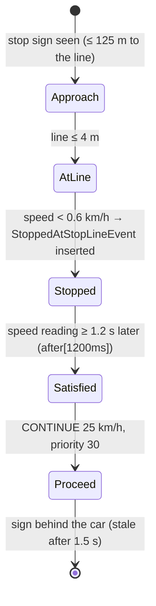

# Business Rules Catalogue

**Audience:** developers and maintainers who change rules, evaluators who check what the expert system actually does, and domain readers who want each rule explained in plain language.

**Related documents:** [BUSINESS_DOMAIN.md](BUSINESS_DOMAIN.md) (the domain in non-technical terms), [ARCHITECTURE.md §5](ARCHITECTURE.md#5-action-selection-and-priority-resolution) (how proposals are arbitrated), [TESTING.md](TESTING.md) (test evidence), [TRACEABILITY_MATRIX.md](TRACEABILITY_MATRIX.md).

---

## 1. How to Read This Catalogue

**Scope.** All 123 rules and 6 queries in [`src/main/resources/rules/`](../src/main/resources/rules). Working tree as of 2026-10-21. The catalogue describes the **Drools** knowledge base, which is the default engine. The project also contains a **SWI-Prolog** knowledge base ([`src/main/prolog/driving_rules.pl`](../src/main/prolog/driving_rules.pl), 120 rules) that re-implements every Drools decision rule under the same names; §2.4 explains how the two correspond. Statements about Prolog come from reading its code.

The rule *name* in quotes is the identifier used by Drools, by the timeline, by the decision panel and in `DrivingDecision`'s source-rule fields.

**Fields.** Each decision rule is described with:

| Field | Meaning |
|---|---|
| Source | File and line of the `rule` keyword; salience (firing order inside its phase, higher first) |
| Output | Proposed action, recommended speed, risk level and `DecisionPriority` level; or the state it changes |
| Purpose | What the rule is for, in plain language |
| Activates when | The conditions, with their thresholds |
| Interactions | How the proposal combines with others; side effects; known issues |
| Example | A concrete activation (and, where useful, a non-activation) |
| Tests | Measured coverage (see below) and probes |

**Priority levels** (`DecisionPriority`): `COMFORT_PROGRESS` 10, `SPEED_COMPLIANCE` 20, `MANEUVER_SAFETY` 30, `ROAD_HAZARD` 40, `COLLISION_AVOIDANCE` 50, `LEGAL_MANDATORY_STOP` 60, `EMERGENCY_SAFETY` 70.

**How proposals are combined** (`DecisionContext`, details in [ARCHITECTURE.md §5](ARCHITECTURE.md#5-action-selection-and-priority-resolution)). Every proposal of a 100 ms cycle is kept, and there are two independent decisions:

- **Speed (longitudinal channel):**
  - priority 60 or 70 proposals *override*: the highest priority wins, then the lowest speed, then the first proposed;
  - otherwise priorities 50, 40 and 20 are **speed ceilings**, and the lowest ceiling wins if it is below the *base*;
  - the base is the lowest priority-30 proposal (moving off, resuming, proceeding after a stop) or, if there is none, the lowest priority-10 proposal;
  - under an override, a ceiling that is strictly lower still caps the speed.
- **Lane (lateral channel):** the highest priority wins; at equal priority `RETURN_RIGHT` beats `CHANGE_LANE_*`, which beats `KEEP_LANE`.
- **Veto:** a lane maneuver is cancelled when the speed decision is a priority-60/70 braking action (`BRAKE`, `STOP`, `WAIT`, `EMERGENCY_BRAKE`) of higher priority than the maneuver.

Each proposal ends with an outcome: `WON`, `LOST_TO` (another rule), `VETOED_BY`, `CAPPED` or `REJECTED_BY` (the actuator refused the lane change). The decision panel lists them.

**How the actuator reads the output** (important for understanding effects; [ARCHITECTURE.md §5.3](ARCHITECTURE.md#53-post-processing-by-the-actuator)):

- Below priority 60 the recommended speed is a **target**. The car slows down when it is above the target. When it is below, it **speeds up**, except under `BRAKE`, `STOP`, `WAIT` and `EMERGENCY_BRAKE`, which never raise the speed.
- At priority 60–70:
  - `STOP`, `WAIT` and `REDUCE_SPEED` mean comfortable braking (2.8 m/s²) to a standstill;
  - `EMERGENCY_BRAKE` means 8.5 m/s²;
  - `MAINTAIN_SPEED` means "hold the current speed";
  - `BRAKE` means comfortable braking.

**Tests field.** Coverage was *measured* in a previous analysis: the backend suite was run with a listener that records which rules fire in which test (on a scratch copy; [TESTING.md §6](TESTING.md#6-rules-and-behaviours-covered)). The firing counts and the probe results date from that run and were **not re-measured** for this working tree; rules added since then say "not measured", and rules whose conditions changed since then may fire in different runs now.

- "Fires in *N* test runs (…)" is the number of executed test invocations in which the rule fired at least once, with the test classes.
- "Named in …" means the rule name appears as a string in that test class, usually in an assertion on the deciding rule (checked against the current tests for the rules added since).
- Classes marked † are Prolog test classes, which were **skipped** in that run (SWI-Prolog not installed).
- "P-nn" refers to an exploratory probe of that analysis ([TESTING.md §5](TESTING.md#5-exploratory-verification-probes)); probes are not part of the project's tests.

**Test class abbreviations** (all under `src/test/java/com/one2drive/projeto1/`):

| Abbr. | Class | Abbr. | Class |
|---|---|---|---|
| RT | `drools.DrivingExpertSystemRulesTest` | LO | `simulation.LeftLaneOvertakingE2ETest` |
| AP | `drools.AgendaPhasesTest` | MV | `simulation.MultiVehicleOvertakingE2ETest` |
| SE | `simulation.SimulationEngineE2ETest` | PC | `simulation.PedestrianConflictE2ETest` |
| RL | `simulation.RoadLawAndOvertakingE2ETest` | PD | `simulation.PresentationDemoE2ETest` |
| LC | `simulation.LaneChangeManeuverE2ETest` | RH | `simulation.RedLightHoldTimerE2ETest` |
| RM | `simulation.RoadMapE2ETest` | RS | `simulation.RedTrafficLightStopE2ETest` |
| BX | `simulation.BoxedInTrafficE2ETest` | SR | `simulation.SideReadingAfterLaneChangeE2ETest` |
| CW | `simulation.CrosswalkE2ETest` | SF | `simulation.StationaryFrontVehicleE2ETest` |
| FS | `simulation.FarStopNearObstacleE2ETest` | TC | `simulation.TrafficLightCycleE2ETest` |
| LL | `simulation.LaneChangeLawE2ETest` | PS | `prolog.PrologSimulationE2ETest` (only its Drools test ran) |
| WN | `simulation.LaneChangeWhyNotE2ETest` | PR† / PE† | `prolog.PrologRulesTest` / `prolog.PrologDroolsEquivalenceTest` |
| PA | `simulation.PedestrianAtSpeedE2ETest` | CA | `simulation.CentreAvoidanceNoRoomToFollowE2ETest` |
| BN | `simulation.BarrierNoRoomToFollowE2ETest` | PO | `simulation.PotholeOtherLaneE2ETest` |

Thresholds below are reproduced exactly from the DRL files. "CE" in rule reasons refers to the Portuguese Highway Code (*Código da Estrada*).

---

## 2. Rule Categories, Phases and Control

### 2.1 Categories at a glance

| Section | File | Rules | Priorities proposed | Role |
|---|---|---|---|---|
| [§2.3](#23-control-rule) | `control.drl` | 1 | — | Explicit control phase of each cycle |
| [§3](#3-perception-and-state-maintenance-rules) | `01-state-updates.drl` | 33 | — (no proposals) | Turn sensor events into beliefs; clear stale beliefs; derive the safe lane-change sides |
| [§4](#4-emergency-rules) | `emergency.drl` | 5 | 70 | Imminent collision; pedestrian beyond comfortable braking |
| [§5](#5-pedestrian-rules) | `pedestrian.drl` | 6 | 60 | Pedestrian in the path or crossing |
| [§6](#6-front-vehicle-following-distance-and-overtaking) | `front-vehicle.drl` | 22 | 50, 30, 20 | Following distance, overtaking, Art. 36 (left and far-left lanes), boxed in |
| [§7](#7-speed-rules) | `speed.drl` | 5 | 20, 10 | Legal limit, limit ahead, cruise speed, acceleration request |
| [§8](#8-stop-sign-rules) | `traffic-signs.drl` | 6 | 60, 30 | Stop-sign approach, stop, 1.2 s hold, proceed |
| [§9](#9-traffic-light-rules) | `traffic-lights.drl` | 7 | 60, 30, 10 | Commitment, red, yellow, green |
| [§10](#10-road-hazard-rules) | `road-hazards.drl` | 3 | 50, 40 | Pothole slow-down (hard braking for a severe one); stop before an obstacle |
| [§11](#11-lane-safety-queries-and-hazard-avoidance-rules) | `lane-safety.drl`, `avoidance.drl` | 0 + 5 queries, 10 | 50, 40, 30 | Safe-lane-change proof; lane changes around hazards |
| [§12](#12-driver-lane-change-requests) | `lane-change.drl` | 4 | 30 | Lane changes asked from outside |
| [§13](#13-keep-right-rule) | `road-law.drl` | 1 | 30 | Return to the rightmost lane |
| [§14](#14-barrier-rules) | `barrier.drl` | 7 | 60, 50, 10 | Closed barrier: change lane, brake in its lane, or stop; open barrier |
| [§15](#15-weather-fuzzy-logic-and-rain-ttc-rules) | `fuzzy-weather.drl`, `temporal.drl` | 8 + 1 | 50, 40 | Fuzzy weather speed ceiling; rain with low TTC |
| [§16](#16-default-move-off-rules-and-decision-query) | `defaults.drl`, `queries.drl` | 4 + 1 query | 30, 10 | Default baseline; moving off after a standstill |
| — | `00-declarations.drl` | 0 | — | Declares the 24 event types (`@role(event)`, `@timestamp`, `@expires`) |

Of the 123 rules:

- 33 maintain perception beliefs (32 sensor-state rules plus "Derive the sides that are safe to change lane to") and 1 is the control rule;
- 67 propose decisions (65 in the `decision` group, 2 in `fallback`);
- 22 maintain internal state or intermediate conclusions without proposing: overtaking (3), boxed-in (3), move-off (2), pedestrian braking phase (3), stop-sign stop event and satisfaction (3), traffic-light commitment (1), and the 7 fuzzification and fuzzy-inference steps.

### 2.2 Phases (agenda groups)

Every rule belongs to an agenda group. At the start of every cycle `KnowledgeSession.beginDecisionCycle` pushes the focus onto `fallback`, `decision`, `perception` and `control`; the focus is a stack, so the groups run in this order:

| Phase | Rules | Content |
|---|---|---|
| `control` | 1 | "Control: perceive, then decide, then fall back" |
| `perception` | 33 | All of `01-state-updates.drl` |
| `decision` | 87 | All decision, state-machine and fuzzy rules |
| `fallback` | 2 | "Default maintain speed baseline", "Move off when stopped and nothing holds the vehicle" |

Inside a phase, salience orders the firing. Because the speed decision is arbitrated afterwards by `DecisionContext`, salience matters for the outcome only in exact ties and for rules that change state that later rules read.

### 2.3 Control rule

**"Control: perceive, then decide, then fall back"** — `control.drl:13`, agenda group `control`, salience 10000, `no-loop`.
- **Activates when:** `DecisionContext(controlDispatched == false)`. `DecisionContext.beginCycle` resets the flag at the start of every cycle, so the rule fires once per cycle.
- **Action:** sets `controlDispatched = true`. It does not set the focus itself: the phase order is pushed by `KnowledgeSession.beginDecisionCycle` (§2.2). The rule is the explicit control phase, kept out of `MAIN` so that it cannot fire again after the fallback group.
- **Tests:** fired in 168 test runs (all engine-level classes) in the earlier measurement; `AgendaPhasesTest` checks the order.

### 2.4 Prolog counterpart

[`driving_rules.pl`](../src/main/prolog/driving_rules.pl) contains `rule(Id, Precedence, Conditions, Actions)` terms executed by the project's own engine ([`engine.pl`](../src/main/prolog/engine.pl)); the precedence equals the Drools salience. Comparing the rule names programmatically:

| Relationship | Count | Detail |
|---|---|---|
| Same name in both | 75 | All decision rules except the 13 split ones below, plus the state-machine and fuzzy rules; includes the 3 split rules that keep an unsuffixed variant |
| Drools rule split into one Prolog rule per outcome | 16 → 43 variants | E.g. "Hold at red traffic light" → `(emergency)` and `(stop)`; "Stop before obstacle ahead while still in its lane" → `(brake)`, `(emergency)`, `(hold)`, `(stop)`. Three also keep a rule of exactly the Drools name, counted in the row above: "Pothole ahead reduce speed" (plus `(emergency)`, `(hold)`), "Closed barrier requires stop" and "Stop sign requires full stop near line" (each plus `(emergency)`) |
| Prolog-only intermediate rules | 2 | "Pedestrian conflicts with trajectory (in path)" and "(crossing)" |
| Drools-only | 35 | The 33 perception rules (their work is done by `driving_state.pl` outside the rule engine), the control rule (the Prolog agenda orders rules by precedence), and "Forget the stop when the stop sign is re-armed" (handled in `driving_state.pl`) |

Every Prolog precedence equals the salience of its Drools rule (the two intermediate rules have 1000). `RuleNameParityTest` (which reads the sources and runs without SWI-Prolog) enforces the name correspondence: every Drools driving rule must be a Prolog rule id or its base name, and the reverse; its exception lists hold exactly the control rule, the stop-sign re-arm and "Pedestrian conflicts with trajectory".

The Prolog side returns proposals with the same fields, and Java arbitrates them with the same `DecisionContext`. Behavioural equivalence is checked by `PrologDroolsEquivalenceTest` and the dual-backend E2E tests, which were skipped in the earlier measurement.

---

## 3. Perception and State-Maintenance Rules

**File:** [`01-state-updates.drl`](../src/main/resources/rules/01-state-updates.drl), agenda group `perception`, all with `no-loop true` except the safe-side derivation. Updates use salience 1000 (the pending-limit activation 1010), stale clearing 900, the safe-side derivation 800.

**Common pattern.** Each "Update …" rule matches one event from an entry point together with the single state fact for that topic. It fires only if the event is not older than the fact and is either newer or carries different values. It copies the values and calls `update`. A reading that reports nothing meaningful (target `"none"`, distance ≤ 0 or infinite) resets the fact to its sentinel values. Each "Clear stale …" rule resets a fact when its timestamp is older than the vehicle-state timestamp by the given threshold. None of these rules proposes a decision.

| Rule (line) | Trigger | Updates | Specific behaviour | Tests |
|---|---|---|---|---|
| "Track the speed limit sign ahead as pending" (15) | `SpeedLimitDetectedEvent` (`ROAD_STREAM`) newer than the pending sign | `PendingSpeedLimit` (sign id, limit, **position on the road** = ego position + distance) | A sign read ahead does not change the limit yet | fires in 16 runs (RT, PD, RL, RM, SE); P-09 |
| "Activate the pending speed limit at its sign" (34) | pending sign and ego position ≥ sign position | `CurrentSpeedLimit` (limit, source sign, time); clears the pending sign | Salience 1010: a sign just passed takes effect before the next reading replaces it | fires in 10 runs (RT, PD, RL, RM, SE); P-09 |
| "Drop a pending speed limit the camera no longer sees" (54) | pending sign not reported for > 1000 ms | clears `PendingSpeedLimit` | E.g. rain shortens the camera range | never fired in the suite |
| "Update vehicle state from speed sensor" (67) | `VehicleSpeedEvent` (`VEHICLE_STREAM`) | `VehicleStateFact` speed and time | **Does not fire in engine runs**: the backend writes the same speed and time into the fact before rules fire (R-16) | never fired in the suite; P-09 |
| "Update traffic light state" (82) | `TrafficLightEvent` (`TRAFFIC_STREAM`) | `TrafficLightStateFact` (id, state, distance) | Resets the stop/proceed commitment when another light is seen or the light is green | fires in 36 runs (AP, RT, FS, PC, PS, RH, RS, SE, TC) |
| "Update stop sign state" (108) | `StopSignEvent` (`ROAD_STREAM`) | `StopSignState` (id, **distance to the stop line** = sign distance − 15 m, time) | A reading more than 8 m from the line resets "satisfied" (a new approach) | fires in 5 runs (RT, SE) |
| "Update weather state" (131) | `WeatherEvent` (`ENVIRONMENT_STREAM`) | `WeatherStateFact` (condition, visibility, grip) | — | fires in 116 runs |
| "Update front vehicle from distance" (151) | `FrontDistanceEvent` (`PERCEPTION_STREAM`) | `FrontVehicleState` target and distance | The only rule that may adopt a new target | fires in 37 runs |
| "Update front vehicle from relative speed" (176) | `RelativeSpeedEvent` | `FrontVehicleState` relative speed (> 0 = closing) | Only for the target already held | fires in 30 runs |
| "Update front vehicle from ttc" (196) | `TTCEvent` | `FrontVehicleState` TTC | Only for the target already held | fires in 28 runs |
| "Update pedestrian state" (218) | `PedestrianDetectedEvent` | `PedestrianStateFact` (id, distance, in path, crossing state) | Crossing states: `WAITING`, `CROSSING`, `CROSSED` | fires in 26 runs (CW, RT, PC, PD, RH, RL, SE) |
| "Update pothole state" (247) | `PotholeDetectedEvent` | `PotholeStateFact` (id, distance, severity, lane) | The camera reports the nearest pothole in the ego's lane, else in any lane | fires in 14 runs |
| "Update barrier state" (273) | `BarrierDetectedEvent` | `BarrierStateFact` (id, distance, open, lane) | — | fires in 2 runs (RT, LL) |
| "Update lane occupancy left" (302) / "… right" (325) | `LaneOccupancyEvent` for that side | `LaneOccupancyState` (occupied, nearest distance, safe to enter, front/rear distance, rear TTC) | See the occupancy definition below the table | fires in 114 / 109 runs |
| "Update acceleration request" (348) | `AccelerationRequestEvent` (`COMMAND_STREAM`) | `AccelerationRequestState` (target, time) | — | fires in 1 run (RT) |
| "Update lane change request" (363) | `LaneChangeRequestEvent` | `LaneChangeRequestState` (active, direction, time) | Only a newer request or a new direction re-activates it | fires in 7 runs (RT, LC, SE) |
| "Expire lane change request" (381) | active request older than 1500 ms | `active = false` | — | fires in 5 runs (LC, SE) |
| "Clear stale front vehicle perception" (398) | no radar sample for > 250 ms | `FrontVehicleState` → `"none"` | The radar reports every 100 ms, so two missed samples mean the vehicle is gone | fires in 16 runs |
| "Update left lane vehicle state" (415) / "Update right lane vehicle state" (435) / "Update far left lane vehicle state" (471) | `LeftLaneVehicleEvent` / `RightLaneVehicleEvent` / `FarLeftLaneVehicleEvent` | `LeftLaneVehicleState` / `RightLaneVehicleState` / `FarLeftLaneVehicleState` (target, distance, relative speed) | Nearest vehicle ahead in the lane to the left, to the right, and two to the left, from the front radar | fire in 26 / 25 / 9 runs |
| "Clear stale left lane vehicle perception" (507) / "Clear stale right lane vehicle perception" (454) / "Clear stale far left lane vehicle perception" (490) | > 250 ms without a reading | the matching state → no target | — | fire in 8 / 19 / 1 runs |
| "Clear stale pedestrian perception" (523) | > 1000 ms | `PedestrianStateFact` → `"none"` | — | fires in 8 runs |
| "Clear stale traffic light perception" (546) | > 400 ms (two missed camera readings) | `TrafficLightStateFact` → `"none"`, GREEN, ∞, commitment NONE | Clears the light once it is behind the car (fixes old R-08) | fires in 10 runs; P-03 |
| "Clear stale stop sign perception" (563) | > 1500 ms, and the sign is satisfied or the line is more than 4 m away | `StopSignState` → `"none"`, not satisfied | A stop still owed at or past the line is kept until it is made, so a car that reached the line too fast still stops | fires in 1 run (SE) |
| "Clear stale pothole perception" (581) / "Clear stale barrier perception" (597) / "Clear stale obstacle perception" (635) | > 1000 ms | the matching fact → `"none"` | — | 6 runs / **never fired** / 5 runs |
| "Update obstacle state" (613) | `ObstacleDetectedEvent` | `ObstacleStateFact` (id, distance, severity, lane) | Guard only checks that the event is not older | fires in 11 runs |
| "Derive the sides that are safe to change lane to" (664) | for LEFT and RIGHT: the four sub-goals of `safeToChangeLane` (§11.1), spelled out | inserts `SafeLaneSide(side)` **logically** (retracted as soon as a sub-goal stops holding) | Salience 800, after the readings above. Rules that need "no safe side" test `not SafeLaneSide(...)`, because negating the query itself fails inside Drools 8.44, and calling the query from here answered one cycle late | not measured |

**When a side counts as occupied** (`WorldState.sideLaneOccupancy`, reported by the blind-spot sensor every 200 ms):

- it is the road edge, or the line to cross is continuous;
- a blocking element (obstacle, pothole, closed barrier) is in that lane from one block behind to 60 m ahead;
- a pedestrian is in or near (≤ 2.5 m) that lane, from 5 m behind to 35 m ahead;
- a vehicle is in that lane within 30 m;
- a vehicle ahead in it is closer than 14 m, or would be reached within 3 s;
- a vehicle behind in it is closer than 12 m, or would reach the ego within 3.5 s.

**Prolog:** `driving_state.pl` keeps the same beliefs between cycles with the same thresholds (`on_event/2`, `expire_old_readings/1`), and turns them into the facts of each cycle (`load_cycle_facts/0`). There is no `SafeLaneSide` fact: the Prolog rules prove `safe_to_change_lane/1` live (§11.1).

---

## 4. Emergency Rules

**File:** [`emergency.drl`](../src/main/resources/rules/emergency.drl). All five propose `EMERGENCY_BRAKE`, 0 km/h, risk `CRITICAL`, priority `EMERGENCY_SAFETY` (70). The actuator applies 8.5 m/s² and the hazard lights. Being the highest priority, they override everything; a lane maneuver of lower priority that has not started yet is vetoed.

### "Emergency brake when persistent TTC is critical"
- **Source:** `emergency.drl:19`, salience 900.
- **Purpose:** brake as hard as possible when several recent radar samples confirm an imminent collision with the vehicle ahead.
- **Activates when:** at least 3 `TTCEvent` samples with 0 < TTC < 2.5 s in `window:time(2s)` of `PERCEPTION_STREAM` (any target); one match per cycle (`accumulate`).
- **Interactions:** TTC exists only for the nearest vehicle ahead in the ego's committed lane.
- **Example:** TTC samples 2.3 / 2.1 / 1.9 s within the last 2 s → activates. One isolated 2.2 s sample → does not.
- **Tests:** named in SE, PR†; fires in 5 runs (RT, SE, SF); P-04, P-06 (S8).

### "Emergency brake when TTC is immediately critical"
- **Source:** `emergency.drl:43`, salience 890.
- **Purpose:** react to a single very low TTC without waiting for confirmation.
- **Activates when:** any `TTCEvent` with 0 < TTC < 1.3 s in `window:time(200ms)`.
- **Example:** one TTC of 1.2 s in the last 200 ms → activates; 1.5 s → does not.
- **Tests:** named in SE, PR†; fires in 2 runs (SE); P-04.

### "Emergency stop for pedestrian extremely close"
- **Source:** `emergency.drl:62`, salience 880.
- **Purpose:** last-resort braking for a pedestrian very close ahead.
- **Activates when:** `PedestrianStateFact` in the path or crossing, at ≤ 6 m.
- **Interactions:** the pedestrian rules (§5) normally stop the car much earlier; this rule is the backstop.
- **Tests:** named in RT; fires in 2 runs (RT); observed in P-10 at high speed.

### "Emergency brake for pedestrian when comfortable braking no longer stops in time"
- **Source:** `emergency.drl:87`, salience 879.
- **Purpose:** brake hard as soon as comfortable braking can no longer stop the car 6 m short of a pedestrian first seen too late (the same escalation the obstacle, barrier and stop-sign rules make), instead of waiting for the 6 m emergency distance. The rule comment gives the case: at 90 km/h a pedestrian 90 m ahead, where comfortable braking needs 110 m.
- **Activates when:** `PedestrianStateFact` in the path or crossing at > 6 m, and v² / (2 × max(0.5, distance − 6)) > 2.8 × 1.1 m/s² (v in m/s; 2.8 = `StoppingPolicy.COMFORT_DECELERATION_MPS2`).
- **Interactions:** it addresses R-04.
- **Tests:** named in RT, PA, PR†; PA checks that at 90 km/h a pedestrian 90 m ahead (or crossing into the lane from 80 m) is braked for hard and never reached, and that from 50 km/h the rule does not fire. Firing count not measured.

### "Emergency braking for high severity obstacle at critical distance"
- **Source:** `emergency.drl:113`, salience 870.
- **Purpose:** emergency braking just before a high-severity obstacle in the lane the vehicle is physically in.
- **Activates when:** an `ObstacleDetectedEvent` in `window:time(300ms)` of `ROAD_STREAM`, in the ego's **physical** lane (from its lateral position, so a car already steering out of the lane is no longer concerned), 0 < distance ≤ 8 m, severity `HIGH`.
- **Interactions:** backstop for "Stop before obstacle ahead while still in its lane" (§10). There is no priority-70 equivalent for barriers or for LOW/MEDIUM obstacles; the obstacle and barrier approach rules have their own `EMERGENCY_BRAKE` branches (§10, §14).
- **Tests:** named in RT, PR†; fires in 2 runs (RT, SE); P-11 (90 km/h case).

---

## 5. Pedestrian Rules

**File:** [`pedestrian.drl`](../src/main/resources/rules/pedestrian.drl). The camera reports the most relevant pedestrian ahead (up to 120 m × visibility) with two attributes:

- **in path:** in the ego's lane or within 3.5 m laterally;
- **crossing state:** `WAITING` (on the road, not crossing), `CROSSING` (walking across and not yet at the far side, whatever lane it is in), `CROSSED`.

A pedestrian **conflicts** when it is in path or crossing. Stopping for a pedestrian is a mandatory stop, priority 60, like a red light. The approach follows braking curves that end 18 m short of the pedestrian:

- the **upper** curve, at 2.0 m/s²: speed > √(2 × 2.0 × (distance − 18));
- the **lower** curve, at 1.4 m/s².

A small state machine, `PedestrianBrakingState`, records whether the vehicle is braking or holding, so that it does not alternate on every tick.

### "Stop for pedestrian in crossing zone"
- **Source:** `pedestrian.drl:48`, salience 600.
- **Output:** `STOP`, 0 km/h, `HIGH`, priority 60.
- **Activates when:** a conflicting pedestrian at 6 m < distance ≤ 32 m.
- **Interactions:** at equal priority and speed, a red-light or stop-sign proposal fired earlier (higher salience) is kept, which keeps a signal's own emergency brake. A priority-60 `STOP` at 0 km/h also hides a priority-50 `EMERGENCY_BRAKE` for an obstacle in the same cycle (R-11, P-14).
- **Example:** P-08: ego at 10 km/h, standing pedestrian in lane; `STOP` from 30.4 m, at rest 30.3 m before the pedestrian; no acceleration.
- **Tests:** named in RT; fires in 14 runs (CW, RT, PC, RH, SE); P-06 (S7), P-08, P-10.

### "Start braking for pedestrian above the braking curve" / "Hold speed for pedestrian once under the lower curve" / "End the pedestrian approach once no pedestrian is approached"
- **Source:** `pedestrian.drl:68`, `:80`, `:94`, salience 607 (state only).
- **Output:** `PedestrianBrakingState` phase `BRAKING`, `HOLDING` or `NONE`.
- **Activates when:**
  - start: a conflicting pedestrian beyond 32 m and the speed above the upper curve;
  - hold: braking and the speed is now at or below the lower curve;
  - end: no conflicting pedestrian beyond 32 m any more.
- **Tests:** fire in 14 / 8 / 8 runs (CW, RT, PC, PD, RL, SE).

### "Brake for pedestrian proximity"
- **Source:** `pedestrian.drl:104`, salience 605.
- **Output:** priority 60:
  - phase `BRAKING`: `BRAKE`, 20 km/h, `HIGH`;
  - otherwise `MAINTAIN_SPEED` at the current speed, `MODERATE`, which stops the car from speeding up towards the pedestrian.
- **Activates when:** a conflicting pedestrian beyond 32 m, and either the phase is not `NONE` or the speed is above the lower curve.
- **Interactions:** under priority 60 the actuator treats `BRAKE` as comfortable braking and `MAINTAIN_SPEED` as "hold the speed".
- **Example (P-10, measured before "Emergency brake for pedestrian when comfortable braking no longer stops in time" existed):** standing pedestrian 110 m ahead, in clear weather.
  - The first pedestrian decision comes at about 107 m.
  - The car stops before the pedestrian from 50, 60, 65, 70 and 90 km/h (3.1 m before at 90).
  - From 120 km/h it reaches the pedestrian at 74.5 km/h (R-04).
- **Tests:** named in RT; fires in 15 runs (CW, RT, PC, PD, RL, SE); P-06, P-10.

### "Hold for pedestrian still crossing"
- **Source:** `pedestrian.drl:132`, salience 602.
- **Output:** `STOP`, 0 km/h, `HIGH`, priority 60.
- **Activates when:** the vehicle is at rest (< 1 km/h) and a pedestrian is still `CROSSING` at 32 m < distance ≤ 45 m.
- **Purpose:** keep a car that stopped further back from moving off towards a crossing that is still occupied.
- **Tests:** named in RT; fires in 1 run (RT).

**Prolog:** "Brake for pedestrian proximity" is split into `(brake)` and `(hold speed)`. Two intermediate rules, "Pedestrian conflicts with trajectory (in path)" and "(crossing)" (precedence 1000), derive the conflict that Drools writes inline.

---

## 6. Front Vehicle, Following Distance and Overtaking

**File:** [`front-vehicle.drl`](../src/main/resources/rules/front-vehicle.drl). Inputs come from the front radar:

- the nearest vehicle ahead in the ego's committed lane, up to 130 m, with Gaussian distance noise (σ 0.7 m);
- the nearest vehicle ahead in the lanes to the left, to the right and two to the left, without noise.

Relative speed is positive when closing. The *desired speed* used below is the posted limit or, when no sign has been seen, `min(cruise speed, limit)`. The cruise speed is the scenario's initial speed.

### 6.1 Following distance

#### "Brake when front vehicle distance low"
- **Source:** `front-vehicle.drl:43`, salience 520.
- **Output:** `BRAKE` to `max(0, front-vehicle speed − 3 km/h)`, `HIGH`, priority 50.
- **Activates when:** a target at 0 < distance < 14 m that is being approached (relative speed > 0).
- **Tests:** named in RT, PR†; fires in 7 runs (RT, RL, SE, SF).

#### "Keep safe following distance behind front vehicle"
- **Source:** `front-vehicle.drl:81`, salience 510.
- **Purpose:** keep enough distance to stop behind the vehicle ahead (Art. 18 and 24 CE). It follows the speed from which a 2.0 m/s² deceleration still matches the front vehicle's speed 12 m behind it.
- **Activates when** any of these holds:
  - closing (relative speed > 0.3 m/s) and above that curve;
  - within 14 m of a (nearly) stopped vehicle;
  - within 12 m of a moving vehicle, without opening the gap fast.
- **Output** (priority 50):
  - behind a stopped vehicle with ≤ 2 m of room left: `STOP` 0 km/h, `HIGH`;
  - inside the 12 m gap behind a moving vehicle: `REDUCE_SPEED` to its speed − 3 km/h ("Reopening the following gap");
  - otherwise: `REDUCE_SPEED` to the curve speed, `MODERATE`.
- **Tests:** named in RT; fires in 29 runs (BX, RT, LL, MV, PD, RL, SR, SE, SF); P-02c.

#### "Reduce speed when closing front vehicle"
- **Source:** `front-vehicle.drl:123`, salience 500.
- **Output:** `REDUCE_SPEED` to `max(20, 1.2 × distance)` km/h, `MODERATE`, priority 50.
- **Activates when:** 14 m ≤ distance < 35 m and relative speed > 0.8 m/s.
- **Interactions:** the target grows with the distance. If it is the lowest ceiling and lies above the current speed, the actuator **accelerates** towards the vehicle being approached (R-02).
- **Example (P-02c):** ego 20 km/h, vehicle at 15 km/h 30 m ahead → `REDUCE_SPEED 36.8`, acceleration +0.8 m/s², speed 20 → 24 km/h while the gap closed from 30 to 27 m.
- **Tests:** fires in 25 runs (BX, LL, LO, MV, PD, RL, SR, SE, SF); P-02c.

#### "Approaching trend from sliding distance window"
- **Source:** `front-vehicle.drl:146`, salience 505.
- **Output:** `REDUCE_SPEED` 35 km/h, `MODERATE`, priority 50.
- **Activates when:**
  - a target is held at < 50 m and the ego is not changing lanes;
  - at least 3 `FrontDistanceEvent` samples **of the same target** are in `window:time(2s)`;
  - the smallest sample is more than 4 m below the largest.
- **Interactions:** the condition measures the *spread* of the samples, not their order, so it also fires when the vehicle ahead pulls away (R-09).
- **Example (P-07):** vehicle 20 m ahead doing 90 km/h, ego 60 km/h → the rule fired 21 times while the gap grew from 28 to 45 m, and the ego slowed to 38.8 km/h.
- **Tests:** named in RT, PR†; fires in 26 runs; P-07.

#### "Follow the front vehicle speed outside the following gap"
- **Source:** `front-vehicle.drl:188`, salience 508.
- **Output:** `REDUCE_SPEED` to the front vehicle's speed (1 km/h less when closer than 16 m), `MODERATE`, priority 50.
- **Activates when:**
  - a moving vehicle (≥ 0.5 m/s) is beyond the 12 m gap;
  - it is within 20 m divided by the grip factor (between 20 and 40 m; further in rain).
- **Purpose:** without this rule the cruise speed would drive the car at the vehicle ahead, and braking would take over again below 14 m, in a loop.
- **Interactions:** at the window edge, radar noise makes the rule drop out for single ticks and the cruise-speed rule takes over (R-25).
- **Tests:** fires in 7 runs (BX, RT, RL); P-02c.

#### "Hold speed on an approaching trend below its target"
- **Source:** `front-vehicle.drl:217`, salience 504.
- **Output:** `REDUCE_SPEED` at the current speed, `MODERATE`, priority 50.
- **Activates when:** the same trend condition as above, the vehicle is closing (relative speed > 0), and the ego is below 35 km/h.
- **Purpose:** stop the 35 km/h trend target from accelerating a slower car towards the vehicle it approaches. This ceiling is lower, so it wins.
- **Tests:** fires in 14 runs (BX, MV, RL, SE, SF); P-02c.

### 6.2 Overtaking and return

The overtaking state (`OvertakingStateFact`: active, original lane, passed, start time, target) is changed only by the rules below. Lane changes are decided in the lateral channel, so an overtake can start in the same cycle as a speed reduction. Every overtake also requires:

- no conflicting pedestrian;
- no red or yellow light within 125 m (Art. 41 CE);
- no continuous line to cross (`noContinuousLine(LEFT)`, §11).

#### "Overtake slow front vehicle via left lane"
- **Source:** `front-vehicle.drl:289`, salience 525, `no-loop`.
- **Output:** `CHANGE_LANE_LEFT`, `LOW`, priority 30, and the overtaking state set to active with this target and original lane.
- **Activates when:**
  - the ego is in RIGHT or CENTER and not changing lanes;
  - a target is > 15 m ahead, closing at > 0.5 m/s, with a radar sample from this cycle;
  - the left side is unoccupied and the next vehicle ahead in that lane is more than 20 m beyond the target;
  - `roomToFollow(LEFT)` holds: the vehicle ahead in the left lane, if any, can still be followed after the move (§11.1);
  - the target is within `max(50, 5.5 × relative speed + 10)` m;
  - the target is moving at ≥ 1 m/s, or is far enough to pass on the move;
  - it is not already the tracked overtake from this lane.
- **Example (P-02a/b):** a vehicle at 18 km/h, 45 m or 120 m ahead → overtaken and returned right. The overtaking state was cleared afterwards (old R-05 fixed).
- **Tests:** named in PR†; fires in 17 runs (LL, LO, MV, PD, RL, SR, SE, SF); P-02.

#### "Overtake the vehicle being followed"
- **Source:** `front-vehicle.drl:335`, salience 524.
- **Output:** as above.
- **Activates when:**
  - the ego follows a vehicle at 6–30 m, matching its speed within ±0.5 m/s;
  - that vehicle is at least 10 km/h below the desired speed;
  - the same lane and legal conditions as above hold.
- **Purpose:** the exit from following; the rule above needs the ego to be closing in.
- **Tests:** named in RT, PR†; fires in 2 runs (RT, RL).

#### "Go around stationary front vehicle from standstill"
- **Source:** `front-vehicle.drl:531`, salience 525.
- **Output:** `CHANGE_LANE_LEFT`, `LOW`, priority 30, plus the overtaking state.
- **Activates when:** the ego is below 3 km/h, a (nearly) stopped vehicle is 6–20 m ahead, the left side is unoccupied, and the same legal conditions hold.
- **Tests:** named in RT; fires in 3 runs (RT, SF).

#### "Cancel overtaking that never left its original lane"
- **Source:** `front-vehicle.drl:255`, salience 540, state only.
- **Activates when:** the overtake is active and not passed, the ego is still in its original lane and idle, and more than 1000 ms have passed since it started.
- **Purpose:** prevents the state from latching when the maneuver never started (old R-05).
- **Tests:** fires in 1 run (SF).

#### "Mark front vehicle passed once it is behind or cleared"
- **Source:** `front-vehicle.drl:574`, salience 480, state only (`passedTarget = true`).
- **Activates when:**
  - the overtake is active and not yet passed;
  - the ego has left both RIGHT and its original lane, and is idle;
  - the right side is unoccupied with nothing ahead in it within 80 m, by a reading taken after the lane change settled;
  - the front radar is no longer tracking the overtaken vehicle.
- **Tests:** fires in 11 runs.

#### "Return to right lane after overtaking slow vehicle"
- **Source:** `front-vehicle.drl:589`, salience 480.
- **Output:** `RETURN_RIGHT`, `LOW`, priority 30 (Art. 38 CE).
- **Activates when:**
  - the overtake is active and passed, and the ego is not in RIGHT and idle;
  - there is no continuous line to the right;
  - the right side is clear with nothing within 80 m ahead, by a reading taken after the last lane change settled;
  - no driver request is active.
- **Interactions:** the actuator moves one lane right per maneuver, so LEFT → CENTER → RIGHT takes two returns.
- **Tests:** named in SR; fires in 11 runs; P-02.

#### "Deactivate overtaking state once return right completes"
- **Source:** `front-vehicle.drl:613`, salience 455, state only.
- **Activates when:** the overtake is active and passed, and the ego is in RIGHT and idle.
- **Tests:** fires in 8 runs.

### 6.3 Slower vehicle in the left lane (Art. 36 CE)

#### "Move left behind slower left lane vehicle to overtake it on the left"
- **Source:** `front-vehicle.drl:394`, salience 525.
- **Output:** `CHANGE_LANE_LEFT` (RIGHT → CENTER), `LOW`, priority 30, plus the overtaking state with that vehicle as target.
- **Activates when:**
  - the ego is in RIGHT and `safeToChangeLane(LEFT)` holds (idle, right marking not continuous, left side clear, room to follow, §11.1);
  - a vehicle in the lane to the left is > 15 m ahead (reading from this cycle), with relative speed > −0.5 m/s, moving at ≥ 1.4 m/s and at least 1.4 m/s slower than the desired speed;
  - that vehicle is within `max(50, 5.5 × relative speed + 10)` m;
  - LEFT (the far-left reading) is clear more than 20 m beyond it;
  - no nearer vehicle is in the ego's lane, and there is no conflicting pedestrian or red/yellow light within 125 m;
  - it is not already the tracked overtake target.
- **Tests:** fires in 6 runs (WN, LO, SR).

#### "Do not pass a slower left lane vehicle on its right"
- **Source:** `front-vehicle.drl:445`, salience 508.
- **Output** (priority **20**, `SPEED_COMPLIANCE`, a ceiling), in this order:
  - comfortable braking would carry the ego past it (`StoppingPolicy.closingDistanceMeters(relative speed, 2.8)` > distance + 5 m): `EMERGENCY_BRAKE` with the curve speed as target, `HIGH`;
  - closing in (above the curve that matches that vehicle's speed 35 m behind it, braking at 2.0 m/s²): `REDUCE_SPEED` to the curve speed;
  - closer than 33 m: `REDUCE_SPEED` to its speed − 1.5 m/s (fall back so the lane reads free);
  - otherwise: `MAINTAIN_SPEED` at its speed.
  Risk `MODERATE` except for the emergency branch.
- **Activates when:** a vehicle in the lane immediately to the left with relative speed > −2.5 m/s, moving at ≥ 1.4 m/s, is within 37 m or the ego is above that curve.
- **Interactions:** at priority 20 the `EMERGENCY_BRAKE` branch is a ceiling, not an override: it decides only when its target is the lowest ceiling, and it vetoes no lane change. When it decides, the actuator brakes at 8.5 m/s² whatever the target.
- **Tests:** named in RT; fires in 15 runs (RT, LC, WN, LO, MV, RL, SR); P-06 (S9).

#### "Do not pass a slower far left lane vehicle on its right"
- **Source:** `front-vehicle.drl:499`, salience 508.
- **Purpose:** the same for a slower vehicle two lanes to the left (LEFT seen from RIGHT, `FarLeftLaneVehicleState`), which the rule above does not see. There is no lane to move into behind it, so there is no fall-back branch.
- **Output** (priority 20): `EMERGENCY_BRAKE` to the curve speed (`HIGH`) when comfortable braking would carry the ego past it (same test as above); `REDUCE_SPEED` to the curve speed when closing in; otherwise `MAINTAIN_SPEED` at its speed (`MODERATE`).
- **Activates when:** the same conditions as the rule above, on the far-left reading (relative speed > −2.5 m/s, moving at ≥ 1.4 m/s, within 37 m or above the 35 m curve).
- **Interactions:** addresses R-26.
- **Tests:** no test names the rule; CA checks that after going round on the right a slower vehicle on the left is not passed on its right. Firing count not measured.

### 6.4 Boxed in behind slow traffic

A `BoxedInFact` records that the ego, outside RIGHT, follows a slow vehicle and cannot move left. "Slow" means at least 10 km/h below the desired speed, within 30 m. "Cannot move left" means one of: the ego is in LEFT, the left line is continuous, the left side is occupied, or the left lane is no clearer (not 20 m beyond the vehicle ahead).

| Rule (line, salience) | Output | Activates when |
|---|---|---|
| "Note the vehicle is boxed in behind slow traffic" (633, 536) | inserts `BoxedInFact(lane, now)` | the situation above, no fact yet |
| "Forget boxed in once nothing is ahead" (654, 535) | deletes the fact | idle and no vehicle within 80 m ahead |
| "Forget boxed in once the left lane opens" (665, 535) | deletes the fact | not in LEFT, no continuous line, left side unoccupied and clearer by > 20 m |
| "Fall back behind slow traffic to return right" (682, 507) | `REDUCE_SPEED` to the front vehicle's speed − 3 km/h, priority 50 | boxed in for ≥ 3 s, right side occupied, vehicle within 30 m |
| "Return right when boxed in and the right lane is clear" (713, 470) | `RETURN_RIGHT`, priority 30 (Art. 13 CE) | boxed in ≥ 3 s, right side clear (reading after the lane settled), no continuous line, no request, a vehicle in the right lane within 80 m and at least `max(30 m, speed × 2 s)` ahead (3 s in rain or grip < 0.85) |
| "Keep the right lane while the lanes ahead stay blocked" (746, 527) | `KEEP_LANE`, priority 50 | boxed in, ego in RIGHT, no request, no obstacle, pothole, closed barrier or conflicting pedestrian ahead |

Tests: these six rules fire in 5, 1, 1, 3, 3 and 3 runs (BX, RL). The fall-back rule and the cruise-speed rule alternate when the gap sits at 30 m: P-02d counted 114 decision changes in 30 s (R-25).

**Prolog:** "Keep safe following distance behind front vehicle" → `(reduce)`, `(reopen gap)`, `(stop)`; "Do not pass a slower left lane vehicle on its right" → `(emergency)`, `(closing in)`, `(fall back)`, `(hold)`; "Do not pass a slower far left lane vehicle on its right" → `(emergency)`, `(closing in)`, `(hold)`. The other rules keep their names.

---

## 7. Speed Rules

**File:** [`speed.drl`](../src/main/resources/rules/speed.drl). The limit in force is `CurrentSpeedLimit`. Its seed value, 120 km/h with source `"default"`, means "no sign seen yet" and is not treated as a target. A 0.1 km/h dead band separates "exceeding" from "compliant".

### "Reduce speed when exceeding detected limit"
- **Source:** `speed.drl:22`, salience 300.
- **Output:** `REDUCE_SPEED` to the limit, `MODERATE`, priority 20 (ceiling).
- **Activates when:** speed > limit + 0.1 km/h.
- **Interactions:** as a ceiling it always binds, so no other priority-20–50 proposal can raise the speed above the limit. In P-01 the speed stayed at 30 km/h under a 30 km/h sign in rain (old R-01 fixed).
- **Tests:** named in RT, PR†; fires in 2 runs (RT, RL); P-01.

### "Slow down in time for the speed limit ahead"
- **Source:** `speed.drl:49`, salience 310.
- **Output:** priority 20, target `min(current limit, approach speed)`:
  - above the target: `REDUCE_SPEED`, `MODERATE`;
  - otherwise: `MAINTAIN_SPEED`, `LOW`.
  The approach speed is `StoppingPolicy.approachSpeedKmh(next limit, distance)`, the fastest speed from which 2.0 m/s² still reaches the new limit 8 m before the sign.
- **Activates when:** a pending limit is ahead and its approach speed at the current distance to the sign is ≤ current speed + 1 km/h (far from the sign, or for a higher limit, the approach speed stays above the current speed and the rule stays out).
- **Example (P-09, S2):**
  - the camera reads the 50 km/h sign at about 118 m (0.9 s);
  - deceleration of about 2 m/s² from 1.0 s;
  - 50 km/h reached at 135.7 m, 4.3 m before the sign;
  - the limit is activated at the sign (141.3 m, 7.1 s).
- **Tests:** named in RT, PR†, SE; fires in 10 runs (RT, PD, RL, RM, SE); P-09.

### "Maintain speed when compliant with detected limit"
- **Source:** `speed.drl:81`, salience 210.
- **Output:** `MAINTAIN_SPEED` at the **limit**, `LOW`, priority 10 (comfort base).
- **Activates when:** a limit posted by a sign (not the seed) and speed ≤ limit + 0.1.
- **Interactions:** the base for "drive at the limit". Other comfort proposals with lower speeds undercut it, because comfort proposals are combined by minimum (R-24).
- **Tests:** named in RT, PR†; fires in 9 runs; P-01, P-09.

### "Build back up to the scenario cruise speed when no sign governs the road"
- **Source:** `speed.drl:110`, salience 208.
- **Output:** `MAINTAIN_SPEED` to `min(cruise, limit)`, `LOW`, priority **20** (ceiling).
- **Activates when:** no sign has been seen (seed limit), the cruise speed is > 0, and speed < `min(cruise, limit)` − 0.5.
- **Interactions:**
  - The only target that speeds the car up again after a brake or stop when no sign governs.
  - It fires only *below* the cruise speed. In rain with no sign, the weather ceiling is therefore the only proposal, and the car drives at the weather ceiling even if that is above the cruise speed (R-23, P-16).
  - It alternates with following rules at their window edges (R-25).
- **Tests:** named in PR†; fires in 71 runs; P-02c, P-02d, P-15.

### "Allow acceleration request when safe context"
- **Source:** `speed.drl:134`, salience 205.
- **Output:** `ACCELERATE` to the requested speed, `LOW`, priority 10 (comfort).
- **Activates when:** a request with target > 0 is less than 1.5 s old.
- **Interactions:** applies only when no ceiling is lower (arbitration). Requests come from scenario timed actions (`REQUEST_ACCELERATION`, used by no scenario) or the JavaFX button; there is no REST endpoint.
- **Tests:** fires in 1 run (RT).

**Prolog:** "Slow down in time for the speed limit ahead" → `(slow)` and `(hold)`; the pending sign is `pending_limit/4` in `driving_state.pl`, loaded as `pending_speed_limit(Kmh, SignPositionM)`, and the approach speed is `approach_speed/3`.

---

## 8. Stop Sign Rules

**File:** [`traffic-signs.drl`](../src/main/resources/rules/traffic-signs.drl). A stop sign binds only the lane it stands in: the camera reports only a sign in the car's path lane (its lane, or the lane it is moving into during a lane change; `WorldState.nearestStopSign`). `StopSignState.distanceMeters` is the distance to the **stop line**, 15 m before the sign (`StoppingPolicy.STOP_SIGN_OFFSET_METERS`).

### "Stop sign requires progressive deceleration"
- **Source:** `traffic-signs.drl:49`, salience 610.
- **Output:** priority 60:
  - `EMERGENCY_BRAKE` 0 km/h, `HIGH`: when comfortable braking (2.8 m/s²) would stop the car more than 1 m past the line (shortfall > 3 m; > 1 m if the previous decision was already a stop-sign emergency brake);
  - `REDUCE_SPEED`, `MODERATE`: above the 2.8 m/s² curve;
  - `MAINTAIN_SPEED`, `LOW`: otherwise (coast).
  The target is always `min(current speed, limit)`, which the actuator executes as comfortable braking or hold.
- **Activates when:** sign not satisfied, line 4–125 m ahead, and the speed above the 2.0 m/s² curve that ends 2 m before the line.
- **Interactions:** reads the previous `DrivingDecision` (one cycle late, A-06) so that the emergency burst is held.
- **Tests:** named in SE; fires in 5 runs (RT, SE).

### "Stop sign requires full stop near line"
- **Source:** `traffic-signs.drl:112`, salience 620.
- **Output:** priority 60, 0 km/h, `HIGH`:
  - `EMERGENCY_BRAKE` with the same test as the approach (shortfall > 3 m, or > 1 m after a stop-sign emergency brake): the sign was first seen with the line already close or behind, or reached too fast;
  - `STOP` otherwise.
- **Activates when:** the sign is not satisfied and the line is ≤ 4 m away (or already behind; the stale-sign rule keeps a stop that is still owed, §3).
- **Tests:** named in SE; fires in 4 runs (RT, SE). `StopSignSeenLateE2ETest` checks hard braking and the full stop when the stop line is already behind.

### "Start stop timer once vehicle is stopped"
- **Source:** `traffic-signs.drl:148`, salience 630, state only.
- **Output:** inserts `StoppedAtStopLineEvent(now, sign id)`.
- **Activates when:** the sign is not satisfied, the line is ≤ 4 m away, the speed is < 0.6 km/h, and no such event exists for this sign.
- **Tests:** fires in 4 runs (RT, SE).

### "Stop sign condition satisfied after full stop hold"
- **Source:** `traffic-signs.drl:160`, salience 635, `no-loop`, state only (`satisfied = true`).
- **Activates when:** a `VehicleSpeedEvent` exists `after[1200ms]` the `StoppedAtStopLineEvent` (Allen interval relation, Drools CEP).
- **Interactions:** with the realtime clock of the JavaFX client, stream timestamps and the session clock differ. P-04b showed that the car then never leaves a stop sign (A-07).
- **Tests:** fires in 2 runs (RT, SE); P-04b.

### "Forget the stop when the stop sign is re-armed"
- **Source:** `traffic-signs.drl:175`, salience 640.
- **Output:** deletes the `StoppedAtStopLineEvent`.
- **Activates when:** another sign is seen, or the line is more than 8 m away again.
- **Tests:** fires in 1 run (SE).

### "Proceed after stop sign condition satisfied"
- **Source:** `traffic-signs.drl:185`, salience 200.
- **Output:** `CONTINUE` 25 km/h, `LOW`, priority 30 (release base).
- **Activates when:** the sign is satisfied and the line is ≤ 4 m away.
- **Tests:** named in SE, PR†, PS; fires in 2 runs (RT, SE); P-04b.

**Prolog:** "Stop sign requires progressive deceleration" → `(brake)`, `(emergency)`, `(hold speed)`; "Stop sign requires full stop near line" → itself and `(emergency)`; the timer is the conclusion `stop_hold_started/2`, which `driving_state.pl` stores between cycles; the re-arm is done there too.

---

## 9. Traffic Light Rules

**File:** [`traffic-lights.drl`](../src/main/resources/rules/traffic-lights.drl). A traffic light governs the whole road. The vehicle stops at a virtual stop line 18 m before the light (`RED_LIGHT_STOP_LINE_OFFSET_METERS`), with a 3 m tolerance.

The light itself cycles in the simulation (`TrafficLight`): yellow turns red after 3 s, and red turns green once the ego has waited **5 s at rest** at the stop line. Distances used below:

- `required(a)`: reaction (0.5 s) + braking at `a` + 18 m (`StoppingPolicy.requiredDistanceMeters`);
- anticipation deceleration: 2.0 m/s²;
- comfortable deceleration: 2.8 m/s².

### "Commit to stop or to proceed at traffic light"
- **Source:** `traffic-lights.drl:37`, salience 700, `no-loop`, state only.
- **Output:** `TrafficLightStateFact.commitment`:
  - `COMMITTED_TO_STOP` if the light is red, or yellow with distance ≥ `required(2.8)`;
  - `COMMITTED_TO_PROCEED` otherwise (yellow too close to stop comfortably).
- **Activates when:** a light is yellow or red and no commitment exists yet.
- **Interactions:** the commitment is kept until the light turns green, another light is seen, or the light is behind the car. The decision therefore cannot swing between stopping and driving on.
- **Tests:** fires in 34 runs (AP, RT, FS, PC, PS, RH, RS, SE, TC).

### "Red traffic light progressive approach"
- **Source:** `traffic-lights.drl:66`, salience 620.
- **Output:** priority 60:
  - `EMERGENCY_BRAKE` 0 km/h if comfortable braking would leave a shortfall > 2 m before the line;
  - `REDUCE_SPEED` if the distance ≤ `required(2.8)`;
  - `MAINTAIN_SPEED` otherwise.
  The target is `min(speed, limit)`.
- **Activates when:** red, committed to stop, ≤ 125 m, more than 21 m from the light, and within `required(2.0)`.
- **Example (P-15, S3):**
  - `MAINTAIN_SPEED 70` at 118 m;
  - braking from 94.7 m;
  - `STOP` from 20.6 m;
  - at rest 19.2 m before the light;
  - green 5 s later, then `RESUME 30` and move-off.
- **Tests:** fires in 20 runs (AP, RT, FS, PC, RH, RS, SE, TC); P-15.

### "Hold at red traffic light"
- **Source:** `traffic-lights.drl:109`, salience 640.
- **Output:** priority 60, `HIGH`:
  - `EMERGENCY_BRAKE` 0 km/h if comfortable braking no longer fits: before the line, a shortfall > 2 m; past the line, a comfortable stop longer than the distance to the light − 3 m;
  - `STOP` 0 km/h otherwise.
- **Activates when:** red, committed to stop, distance ≤ 21 m (line + tolerance).
- **Tests:** named in RT; fires in 21 runs; P-15.

### "Red traffic light requires full stop and hold"
- **Source:** `traffic-lights.drl:138`, salience 635.
- **Output:** `STOP` 0 km/h, `HIGH`, priority 60.
- **Activates when:** red, committed to stop, 0 ≤ distance ≤ 4 m.
- **Interactions:** whenever it fires, "Hold at red traffic light" (higher salience) has already proposed `STOP`/`EMERGENCY_BRAKE` at 0 km/h and wins the tie, so this rule never decides (R-13).
- **Tests:** fires in 1 run (TC).

### "Yellow traffic light: stop before the line"
- **Source:** `traffic-lights.drl:162`, salience 625.
- **Output:** priority 60:
  - `STOP` 0 km/h at the line (≤ 21 m);
  - `REDUCE_SPEED` within `required(2.8)`;
  - `MAINTAIN_SPEED` otherwise.
  The target is `min(speed, limit)`. There is no emergency branch, because the commitment was made only with room for a comfortable stop.
- **Activates when:** yellow, committed to stop, and at the line or within `required(2.0)`.
- **Interactions:** a vehicle committed to proceed gets no proposal from the light.
- **Tests:** named in RT; fires in 7 runs (RT, RH, TC).

### "Green traffic light allows progression when no higher hazard"
- **Source:** `traffic-lights.drl:195`, salience 180.
- **Output:** `CONTINUE` 50 km/h, `LOW`, priority 10 (comfort base).
- **Activates when:** a green light within 40 m.
- **Interactions:** comfort proposals are combined by minimum, so this *lowers* the speed to 50 km/h near every green light, whatever the limit (R-24). P-03c: 70 → 50 km/h without a sign; 90 → 72.9 km/h at the light with a 90 km/h sign.
- **Tests:** fires in 9 runs (RT, PC, RH, RS, SE, TC); P-03c.

### "Green traffic light releases red-light hold"
- **Source:** `traffic-lights.drl:214`, salience 610.
- **Output:** `RESUME` 30 km/h, `LOW`, priority 30 (release base).
- **Activates when:** a green light at 0–40 m and the speed < 1 km/h.
- **Tests:** fires in 7 runs (PC, RH, RS, SE, TC); P-15.

**Prolog:** the commitment rule is split into `(red)`, `(yellow, can stop)`, `(yellow, too close)`; "Red traffic light progressive approach" → `(brake)`, `(emergency)`, `(hold speed)`; "Hold at red traffic light" → `(emergency)`, `(stop)`; the yellow rule → `(brake)`, `(hold speed)`, `(stop)`.

---

## 10. Road Hazard Rules

**File:** [`road-hazards.drl`](../src/main/resources/rules/road-hazards.drl).

### "Pothole ahead reduce speed"
- **Source:** `road-hazards.drl:35`, salience 460.
- **Output** (priority 40; crossing speed 30 km/h, `StoppingPolicy.POTHOLE_CROSSING_SPEED_KMH`):
  - severity `HIGH`, above the crossing speed, and slowing to it by the pothole needs more than 2.8 × 1.1 m/s²: `EMERGENCY_BRAKE` (target 30 km/h), `HIGH`;
  - closer than 15 m: `REDUCE_SPEED` 20 km/h, `MODERATE`;
  - beyond 40 m: `REDUCE_SPEED` to the 2.0 m/s² curve that reaches 30 km/h at the pothole, or `MAINTAIN_SPEED` at the current speed when already below that curve;
  - otherwise: `REDUCE_SPEED` 30 km/h, `MODERATE`.
  The reason names the situation: a way round is decided only at 50 m, the pothole is too close to go round, or no lane is free.
- **Activates when:**
  - a pothole is in the ego's **path lane** (its lane, or the target lane during a lane change), at a distance > 0 and ≤ `max(40 m, distance to slow from the current speed to 30 km/h at 2.8 m/s², reaction included)`;
  - and it is not being gone round: it is **not** the case that a safe side exists (`SafeLaneSide`) while the pothole is within 50 m and a lane change still leaves the lane before it (`StoppingPolicy.roomToLeaveLane`).
- **Interactions:** below the curve speed, the 30 km/h target accelerates a slower car (R-02). At priority 40 the `EMERGENCY_BRAKE` branch is a ceiling, not an override: it decides only when its target (30 km/h) is the lowest ceiling; then the actuator brakes at 8.5 m/s².
- **Tests:** fires in 7 runs (RT, LC, RL, SE) in the earlier measurement, when the rule had a fixed 40 m window and no lane condition; named in CA and PO (no slow-down for a pothole in another lane).

### "Stop before obstacle ahead while still in its lane"
- **Source:** `road-hazards.drl:106`, salience 465.
- **Output** (priority 50; room = distance − 10 m, the stop point):
  - `STOP` 0 km/h if room ≤ 0.5 m;
  - `EMERGENCY_BRAKE` 0 km/h if the deceleration needed exceeds 2.8 × 1.1 m/s²;
  - `MAINTAIN_SPEED` (hold, `MODERATE`) while below the 2.0 m/s² curve over the room;
  - `BRAKE` to that curve speed, `HIGH`, otherwise.
- **Activates when:**
  - an obstacle is in the ego's **path lane** (its committed lane, or the target lane while a lane change is moving);
  - its distance is ≤ `max(60, required stopping distance at 2.8 m/s² + 10 m)`, so the window grows with speed.
- **Purpose:** keep the car able to stop 10 m before the obstacle (`StoppingPolicy.OBSTACLE_STOP_OFFSET_METERS`) until a lane change takes it out of the path. A lane change towards a lane with an obstacle brings that obstacle into the path, and the car brakes for it during the maneuver. It brings the car to the 50 m mark, where the avoidance is decided (§11), at a speed from which it can still stop.
- **Tests:** named in RM; fires in 8 runs (RT, FS, RL, RM, SE); P-11, P-14.

### "Stop before obstacle when lane change prohibited by continuous line"
- **Source:** `road-hazards.drl:147`, salience 466.
- **Output:** `BRAKE` to the 2.0 m/s² curve, `STOP` at ≤ 0.5 m of room, or `MAINTAIN_SPEED` when below the curve; `HIGH`, priority 50; reason names the continuous line.
- **Activates when:** the same obstacle window as above but in the ego's committed lane, neither side is safe to enter (`LaneOccupancyState.safeToEnter` false on both), and a continuous line closes at least one side:
  - from CENTER: either line;
  - from RIGHT: the right marking;
  - from LEFT: the left marking.
- **Interactions:** it has no emergency branch itself, but the rule above runs in the same cycle and escalates, so the lowest ceiling wins (old R-07 fixed). P-11 (S15, a scenario now set aside in `scenarios.json`): stopped 10.4 m before the obstacle from 50 and 70 km/h; from 90 km/h, with the obstacle appearing 45 m ahead, it was reached at 2.3 km/h (a physical limit of that set-up).
- **Tests:** fires in 1 run (RL); P-11.

**Prolog:** "Pothole ahead reduce speed" → itself, `(emergency)` and `(hold)`; the two obstacle rules → `(brake)`, `(emergency)`, `(hold)`, `(stop)` and `(brake)`, `(hold)`, `(stop)` respectively.

---

## 11. Lane Safety Queries and Hazard Avoidance Rules

### 11.1 Backward chaining: `safeToChangeLane`

**File:** [`lane-safety.drl`](../src/main/resources/rules/lane-safety.drl). Queries propose nothing; rules use them as conditions, and after each cycle `DroolsBackend` asks each sub-goal separately to answer "why not change lane?" for both sides (`LaneChangeCheck`, shown in the decision panel). `$side` is the side of the vehicle (LEFT or RIGHT), not a road lane.

| Query (line) | Holds when |
|---|---|
| `safeToChangeLane(Lane $side)` (21) | all four sub-goals below hold |
| `maneuverIdle()` (29) | `VehicleStateFact.laneChangeState == IDLE` |
| `noContinuousLine(Lane $side)` (35) | the line actually crossed is not continuous: LEFT from RIGHT and RIGHT from CENTER cross the *right* marking (CENTER\|RIGHT); LEFT from CENTER and RIGHT from LEFT cross the *left* marking (LEFT\|CENTER). No lane on that side → false |
| `sideClear(Lane $side)` (43) | that side's `LaneOccupancyState.occupied == false` |
| `roomToFollow(Lane $side)` (51) | the vehicle ahead in the lane on that side (front radar), if any, can still be followed after a 3 s lane change: `StoppingPolicy.roomToFollow(speed, distance, relative speed)` |

The why-not text omits "side occupied" when the line already fails, because the blind-spot sensor reports a continuous line as occupied (`LaneChangeCheck.explanation`). Tests: `LaneChangeWhyNotE2ETest` (5 executed); `LaneChangeLawE2ETest` checks that the line crossed from RIGHT is the right marking (old R-06 fixed).

The same four sub-goals are also spelled out in the perception rule "Derive the sides that are safe to change lane to" (§3), whose logical `SafeLaneSide` facts the rules read under `not` ("no safe side"); the query stays the explained goal.

**Prolog:** `safe_to_change_lane/1` with the same sub-goals, proved by backward chaining (`prove(Goal)` conditions, `prove_goal/2` in `engine.pl`); "no safe side" is `not(test(safe_to_change_lane(Side)))`; `subgoal_results/2` answers why-not.

### 11.2 Hazard avoidance

**File:** [`avoidance.drl`](../src/main/resources/rules/avoidance.drl). A hazard in the ego's committed lane within 50 m triggers a lane change into a side proved safe by `safeToChangeLane`, provided the lane change still takes the car out of the lane before the hazard: `StoppingPolicy.roomToLeaveLane(speed, distance)`, i.e. distance ≥ speed × (0.5 s reaction + 2.0 s to leave the lane) + 5 m (the hazard's length). Closer than that, the approach rules of §10 and §14 brake for it instead. 50 m lies inside the 60 m over which the blind-spot sensor reports hazards in side lanes. Obstacles are avoided at priority 50 (they block the lane); potholes at 40 (they can be driven over slowly).

| Rule (line, salience) | Ego lane | Hazard | Proposal | Extra condition | Tests |
|---|---|---|---|---|---|
| "Maintain ongoing lane change left avoidance" (46, 475) | any | — | `CHANGE_LANE_LEFT`, p30 | a maneuver is `REQUESTED` or `CHANGING` towards LEFT, or RIGHT → CENTER | named in PR†; fires in 32 runs |
| "Maintain ongoing lane change right avoidance" (66, 475) | any | — | `CHANGE_LANE_RIGHT`, p30 | a maneuver is `REQUESTED` or `CHANGING` towards RIGHT, or LEFT → CENTER | fires in 33 runs |
| "Avoid pothole in centre lane by changing right when right is clear" (86, 475) | CENTER | pothole ≤ 50 m in CENTER | `CHANGE_LANE_RIGHT`, p40 | `safeToChangeLane(RIGHT)` | fires in 5 runs (LC, RL, SE) |
| "Avoid pothole in centre lane by changing left when right is occupied" (109, 470) | CENTER | pothole in CENTER | `CHANGE_LANE_LEFT`, p40 | right is not a safe side (`not SafeLaneSide(RIGHT)`: occupied, or clear with no room to follow), `safeToChangeLane(LEFT)` | named in CA; fires in 2 runs (LC, RL) |
| "Avoid pothole in left lane by changing right" (135, 470) | LEFT | pothole in LEFT | `CHANGE_LANE_RIGHT`, p40 | `safeToChangeLane(RIGHT)` | fires in 1 run (RM) |
| "Avoid pothole in right lane by changing left" (158, 470) | RIGHT | pothole in RIGHT | `CHANGE_LANE_LEFT`, p40 | `safeToChangeLane(LEFT)` | fires in 1 run (SE) |
| "Avoid obstacle in centre lane by changing left" (188, 470) | CENTER | obstacle ≤ 50 m in CENTER | `CHANGE_LANE_LEFT`, p50 | `safeToChangeLane(LEFT)` | named in RT, PR†; fires in 3 runs (RT, RM) |
| "Avoid obstacle in centre lane by changing right when left is occupied" (211, 470) | CENTER | obstacle in CENTER | `CHANGE_LANE_RIGHT`, p50 | left is not a safe side (`not SafeLaneSide(LEFT)`), `safeToChangeLane(RIGHT)` | named in CA; fires in 1 run (RM) |
| "Avoid obstacle in left lane by changing right" (237, 470) | LEFT | obstacle in LEFT | `CHANGE_LANE_RIGHT`, p50 | `safeToChangeLane(RIGHT)` | **never fired** in the suite |
| "Avoid obstacle in right lane by changing left" (260, 470) | RIGHT | obstacle in RIGHT | `CHANGE_LANE_LEFT`, p50 | `safeToChangeLane(LEFT)` | fires in 4 runs (FS, RL, RM, SE) |

Every row except the two "Maintain ongoing…" rules also requires `roomToLeaveLane`.

Notes:
- From CENTER, potholes prefer the right (rightmost safe lane policy) and obstacles prefer the left; the other side is used when the preferred one is not a safe side, despite the "is occupied" in the rule names.
- The two "Maintain ongoing…" rules keep the lane decision on the maneuver while it moves; they stay at priority 30 so that they do not count as a hold.
- A lane maneuver is vetoed only by a priority-60/70 *braking* decision. On the approach to a distant red light (still slowing, not braking) the avoidance goes ahead (`FarStopNearObstacleE2ETest`).
- The actuator can still refuse the maneuver (A-02).

---

## 12. Driver Lane-Change Requests

**File:** [`lane-change.drl`](../src/main/resources/rules/lane-change.drl). Requests come from outside the expert system:

- `POST /api/simulation/lane-change/{direction}`;
- a scenario's timed action (S9);
- the JavaFX client's buttons.

The Angular UI no longer has lane-change buttons; the DRL comment that mentions them is out of date. A request is active for 1.5 s.

| Rule (line, salience) | Proposal (priority 30) | Activates when | Tests |
|---|---|---|---|
| "Block lane change when target lane occupied" (19, 430) | `KEEP_LANE`, `MODERATE` | request LEFT and the left side occupied | named in RT; fires in 1 run (RT); P-06 (S9) |
| "Allow lane change left when lane safe" (39, 420) | `CHANGE_LANE_LEFT`, `LOW` | request LEFT and `safeToChangeLane(LEFT)` | fires in 4 runs (LC, SE) |
| "Block lane change right when target lane occupied" (59, 430) | `KEEP_LANE`, `MODERATE` | request RIGHT and the right side occupied | fires in 2 runs (LC, SE) |
| "Allow lane change right when lane safe" (79, 420) | `CHANGE_LANE_RIGHT`, `LOW` | request RIGHT and `safeToChangeLane(RIGHT)` | fires in 1 run (RT) |

When the side is clear but another sub-goal fails (continuous line, maneuver in progress, no room to follow), neither rule fires. The lane decision is then the default `KEEP_LANE`, and the why-not check names the failing sub-goal.

---

## 13. Keep-Right Rule

### "Enforce keep right road law when right lane is safe"
- **Source:** [`road-law.drl:31`](../src/main/resources/rules/road-law.drl), salience 460, `no-loop`.
- **Output:** `RETURN_RIGHT`, `LOW`, priority 30 (Art. 13 CE: drive in the rightmost available safe lane).
- **Activates when:**
  - the ego is not in RIGHT, is idle, and the simulation time is ≥ 4 s;
  - the scenario is not `S12_PRESENTATION_DEMO` (`VehicleStateFact.presentationDemo`, set by the backend);
  - a lane change the driver asked for is not undone at once: no request made up to 4.5 s before the lane last settled, while that was less than 5 s ago;
  - the world reports no hazard in RIGHT within 150 m (`rightLaneBlockedAhead`, computed from world truth, A-01);
  - there is no continuous line to the right;
  - the right side is clear with nothing within 80 m ahead, by a reading taken after the lane settled;
  - nothing else is in progress: no move-off, no obstacle, pothole, closed barrier or conflicting pedestrian ahead, no front vehicle within 80 m, no active request, no active overtake.
- **Tests:** named in SR, PR†; fires in 14 runs (FS, LC, WN, RL, RM, SE); P-02c, P-06.

---

## 14. Barrier Rules

**File:** [`barrier.drl`](../src/main/resources/rules/barrier.drl). A closed barrier blocks a lane. The avoidance rules prove the lane change through `safeToChangeLane`; the barrier must be in the ego's lane, within 55 m, and the lane change must still leave the lane before it (`StoppingPolicy.roomToLeaveLane`, §11.2).

| Rule (line, salience) | Proposal | Activates when | Tests |
|---|---|---|---|
| "Avoid closed barrier by changing left when safe" (26, 650) | `CHANGE_LANE_LEFT`, `HIGH`, p50 | ego RIGHT, barrier in RIGHT, `safeToChangeLane(LEFT)` | **never fired** in the suite; P-06 (S6) |
| "Avoid closed barrier by changing left from centre when safe" (49, 650) | `CHANGE_LANE_LEFT`, p50 | ego CENTER, barrier in CENTER, `safeToChangeLane(LEFT)` | **never fired** |
| "Avoid closed barrier by changing right from centre when safe" (72, 650) | `CHANGE_LANE_RIGHT`, p50 | ego CENTER, barrier in CENTER, left is not a safe side (`not SafeLaneSide(LEFT)`), `safeToChangeLane(RIGHT)` | named in LL, BN, PR†; fires in 1 run (LL) |
| "Avoid closed barrier by changing right when safe" (97, 650) | `CHANGE_LANE_RIGHT`, p50 | ego LEFT, barrier in LEFT, `safeToChangeLane(RIGHT)` | **never fired** |
| "Stop before closed barrier while still in its lane" (132, 645) | p50 ceiling, room = distance − 10 m (`BARRIER_STOP_OFFSET_METERS`): `STOP` 0 km/h if room ≤ 0.5 m; `EMERGENCY_BRAKE` 0 km/h if the deceleration needed exceeds 2.8 × 1.1 m/s²; `MAINTAIN_SPEED` (`MODERATE`) while below the 2.0 m/s² curve over the room; otherwise `BRAKE` to that curve speed, `HIGH` | closed barrier in the ego's **path lane** at a distance ≤ `max(55, required stopping distance at 2.8 m/s² + 10 m)` | named in RT, PR†; not measured |
| "Closed barrier requires stop" (176, 640) | **p60**, 0 km/h, `HIGH`: `EMERGENCY_BRAKE` if v² / (2 × distance) > 2.8 × 1.1 m/s², else `STOP` | ego idle, no `SafeLaneSide` on either side, closed barrier in the ego's committed lane at a distance ≥ 0 and ≤ `max(55, braking distance at 2.8 m/s² + reaction)` | named in BN; fired in 1 run (RT; then a fixed 55 m window and `STOP` only); P-13 |
| "Open barrier allows continue if no higher priority" (205, 170) | `CONTINUE` 35 km/h, `LOW`, p10 | open barrier at 0–35 m | **never fired**; P-03d |

Interactions:
- **Closed barrier, no free side.** "Stop before closed barrier while still in its lane" holds the car on the comfortable braking curve from the stopping distance at the current speed, as the obstacle rule does (§10), and both it and the mandatory stop escalate to `EMERGENCY_BRAKE` when comfortable braking no longer fits. This addresses R-22; P-13 (measured before) has not been re-run.
- **During the avoidance.** The in-lane rule is a ceiling, so it vetoes nothing; it stops holding once the lane change moves the path out of the barrier's lane. It also brakes for a barrier in the lane being entered. The mandatory stop holds only while the car is idle, so it does not veto an avoidance that has started.
- **Side "clear" but not safe.** A side reported clear with no room to follow the vehicle ahead in it is not a safe side: the avoidance rules do not match, and the stop rule does (BN).
- **Open barrier.** Its 35 km/h comfort proposal lowers the speed near the barrier, as the green-light rule does (R-24; P-03d: 70 → 50.8 km/h at the barrier).
- **S6.** P-06 confirmed that S6 exercises "Avoid closed barrier by changing left when safe" (RIGHT → CENTER and back).

**Prolog:** "Stop before closed barrier while still in its lane" → `(brake)`, `(emergency)`, `(hold)`, `(stop)`; "Closed barrier requires stop" → itself and `(emergency)`.

---

## 15. Weather (Fuzzy Logic) and Rain-TTC Rules

### 15.1 Fuzzy weather controller

**File:** [`fuzzy-weather.drl`](../src/main/resources/rules/fuzzy-weather.drl), with the arithmetic in [`FuzzySupport.java`](../src/main/java/com/one2drive/projeto1/drools/FuzzySupport.java). This is a Mamdani controller in four steps:

1. **Fuzzification** of visibility and grip (0–1) into four terms that sum to 1:
   - poor: trapezoid 0, 0, 0.35, 0.5;
   - reduced: triangle 0.35, 0.5, 0.7;
   - fair: triangle 0.5, 0.7, 0.85;
   - good: trapezoid 0.7, 0.85, 1, 1.
2. **Inference:** AND = min, OR = max.
3. **Composition:** each conclusion clips its output term (all triangles, km/h); the clipped sets are joined by max:
   - very_slow: 15, 25, 35;
   - slow: 30, 40, 50;
   - moderate: 45, 55, 65;
   - prudent: 55, 65, 75;
   - light: 65, 75, 85.
4. **Defuzzification:** the centroid of the joined set, sampled every 0.5 km/h from 0 to 130 km/h.

Memberships and conclusions are inserted **logically** (truth maintenance), so they disappear when the weather reading changes.

| Rule (line, salience) | Output |
|---|---|
| "Fuzzify visibility" (33, 360) / "Fuzzify grip" (44, 360) | one `FuzzyMembership` per term |
| "Fuzzy: poor visibility or poor grip -> very slow" (55, 355) | `FuzzyConclusion("very_slow", max(v, g))` |
| "Fuzzy: reduced visibility or reduced grip -> slow" (66, 355) | `slow`, max |
| "Fuzzy: fair visibility or fair grip -> moderate" (77, 355) | `moderate`, max |
| "Fuzzy: rain with good visibility and good grip -> prudent" (89, 355) | `prudent`, min (rain is crisp: 1 or 0) |
| "Fuzzy: no rain with good visibility and good grip -> light" (102, 355) | `light`, min; alone it restricts nothing |
| "Defuzzify weather speed ceiling" (114, 350) | `REDUCE_SPEED` to the centroid, priority **40**; risk `MODERATE` when the strongest term is `prudent`, else `HIGH`; evidence lists memberships, conclusions and centroid. Proposed only when a restrictive term (not `light`) holds |

**Examples.**
- Default rain (visibility 0.7, grip 0.65): conclusions moderate 1.0 and slow 0.25 → ceiling ≈ 50.6 km/h. In S10 (85 km/h, rain) the car settled at 50.6 km/h (P-06).
- Clear weather (1.0/1.0): only `light` → no proposal.
- Under a posted 30 km/h limit, the ceiling (51 km/h) loses to the compliant base (P-01).
- With **no sign** and a cruise speed below the ceiling, the ceiling is the only proposal and the car **accelerates** to it: 30 → 50.6 km/h (R-23, P-16).

**Tests:**
- Defuzzify: named in RT, LC, SE, PR†; fires in 13 runs.
- Fuzzify: fires in 168 runs.
- Inference rules: very_slow 1, slow 12, moderate 11, prudent 1, light 158 runs.
- `FuzzySupportTest` (6 tests) checks the sets and the centroid.

**Prolog:** the same rules, sets and centroid in `driving_rules.pl` (section "Condições meteorológicas: lógica difusa"), with `fuzzy_membership/3` and `fuzzy_conclusion/2` facts.

### 15.2 "Persistent low TTC in rain increases conservatism"
- **Source:** [`temporal.drl:17`](../src/main/resources/rules/temporal.drl), salience 560.
- **Output:** `BRAKE` 15 km/h, `HIGH`, priority 50.
- **Activates when:**
  - the weather is RAIN;
  - at least 2 `TTCEvent` samples with 0 < TTC < 3 s in `window:time(2s)`;
  - each coincides within 400 ms with a rain `WeatherEvent` (Allen `coincides[400ms]`).
- **Interactions:** as a `BRAKE`, the 15 km/h target is never used to accelerate.
- **Tests:** named in RT, PR†; fires in 2 runs (RT).

---

## 16. Default, Move-Off Rules and Decision Query

**Files:** [`defaults.drl`](../src/main/resources/rules/defaults.drl), [`queries.drl`](../src/main/resources/rules/queries.drl).

### "Default maintain speed baseline"
- **Source:** `defaults.drl:25`, agenda group `fallback`, salience −100.
- **Output:** `MAINTAIN_SPEED` at the current speed, `LOW`, priority 10.
- **Activates when:** `DecisionContext(priority <= 0)` at cycle start. The context is mutated without `update`, so the condition stays true and the rule fires every cycle. A right-hand-side guard proposes only if no speed proposal was made.
- **Interactions:** the timeline shows it as fired even when it proposed nothing (R-17; P-09: 200 firings in 200 ticks).
- **Tests:** named in RT, SE, PS, PR†; fires in 168 runs.

### "Start moving off after a standstill" / "Stop moving off once held or at speed"
- **Source:** `defaults.drl:60` and `:71`, salience 60, state only (`MoveOffState`).
- **Activates when:**
  - start: inactive, speed < 3 km/h, idle, and the previous decision's priority ≤ 30 (read one cycle late, A-06);
  - stop: active and either speed ≥ `min(30, limit)` − 1 or the previous decision's priority > 30.
- **Tests:** fire in 20 and 14 runs.

### "Move off when stopped and nothing holds the vehicle"
- **Source:** `defaults.drl:89`, agenda group `fallback`, salience −90.
- **Output:** `CONTINUE` to `min(30, limit)`, `LOW`, priority 30 (release base).
- **Activates when:** move-off is active and no driver request is active.
- **Interactions:** the stop-sign proceed rule (25 km/h) is lower and wins as the base; any hold of priority ≥ 40 stops the move-off.
- **Tests:** named in PR†; fires in 20 runs; P-15.

### Query "Current Driving Decision"
- **Source:** `queries.drl:5`.
- **Returns:** the `DrivingDecision` fact. The session opens it as a live query; `DroolsBackend.queryCurrentDecision` runs it for the API.
- **Tests:** RT `queryReturnsCurrentDecision`.

---

## 17. Consistency Audit

### 17.1 Method

All rules and queries were read and checked for (the audit was made on the previous version, with 119 rules; the 123 rules of this working tree were re-read against its findings):

- contradictory or incompatible actions;
- unreachable rules;
- impossible, redundant, overly broad or incomplete conditions;
- priority conflicts;
- situations with no applicable action;
- circular dependencies, recursion and infinite loops;
- nondeterminism;
- unused variables;
- discrepancies with the existing documentation.

Every finding of the audit before it was re-checked in that analysis. Suspected problems were **executed** where possible: the probes P-01 to P-18 ran the real engine on a copy of the repository ([TESTING.md §5](TESTING.md#5-exploratory-verification-probes)). For this working tree the findings were re-checked against the rule sources only; the probes were not re-run, so a status that changed here rests on the code (and, where named, on a project test), not on a probe.

- Severity uses the scale in [ARCHITECTURE.md §9.2](ARCHITECTURE.md#92-audit-findings).
- *Confirmed* means demonstrated by execution or certain from the code; *Potential* means plausible but not demonstrated.
- *Fixed* and *Obsolete* findings are kept so that IDs stay stable.

### 17.2 Summary

| ID | Finding | Rules / files | Status (working tree, 2026-10-21) | Severity |
|---|---|---|---|---|
| R-01 | Legal speed limit overridden by higher-priority proposals | arbitration | **Fixed** (ceilings combine by minimum; P-01) | — |
| R-02 | Speed-reduction decisions can accelerate a slower vehicle | `REDUCE_SPEED` targets + actuator | **Partially fixed**: `BRAKE`/`STOP` never accelerate (P-08); `REDUCE_SPEED` still does (P-02c) | Medium |
| R-03 | Gap erosion behind slow vehicles | `front-vehicle.drl` | **Fixed** (following curve and gap rules; P-02c, P-02d) | — |
| R-04 | Pedestrian reaction too late at speed | `pedestrian.drl`, `emergency.drl` | **Fixed in the rules** (new emergency rule, §4; PA); P-10 not re-run | — |
| R-05 | Overtaking state latches | `front-vehicle.drl` | **Fixed** (cancel rule; separate lane channel; P-02) | — |
| R-06 | Marking fields read as ego-relative | queries and rules | **Fixed** (`noContinuousLine`; S15 corrected; P-11) | — |
| R-07 | No emergency escalation for the continuous-line obstacle stop | `road-hazards.drl` | **Fixed** (sibling rule escalates; P-11) | — |
| R-08 | Traffic-light belief never cleared | `01-state-updates.drl` | **Fixed** (400 ms stale clearing; P-03) | — |
| R-09 | "Approaching trend…" detects spread, not approach | `front-vehicle.drl:146` | **Open** (P-07) | Medium |
| R-10 | Speed radar enforced once per session | — | **Obsolete** (feature removed) | — |
| R-11 | Braking strength ignored when a mandatory stop meets an emergency ceiling | arbitration | **Open, confirmed** (P-14) | Medium |
| R-12 | `DecisionContext` guards without effect | — | **Fixed** (guards removed) | — |
| R-13 | Redundant red-light hold rule | `traffic-lights.drl:138` | **Open** (static) | Low |
| R-14 | Yellow-light target not applied | — | **Obsolete** (rule replaced) | — |
| R-15 | Pothole slow-down ignores the pothole's lane | `road-hazards.drl:35` | **Fixed** (pothole must be in the path lane; PO) | — |
| R-16 | Speed-sensor update rule never fires | `01-state-updates.drl:67` | **Open** (P-09; never fired in the suite) | Low |
| R-17 | Baseline rule fires every tick | `defaults.drl:25` | **Open** (P-09) | Low |
| R-18 | Unused inputs, fields and actions | several | **Open** (list updated) | Low |
| R-19 | `SpeedRadarEvent` never expires | — | **Obsolete** | — |
| R-20 | Scenario data does not exercise the named rules | `scenarios.json` | **Fixed** (P-06) | — |
| R-21 | Stop-sign timer at exactly 0 ms | — | **Obsolete** (timer replaced) | — |
| R-22 | Closed barrier with no free side: fixed 55 m window, no escalation | `barrier.drl:132`, `barrier.drl:176` | **Fixed in the rules** (speed-dependent window and emergency branches); P-13 not re-run | — |
| R-23 | In rain with no sign, the weather ceiling becomes the target speed | `fuzzy-weather.drl`, `speed.drl` | **Open, confirmed** (P-16) | Medium |
| R-24 | Green light and open barrier lower the speed (50 / 35 km/h comfort proposals) | `traffic-lights.drl:195`, `barrier.drl:205` | **Open, confirmed** (P-03c, P-03d) | Low |
| R-25 | Decision oscillation at the edges of following windows | `front-vehicle.drl`, `speed.drl` | **Open, confirmed** (P-02d) | Low |
| R-26 | The Art. 36 rule covers only the adjacent left lane | `front-vehicle.drl:445`, `front-vehicle.drl:499` | **Fixed** ("Do not pass a slower far left lane vehicle on its right"; CA) | — |

### 17.3 Findings in detail

**Open and new findings**

**R-02 — Speed-reduction decisions can still accelerate a slower vehicle.**
- *Where:* `DecisionActuator.applyDecision` tracks the recommended speed of non-braking actions as a target. Affected rules include:
  - "Reduce speed when closing front vehicle" (`max(20, 1.2 × distance)`);
  - "Approaching trend from sliding distance window" (35 km/h);
  - "Pothole ahead reduce speed" (30/20 km/h);
  - "Defuzzify weather speed ceiling".
- *Example (P-02c):* ego at 20 km/h in LEFT; vehicle at 15 km/h 30 m ahead. The decision was `REDUCE_SPEED 36.8` and the car accelerated at +0.8 m/s² to 24 km/h while closing. "Hold speed on an approaching trend below its target" then stopped the acceleration.
- *Fixed part:* `BRAKE`, `STOP`, `WAIT` and `EMERGENCY_BRAKE` never raise the speed (P-08).
- *Severity:* Medium.
- *Recommendation:* treat every speed ceiling as "never above the current speed unless it is the base" (e.g. cap ceilings at the current speed in the actuator when the action is `REDUCE_SPEED`).

**R-09 — Distance trend measures spread.**
- *Where:* "Approaching trend from sliding distance window". Since the baseline, samples are filtered by target and lane changes are excluded, but the direction of the change is still not checked.
- *Example (P-07):* a vehicle 20 m ahead pulling away at 90 km/h → `REDUCE_SPEED 35` for 1.5 s; the ego (60 km/h) slowed to 38.8 km/h while the gap grew.
- *Severity:* Medium (unnecessary braking).
- *Recommendation:* compare the oldest and newest samples, or require a positive relative speed.

**R-11 — Braking strength ignored when a mandatory stop meets an emergency ceiling.**
- *Where:* `DecisionContext`.
  - A priority-60 override wins the action.
  - A lower-priority ceiling only *caps the speed* (`CAPPED`) when its speed is strictly lower.
  - An `EMERGENCY_BRAKE` at 0 km/h from a priority-50 rule therefore loses to a priority-60 `STOP` at 0 km/h, and the actuator brakes at 2.8 m/s² instead of 8.5 m/s².
  - The same happens within priority 50 on exact ties (first proposal kept).
- *Example (P-14):* ego RIGHT at 50 km/h with no free side; a MEDIUM obstacle appears 26 m ahead.
  - Alone, "Stop before obstacle ahead while still in its lane" brakes as an emergency and the car stops 10.3 m before the obstacle.
  - With a standing pedestrian 32 m ahead, "Stop for pedestrian in crossing zone" (`STOP`, p60) wins and the obstacle is **reached at 27.8 km/h**.
- *Severity:* Medium (requires two simultaneous hazards).
- *Recommendation:* when the winner is a stop, adopt the strongest braking action among the proposals that ask for 0 km/h (`EMERGENCY_BRAKE` > `STOP` > `BRAKE`).

**R-13 — Redundant red-light hold.**
- *Where:* "Red traffic light requires full stop and hold" (0–4 m).
- *Why redundant:* whenever it fires, "Hold at red traffic light" (≤ 21 m, salience 640) has already proposed `STOP` or `EMERGENCY_BRAKE` at 0 km/h with the same priority, and wins the tie.
- *Severity:* Low.
- *Recommendation:* remove the rule or merge it.

**R-16 — Unreachable speed-sensor update.**
- *Where:* "Update vehicle state from speed sensor".
- *Why it never fires:* both backends write the ego's speed and the cycle time into the vehicle state before the rules fire, so the rule's guard is false. It fired in neither P-09 nor the test suite. The speed belief therefore comes from world truth (A-01).
- *Severity:* Low.

**R-17 — Baseline timeline noise.**
- *Where:* "Default maintain speed baseline".
- *Effect:* it fires every cycle and is listed as `RULE FIRED`, even when its guard skips the proposal (P-09).
- *Severity:* Low.

**R-18 — Unused inputs, fields and actions.**
- Events read by no rule: `VisibilityEvent`, `RoadGripEvent`, `ReducedVisibilityEvent` and `ReducedGripEvent` (the fuzzy controller reads `WeatherStateFact`), and `CrosswalkDetectedEvent`. The crosswalk is perceived but no rule reacts to it; pedestrians are handled on their own.
- Fields computed every cycle but read by no rule: `VehicleStateFact.leftAdjacentLaneSafe` and `rightAdjacentLaneSafe` (Prolog receives them as `adjacent_lane_safe/2`, which no Prolog rule reads either).
- Fields copied but unused: `LaneOccupancyState.rearDistanceMeters` and `rearTtcSeconds`.
- `DrivingAction.WAIT` is never proposed.
- Acceleration requests have no REST endpoint, and no scenario uses `REQUEST_ACCELERATION`.
- *Severity:* Low.

**R-23 — Weather ceiling as target speed.**
- *Where:* "Defuzzify weather speed ceiling" and "Build back up to the scenario cruise speed when no sign governs the road".
- *Mechanism:*
  - With no posted sign, no base proposal exists above the cruise speed (the build-up rule only fires below it, and the baseline only when nothing proposed).
  - The weather ceiling is then the decision, and the actuator tracks it as a target.
- *Example (P-16):* rain, no sign, cruise 30 or 40 km/h → the car **accelerates** to 50.6 km/h; from 85 km/h it slows to 50.6 km/h, as intended.
- *Severity:* Medium (a speed-reduction rule raises the speed above the chosen cruise speed).
- *Recommendation:* make the cruise-speed rule a base proposal (it already caps at the limit), or cap ceilings at the base.

**R-24 — Comfort "progression" proposals lower the speed.**
- *Where:*
  - "Green traffic light allows progression when no higher hazard" (`CONTINUE 50`, priority 10, within 40 m);
  - "Open barrier allows continue if no higher priority" (`CONTINUE 35`, priority 10, within 35 m).
- *Mechanism:* comfort proposals form the base by minimum, so they undercut the compliant limit (sign) and the cruise speed.
- *Examples:*
  - P-03c: green light, cruise 70 → 50 km/h at the light; with a 90 km/h sign → 72.9 km/h at the light.
  - P-03d: open barrier, cruise 70 → 50.8 km/h at the barrier.
- *Severity:* Low (conservative, but it contradicts the rule names).
- *Recommendation:* if the intent is "permission", propose nothing, or propose the current base speed.

**R-25 — Decision oscillation at window edges.**
- *Where:*
  - "Fall back behind slow traffic to return right" (≤ 30 m);
  - "Follow the front vehicle speed outside the following gap" (≤ 20 m / grip);
  - "Build back up to the scenario cruise speed…".
- *Mechanism:* when the gap sits at the window boundary, the following rule drops out on some ticks and the cruise rule takes over.
- *Example (P-02d):* boxed in behind an 18 km/h vehicle. The gap stayed at 29.4–31.4 m, safely, but the decision changed **114 times in 30 s** between `MAINTAIN_SPEED 50` and `REDUCE_SPEED 15`.
- *Severity:* Low (explanation noise and alternating acceleration).
- *Recommendation:* add hysteresis to the window bounds.

**Fixed findings (kept for reference)**

- **R-01:** speed ceilings now combine by minimum, and the legal-limit rule is itself a ceiling. In P-01 (30 km/h sign, rain), the weather proposal ended `LOST_TO` the compliant base and the speed stayed at 30 km/h; it was 51.7 km/h at the baseline.
- **R-03:** the fixed 20 km/h target was replaced by speed matching and a stopping curve.
  - P-02c: following at 15 km/h with a 19 m gap.
  - P-02d: minimum gap 17.2–20.3 m (1.2 m at the baseline).
- **R-05:** "Cancel overtaking that never left its original lane" clears an overtake that never started, and the lane decision no longer competes with speed proposals (P-02a/b).
- **R-06:** `noContinuousLine` maps each lane change to the line it really crosses, and S15 sets the CENTER|RIGHT line (P-11). S15 is now set aside (commented out in `scenarios.json`); its situation stays covered by `RoadLawAndOvertakingE2ETest`.
- **R-07:** "Stop before obstacle ahead while still in its lane" escalates to emergency braking in the same cycle as the continuous-line rule (P-11).
- **R-08:** "Clear stale traffic light perception" resets the light 400 ms after it is passed (P-03: 90 km/h held after a green light, no flicker).
- **R-12:** the ineffective guards were removed; comfort proposals rely on the arbitration.
- **R-20:** S6, S8, S9 and S11 now engage the rules they are named after (P-06).
- **R-04** (pedestrian reaction at high speed; Medium in the previous analysis): P-10 had the car stop before a standing pedestrian 110 m ahead from 50 to 90 km/h but reach it at 74.5 km/h from 120 km/h, because the pedestrian rules brake at comfortable deceleration. The recommended escalation now exists: "Emergency brake for pedestrian when comfortable braking no longer stops in time" (§4) brakes hard as soon as comfortable braking (+10 %) no longer stops 6 m short of the pedestrian. PA checks the 90 km/h cases; P-10 was not re-run, so the 120 km/h case is not measured.
- **R-15** (pothole slow-down ignored the pothole's lane; Low): "Pothole ahead reduce speed" now requires the pothole to be in the car's path lane (PO checks that a pothole in another lane does not slow the car).
- **R-22** (closed barrier with no free side; High in the previous analysis): "Closed barrier requires stop" matched only within 55 m and proposed `STOP` at 2.8 m/s², so P-13 had the car reach the barrier at 29.7 km/h from 70 km/h and 64.8 km/h from 90 km/h. Both recommended changes are now in the rules: "Stop before closed barrier while still in its lane" (§14) binds from the stopping distance at the current speed and escalates to `EMERGENCY_BRAKE`, and the mandatory stop's window also grows with speed and has an emergency branch. P-13 was not re-run.
- **R-26** (the Art. 36 rule covered only the adjacent left lane; Low, observation): P-18 had the ego in RIGHT pass a slower vehicle in LEFT at full speed. "Do not pass a slower far left lane vehicle on its right" (§6.3) now covers the lane two to the left; CA checks the case after an avoidance to the right. P-18 was not re-run.

**Obsolete findings:** R-10 and R-19 (speed radar removed), R-14 (yellow rule replaced by the commitment-based rules), R-21 (stop timer replaced by `StoppedAtStopLineEvent` + `after[1200ms]`).

### 17.4 Checks without findings

- **Circular dependencies / infinite loops:** none found.
  - The state machines progress monotonically and have exit conditions: move-off, pedestrian braking phase, stop-sign event, light commitment, overtaking, boxed-in.
  - Every sensor-state perception rule is protected by `no-loop` and by timestamp/change guards; the safe-side derivation only inserts logically and changes no fact it reads.
  - Only the distance rule may adopt a new radar target, which avoids a known re-adoption loop (comment in `01-state-updates.drl`).
  - `DroolsBackend.decide` caps a tick at 5000 firings and logs when the cap is hit; it was never reported in the executed runs.
  - The Prolog engine has the same cap (`max_firings_per_cycle(5000)`).
- **Nondeterminism:**
  - With the pseudo clock and the fixed radar-noise seed (42), runs are deterministic.
  - Speed arbitration depends on firing order only in exact ties (R-11).
  - API mutations take effect at the next tick boundary, so their exact simulation time depends on wall-clock arrival.
  - The JavaFX client's realtime clock changes rule behaviour (A-07).
- **No applicable action:**
  - Speed: when no speed rule proposes, `DecisionContext` keeps the current speed ("Default base decision").
  - Lane: `KEEP_LANE` ("Default lane decision") is the default.
  - "Uncovered" windows by design: potholes, obstacles and closed barriers beyond their speed-dependent windows (at least 40, 60 and 55 m), and no priority-70 rule for LOW/MEDIUM obstacles or barriers within 8 m (their approach rules have their own emergency branches).
- **Contradictory lane proposals:** rules that block a direction and rules that move into it are exclusive by their conditions (occupied vs not occupied). The lateral tie-break order (`RETURN_RIGHT` > `CHANGE_LANE` > `KEEP_LANE`) applies only within one priority.

### 17.5 Discrepancies between documentation and rules

In addition to [ARCHITECTURE.md §9.4](ARCHITECTURE.md#94-discrepancies-with-existing-documentation):

| Document | Statement | Rules |
|---|---|---|
| `README.md` | "Approaching distance trend — a `window:length(5)` sliding window" | `window:time(2s)` spread rule (R-09) |
| `README.md` | SWI-Prolog "replicates every Drools decision rule, under the same rule names" | Holds by base name, as `RuleNameParityTest` enforces: 75 identical names; 16 Drools rules are split into 43 named variants (§2.4) |
| `README.md` | "Do not read `DecisionContext(priority ...)` in a rule" | "Default maintain speed baseline" does, deliberately, with a right-hand-side guard |
| `lane-change.drl` comment | Requests come from "the operator's LANE LEFT / LANE RIGHT buttons" | The Angular UI has no such buttons; requests come from the REST endpoint, scenario actions or the JavaFX client (§12) |
| `driving_rules.pl` header comment | Java arbitration: highest priority wins, lowest speed on a tie | Channel arbitration with ceilings, bases, caps and vetoes (§1) |
| `fuzzy-weather.drl` comment | The fuzzy ceiling "never raises the speed above the legal limit" | True for the limit; it can raise the speed above the cruise speed (R-23) |
| `docs/report-implementation-audit.md` | Describes 80 rules, barrier rules as stop/continue only, the persistent-TTC rule at priority 50 | Outdated (123 rules; four barrier avoidance rules and an in-lane barrier approach; persistent TTC at 70) |

### 17.6 Limitations of this audit

- **Unreachability:** static analysis cannot prove that a rule is unreachable in every situation.
  - Rule-firing coverage shows which rules fired in the test suite of the previous analysis; 8 never fired ([TESTING.md §6](TESTING.md#6-rules-and-behaviours-covered)). The 4 rules added since were not measured.
  - Only R-16 is classified as not firing in engine runs, with both a code argument and an execution trace.
- **Probes** demonstrate behaviour in specific set-ups; they do not measure how frequent a situation is.
- **Prolog:** the knowledge base was read but **not executed** for this catalogue (in the measured run SWI-Prolog was not installed). Name parity is enforced by `RuleNameParityTest`, which needs no SWI-Prolog; behavioural equivalence is claimed by the project's Prolog tests, which were skipped in that run.
- **This working tree** was checked against the rule sources only; no tests or probes were run for it.
- **Real-world adequacy** of thresholds (TTC 2.5 s, 12 m gap, 2.0/2.8 m/s² curves, the fuzzy sets) was not assessed against external standards.
