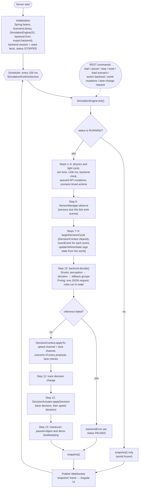
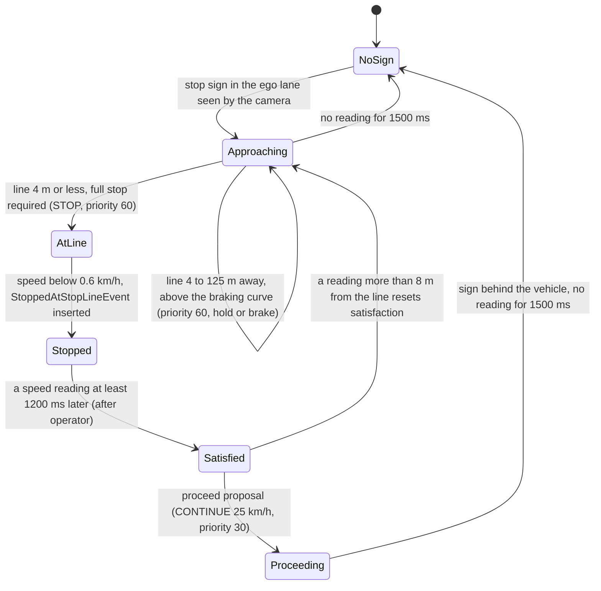

# Execution Flow

**Audience:** developers and maintainers who need to know what happens, in which order and in which class or rule, from start-up to a driving decision and back. Also useful to evaluators who want to connect a scenario with the code path it exercises.

**Related documents:** [ARCHITECTURE.md](ARCHITECTURE.md) (components and arbitration), [BUSINESS_RULES.md](BUSINESS_RULES.md) (what each rule does).

Scope of the statements in this document:

- They refer to the Spring Boot server path with the **Drools** backend and its pseudo session clock, which is the default way to run the system.
- Where the **SWI-Prolog** backend differs, this is stated. Those differences come from reading the code; the Prolog backend was not executed in this analysis.
- Differences in the legacy JavaFX client are noted where relevant.
- Timings are in **simulation time**: one tick = 100 ms.

---

## 1. Overview

The step numbers follow the order of statements in [`SimulationEngine.tick()`](../src/main/java/com/one2drive/projeto1/simulation/SimulationEngine.java) (lines 274–338).

---

## 2. Stages in Chronological Order

### 2.1 Initialisation

| Step | Responsible code | What happens |
|---|---|---|
| Spring start-up | `DrivingExpertSystemServerApplication.main` | Starts the web server on port 8080 (`application.properties`) |
| Configuration | `SimulationCoreConfig.simulationConfig()` → `SimulationConfig.defaultConfig()` | Tick 100 ms, map 100 blocks of 5 m, sensor ranges and rates, accelerations, light timings |
| Scenario library | `ScenarioLibrary.loadFromClasspath("/scenarios/scenarios.json")` | 15 scenarios parsed with Jackson |
| Engine | `SimulationCoreConfig.simulationEngine(…, @Value("${expert.backend:drools}"))` → `new SimulationEngine(config, S1, pseudoClock=true, …, ExpertBackendType.parse(backend))` | Builds the world from S1, registers the five sensors, holds the vehicle at rest (speed 0, `STOPPED`), creates the backend. Status `STOPPED` |
| Drools backend | `DroolsBackend` constructor → `KnowledgeSession.createPseudoClock` | New `KieSession` (all DRL files compiled into `drivingKbase`); pseudo clock; listeners; global `droolsSupport`; seed facts; live query "Current Driving Decision"; then `VehicleStateFact` and `CruiseTargetFact(initial speed)` |
| Seed facts | `KnowledgeSession.create` | `DecisionContext`, `DrivingDecision`, `CurrentSpeedLimit(120, "default")`, `PendingSpeedLimit`, `WeatherStateFact(CLEAR)`, both `LaneOccupancyState` *occupied*, "none" front/side-lane/pedestrian/hazard/sign/light facts, inactive request, move-off, pedestrian-braking and overtaking states |
| Prolog backend (if selected) | `PrologBackend` → `PrologKnowledgeSession.start` → `PrologProcess` | Starts `swipl`, sends `reset` with the cruise speed, the `StoppingPolicy` figures and the priority values; `driving_state.pl` seeds the same initial beliefs |
| Scheduler | `SimulationRuntimeService.startLoop()` (`@PostConstruct`) | Single-thread scheduler: `tick()` and a snapshot every 100 ms; exceptions are logged and the loop continues |
| Start | `POST /api/simulation/start` → `SimulationEngine.start()` | If the world is still at rest at time 0, the scenario's initial speed is applied (`CRUISING`); status `RUNNING` |

Loading a scenario (`POST /api/scenarios/{id}/load`), `POST /api/simulation/reset` (which always reloads S1) and `POST /api/simulation/backend/{type}` (which reloads the current scenario) all call `SimulationEngine.reset`. It closes the old backend, rebuilds the world and creates a new backend session from an empty working memory. If a backend switch fails, the previous backend is restored and the error is returned (HTTP 503).

### 2.2 Input acquisition and definition

Inputs reach the system in four ways:

1. **Scenario definition:** the initial world (map, elements, actors, weather, markings, initial speed and lane).
2. **Timed actions:** `runTimedActions()` executes scenario actions whose trigger time has passed (add a road element or actor, set or clear rain, request a lane change or an acceleration).
3. **User commands (REST):**
   - World mutations are queued by `enqueueWorldMutation` while the simulation runs and applied by `flushPendingMutations()` at the start of the next tick.
   - Lane-change and acceleration requests go to the backend at once (`submitCommand`): Drools inserts them into `COMMAND_STREAM`; Prolog sends them with the next tick.
   - Invalid requests are rejected with HTTP 400 or 404.
4. **Sensor observations:** `SensorManager.observe(world, t)` asks each sensor whose period has elapsed to observe the ground truth.

| Sensor | Period | Ticks on which it emits | Events |
|---|---|---|---|
| `SpeedSensor` | 100 ms | every tick | `VehicleSpeedEvent` |
| `FrontRadarSensor` | 100 ms | every tick (if something is in range) | `FrontDistanceEvent`, `RelativeSpeedEvent`, `TTCEvent` for the nearest vehicle ahead in the own lane ≤ 130 m (distance noise σ 0.7 m); `LeftLaneVehicleEvent`, `RightLaneVehicleEvent`, `FarLeftLaneVehicleEvent` for the nearest vehicle ahead in those lanes |
| `CameraSensor` | 200 ms | t = 100, 300, 500 … ms | nearest speed-limit sign, traffic light, stop sign (own lane only), crosswalk, pothole, barrier, obstacle (own lane preferred, else any lane), the most relevant pedestrian; range 120 m × visibility (84 m in rain) |
| `BlindSpotSensor` | 200 ms | t = 100, 300, 500 … ms | two `LaneOccupancyEvent` (left and right side) |
| `EnvironmentSensor` | 400 ms | t = 100, 500, 900 … ms | `WeatherEvent`, `VisibilityEvent`, `RoadGripEvent`; `ReducedVisibilityEvent` / `ReducedGripEvent` below 0.85 |

Sensors emit nothing when nothing is in range; there are no "nothing detected" events.

### 2.3 State and environment representation

- **Ground truth:** `WorldState` (ego, actors, `RoadMap` matrix, weather, markings). Distances are measured around the looping road.
- **Observations:** event objects stamped with the simulation time.
  - Drools inserts them into their entry point, and they expire after their `@expires` time (3–30 s).
  - Prolog receives them as JSON in the tick request and keeps what it needs in `driving_state.pl`.
- **Beliefs:** state facts maintained by the perception rules (§2.5), plus one fact written by Java every tick. `updateVehicleState` copies into `VehicleStateFact` (or the Prolog `vehicle_input`):
  - the ego's speed, position, lane, lane-change state, target lane and lateral position;
  - the road markings;
  - the time the last lane change settled;
  - the presentation-demo flag;
  - three world-derived flags: `rightLaneBlockedAhead`, `leftAdjacentLaneSafe`, `rightAdjacentLaneSafe` ([ARCHITECTURE.md §9.2](ARCHITECTURE.md#92-audit-findings), A-01).

### 2.4 Condition evaluation

Conditions are of five kinds:

- **Belief conditions** on state facts, e.g. a `PedestrianStateFact` in the path within 32 m.
- **Temporal (CEP) conditions** on event windows, e.g. three or more `TTCEvent` with TTC < 2.5 s in `window:time(2s)`, or Allen relations such as `VehicleSpeedEvent(this after[1200ms] $stopped)`.
- **Goals proved by backward chaining:** `safeToChangeLane(side)` and its four sub-goal queries.
- **Arithmetic conditions** on stopping distances and braking curves (`StoppingPolicy` formulas).
- **Freshness and change guards** in perception rules, so that a belief is updated only by newer or different information.

### 2.5 Rule activation and firing

**Drools.** The control rule (salience 10000) sets the focus, and the three agenda groups run in order:

1. **`perception`** (32 rules):
   - updates from events (salience 1000; 1010 for activating a pending speed limit);
   - stale clearing and request expiry (900).
2. **`decision`** (84 rules), in salience order:
   - emergency rules (900–870);
   - traffic-light commitment (700);
   - barrier rules (650–640);
   - stop-sign and traffic-light rules, including the green-light release (640–610);
   - pedestrian rules (607–600);
   - rain + TTC (560);
   - front-vehicle, overtaking and boxed-in rules (540–455);
   - avoidance and hazard rules (475–460);
   - lane-change requests (430–420);
   - fuzzy weather (360–350);
   - speed rules (310–205);
   - proceed after a stop sign (200);
   - green light and open barrier (180–170);
   - move-off state (60).
3. **`fallback`** (2 rules): "Move off when stopped and nothing holds the vehicle" (−90) and "Default maintain speed baseline" (−100).

Rules that modify a fact cause dependent rules to be re-evaluated within the same `fireAllRules` call (forward chaining); `no-loop` stops self-retriggering. A tick is capped at 5000 firings.

**Prolog.**
- `server.pl` handles the `tick` request:
  - `update_state` applies the events to the stored state;
  - `load_cycle_facts` builds a fresh working memory;
  - `run_rules` fires rules by precedence (equal to the Drools salience), re-matching only the rules that read a new fact type;
  - `store_conclusions` saves what persists.
- The reply carries every `proposal/5` fact with its evidence, the working memory, the limit in force, the lane checks and the engine statistics.

### 2.6 Priority and conflict handling

Every proposal is kept. `DecisionContext.applyTo` arbitrates two channels separately:

- **Speed:**
  - priority ≥ 60 overrides (highest priority, then lowest speed, then firing order), possibly capped by a strictly lower ceiling;
  - below 60, the lowest of the 50/40/20 ceilings wins if it is under the base (priority 30, else 10).
- **Lane:** the highest priority wins, then `RETURN_RIGHT` > `CHANGE_LANE` > `KEEP_LANE`.
- **Veto:** a lane maneuver is vetoed by a higher-priority mandatory stop or emergency that is braking.

Details: [ARCHITECTURE.md §5](ARCHITECTURE.md#5-action-selection-and-priority-resolution).

### 2.7 Final action selection

After inference:

1. `DecisionContext.applyTo(decision)` sets the speed and lane decisions and the outcome of every proposal.
2. The backend attaches the why-not lane checks (Drools: sub-goal queries; Prolog: `laneChecks` in the reply).
3. Drools updates the `DrivingDecision` fact, which rules read at the next tick; Prolog sends it back as `previousDecision`.
4. `trackDecisionTransition()` adds a `DECISION` timeline entry when the headline action, risk, source rule or recommended speed changed.
5. `DecisionActuator.applyDecision` applies the lane decision (it may refuse it and replace the speed decision) and then the speed decision. See [ARCHITECTURE.md §5.3](ARCHITECTURE.md#53-post-processing-by-the-actuator).

### 2.8 Result presentation and consumption

- **Vehicle:** acceleration, indicator, steering and driving state; for an accepted lane maneuver, `LaneChangeState.REQUESTED` and the target lane.
- **Timeline:** `ExplanationTrace` (500 entries):
  - perception changes (`SensorSignificance`);
  - rule activations and firings (Drools listeners; for Prolog, one `RULE FIRED` entry per rule that concluded something);
  - fact changes and decisions;
  - actuator changes (when the action or the acceleration changes by ≥ 0.25 m/s²);
  - maneuver start and completion;
  - backend errors.
- **Snapshot:** `SimulationEngine.snapshot()` → `ApiModelMapper` → `ApiSimulationSnapshot` → WebSocket frame `snapshot` (`/api/ws/simulation`), also returned by `GET /api/simulation/state`. It carries the ego, environment, speed advisor, both decision channels, the proposals and their outcomes, the lane checks, sensor telemetry, world objects, working memory, timeline, road map, lane safety, demo phases, and the active backend and its error.
- **Decision panel (Angular):** shows the speed and lane channels with their rules, the proposal list with outcomes, and the engine toggle.

### 2.9 State updates and repeated execution

The decision takes physical effect at the **next** tick. `WorldPhysicsEngine.updateWorld`:

- applies the acceleration (`v = max(0, v + a·0.1 s)`, `x += v·0.1 s`);
- advances a lane change;
- moves actors (vehicles at constant speed, crossing pedestrians laterally);
- advances the traffic-light cycle:
  - yellow → red after 3 s;
  - red → green after the ego has been at rest at the stop line for 5 s.

After the actuator, the engine also runs:

- **`settleManeuver()`:** a completed lane change makes the target lane the committed lane and records `laneSettledAtMillis`;
- **`normalizeCompletedManeuver()`** (start of the next tick): `COMPLETED` → `IDLE`;
- **`consumePassedRoadElements()`:**
  - on non-looping maps, passed detected elements become inactive and are removed 50 m behind;
  - passed actors are removed once out of view, or when a passed vehicle would catch up within one car length;
  - pedestrians that have crossed leave the road;
- **`purgeExpiredDetections()`:** detection badges expire after 600 ms.

Because the road loops, a scenario never ends by itself.

### 2.10 Termination

| Trigger | Effect |
|---|---|
| `POST /api/simulation/pause` | Status `PAUSED`; ticks return snapshots without advancing; `resume` continues |
| `POST /api/simulation/stop` | Status `STOPPED`; frozen; `start` continues from the current state |
| `reset` / scenario load / backend switch | Pending mutations cleared, backend closed and recreated, clock and sensors reset, world rebuilt, vehicle at rest, status `STOPPED` |
| Inference failure | Status `PAUSED`, `backendError` shown in the UI; reset or switch backend to continue (§3.7) |
| Server shutdown | `SimulationRuntimeService.stopLoop()` (`@PreDestroy`) stops the scheduler; `SimulationEngine.close()` (bean destroy method) closes the backend (Drools: live query and session; Prolog: process) |

---

## 3. Special Situations

### 3.1 Several rules apply

All applicable rules fire and propose; arbitration combines them per channel.

- **S2 trace (§4.1):** from 1.2 s "Slow down in time for the speed limit ahead" (ceiling 20, about 88 km/h and falling) and "Build back up to the scenario cruise speed when no sign governs the road" (ceiling 20, 90 km/h) both proposed. The lower ceiling won.
- **S8 (§4.4):** the overtake (lane channel) and the following-distance reduction (speed channel) were both applied in the same cycle.

### 3.2 No rule applies

- **Speed channel:** if no speed rule proposes, the decision is `MAINTAIN_SPEED` at the current speed, priority 0, "Default base decision". In practice "Default maintain speed baseline" (fallback group) proposes the same thing at priority 10 whenever nothing else proposed.
- **Lane channel:** with no lane proposal, the decision is `KEEP_LANE`, "Default lane decision".
- **Before the first tick:** the published decision is `CONTINUE`, speed 0, "Default continue decision".

### 3.3 Emergency

The four `EMERGENCY_SAFETY` rules (priority 70) override every other speed proposal, and they veto lane maneuvers that have not started. `EMERGENCY_BRAKE` applies 8.5 m/s² and switches on the hazard lights. The decision stays as long as its condition holds:

- persistent TTC: at least three samples below 2.5 s within 2 s;
- immediate TTC: one sample below 1.3 s within 200 ms;
- pedestrian: a conflicting pedestrian within 6 m;
- obstacle: a HIGH obstacle within 8 m in the physical lane within 300 ms.

Other rules also issue `EMERGENCY_BRAKE` when comfortable braking no longer suffices:

- the stop-sign and red-light approaches and "Hold at red traffic light" (priority 60);
- "Stop before obstacle ahead while still in its lane" (priority 50).

The closed-barrier stop has no such escalation (R-22).

### 3.4 Missing or stale input data

Perception beliefs are only valid while readings keep arriving. Staleness is measured against the vehicle-state timestamp:

| Belief | Reset when no new reading for | Reset value |
|---|---|---|
| `FrontVehicleState` | 250 ms | target `"none"`, distance and TTC `+∞`, relative speed 0 |
| `LeftLaneVehicleState`, `RightLaneVehicleState`, `FarLeftLaneVehicleState` | 250 ms | no target, `+∞` |
| `TrafficLightStateFact` | 400 ms | `"none"`, GREEN, `+∞`, commitment NONE |
| `PedestrianStateFact` | 1000 ms | `"none"`, `+∞`, not in path, WAITING |
| `PotholeStateFact`, `ObstacleStateFact` | 1000 ms | `"none"`, `+∞`, lane `CENTER` |
| `BarrierStateFact` | 1000 ms | `"none"`, `+∞`, open |
| `PendingSpeedLimit` | 1000 ms | cleared |
| `StopSignState` | 1500 ms | `"none"`, `+∞`, not satisfied |
| `LaneChangeRequestState` | 1500 ms after the request | inactive |
| `CurrentSpeedLimit` | never (a limit stays in force after its sign) | — |
| `LaneOccupancyState`, `WeatherStateFact` | never (their sensors emit continuously) | — |

Other defaults:

- Adjacent lanes are *occupied* until the first blind-spot report.
- The legal limit is a placeholder 120 km/h (source `"default"`) until a sign is passed; it is not used as a target.
- A scenario without a map gets an empty 500 m road; one without a lane starts in `RIGHT`; one without weather starts `CLEAR`.

There is no representation of a failed or unknown sensor: a silent sensor is indistinguishable from an empty road ([BUSINESS_DOMAIN.md §10](BUSINESS_DOMAIN.md#10-confirmed-limitations-and-missing-features)). The vehicle's own speed belief comes from the world state, not from the speed sensor (R-16).

### 3.5 Lane change in progress

```mermaid
stateDiagram-v2
    [*] --> IDLE
    IDLE --> REQUESTED: lane decision accepted by the actuator (target safe, no continuous line)
    REQUESTED --> CHANGING: next physics update
    CHANGING --> CHANGING: lateral move 1.2 m/s (smoothstep)
    CHANGING --> COMPLETED: lateral position reaches the target lane centre (about 2.9 s)
    COMPLETED --> IDLE: next tick; committed lane becomes the target lane
```

While `REQUESTED` or `CHANGING`:

- "Maintain ongoing lane change left avoidance" and "Maintain ongoing lane change right avoidance" keep proposing the same direction (priority 30);
- `maneuverIdle` fails, so no new maneuver is proposed through `safeToChangeLane`;
- the front radar keeps tracking the origin lane until the lane settles.

There is no abort transition (A-12). Emergency rules can still brake.

### 3.6 Stop-sign lifecycle

With the realtime clock of the JavaFX client, the transition from Stopped to Satisfied never happens (A-07, probe P-04b).

### 3.7 Inference failure

If `backend.decide()` throws an `ExpertSystemException`:

- the engine records `"<backend> failed: <message>"` as `backendError`;
- it adds an `INFO` timeline entry;
- it sets the status to `PAUSED`;
- it returns the snapshot **without applying any decision**.

For Prolog, the cause can be an error reply, a closed stream, a dead process or no reply within 2 s; on a timeout the process is killed. The UI shows the error banner ("Reset, or switch engine, to continue"), and `GET /api/simulation/status` reports `drools: "ERROR"`. A reset clears the error. Not executed in this analysis.

### 3.8 Backend switch

`POST /api/simulation/backend/{drools|prolog}` → `SimulationRuntimeService.switchBackend` → `SimulationEngine.switchBackend(type, current scenario)`:

- The engine resets with the new backend: an empty working memory, the world rebuilt, status `STOPPED`.
- If the new backend cannot start (e.g. `swipl` missing), the previous backend is restored, the exception propagates, and the API answers HTTP 503.

`PrologSimulationE2ETest.failedSwitchKeepsThePreviousBackend` (executed here) checks this last case with a nonexistent executable.

---

## 4. Worked Examples (Observed)

The following traces were observed by running the real engine (Drools, pseudo clock) on a copy of the repository: exploratory probes, see [TESTING.md §5](TESTING.md#5-exploratory-verification-probes). The numbers come from those runs.

### 4.1 Speed limit sign (scenario S2)

S2: ego in the `RIGHT` lane, initial speed 90 km/h; a 50 km/h sign in the `CENTER` lane at 140 m (map row 28). Probe P-09.

| Time | Inputs this tick | Rules fired (in order) | Decision | Vehicle |
|---|---|---|---|---|
| before START | — | — | `CONTINUE`, 0 km/h, priority 0, "Default continue decision" | 0 km/h, `STOPPED` |
| 0.1 s (tick 1) | speed 90; blind spot: left clear, right = road edge; environment clear | Control; Update weather state; Update lane occupancy left; Update lane occupancy right; Fuzzify visibility; Fuzzify grip; Fuzzy: no rain … -> light; Default maintain speed baseline | `MAINTAIN_SPEED` 90, priority 10 | acceleration 0 |
| 0.2 s | speed only | Control; Default maintain speed baseline | `MAINTAIN_SPEED` 90, priority 10 | 0 |
| 0.9 s | camera: 50 km/h sign, about 118 m | Control; **Track the speed limit sign ahead as pending**; Update weather state; Update lane occupancy left/right; fuzzy rules; **Slow down in time for the speed limit ahead**; Default maintain speed baseline (no proposal) | `MAINTAIN_SPEED` 90.4, priority 20 (approach speed reached) | 0 |
| 1.0 – 6.5 s | camera re-reads the sign every 200 ms | Slow down in time for the speed limit ahead; from 1.2 s also Build back up to the scenario cruise speed… | `REDUCE_SPEED` falling from 89.7 to 50.0, priority 20 | about −2.0 m/s²; 69.2 km/h at 4.0 s |
| 6.7 s | position 135.7 m (sign at 140 m) | Slow down in time for the speed limit ahead | `MAINTAIN_SPEED` 50, priority 20 | 50.0 km/h, 4.3 m before the sign |
| 7.1 s | position 141.3 m | **Activate the pending speed limit at its sign**; **Maintain speed when compliant with detected limit** | `MAINTAIN_SPEED` 50, priority 10 | 50.0 km/h, stable |

Explanation:

1. The sign was first read at about 118 m, on the first camera cycle after it came within the 120 m range. Although it stands in another lane, the camera reports the nearest sign in any lane.
2. The sign is first kept as **pending**, with its position on the road; the limit in force does not change yet.
3. "Slow down in time for the speed limit ahead" holds the speed until the 2.0 m/s² approach curve is reached, then follows it down, so the car reaches 50 km/h just before the sign.
4. At the sign the pending limit becomes the limit in force, and the compliant rule takes over.
5. Over the 200 ticks, "Update vehicle state from speed sensor" never fired (R-16), while "Default maintain speed baseline" and the control rule fired on every tick (R-17).

### 4.2 Emergency braking on repeated low TTC

Rule-level probe P-04 (pseudo clock), five consecutive 100 ms cycles. Each cycle inserted, for the same target, a front distance of 15 m, a relative speed of 12.5 m/s and a TTC of 1.2 s.

| Cycle | TTC events in window | Deciding rule | Decision |
|---|---|---|---|
| 1–2 | 1–2 | Emergency brake when TTC is immediately critical (TTC < 1.3 s within 200 ms) | `EMERGENCY_BRAKE`, priority 70 |
| 3–5 | 3–5 | Emergency brake when persistent TTC is critical (≥ 3 samples < 2.5 s within 2 s) | `EMERGENCY_BRAKE`, priority 70 |

- From cycle 3, both emergency rules proposed the same action and speed (0); the higher-salience persistent rule was first and kept the decision.
- With a realtime session clock (JavaFX client), the same input produced `REDUCE_SPEED` from "Follow the front vehicle speed outside the following gap", because the TTC events expired on insertion ([ARCHITECTURE.md §9.2](ARCHITECTURE.md#92-audit-findings), A-07).

### 4.3 Overtaking a slow vehicle

Ego `RIGHT` at 50 km/h, slow vehicle in the same lane at 18 km/h, CENTER lane free (probe P-02):

- **Starting gap 45 m (as in S14).**
  - "Overtake slow front vehicle via left lane" (lane channel, priority 30) proposed from the first tick.
  - The ego reached `CENTER` at 3.1 s.
  - "Mark front vehicle passed…" and "Return to right lane after overtaking slow vehicle" brought it back to `RIGHT` at 14.5 s; "Deactivate overtaking state…" then cleared the state.
  - The minimum gap in the same lane was 26.7 m.
- **Starting gap 120 m.**
  - The overtake started when the vehicle came within reach; the ego reached `CENTER` at 9.9 s and was back in `RIGHT` at 21.3 s (minimum same-lane gap 36.1 m).
  - At the baseline commit this set-up latched the overtaking state and ended with a 1.2 m gap; both defects are fixed (R-03, R-05).

### 4.4 Critical TTC with an overtake (scenario S8)

S8: ego `CENTER` at 95 km/h, vehicle `CENTER` 40 m ahead at 30 km/h (probe P-06, 30 s):

1. In the first cycle, "Keep safe following distance behind front vehicle" (`REDUCE_SPEED 48`, priority 50, speed channel) and "Overtake slow front vehicle via left lane" (`CHANGE_LANE_LEFT`, priority 30, lane channel) both won their channel; the lane change started.
2. While the maneuver was moving, the persistent-TTC emergency rule fired for 27 ticks: `EMERGENCY_BRAKE` 0 km/h, priority 70.
3. The "Maintain ongoing lane change" proposals were vetoed ("Arbitration veto"), but a maneuver already in progress is not interrupted by the actuator.
4. The ego reached `LEFT` at 3.1 s, at a minimum speed of 10.4 km/h, passed the vehicle, and returned `LEFT → CENTER → RIGHT` (25.9 s, 29.1 s), building back up towards 95 km/h (88.1 km/h at 30 s).

### 4.5 Red light with the light cycle (scenario S3)

S3: ego `RIGHT` at 70 km/h, red light (road-wide) at 120 m (probe P-15):

| Time | Distance to light | Decision | Speed |
|---|---|---|---|
| 0.1 s | 118 m | "Commit to stop or to proceed at traffic light" → committed to stop; `MAINTAIN_SPEED 70`, priority 60, "Red traffic light progressive approach" | 70 km/h |
| 1.3 s | 94.7 m | `REDUCE_SPEED` (within the comfortable stopping distance), alternating with `MAINTAIN_SPEED` | braking 2.8 m/s² |
| 8.1 s | 20.6 m | `STOP`, priority 60, "Hold at red traffic light" | 10.5 km/h |
| 9.1 s | 19.2 m | at rest, about 1.2 m before the stop line (18 m before the light) | 0 |
| 14.1 s | 19.2 m | light turns GREEN after 5 s at rest → `RESUME 30`, priority 30, "Green traffic light releases red-light hold" | 0 |
| 14.3 s | — | "Move off when stopped and nothing holds the vehicle" (`CONTINUE 30`) | 1.2 km/h |
| 23.3 s | −21 m (passed) | "Build back up to the scenario cruise speed…" (70) | 29 km/h and rising |

---

## 5. Where Each Stage Is Implemented

| Stage | Classes and methods | Rules |
|---|---|---|
| Initialisation | `SimulationCoreConfig`, `SimulationEngine` constructor / `reset` / `switchBackend`, `DroolsBackend`, `KnowledgeSession.create`, `PrologBackend`, `PrologKnowledgeSession.start`, `ScenarioFactory.buildWorld` | `00-declarations.drl`; Prolog `reset_state/3` |
| Input acquisition | `SensorManager.observe`, the five sensors, `flushPendingMutations`, `runTimedActions`, `requestLaneChange`, `requestAcceleration`, controllers | — |
| Representation | `WorldState`, `RoadMap`, `ExpertSystemBackend.insertEvent` (`EventRouter`), `updateVehicleState` | `01-state-updates.drl`; `driving_state.pl` |
| Condition evaluation and activation | `DroolsBackend.decide` (`fireAllRules`), `PrologKnowledgeSession.cycle` (`run_rules/0`) | all DRL files; `driving_rules.pl` |
| Conflict handling | `DroolsSupport.proposeDecision`, `PrologProposal.proposeTo`, `DecisionContext.applyTo` | the 64 proposing rules |
| Final selection | `DecisionContext.applyTo`, `DroolsBackend.laneCheck`, `trackDecisionTransition`, `DecisionActuator.applyDecision` | `lane-safety.drl` (why-not) |
| Presentation | `snapshot`, `ApiModelMapper`, `RealtimeSnapshotPublisher`, `ExplanationTrace`, listeners, `InferenceNarrator` | `queries.drl` |
| State update and repetition | `WorldPhysicsEngine.updateWorld` (incl. `RoadMap.advanceTrafficLights`), `settleManeuver`, `normalizeCompletedManeuver`, `consumePassedRoadElements` | state-machine rules in `front-vehicle.drl`, `pedestrian.drl`, `traffic-signs.drl`, `traffic-lights.drl`, `defaults.drl` |
| Termination | `pause`, `stop`, `reset`, `close`, `SimulationRuntimeService.stopLoop`; failure: `SimulationEngine.tick` catch block | — |
