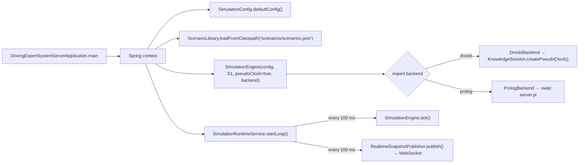
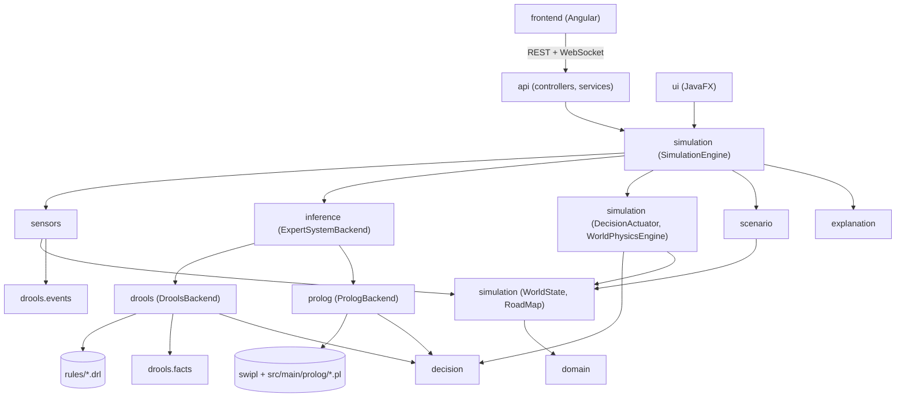

# Project Structure

**Audience:** developers and maintainers who need to find their way around the code base, build it, run it, and change it.

**Related documents:** [ARCHITECTURE.md](ARCHITECTURE.md) explains how the components interact, [EXECUTION_FLOW.md](EXECUTION_FLOW.md) follows one simulation tick step by step, and [BUSINESS_RULES.md](BUSINESS_RULES.md) catalogues the rules.

> **Technology note.** This documentation was requested on the assumption that the project was a *Prolog-based* expert system. In the working tree as of 2026-10-21 the project has **two** interchangeable inference backends:
> - **Drools**: a Java rule engine, the default;
> - **SWI-Prolog**: the project's own production-rule interpreter written in Prolog, run as an external `swipl` process.
>
> Both are hosted by a Java 17 / Spring Boot application with an Angular user interface. Everything below describes the working tree as of 2026-10-21.

---

## 1. Technologies and Tools

| Area | Technology (version) | Where it is declared |
|---|---|---|
| Language and runtime | Java 17 (`<release>17</release>`) | [`pom.xml`](../pom.xml) |
| Build tool | Apache Maven (3.9.x; 3.9.11 used for the verification runs) | [`pom.xml`](../pom.xml) |
| Rule engine 1 (default) | Drools / KIE **8.44.0.Final**: DRL rules, stream (CEP) mode, entry points, agenda groups, queries, live query, truth maintenance | [`pom.xml`](../pom.xml), [`kmodule.xml`](../src/main/resources/META-INF/kmodule.xml), [`rules/`](../src/main/resources/rules) |
| Rule engine 2 | **SWI-Prolog 9.x** (external program, not a Maven dependency; 9.2.9 installed on the analysis machine) running the project's [`engine.pl`](../src/main/prolog/engine.pl) | [`src/main/prolog/`](../src/main/prolog), `pom.xml` resource entry, README |
| Backend web layer | Spring Boot **3.3.4** (`spring-boot-starter-web`, `spring-boot-starter-websocket`, `spring-boot-starter-validation`): REST and a plain WebSocket | [`pom.xml`](../pom.xml), `src/main/java/com/one2drive/projeto1/api/` |
| JSON | Jackson 2.17.2 (scenario file; Prolog protocol; session history files) | [`pom.xml`](../pom.xml) |
| Legacy desktop client | JavaFX **21.0.2** | [`DrivingExpertSystemApp.java`](../src/main/java/com/one2drive/projeto1/ui/DrivingExpertSystemApp.java) |
| Web frontend | Angular **18.2** (18.2.14 installed), RxJS 7.8, TypeScript 5.5 | [`frontend/package.json`](../frontend/package.json) |
| Backend tests | JUnit Jupiter 5.10.2 (incl. parameterised tests over both backends), Maven Surefire 3.2.5 | [`pom.xml`](../pom.xml) |
| Frontend unit tests | Karma 6.4 + Jasmine 5 (ChromeHeadless) | [`frontend/package.json`](../frontend/package.json), [`frontend/angular.json`](../frontend/angular.json) |
| Browser end-to-end tests | Playwright 1.48 (real backend and frontend) | [`frontend/playwright.config.ts`](../frontend/playwright.config.ts) |
| Developer scripts | Bash, PowerShell, cmd; Node for the flowchart renderer | [`scripts/`](../scripts) |

There is no database, no message broker and no external service. The running state lives in memory, in one Java process plus, when selected, one `swipl` child process; finished sessions are saved as JSON files under `~/.projeto-1/sessions` (`history.directory`).

---

## 2. Repository Layout

```text
projeto-1/
├── pom.xml                         Maven build: Spring Boot + Drools + JavaFX + JUnit; copies src/main/prolog to prolog/
├── README.md                       Project README (user-facing guide; some statements are outdated, see §12)
├── docs/                           This documentation set (+ dated reports kept unchanged; fluxogramas/: Portuguese flowcharts)
├── diagrams/                       Earlier Mermaid diagrams (01–08) and a Portuguese conceptual model
├── Relatorio_Previo_ENGCIA/        Portuguese LaTeX preliminary report (mostly section skeletons)
├── scripts/                        dev.sh, dev.ps1, dev.cmd: start backend + frontend together (dev-mine.sh: identical copy of dev.sh);
│                                   dependencies.sh: Node 22 via nvm + npm ci, then dev.sh;
│                                   render-flowcharts.sh (+ .mjs): Mermaid flowcharts of docs/fluxogramas/fluxogramas_apresentar → PNG
├── screenshot_*.png                13 evidence screenshots; one Playwright test rewrites 4 of them (see §12)
├── src/
│   ├── main/
│   │   ├── java/com/one2drive/projeto1/        197 files
│   │   │   ├── api/                Spring Boot application, REST controllers, DTOs, mappers, runtime loop, WebSocket,
│   │   │   │                       session history API and historical explanations
│   │   │   ├── config/             SimulationConfig: numeric simulation parameters
│   │   │   ├── decision/           DecisionPriority, DecisionContext, DecisionProposal, DrivingDecision,
│   │   │   │                       LaneChangeCheck, StoppingPolicy, SpeedIntent
│   │   │   ├── domain/             World model: ego vehicle, actors, road elements, enums (incl. DecisionChannel)
│   │   │   ├── inference/          ExpertSystemBackend interface, backend type, input, exception
│   │   │   ├── drools/             DroolsBackend, KnowledgeSession, EventRouter, FuzzySupport, inspection
│   │   │   │   ├── events/         24 sensor/command/internal event classes + abstract BaseEvent
│   │   │   │   ├── facts/          27 belief and state classes kept in working memory
│   │   │   │   └── listeners/      Agenda and working-memory listeners feeding the timeline
│   │   │   ├── prolog/             PrologBackend, PrologKnowledgeSession, PrologProcess (swipl), results
│   │   │   ├── explanation/        ExplanationTrace (timeline), entry types, DecisionFlowchart (rule → flowchart question)
│   │   │   ├── history/            Saved sessions: SimulationSession, SessionSnapshot, SessionHistoryStore (JSON files)
│   │   │   ├── scenario/           Scenario JSON model, loader, world factory
│   │   │   ├── sensors/            Simulated sensors and their scheduler
│   │   │   ├── simulation/         SimulationEngine, world state, physics, actuator, road map, telemetry
│   │   │   └── ui/                 JavaFX legacy client
│   │   ├── prolog/                 engine.pl, driving_state.pl, driving_rules.pl, server.pl
│   │   └── resources/
│   │       ├── META-INF/kmodule.xml   Knowledge base and session declaration
│   │       ├── application.properties  server.port, expert.backend
│   │       ├── rules/              19 DRL files: 123 rules and 6 queries
│   │       └── scenarios/scenarios.json  14 predefined scenarios (S15 commented out)
│   └── test/java/com/one2drive/projeto1/   58 files: 53 test classes + 5 helpers (harnesses, BackendTestSupport, probes)
│       ├── api/                    WebSocket end-to-end test (real server and client)
│       ├── api/service/, decision/, domain/, history/, explanation/, sensors/   Unit tests
│       ├── drools/                 Rule-level tests, agenda phases, fuzzy arithmetic, harness
│       ├── prolog/                 Prolog rule tests, Drools/Prolog equivalence, rule name parity, Prolog E2E, harness
│       └── simulation/             Engine-level end-to-end tests (most run on both backends)
└── frontend/                       Angular application, Karma unit tests, Playwright end-to-end tests
    ├── src/app/                    core/ (API, WebSocket, state, models), simulation/, scenario/, telemetry/,
    │                               expert-system/, shared/
    ├── e2e/                        22 Playwright tests (simulation.spec.ts 20, realtime.spec.ts 2)
    ├── proxy.conf.json             Dev-server proxy: /api → http://localhost:8080 (REST and WebSocket)
    └── playwright.config.ts
```

Directories that exist locally but are not version-controlled (see [`.gitignore`](../.gitignore)): `target/`, `.dev-logs/`, `frontend/node_modules/`, `frontend/.angular/`, `frontend/dist/`.

---

## 3. Backend Packages and Responsibilities

All Java sources are under `src/main/java/com/one2drive/projeto1/`.

| Package | Key classes | Responsibility |
|---|---|---|
| `api` | `DrivingExpertSystemServerApplication` | Spring Boot entry point (`main`) |
| `api.config` | `SimulationCoreConfig`, `CorsConfig`, `WebSocketConfig` | Creates the singleton `SimulationEngine` (pseudo clock, scenario S1, backend from `expert.backend`), loads the scenario library, allows CORS from `http://localhost:4200` (`CorsConfig.FRONTEND_ORIGIN`), registers the WebSocket handler at `/api/ws/simulation` with the same origin check |
| `api.controller` | `SimulationController`, `ScenarioController`, `WorldController`, `EnvironmentController`, `DroolsController`, `ExplanationController`, `SessionHistoryController`, `RealtimeWebSocketHandler`, `ApiExceptionHandler` | REST and WebSocket endpoints (§9.4); `ExpertSystemException` → HTTP 503, `IllegalArgumentException` → 400, `NoSuchElementException` → 404 |
| `api.service` | `SimulationRuntimeService`, `RealtimeSnapshotPublisher`, `ApiModelMapper`, `ApiRequestMapper`, `InferenceNarrator`, `SessionExplanationService`, `RecordedCycle`, `FlowchartPathBuilder`, `AlternativeExplainer` | 100 ms scheduler, backend switch, session recording, DTO mapping, non-blocking WebSocket publishing, narrative; why / why not / how of a recorded decision |
| `api.model` | `ApiSimulationSnapshot`, `ApiSnapshotPayload` (WebSocket envelope), `ApiDecisionView` (speed and lane channels, proposals, lane checks), `ApiSystemStatus`, `ApiSessionSummary`, `ApiSessionDetail`, `ApiWhyRequest`, `ApiWhyAnswer`, request DTOs | Data transfer objects with Bean Validation constraints |
| `config` | `SimulationConfig` | Tick, map, accelerations, sensor ranges and rates, light timings (§5.2) |
| `decision` | `DecisionPriority`, `DecisionContext`, `DecisionProposal`, `DrivingDecision`, `LaneChangeCheck`, `StoppingPolicy`, `SpeedIntent` | Priority levels; per-channel arbitration of all proposals; the decision; why-not; stopping figures and formulas; what a speed decision does to the car (speed up, hold, slow down) |
| `domain` | `EgoVehicleState`, `DynamicActor`, `OtherVehicle`, `Pedestrian`, `RoadElement` subclasses (`SpeedLimitSign`, `StopSign`, `TrafficLight`, `Crosswalk`, `Pothole`, `StaticObstacle`, `Barrier`), enums (`Lane`, `DrivingAction`, `DecisionChannel`, `RiskLevel`, `LaneChangeState`, `PedestrianCrossingState`, …) | Ground-truth world model and shared vocabulary |
| `inference` | `ExpertSystemBackend`, `ExpertBackendType`, `DecisionInput`, `ExpertSystemException` | Backend-neutral interface used by the engine |
| `drools` | `DroolsBackend`, `KnowledgeSession`, `EventRouter`, `DroolsEntryPoints`, `DroolsSupport`, `FuzzySupport`, `WorkingMemoryInspector`, `FactDescription`, `DecisionLiveQueryListener` | The Drools backend: session, routing, proposals, fuzzy arithmetic, why-not queries, fact rendering |
| `drools.events` | `VehicleSpeedEvent`, `FrontDistanceEvent`, `TTCEvent`, `LeftLaneVehicleEvent`, `CrosswalkDetectedEvent`, `StoppedAtStopLineEvent`, … (24 classes extending `BaseEvent`) | Time-stamped observations, commands and one rule-generated event |
| `drools.facts` | `VehicleStateFact`, `CurrentSpeedLimit`, `PendingSpeedLimit`, `FrontVehicleState`, `LaneOccupancyState`, `TrafficLightStateFact`, `BoxedInFact`, `FuzzyMembership`, `FuzzyConclusion`, `SafeLaneSide`, … (27 classes) | Beliefs and internal states |
| `drools.listeners` | `RuleRuntimeTraceListener`, `WorkingMemoryTraceListener` | Timeline entries for activations, firings and fact changes |
| `prolog` | `PrologBackend`, `PrologKnowledgeSession`, `PrologProcess`, `PrologCycleResult`, `PrologProposal`, `PrologEngineException` | The SWI-Prolog backend: process management, JSON protocol, mapping of proposals, working memory and lane checks |
| `explanation` | `ExplanationTrace`, `TimelineEntry`, `TimelineEntryType`, `DecisionFlowchart` | Chronological trace (the backends create it unbounded, so a whole session is kept; the snapshot carries the last 160 entries); the map from each proposing rule (both engines, by base name) to its question in the decision flowchart |
| `history` | `SimulationSession`, `SessionSnapshot`, `SessionEvent`, `VehicleSample`, `SessionHistoryStore` | One saved run: events, vehicle samples and the recorded cycles of its decisions; stored as one JSON file per session under `history.directory` (default `~/.projeto-1/sessions`) |
| `scenario` | `ScenarioLibrary`, `ScenarioFactory`, `ScenarioDefinition`, `*Definition`, `*Type` enums | Loads `scenarios.json` and builds a `WorldState` |
| `sensors` | `SensorManager`, `SpeedSensor`, `FrontRadarSensor`, `CameraSensor`, `BlindSpotSensor`, `EnvironmentSensor` | Observe the world at their own rates and emit events |
| `simulation` | `SimulationEngine`, `WorldState`, `WorldPhysicsEngine`, `DecisionActuator`, `RoadMap`, `MapLegend`, clocks, `SensorTelemetry`, `SensorSignificance`, `SimulationSnapshot` | The perception–decision–action loop, physics and light cycle, the road matrix, snapshots |
| `ui` | `DrivingExpertSystemApp` | JavaFX client (legacy; Drools only) |

---

## 4. Organisation of Rules, Facts and Events

### 4.1 Drools rule files

All files are in [`src/main/resources/rules/`](../src/main/resources/rules) and share the DRL package `rules`. Every rule belongs to an agenda group (`perception`, `decision` or `fallback`); the control rule is alone in group `control`.

| File | Rules | Content |
|---|---|---|
| [`00-declarations.drl`](../src/main/resources/rules/00-declarations.drl) | 0 | Declares the 24 event types (`@role(event)`, `@timestamp`, `@expires`) |
| [`01-state-updates.drl`](../src/main/resources/rules/01-state-updates.drl) | 33 | `perception`: newest reading → belief; pending speed limit; stale clearing; the sides safe to change lane to (`SafeLaneSide`, logical) |
| [`control.drl`](../src/main/resources/rules/control.drl) | 1 | Control phase (group `control`); the order perception → decision → fallback is stacked by `KnowledgeSession.beginDecisionCycle` |
| [`emergency.drl`](../src/main/resources/rules/emergency.drl) | 5 | Emergency braking: persistent and immediate TTC, pedestrian ≤ 6 m, pedestrian beyond comfortable braking, HIGH obstacle ≤ 8 m |
| [`pedestrian.drl`](../src/main/resources/rules/pedestrian.drl) | 6 | Braking curves and stop for a pedestrian in the path or crossing |
| [`front-vehicle.drl`](../src/main/resources/rules/front-vehicle.drl) | 22 | Following distance, overtaking and return, no passing on the right (left and far-left lanes), boxed-in traffic |
| [`temporal.drl`](../src/main/resources/rules/temporal.drl) | 1 | Rain combined with repeated low TTC (Allen `coincides`) |
| [`speed.drl`](../src/main/resources/rules/speed.drl) | 5 | Legal limit, limit ahead, cruise speed, driver acceleration request |
| [`traffic-signs.drl`](../src/main/resources/rules/traffic-signs.drl) | 6 | Stop sign approach, full stop, 1.2 s hold (Allen `after`), proceed |
| [`traffic-lights.drl`](../src/main/resources/rules/traffic-lights.drl) | 7 | Commitment, red approach and hold, yellow, green |
| [`road-hazards.drl`](../src/main/resources/rules/road-hazards.drl) | 3 | Pothole slow-down; stopping before an obstacle |
| [`lane-safety.drl`](../src/main/resources/rules/lane-safety.drl) | 0 (+5 queries) | `safeToChangeLane` and its sub-goals (backward chaining) |
| [`avoidance.drl`](../src/main/resources/rules/avoidance.drl) | 10 | Lane changes around potholes and obstacles; keeping an ongoing lane change |
| [`lane-change.drl`](../src/main/resources/rules/lane-change.drl) | 4 | Lane changes requested from outside (allow or block) |
| [`road-law.drl`](../src/main/resources/rules/road-law.drl) | 1 | Keep-right rule |
| [`barrier.drl`](../src/main/resources/rules/barrier.drl) | 7 | Closed barrier: change lane, slow to a stop while still in its lane (ceiling), or mandatory stop; open barrier |
| [`fuzzy-weather.drl`](../src/main/resources/rules/fuzzy-weather.drl) | 8 | Fuzzy weather controller (fuzzification, inference, defuzzification) |
| [`defaults.drl`](../src/main/resources/rules/defaults.drl) | 4 | Default baseline; moving off after a standstill |
| [`queries.drl`](../src/main/resources/rules/queries.drl) | 0 (+1 query) | Query "Current Driving Decision" |

Two implementation details matter when editing these files:

- **Imports are package-wide.** Every file declares `package rules`, so the wildcard imports in `01-state-updates.drl` (`drools.events.*`, `drools.facts.*`) make those classes visible in other files. `speed.drl` (`CruiseTargetFact`) and `road-law.drl` (`MoveOffState`) rely on this (A-10).
- **Rules do not choose the final action.** Each decision rule calls `droolsSupport.proposeDecision(...)`, and `DecisionContext` arbitrates afterwards ([ARCHITECTURE.md §5](ARCHITECTURE.md#5-action-selection-and-priority-resolution)). The README asks contributors to choose the priority by the *kind* of rule and to mirror every rule in Prolog.

### 4.2 Prolog sources

All in [`src/main/prolog/`](../src/main/prolog); Maven copies them to the classpath folder `prolog/`.

| File | Lines | Content |
|---|---|---|
| [`engine.pl`](../src/main/prolog/engine.pl) | 396 | Production-rule interpreter: working memory, dependency index, agenda, refraction, `prove/1` backward chaining, `explain/2`, `why_not/2`, `subgoal_results/2`; the meta-knowledge parts are labelled "Meta-conhecimento" |
| [`driving_state.pl`](../src/main/prolog/driving_state.pl) | 642 | State kept between cycles (the role of `01-state-updates.drl`); turns it into the facts of each cycle; `prepare_cycle/0` |
| [`driving_rules.pl`](../src/main/prolog/driving_rules.pl) | 2 292 | 120 rules mirroring the Drools decision rules (the Drools name, with an outcome suffix in parentheses where one Drools rule has several outcomes; precedence = salience); helper predicates; fuzzy sets |
| [`server.pl`](../src/main/prolog/server.pl) | 148 | JSON-lines protocol: `reset`, `prepareCycle`, `tick`, `whynot`, `dependencyIndex` |

All comments in the Prolog files are in European Portuguese; identifiers, rule ids (the Drools rule names) and the reason texts in `proposal(...)` are in English.

### 4.3 Facts and events

- **Events** (`drools/events/`) are observations stamped with simulation milliseconds.
  - Drools receives them through six named **entry points**, chosen by [`EventRouter`](../src/main/java/com/one2drive/projeto1/drools/EventRouter.java) and created on first use: `VEHICLE_STREAM`, `PERCEPTION_STREAM`, `ROAD_STREAM`, `TRAFFIC_STREAM`, `ENVIRONMENT_STREAM`, `COMMAND_STREAM`.
  - The Prolog backend receives the same objects serialised to JSON (with a `type` field).
- **State facts** (`drools/facts/`) are long-lived, mutable beliefs. `KnowledgeSession.create` inserts them once with neutral seed values, e.g. `CurrentSpeedLimit(120, "default")` and adjacent lanes *occupied* until reported.
- **Decision objects:** `DecisionContext` (all proposals of the cycle) and `DrivingDecision` (the published result) are also facts in the Drools session.

The per-rule catalogue is in [BUSINESS_RULES.md](BUSINESS_RULES.md).

---

## 5. Data and Configuration

### 5.1 Configuration files

| File | Content |
|---|---|
| [`src/main/resources/application.properties`](../src/main/resources/application.properties) | `server.port=8080`; `expert.backend=drools` (or `prolog`; Prolog needs `swipl`) |
| [`src/main/resources/META-INF/kmodule.xml`](../src/main/resources/META-INF/kmodule.xml) | Kbase `drivingKbase` (`packages="rules"`, `eventProcessingMode="stream"`) and ksession `drivingKsession` (`stateful`, `clockType="realtime"`). The clock type is overridden in code: pseudo clock in the server and tests, realtime in the JavaFX client |
| JVM property `prolog.executable` | Path of `swipl` when it is not on `PATH` or in the default install folders |
| Spring property `history.directory` | Folder of the saved sessions; not set in `application.properties`, default `${user.home}/.projeto-1/sessions` |
| [`frontend/proxy.conf.json`](../frontend/proxy.conf.json) | Angular dev server forwards `/api` to `http://localhost:8080`, WebSocket included (`"ws": true`) |
| [`frontend/.env.e2e`](../frontend/.env.e2e) | Backend and frontend URLs for end-to-end runs (no secrets) |

There are no environment-specific Spring profiles.

### 5.2 Simulation parameters

[`SimulationConfig.defaultConfig()`](../src/main/java/com/one2drive/projeto1/config/SimulationConfig.java):

| Parameter | Value | Parameter | Value |
|---|---|---|---|
| Tick length | 100 ms | Front radar range / rate | 130 m / 100 ms |
| Road block (matrix row) length | 5 m | Camera range / rate | 120 m × visibility / 200 ms |
| Default rows (empty road) | 100 (500 m loop) | Blind-spot range / rate | 30 m / 200 ms |
| Maximum acceleration | 1.6 m/s² | Environment sensor range / rate | 200 m / 400 ms |
| Comfortable deceleration | 2.8 m/s² | Speed sensor rate | 100 ms |
| Emergency deceleration | 8.5 m/s² | Radar distance noise (std. dev.) | 0.7 m (own lane) |
| Default cruise speed | 90 km/h | Lane-change lateral speed | 1.2 m/s (≈ 2.9 s per 3.5 m lane) |
| Yellow light | 3 s | Red light, counted while the ego waits at the line | 5 000 ms |
| `laneChangeSeconds` | 3.0 (getter only, not used) | | |

[`StoppingPolicy`](../src/main/java/com/one2drive/projeto1/decision/StoppingPolicy.java) holds the stopping figures shared by the rules and sent to Prolog:

| Constant | Value |
|---|---|
| Comfortable deceleration | 2.8 m/s² |
| Anticipation deceleration | 2.0 m/s² |
| Reaction time | 0.5 s |
| Red-light stop line | 18 m before the light (tolerance 3 m) |
| Stop-sign line | 15 m before the sign |
| Speed-limit approach buffer | 8 m |
| Obstacle stop offset | 10 m |
| Barrier stop offset | 10 m |
| Pothole crossing speed (when it cannot be gone round) | 30 km/h |
| Length of a fixed hazard along the road | 5 m |
| Following gap | 12 m |
| Lane-change duration assumed by the rules | 3 s |
| Time to clear the lane being left | 2 s |

Many other thresholds (distances, TTC limits, target speeds) are literals in the DRL and Prolog rule files; [BUSINESS_RULES.md](BUSINESS_RULES.md) lists them.

### 5.3 Scenario data

[`src/main/resources/scenarios/scenarios.json`](../src/main/resources/scenarios/scenarios.json) is a JSON array of `ScenarioDefinition`, read with Java-style comments allowed (`JsonReadFeature.ALLOW_JAVA_COMMENTS`). The fields are:

- `id`, `name`, `initialSpeedKmh` (also the cruise speed);
- `initialWeather` (`CLEAR` or `RAIN`);
- optional `initialLane` (default `RIGHT`) and `initialPositionMeters`;
- `leftMarking` / `rightMarking` (`DASHED` or `CONTINUOUS`; left = the LEFT|CENTER line, right = the CENTER|RIGHT line);
- `loopWorldObjects`;
- `map` (rows of `[LEFT, CENTER, RIGHT]` legend codes) and `mapLegend`;
- `roadElements`, `actors`, `timedActions`.

Default map legend codes ([`MapLegend.java`](../src/main/java/com/one2drive/projeto1/simulation/MapLegend.java)):

| Code | Element | Code | Element |
|---|---|---|---|
| `0` | free | `5` | crosswalk |
| `1` | obstacle (high severity) | `6` | red light |
| `2` | pothole (high severity) | `7` | green light |
| `3` | closed barrier | `8`–`13` | speed limits 30/50/70/90/100/120 km/h |
| `4` | stop sign | | |

The 14 scenarios offered (S1–S11, `S12_PRESENTATION_DEMO`, `S13_MATRIX_COURSE`, `S14_SLOW_VEHICLE_OVERTAKE`) are listed in [BUSINESS_DOMAIN.md §4](BUSINESS_DOMAIN.md#4-main-use-cases) and [TESTING.md §7](TESTING.md#7-scenario-coverage). `S15_CONTINUOUS_LINE_BLOCKED` is commented out of the file; its situation is still covered by `RoadLawAndOvertakingE2ETest`. The speed-radar scenario was removed earlier.

---

## 6. Entry Points and Start-up Sequence

| Entry point | How to start | What happens |
|---|---|---|
| Spring Boot server (primary) | `mvn spring-boot:run` | Spring creates `SimulationConfig`, `ScenarioLibrary` and `SimulationEngine` (S1, pseudo clock, backend from `expert.backend`, status `STOPPED`). `SimulationRuntimeService.startLoop()` schedules `tick()` + WebSocket publish every 100 ms. Ticks do nothing until `POST /api/simulation/start` |
| Angular UI | `cd frontend && npm start` | `ng serve` on port 4200 with `/api` proxied to 8080, WebSocket included; the page opens `ws://localhost:4200/api/ws/simulation` |
| Full stack | `./scripts/dev.sh` (macOS/Linux) or `scripts\dev.cmd` (Windows) | Starts both services, waits until both answer, stops both on Ctrl-C |
| JavaFX client (legacy) | `mvn javafx:run` | `DrivingExpertSystemApp` builds its own `SimulationEngine` with Drools and a **realtime** clock (A-07) |
| Prolog backend | select `prolog` in the UI toggle, set `expert.backend=prolog`, or `POST /api/simulation/backend/prolog` | `PrologProcess` starts `swipl -q -g main -t halt server.pl` from a temporary copy of `src/main/prolog`; `swipl` is found through `-Dprolog.executable`, `PATH`, or the usual Windows/macOS install folders |
| Flowchart images | `scripts/render-flowcharts.sh` (one file by default, named files, or `--all`) | Renders the first Mermaid block of each Markdown file in `docs/fluxogramas/fluxogramas_apresentar/` to a PNG next to it, with the frontend's Playwright in a headless Chromium; Mermaid's bundle is downloaded once to `~/.projeto-1/tools` |



The per-tick sequence is in [EXECUTION_FLOW.md](EXECUTION_FLOW.md).

---

## 7. Dependencies Between Components



Notable couplings:

- Both backends read `WorldState` directly for some vehicle-state fields (lane-safety flags, right-lane hazard, markings).
- `DecisionActuator` calls `WorldState.isLaneSafe` (see [ARCHITECTURE.md §9](ARCHITECTURE.md#9-architectural-limitations-and-audit-findings)).
- `PrologBackend` reuses the Drools event classes and `FactDescription` as its data model.
- The session explanations (`api.service`) depend on `history` and on `explanation.DecisionFlowchart`, whose rule names must match both rule bases (`DecisionFlowchartTest`).

---

## 8. External Libraries

**Maven** ([`pom.xml`](../pom.xml)):

- Drools, all 8.44.0.Final: `org.kie:kie-api`, `org.kie:kie-ci`, `org.drools:drools-core`, `drools-compiler`, `drools-model-compiler`, `drools-xml-support`;
- JavaFX 21.0.2: `org.openjfx:javafx-controls`, `javafx-graphics`;
- `com.fasterxml.jackson.core:jackson-databind` 2.17.2;
- Spring Boot 3.3.4: `org.springframework.boot:spring-boot-starter-web`, `spring-boot-starter-websocket`, `spring-boot-starter-validation`;
- `org.slf4j:slf4j-api` 2.0.16;
- test scope: `org.junit.jupiter:junit-jupiter` 5.10.2.

Plugins: `maven-compiler-plugin` 3.13.0, `maven-surefire-plugin` 3.2.5, `spring-boot-maven-plugin` 3.3.4, `javafx-maven-plugin` 0.0.8.

**npm** ([`frontend/package.json`](../frontend/package.json)):

- runtime: `@angular/*` ^18.2, `rxjs` ~7.8, `zone.js` ~0.14.10, `tslib`;
- dev: `@angular/cli`, `@angular-devkit/build-angular` ^18.2.21, `typescript` ~5.5.2, `karma` ~6.4, `jasmine-core` ~5.2, `karma-chrome-launcher`, `karma-coverage`, `@playwright/test` ^1.48.2.

**External program:** SWI-Prolog 9.x, only for the Prolog backend and the Prolog tests.

---

## 9. Installation, Configuration and Execution

### 9.1 Prerequisites

- **JDK 17.** Verified in this analysis with Temurin 17.0.20.1.
- **Maven 3.9 or later.** Verified with 3.9.11.
- **Node.js and npm.** The README states Node 20.x / npm 10.x; the frontend unit tests were run here with Node 24.19.0 / npm 11.17.0.
- **Google Chrome (or Chromium),** for Karma and Playwright.
- **SWI-Prolog 9.x,** optional: needed for the Prolog backend and for the Prolog backend tests, which are *skipped* without it. It is installed on the analysis machine (9.2.9), so the Prolog tests run there.

### 9.2 Build and run

| Purpose | Command | Verified during this analysis |
|---|---|---|
| Compile and run backend tests | `mvn clean test` | Not in this refresh. The Surefire reports in `target/surefire-reports` (2026-10-22) show 598 runs in 54 classes, 0 failures, 2 skipped (`InvariantSweepProbeTest`, which needs `-Dprobe.sweep`) |
| Prolog tests only | `mvn test -Dtest='Prolog*Test'` | Not in this refresh (included in the reports above) |
| Start backend on port 8080 | `mvn spring-boot:run` | No |
| Start with the Prolog backend | set `expert.backend=prolog` (needs `swipl`) | No |
| Install frontend dependencies | `cd frontend && npm ci` | No (dependencies were already installed) |
| Start frontend on port 4200 | `cd frontend && npm start` | No |
| Frontend unit tests | `cd frontend && npm test` | Not in this refresh (on 2026-10-18, on a copy of `frontend/`: 57 executed, 52 passed, **5 failed**) |
| Frontend production build | `cd frontend && npm run build` | No |
| Browser end-to-end tests | `cd frontend && npm run e2e` (backend and frontend running) | No ([TESTING.md §4](TESTING.md#4-test-execution-in-this-analysis)) |
| Full stack | `./scripts/dev.sh` or `scripts\dev.cmd` | No |
| JavaFX client | `mvn javafx:run` | No |
| Flowchart PNGs | `scripts/render-flowcharts.sh` | No |

### 9.3 Useful URLs (from configuration)

- Angular UI: `http://localhost:4200`
- Backend status: `http://localhost:8080/api/simulation/status`
- Snapshot channel (WebSocket): `ws://localhost:8080/api/ws/simulation`

### 9.4 REST and WebSocket interface

| Method and path | Purpose |
|---|---|
| `POST /api/simulation/start`, `/pause`, `/resume`, `/stop`, `/reset` | Simulation lifecycle; `reset` reloads scenario S1. `start` from `STOPPED` opens a session; `stop` saves it and returns its `sessionId` (HTTP 500 if it cannot be saved); reset, scenario load and engine switch save an open session first |
| `POST /api/simulation/backend/{drools\|prolog}` | Switch the deciding backend; reloads the current scenario with an empty working memory. HTTP 503 if the backend cannot start (previous one kept) |
| `POST /api/simulation/lane-change/{LEFT\|RIGHT}` | Lane-change request (a command; the rules decide) |
| `GET /api/simulation/state` | Full snapshot |
| `GET /api/simulation/status` | `backend` (constant `CONNECTED`), `drools` (`ACTIVE` or `ERROR`, for whichever backend is active), `simulation`, `expertBackend` |
| `GET /api/scenarios`, `POST /api/scenarios/{id}/load` | List and load scenarios |
| `PUT /api/world/map/cells` | Paint one matrix cell (`row`, `lane`, `code`; `0` frees it) |
| `POST /api/world/elements`, `PUT/DELETE /api/world/elements/{id}` | Add, update, remove road elements (`distanceAheadMeters` 1–1000) |
| `POST /api/world/actors`, `PUT/DELETE /api/world/actors/{id}` | Add, update, remove vehicles and pedestrians (`speedKmh` 0–180; a vehicle below 6 km/h, `ApiRequestMapper.MIN_VEHICLE_SPEED_KMH`, is refused with HTTP 400; the Add vehicle form asks 6–180 km/h, a pedestrian 0–6 km/h) |
| `POST /api/environment` | `rain` flag and/or `visibilityFactor`, `gripFactor` (0.2–1.0) |
| `GET /api/drools/working-memory`, `/decision`, `/rules/recent`, `/timeline/recent`; `GET /api/explanations/recent` | Inspection (the `/api/drools/...` paths serve whichever backend is active) |
| `GET /api/history/sessions`, `GET /api/history/sessions/{id}` | Saved sessions: summaries (newest first), one session in full |
| `POST /api/history/sessions/{id}/why` | Body `{timestampMillis}`: why / why not / how of the recorded decision at, or last before, that time (the last one if omitted), per channel |
| `ws://…/api/ws/simulation` | WebSocket, backend to frontend; JSON frames `{"event":"snapshot","payload":…}`: the last one on connect, then every tick and after each command |

World mutations sent while the simulation runs are queued and applied at the start of the next tick. CORS, and the WebSocket origin check, allow `http://localhost:4200` only.

---

## 10. Running the Existing Tests

| Suite | Location | Command | Count |
|---|---|---|---|
| Backend (JUnit 5) | `src/test/java/com/one2drive/projeto1/` | `mvn test` (single class: `mvn test -Dtest=SimulationEngineE2ETest`) | 54 classes; 598 runs in the Surefire reports of 2026-10-22 |
| Frontend unit (Karma/Jasmine) | `frontend/src/app/**/*.spec.ts` | `cd frontend && npm test` | 83 cases in 13 files |
| Browser end-to-end (Playwright) | `frontend/e2e/simulation.spec.ts`, `frontend/e2e/realtime.spec.ts` | start backend + frontend, then `cd frontend && npm run e2e` | 22 tests |

Notes:

- `mvn test` runs only the JUnit suite.
- Without `swipl`, the Prolog tests are **skipped** through JUnit assumptions, not failed. That covers `PrologRulesTest`, `PrologDroolsEquivalenceTest`, `PrologSimulationE2ETest`, the PROLOG half of the 28 dual-backend simulation E2E classes, and the dependency-index benchmark. `RuleNameParityTest` and `DecisionFlowchartTest` read the sources and need no `swipl`.
- `InvariantSweepProbeTest` is a hand-run probe (`-Dprobe.sweep=true`); it is skipped otherwise.
- `playwright.config.ts` uses a macOS Chrome path unless `PLAYWRIGHT_CHROMIUM_EXECUTABLE` is set.
- One Playwright test overwrites four `screenshot_*.png` files in the repository root.

Results, coverage and gaps are in [TESTING.md](TESTING.md).

---

## 11. Where to Look When Changing a Feature

| Change | Files to inspect |
|---|---|
| Add or change a driving rule | `src/main/resources/rules/<topic>.drl` **and** the mirror rule in `src/main/prolog/driving_rules.pl` (same name, precedence = salience); priority constants in `decision/DecisionPriority.java`; arbitration in `decision/DecisionContext.java`; the rule's flowchart question in `explanation/DecisionFlowchart.java`; tests in `drools/DrivingExpertSystemRulesTest.java`, `prolog/PrologRulesTest.java`, `prolog/PrologDroolsEquivalenceTest.java` (`RuleNameParityTest` and `DecisionFlowchartTest` fail if a name is missing) |
| Change a stopping figure | `decision/StoppingPolicy.java` (sent to Prolog at reset; also used by the rules) |
| Change lane-change safety | `rules/lane-safety.drl`, `safe_to_change_lane/1` in `driving_rules.pl`, `decision/LaneChangeCheck.java`, `DroolsBackend.laneCheck` |
| Change the fuzzy controller | `rules/fuzzy-weather.drl`, `drools/FuzzySupport.java`, and the "Lógica difusa" section of `driving_rules.pl` |
| Add a new kind of observation | class in `drools/events/`; declaration in `rules/00-declarations.drl`; routing in `drools/EventRouter.java`; producer in `sensors/`; perception rule in `rules/01-state-updates.drl`; `on_event/2` in `driving_state.pl` |
| Add a sensor | `sensors/` (extend `AbstractSensor`); register it in the `SensorManager` list in the `SimulationEngine` constructor; ranges and rates in `config/SimulationConfig.java` |
| Change thresholds | DRL and Prolog literals; `SimulationConfig`; `StoppingPolicy`; `BlindSpotSensor.HAZARD_LOOKAHEAD_METERS` (60 m); `WorldState.sideLaneOccupancy` |
| How a decision moves the car | `simulation/DecisionActuator.java`; `simulation/WorldPhysicsEngine.java`; `domain/EgoVehicleState.java` |
| Lane-change execution | `DecisionActuator.applyLaneDecision` / `requestLaneChange`; `WorldPhysicsEngine.advanceLaneChange`; `SimulationEngine.settleManeuver` |
| Traffic-light cycle | `domain/TrafficLight.advance`, `WorldPhysicsEngine.updateWorld`, `SimulationConfig` (yellow, red hold) |
| Backends | `inference/*`, `drools/DroolsBackend.java`, `prolog/*`, `SimulationEngine.createBackend` / `switchBackend` |
| Scenario content | `scenarios.json`; `scenario/ScenarioFactory.java`; enums `ScenarioRoadElementType`, `ScenarioActorType`, `ScenarioTimedActionType` |
| Road matrix and legend | `simulation/RoadMap.java`, `simulation/MapLegend.java` |
| REST API | `api/controller/*`, `api/model/*`, `api/service/ApiModelMapper.java`, `ApiRequestMapper.java`; frontend client `frontend/src/app/core/api/backend-api.service.ts` |
| Timeline and explanations | `explanation/ExplanationTrace.java`, `drools/listeners/*`, `PrologBackend.traceFiredRules`, `simulation/SensorSignificance.java`, `api/service/InferenceNarrator.java` |
| Session history and trip questions | `history/*`, `SimulationRuntimeService` (recording), `SimulationEngine.tick` (`SessionSnapshot`), `api/service/SessionExplanationService.java`, `RecordedCycle`, `FlowchartPathBuilder`, `AlternativeExplainer`, `explanation/DecisionFlowchart.java`; frontend `expert-system/trip-questions/` |
| Decision panel | `frontend/src/app/expert-system/decision-panel/` (channels, proposals and outcomes) |
| Road view | `frontend/src/app/simulation/road-canvas/` (chase-camera 3D view of backend coordinates: `road-projection.ts` is the pinhole camera, `road-solids.ts` the 3D solid layer and the traffic car/barrier/gantry models, `road-ev-model.ts` the ego (an original electric fastback skinned through cross-sections), `road-scene.ts` the view-model builders, `road-kinematics.ts` the snapshot smoothing; a pedestrian at its `lateralPositionMeters` and on its crosswalk), `simulation/RoadRenderItem.java`, `api/model/ApiRoadElement.java` |
| Realtime channel | `api/config/WebSocketConfig.java`, `api/controller/RealtimeWebSocketHandler.java`, `api/service/RealtimeSnapshotPublisher.java`; frontend `core/websocket/realtime-stream.service.ts` |

---

## 12. Structural Observations

Details and evidence are in [ARCHITECTURE.md §9](ARCHITECTURE.md#9-architectural-limitations-and-audit-findings) and [BUSINESS_RULES.md §17](BUSINESS_RULES.md#17-consistency-audit).

- **Duplicated knowledge base.** Every decision rule exists in DRL and in Prolog. Name parity is tested without SWI-Prolog; behavioural equivalence only where `swipl` is installed (A-14).
- **Unused elements:**
  - `ProcessedEvent` is never instantiated;
  - `SimulationConfig.laneChangeSeconds` has only a getter;
  - no rule reads `VisibilityEvent`, `RoadGripEvent`, `ReducedVisibilityEvent`, `ReducedGripEvent` or `CrosswalkDetectedEvent`;
  - `DrivingAction.WAIT` is never proposed;
  - no rule reads `VehicleStateFact.leftAdjacentLaneSafe` or `rightAdjacentLaneSafe`.
- **Screenshots:** the Playwright suite writes its evidence screenshots to `frontend/test-results/evidence/` (git-ignored); the old `screenshot_*.png` files in the repository root were removed.
- **Outdated statements elsewhere:** some statements in `README.md`, `docs/report-implementation-audit.md` and `diagrams/` no longer match the code (test counts, rule counts, `window:length(5)`, `ABORTED`, Prolog rule names). The list is in [ARCHITECTURE.md §9.4](ARCHITECTURE.md#94-discrepancies-with-existing-documentation).
