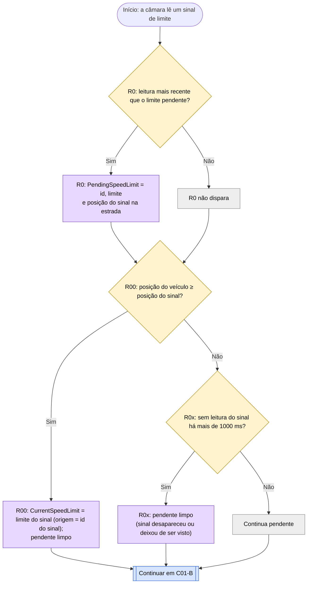
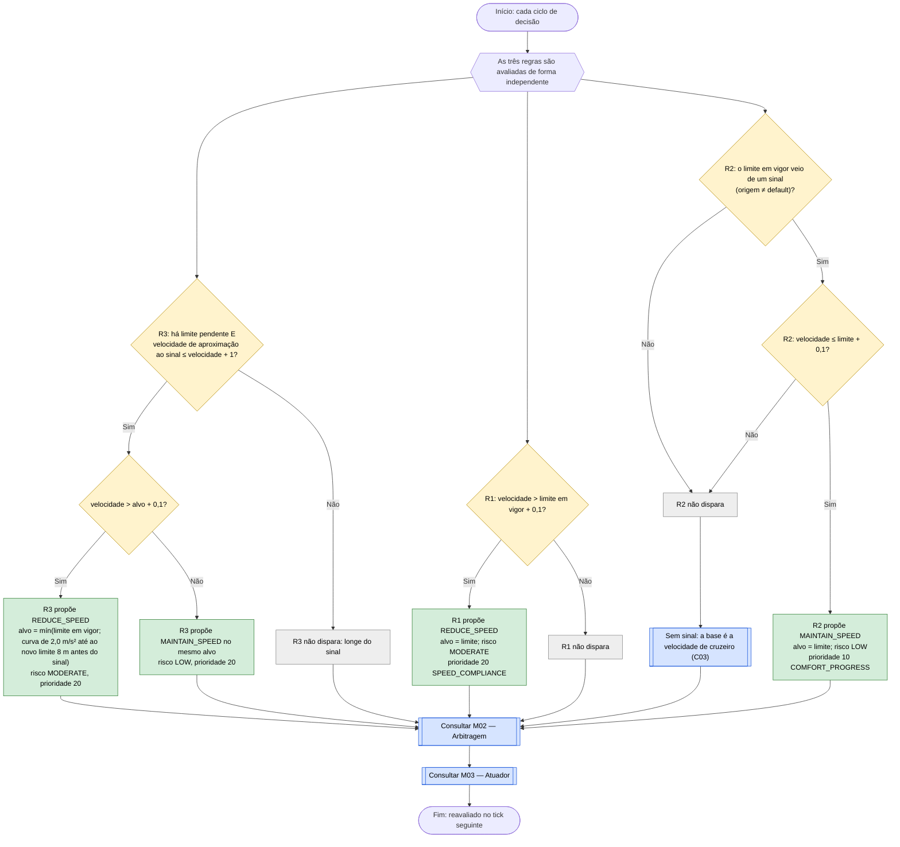

# C01 — Limite de velocidade por sinal

- **Branch / commit:** working tree a 21/10/2026
- **Estado da informação:** confirmado pelo código e por testes.

O sinal de limite vale para **todas as faixas** da estrada. A câmara lê-o até 120 m à frente (menos com visibilidade reduzida), mas o limite só entra em vigor **quando o veículo chega ao sinal**. Até lá fica **pendente**; se for mais baixo do que o atual, o veículo abranda a tempo de chegar ao sinal já no limite novo.

## Fluxograma C01-A — Limite pendente e entrada em vigor

R0 = `Track the speed limit sign ahead as pending`; R00 = `Activate the pending speed limit at its sign`; R0x = `Drop a pending speed limit the camera no longer sees` (todas em `01-state-updates.drl`, ver M04).

## Fluxograma C01-B — Decisão de velocidade

R1 = `Reduce speed when exceeding detected limit`; R2 = `Maintain speed when compliant with detected limit`; R3 = `Slow down in time for the speed limit ahead`.

## Tabela de decisões

| Nó | Regra de origem | Condição real | Caminho verdadeiro | Caminho falso | Resultado |
|---|---|---|---|---|---|
| C01_D1 | R0 | `$e.getTimestamp() > $pending.getTimestamp()` | C01_A1 | C01_X1 | Guarda a posição do sinal: `posição do veículo + distância` |
| C01_D2 | R00 | `VehicleStateFact(positionMeters >= $signPosition)` | C01_A2 | C01_D3 | O limite muda no sinal, não quando é visto |
| C01_D3 | R0x | `$now - $timestamp > 1000` | C01_A3 | C01_W | Um sinal que deixa de ser visto (por exemplo com chuva) não fica à espera |
| C01B_D0 | R3 | `StoppingPolicy.approachSpeedKmh($next, $signPosition - $position) <= $speed + 1.0` | C01B_D0b | C01B_X0 | Longe do sinal a curva está acima de qualquer velocidade |
| C01B_D0b | R3 | `$speed > approach + 0.1` | C01B_P3 | C01B_P3b | — |
| C01B_D1 | R1 | `$speed > $limit + 0.1` | C01B_P1 | C01B_X1 | `REDUCE_SPEED` até ao limite |
| C01B_D2 | R2 | `sourceId != CurrentSpeedLimit.DEFAULT_SOURCE` | C01B_D3 | C01B_X2 | O limite inicial de 120 não é um alvo |
| C01B_D3 | R2 | `$speed <= $limit + 0.1` | C01B_P2 | C01B_X2 | `MAINTAIN_SPEED` com alvo no limite |

R1 e R2 são complementares quando já foi visto um sinal: dispara exatamente uma das duas. A curva de R3 é `√(limite² + 2 × 2,0 m/s² × (distância − 8 m))` (`StoppingPolicy.approachSpeedKmh`, `StoppingPolicy.java:159-163`; a margem de 8 m é `SPEED_LIMIT_APPROACH_BUFFER_METERS` e os 2,0 m/s² são `ANTICIPATION_DECELERATION_MPS2`).

## Ficha técnica

**Identificação**

| Campo | Valor |
|---|---|
| ID | C01 |
| Nome | Limite de velocidade por sinal |
| Objetivo | Manter o veículo dentro do limite legal em vigor, abrandar a tempo para um limite mais baixo à frente e levá-lo até ao limite quando circula abaixo |
| Condição de ativação | Existe sempre um `CurrentSpeedLimit` (inicial: 120 km/h, origem `default`) |
| Dados de entrada | `SpeedLimitDetectedEvent` (limite, distância, id), `PendingSpeedLimit`, `CurrentSpeedLimit` (limite, origem), `VehicleStateFact` (velocidade, posição) |

**Lógica**

| Regra | Ficheiro:linha | Salience | Ação | Prioridade | Factos alterados |
|---|---|---|---|---|---|
| R0 `Track the speed limit sign ahead as pending` | `01-state-updates.drl:15` | 1000 | — | — | `PendingSpeedLimit` |
| R00 `Activate the pending speed limit at its sign` | `01-state-updates.drl:34` | 1010 | — | — | `CurrentSpeedLimit`, `PendingSpeedLimit` |
| R0x `Drop a pending speed limit the camera no longer sees` | `01-state-updates.drl:54` | 900 | — | — | `PendingSpeedLimit` |
| R3 `Slow down in time for the speed limit ahead` | `speed.drl:49` | 310 | `REDUCE_SPEED` ou `MAINTAIN_SPEED` | 20 | — |
| R1 `Reduce speed when exceeding detected limit` | `speed.drl:22` | 300 | `REDUCE_SPEED` | 20 | — |
| R2 `Maintain speed when compliant with detected limit` | `speed.drl:81` | 210 | `MAINTAIN_SPEED` | 10 | — |

Reavaliação: em cada tick. A margem de 0,1 km/h está justificada no comentário de `speed.drl:16-21` (fica dentro da banda morta de ±0,5 km/h do atuador, M03).

**Rastreabilidade**

| Elemento | Local |
|---|---|
| Sensor | `CameraSensor.observe()` (alcance 120 m × fator de visibilidade, até 1; leitura a cada 200 ms) |
| Factos | `CurrentSpeedLimit`, `PendingSpeedLimit` — `drools/facts/` |
| Valores iniciais | `KnowledgeSession.java:107-108` |
| Cenários | `S2` (90 to 50 speed limit), `S11` (sinal de 70 aos 1,5 s, 140 m à frente), `S12_PRESENTATION_DEMO` (sinal de 50 aos 2 s, 170 m à frente) |
| Prolog | `driving_state.pl` (`limit_state/3`, `pending_limit/4`: `activate_pending_limit/1`, `expire_pending_limit/1`, validade `pending_limit_validity_ms(1000)`), carregados como `speed_limit/1`, `signed_speed_limit/1` e `pending_speed_limit/2`; R1, R2 e R3 com os mesmos nomes em `driving_rules.pl` (curva em `approach_speed/3`) |
| Testes unitários | `DrivingExpertSystemRulesTest`: `speedLimitTriggersReduceSpeed` (73), `lowerLimitFarAheadDoesNotSlowTheVehicleYet` (97), `sessionSeedLimitAloneIsNotATargetToSpeedUpTo` (112), `signAboveCurrentSpeedBecomesTheTargetToBuildUpTo` (124); `PrologRulesTest`: `limitPersistsAfterTheSignIsNoLongerSeen` (101), `speedLimitAheadIsPendingUntilTheVehicleReachesTheSign` (676), `vehicleSlowsDownInTimeForALowerLimitAhead` (688), `pendingLimitIsDroppedOneSecondAfterTheCameraLastSawIt` (709); `PrologDroolsEquivalenceTest` (mesmas entradas nos dois motores) |
| Testes de integração | `SimulationEngineE2ETest`: `speedLimitsTakeEffectAtTheirSignsInSequence` (104), `singleSpeedLimitSignGovernsEveryLaneAndSurvivesALaneChange` (177), `signAheadWithHigherLimitBuildsTheVehicleUpToThatLimit` (222); `RoadLawAndOvertakingE2ETest.bug1RegressionSpeedLimit50NeverExceedsOrStabilizesAt51` (492) |

**Relações**

- Fornece o limite a C03, C04, C05, C07 e C11 (velocidade desejada para ultrapassar).
- Conflitos: R1 e R3 são tetos de velocidade (20); R2 é conforto (10). Os tetos de 40 e 50 (perigos, veículo à frente, tempo C18) aplicam-se em conjunto e fica o mais baixo (M02), por isso nenhum deles faz subir acima do limite legal.

**Limitações**

- R1 aplica-se também ao limite inicial de 120 km/h; R2 não.
- O limite em vigor nunca expira: só muda com outro sinal ou com `reset`.
- A câmara reporta apenas o sinal mais próximo.
- Com visibilidade reduzida a câmara vê o sinal mais tarde; R3 começa então mais perto do sinal e a travagem é mais forte (deduzido do código, sem teste).

## Exemplos de entradas

Valores calculados com a curva de R3.

| Entrada | Caminho | Resultado |
|---|---|---|
| 90 km/h, sinal de 50 a 20 m (teste `speedLimitTriggersReduceSpeed`) | R3 (R1 não: o limite em vigor ainda é 120) | `REDUCE_SPEED` ~56 km/h por R3; no sinal o limite passa a 50 e decide R1 (`REDUCE_SPEED` 50) |
| 60 km/h, sinal de 30 a 110 m (teste `lowerLimitFarAheadDoesNotSlowTheVehicleYet`) | C01B_D0 Não (curva ~79 km/h) | Sem redução ainda; decide `Default maintain speed baseline` (60) |
| 90 km/h, sinal de 50 | R3 começa a ~120 m; a 50 m o alvo é ~68 km/h, a 20 m ~56 km/h | Chega ao sinal a 50 km/h |
| 60 km/h, sem sinal visto, sinal de 90 a 80 m | Pendente; no sinal o limite passa a 90; C01B_D3 Sim | `MAINTAIN_SPEED` 90 (teste `signAboveCurrentSpeedBecomesTheTargetToBuildUpTo`) |
| 125 km/h, nenhum sinal visto | C01B_D1 Sim, C01B_D2 Não | `REDUCE_SPEED` 120 |
| 60 km/h, nenhum sinal visto | C01B_D1 Não, C01B_D2 Não | Sem proposta de C01; decide C03 |
| Sinal visto e depois tapado (sai do alcance antes de o veículo lá chegar) | C01_D3 Sim ao fim de 1 s | O pendente é esquecido; o limite em vigor não muda |
