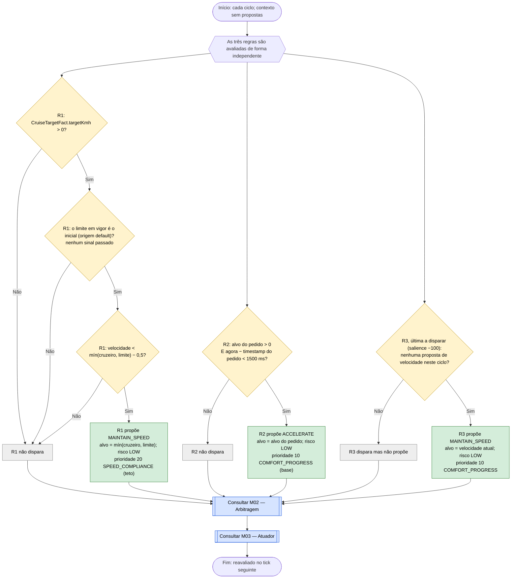

# C03 — Velocidade de base, cruzeiro e pedido de aceleração

- **Branch / commit:** `teste_ana` @ `70082b4` + alterações de 18/10 por commitar (working tree)
- **Estado da informação:** confirmado pelo código; cruzeiro e base confirmados por testes; pedido de aceleração isolado sem teste.

## Fluxograma

R1 = `Build back up to the scenario cruise speed when no sign governs the road`; R2 = `Allow acceleration request when safe context`; R3 = `Default maintain speed baseline`.

## Tabela de decisões

| Nó | Regra | Condição real | Caminho verdadeiro | Caminho falso | Resultado |
|---|---|---|---|---|---|
| C03_D1 | R1 | `CruiseTargetFact( targetKmh > 0 )` | C03_D2 | C03_X1 | Cenário sem velocidade inicial não tem cruzeiro |
| C03_D2 | R1 | `CurrentSpeedLimit( sourceId == CurrentSpeedLimit.DEFAULT_SOURCE )` | C03_D3 | C03_X1 | Depois de passar um sinal, quem manda é C01 |
| C03_D3 | R1 | `$speed < Math.min($target, $limit) - 0.5` | C03_P1 | C03_X1 | Retoma a velocidade de cruzeiro |
| C03_D4 | R2 | `$target > 0 && ($now - $ts) < 1500` | C03_P2 | C03_X2 | Pedido válido durante 1,5 s |
| C03_D5 | R3 | `$ctx.getPriority() == 0` (no lado direito) | C03_P3 | C03_X3 | Só propõe se ninguém propôs uma velocidade |

R1 e R2 não têm guarda sobre a prioridade: é a arbitragem (M02) que decide. R1 é um **teto** (20): qualquer teto mais baixo do ciclo (perigo, veículo à frente, tempo) ganha-lhe, e uma paragem obrigatória ou emergência sobrepõe-se. Quando é o único teto e não há base, é ele que decide, e o carro acelera até à velocidade de cruzeiro.

## Ficha técnica

**Identificação**

| Campo | Valor |
|---|---|
| ID | C03 |
| Nome | Velocidade de base, cruzeiro e pedido de aceleração |
| Objetivo | Dar sempre uma decisão quando nada mais se aplica, recuperar a velocidade de cruzeiro e aceitar um pedido de aceleração |
| Condição de ativação | Todos os ciclos |
| Dados de entrada | `VehicleStateFact.speedKmh` e `timestamp`, `CruiseTargetFact.targetKmh`, `CurrentSpeedLimit`, `AccelerationRequestState` |

**Lógica**

| Regra | Ficheiro:linha | Salience | Ação | Prioridade |
|---|---|---|---|---|
| R1 `Build back up to the scenario cruise speed when no sign governs the road` | `speed.drl:110` | 208 | `MAINTAIN_SPEED` | 20 |
| R2 `Allow acceleration request when safe context` | `speed.drl:134` | 205 | `ACCELERATE` | 10 |
| R3 `Default maintain speed baseline` | `defaults.drl:25` | −100 | `MAINTAIN_SPEED` | 10 |
| `Update acceleration request` (estado) | `01-state-updates.drl:348` | 1000 | — | — |

**Rastreabilidade**

| Elemento | Local |
|---|---|
| Velocidade de cruzeiro | `CruiseTargetFact`, inserido pelo backend com a velocidade inicial do cenário (`DroolsBackend.java:59`) |
| Pedido de aceleração | `SimulationEngine.requestAcceleration()` (885); ação temporizada `REQUEST_ACCELERATION` (664); botão "Request Accel 90" da interface JavaFX antiga (`ui/DrivingExpertSystemApp.java:195`). Não existe endpoint REST |
| Testes | `DrivingExpertSystemRulesTest`: `sessionSeedLimitAloneIsNotATargetToSpeedUpTo` (112), `conflictAccelerationAndCriticalTtcEmergencyWins` (446); `SimulationEngineE2ETest.vehicleBuildsBackUpToScenarioCruiseSpeedAfterBrakingWithNoSign` (965) |

**Relações**

- R1 depende de C01: deixa de disparar assim que o veículo passa um sinal.
- R1 também serve as regras de ultrapassagem (C11): a velocidade desejada é o cruzeiro quando não há sinal.
- Conflitos: R1 é um teto (20) e fica o mais baixo dos tetos. R2 e R3 são base (10): só decidem quando não há teto mais baixo.

**Limitações**

- O alvo de R2 não é limitado pelo limite legal na própria regra. A correção só chega quando a velocidade excede o limite e C01 propõe `REDUCE_SPEED` (teto de 20).
- Nenhum cenário em `scenarios.json` usa `REQUEST_ACCELERATION` e não há endpoint REST: na interface Angular o pedido de aceleração não é acessível.
- Não há teste em que R2 seja a decisão final.

## Exemplos de entradas

| Entrada | Caminho | Resultado |
|---|---|---|
| 60 km/h, cruzeiro 60, sem sinal, sem pedido | R1 Não, R2 Não, R3 Sim | `MAINTAIN_SPEED` 60 por R3 |
| 26 km/h, cruzeiro 50, sem sinal | C03_D3 Sim | `MAINTAIN_SPEED` 50 por R1 (teto sem base); R3 não propõe |
| 26 km/h, cruzeiro 50, sinal de 30 já passado | C03_D2 Não | R1 não dispara; decide C01 |
| 80 km/h, cruzeiro 80, pedido de 120 há 500 ms, sem sinal | R2 Sim, R1 Não | `ACCELERATE` 120 (base sem teto mais baixo) |
| Mesmo caso com três amostras de TTC inferiores a 2,5 s | R2 propõe 10; C10 propõe 70 | `EMERGENCY_BRAKE` (teste `conflictAccelerationAndCriticalTtcEmergencyWins`) |
| Pedido de 120 feito há 2 s | C03_D4 Não | R2 não dispara |
