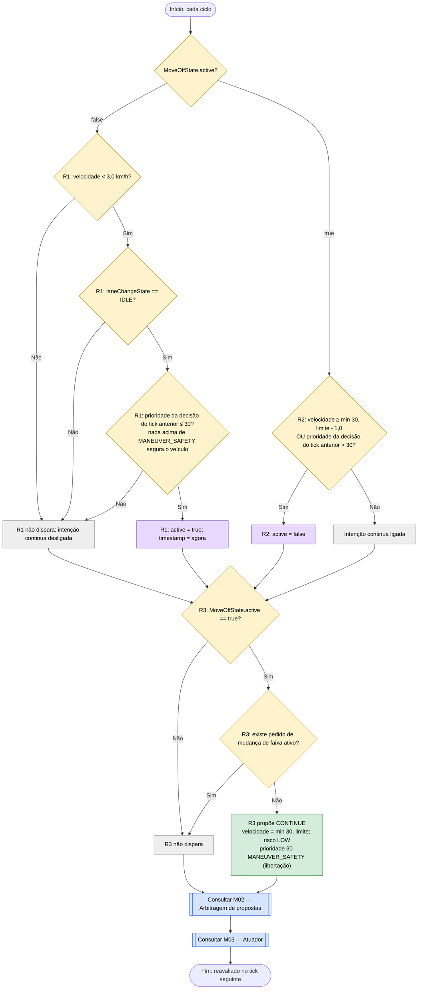

# C04 — Arranque após paragem

- **Branch / commit:** working tree a 21/10/2026
- **Estado da informação:** confirmado pelo código e por testes de integração.

O arranque usa um facto de intenção, `MoveOffState`, que é ligado e desligado por duas regras sem proposta e lido por uma terceira que propõe.

## Fluxograma

R1 = `Start moving off after a standstill`; R2 = `Stop moving off once held or at speed`; R3 = `Move off when stopped and nothing holds the vehicle`.

R1 e R2 têm `salience 60` e R3 tem `salience −90`, por isso R3 lê o estado já atualizado neste ciclo.

## Tabela de decisões

| Nó | Regra | Condição real | Caminho verdadeiro | Caminho falso | Resultado |
|---|---|---|---|---|---|
| C04_D0 | R1 / R2 | `MoveOffState(active == false)` / `MoveOffState(active == true)` | ramo R2 | ramo R1 | Só uma das duas pode disparar |
| C04_D1 | R1 | `VehicleStateFact(speedKmh < 3.0)` | C04_D2 | C04_X1 | Só arranca de uma paragem |
| C04_D2 | R1 | `laneChangeState == LaneChangeState.IDLE` | C04_D3 | C04_X1 | Não liga a meio de uma manobra |
| C04_D3 | R1 | `DrivingDecision(priority <= DecisionPriority.MANEUVER_SAFETY)` | C04_A1 | C04_X1 | Perigo ou paragem obrigatória mantêm o veículo parado |
| C04_D4 | R2 | `$speed >= Math.min(30.0, $limit) - 1.0 \|\| $priority > DecisionPriority.MANEUVER_SAFETY` | C04_A2 | C04_K | Termina ao atingir o alvo ou quando algo o segura |
| C04_D5 | R3 | `MoveOffState(active == true)` | C04_D6 | C04_X3 | — |
| C04_D6 | R3 | `not LaneChangeRequestState(active == true)` (aqui invertida) | C04_X3 | C04_P | Cede a um pedido externo de mudança de faixa |

Um contorno de veículo parado (C11) não precisa de guarda: a mudança de faixa é arbitrada no canal lateral e o arranque acontece ao mesmo tempo (comentário em `defaults.drl:84-88`).

## Ficha técnica

**Identificação**

| Campo | Valor |
|---|---|
| ID | C04 |
| Nome | Arranque após paragem |
| Objetivo | Pôr em andamento, até 30 km/h ou ao limite se for inferior, um veículo parado que já nada segura |
| Condição de ativação | Velocidade inferior a 3 km/h sem manobra em curso e sem decisão anterior acima da prioridade 30 |
| Dados de entrada | `MoveOffState.active`, `VehicleStateFact` (velocidade, `laneChangeState`, `timestamp`), `CurrentSpeedLimit.limitKmh`, `DrivingDecision.priority` (tick anterior), `LaneChangeRequestState.active` |

**Lógica**

| Regra | Ficheiro:linha | Salience | Ação | Prioridade | Factos alterados |
|---|---|---|---|---|---|
| R1 `Start moving off after a standstill` | `defaults.drl:60` | 60 | — | — | `MoveOffState.active = true` |
| R2 `Stop moving off once held or at speed` | `defaults.drl:71` | 60 | — | — | `MoveOffState.active = false` |
| R3 `Move off when stopped and nothing holds the vehicle` | `defaults.drl:89` | −90 | `CONTINUE` | 30 | — |

A decisão lida por R1 e R2 é a do tick anterior (ver M01).

**Rastreabilidade**

| Elemento | Local |
|---|---|
| Facto | `drools/facts/MoveOffState.java`; valor inicial em `KnowledgeSession.java:130` |
| Justificação de desenho | Comentários em `defaults.drl:46-59` e `84-88` |
| Testes | `RoadLawAndOvertakingE2ETest.movingOffAndContinuousEgoMovementIncreasesWorldPosition` (39); `LaneChangeManeuverE2ETest.driverRequestedLaneChangeWhileMovingOff` (264); `RoadMapE2ETest.wallOfObstaclesStopsTheCarUntilALaneOpens` (76); `SimulationEngineE2ETest.stopSignFlowBringsVehicleToFullStopThenProceeds` (316), `redTrafficLightStopsAndHoldsThenGreenResumesAndResetClearsFact` (804); `RoadLawAndOvertakingE2ETest.pedestrianCrossingBrakesThenResumesAfterCrossingClears` (196); `PrologSimulationE2ETest.stopSignFlowBringsVehicleToFullStopThenProceeds` (139); `PrologRulesTest.moveOffIntentSurvivesBetweenCyclesUntilAtSpeed` (903); `PrologDroolsEquivalenceTest`, sequências "move off from a standstill until close to the target", "a vehicle that only slowed down is not sped up", "held for a pedestrian, moves off once nothing holds it", "move off under a 20 km/h limit" e "a pending driver request holds back moving off" |
| Prolog | As três regras com os mesmos nomes em `driving_rules.pl`; a intenção persiste entre ciclos no estado `move_off/2` de `driving_state.pl` (conclusões `move_off_started/1` e `move_off_ended`, gravadas por `store_conclusions/0`) |

**Relações**

- É a saída de C05, C06, C07, C08 e C13 depois de o veículo parar.
- C17 não dispara enquanto `MoveOffState.active == true` (`road-law.drl:43`).
- Na arbitragem (M02) R3 é uma **libertação** (30): é a base do canal de velocidade, limitada por qualquer teto (20, 40, 50) mais baixo. Entre libertações fica a de velocidade mais baixa: contra `Proceed after stop sign condition satisfied` (`CONTINUE` 25 km/h) ganha esta; contra `Green traffic light releases red-light hold` (`RESUME` 30 km/h) a mesma velocidade, ganha a que foi proposta primeiro (a do semáforo, de salience mais alta). As mudanças de faixa estão noutro canal e não competem com R3.

**Limitações**

- R3 cede a um pedido de mudança de faixa do condutor (C04_D6), para o pedido ser atendido primeiro.
- O alvo de 30 km/h está fixo na regra; acima dele a aceleração depende de C01 ou C03.
- Não há teste de regras em `DrivingExpertSystemRulesTest` para C04; do lado Drools a cobertura é de integração e da equivalência com Prolog.

## Exemplos de entradas

| Entrada | Caminho | Resultado |
|---|---|---|
| Parado (0 km/h), IDLE, decisão anterior `MAINTAIN_SPEED` prioridade 10, limite 120 | R1 liga; R3 propõe | `CONTINUE` 30 |
| Parado, decisão anterior `STOP` prioridade 60 (vermelho) | C04_D3 Não | Sem proposta; o veículo continua parado |
| Intenção ligada, 29,2 km/h, limite 120 | C04_D4 Sim (≥ 29) | Intenção desligada; R3 não dispara |
| Intenção ligada, 12 km/h, limite 20 | alvo = 20 | `CONTINUE` 20 |
| Intenção ligada, 10 km/h, pedido de mudança de faixa ativo | C04_D6 Sim | R3 não dispara; decide C15 |
| Intenção ligada, 10 km/h, decisão anterior com prioridade 40 | C04_D4 Sim | Intenção desligada |
