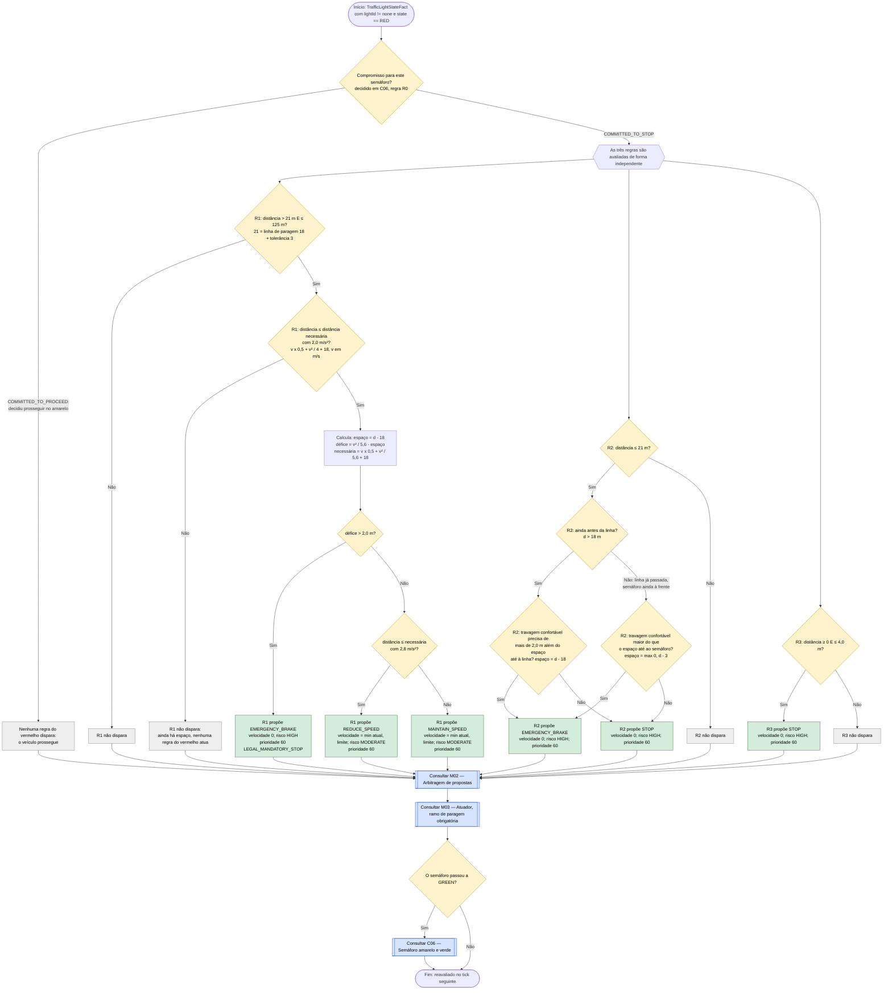

# C05 — Semáforo vermelho

- **Branch / commit:** `teste_ana` @ `70082b4` + alterações de 18/10 por commitar (working tree)
- **Estado da informação:** confirmado pelo código, por testes e em execução.

## Fluxograma

R1 = `Red traffic light progressive approach`; R2 = `Hold at red traffic light`; R3 = `Red traffic light requires full stop and hold`.

## Situações a resolver

Os nós a **vermelho** nos fluxogramas acima assinalam passos onde há um problema por resolver.

| Nó | Problema | Confirmação | Como reproduzir |
|---|---|---|---|
| C05_P3 | ~~`MAINTAIN_SPEED` com prioridade 60 ganha à travagem por veículo à frente (50).~~ **Resolvido** (commit `3814b81`): a arbitragem limita a velocidade de uma proposta ≥ 60 ao teto mais baixo do ciclo (`CAPPED`, M02), e o atuador abranda até ela (M03). Para o peão já estava resolvido: as regras de C08 propõem com prioridade 60 e ganham por terem velocidade mais baixa. | Peão: confirmado por teste e em execução. Veículo à frente: confirmado por teste (`DecisionContextTest.mandatoryStopIsCappedByALowerCeiling`) | Peão: caso A17 e `PedestrianConflictE2ETest` |

Resolvido: o `EMERGENCY_BRAKE` isolado na aproximação normal (antigo C05_P1, caso A03) e a paragem em cima do semáforo (`relatorio-validacao.md`, secção 13); o carro que passava o semáforo e ficava parado para sempre depois dele (antigo C05_P4, caso A20: secção 14).

Os casos (A01 a A22, B01 a B08) estão descritos em `relatorio-validacao.md`, secção 8.

## Tabela de decisões

| Nó | Regra | Condição real | Caminho verdadeiro | Caminho falso | Resultado |
|---|---|---|---|---|---|
| C05_D0 | R1, R2, R3 | `commitment == TrafficLightCommitment.COMMITTED_TO_STOP` | C05_F | C05_X0 | Um vermelho ainda à frente compromete sempre a parar, onde quer que o veículo esteja. Só o compromisso de prosseguir tomado no amarelo o impede. Ver C06 |
| C05_D1 | R1 | `distanceMeters <= 125.0` e `$distance > StoppingPolicy.RED_LIGHT_STOP_LINE_OFFSET_METERS + StoppingPolicy.STOP_LINE_TOLERANCE_METERS` | C05_D2 | C05_X1 | Zona de aproximação |
| C05_D2 | R1 | `$distance <= StoppingPolicy.requiredDistanceMeters($speed, StoppingPolicy.ANTICIPATION_DECELERATION_MPS2, StoppingPolicy.RED_LIGHT_STOP_LINE_OFFSET_METERS)` | C05_C | C05_X1b | Só atua dentro da distância necessária com 2,0 m/s² |
| C05_D3 | R1 | `shortfall > 2.0`, com `shortfall = StoppingPolicy.brakingDistanceMeters($speed, COMFORT_DECELERATION_MPS2) - room` | C05_P1 | C05_D4 | Travagem confortável já não chega |
| C05_D4 | R1 | `$distance <= StoppingPolicy.requiredDistanceMeters($speed, StoppingPolicy.COMFORT_DECELERATION_MPS2, StoppingPolicy.RED_LIGHT_STOP_LINE_OFFSET_METERS)` | C05_P2 | C05_P3 | Trava ou segura a velocidade |
| C05_D5 | R2 | `$distance <= StoppingPolicy.RED_LIGHT_STOP_LINE_OFFSET_METERS + StoppingPolicy.STOP_LINE_TOLERANCE_METERS` | C05_D9 | C05_X2 | Na linha, ou depois dela com o semáforo ainda à frente |
| C05_D9 | R2 | `distanceToStopLine > 0.0`, com `distanceToStopLine = $distance - StoppingPolicy.RED_LIGHT_STOP_LINE_OFFSET_METERS` | C05_D8 | C05_D10 | Antes ou depois da linha de paragem |
| C05_D8 | R2 | `comfortableStop - distanceToStopLine > 2.0`, com `comfortableStop = StoppingPolicy.brakingDistanceMeters($speed, StoppingPolicy.COMFORT_DECELERATION_MPS2)` | C05_P6 | C05_P4 | Antes da linha: o mesmo critério da aproximação |
| C05_D10 | R2 | `comfortableStop > Math.max(0.0, $distance - StoppingPolicy.STOP_LINE_TOLERANCE_METERS)` | C05_P6 | C05_P4 | Depois da linha: emergência só se a paragem confortável já não cabe antes do semáforo |
| C05_D6 | R3 | `distanceMeters >= 0, distanceMeters <= 4.0` | C05_P5 | C05_X3 | Paragem |
| C05_D7 | — | `TrafficLightStateFact.state` | C06 | fim | Saída do cenário |

## Ficha técnica

**Identificação**

| Campo | Valor |
|---|---|
| ID | C05 |
| Nome | Semáforo vermelho |
| Objetivo | Estar parado antes da linha de paragem, com travagem progressiva, e manter o veículo parado enquanto estiver vermelho |
| Condição de ativação | `TrafficLightStateFact(lightId != "none", state == RED)`. O semáforo vale para **todas as faixas**: a câmara reporta o mais próximo à frente, em qualquer faixa (`WorldState.nearestTrafficLight`) |
| Dados de entrada | Distância ao semáforo, `VehicleStateFact.speedKmh`, `CurrentSpeedLimit.limitKmh` |

**Lógica**

| Regra | Ficheiro:linha | Salience | Ação | Prioridade |
|---|---|---|---|---|
| R1 `Red traffic light progressive approach` | `traffic-lights.drl:66` | 620 | `EMERGENCY_BRAKE`, `REDUCE_SPEED` ou `MAINTAIN_SPEED` | 60 |
| R2 `Hold at red traffic light` | `traffic-lights.drl:109` | 640 | `STOP` | 60 |
| R3 `Red traffic light requires full stop and hold` | `traffic-lights.drl:138` | 635 | `STOP` | 60 |
| `Update traffic light state` (estado) | `01-state-updates.drl:82` | 1000 | — | — |

Como a prioridade é 60, o atuador usa o ramo de paragem obrigatória (M03): `REDUCE_SPEED` trava a 2,8 m/s², `MAINTAIN_SPEED` não trava, `EMERGENCY_BRAKE` trava a 8,5 m/s² e `STOP` imobiliza abaixo de 0,6 km/h.

**Distância de paragem** (`decision/StoppingPolicy.java`). As regras decidem com a distância de que o veículo precisa a partir da velocidade atual:

`necessária = v × tempo de reação + v² / (2 × desaceleração) + afastamento da linha de paragem`

| Constante | Valor | Significado |
|---|---|---|
| `COMFORT_DECELERATION_MPS2` | 2,8 | Travagem confortável, lida de `SimulationConfig` |
| `ANTICIPATION_DECELERATION_MPS2` | 2,0 | A partir daqui o veículo deixa de ganhar velocidade |
| `REACTION_TIME_SECONDS` | 0,5 | Uma leitura da câmara (200 ms) mais os ciclos até o atuador responder |
| `RED_LIGHT_STOP_LINE_OFFSET_METERS` | 18 | Onde o veículo fica parado, medido do semáforo ao ponto de referência do veículo. Não existe linha de paragem no mundo; é esta |
| `STOP_LINE_TOLERANCE_METERS` | 3 | Até onde, antes da linha, um veículo parado conta como estando nela |

Um `STOP` não é instantâneo e a distância que as regras conhecem tem uma leitura de atraso. Por isso a travagem começa com o tempo de reação incluído, e R2 mantém o veículo parado em toda a faixa entre a linha e 3 m antes dela.

**Rastreabilidade**

| Elemento | Local |
|---|---|
| Sensor | `CameraSensor.observe()`: semáforo mais próximo à frente, a até 120 m × visibilidade |
| Facto | `drools/facts/TrafficLightStateFact.java`; valor inicial em `KnowledgeSession.java:123` |
| Cenário de demonstração | `S3` (Red traffic light) — `scenarios.json:121` |
| Testes | `DrivingExpertSystemRulesTest.redLightTriggersStop` (143); `SimulationEngineE2ETest.redTrafficLightStopsAndHoldsThenGreenResumesAndResetClearsFact` (803); `RedTrafficLightStopE2ETest`: `at70KmhBrakesEarlyAndRestsBeforeTheStopLine` (86), `neverPassesTheStopLineAtAnySpeed` (146), `staysAtRestWhileTheLightIsRed` (168), `drivesOnWhenTheLightTurnsGreen` (197); `PedestrianConflictE2ETest.afterThePedestrianHasCrossedTheRedLightIsStillRespected` (248) |

**Relações**

- Lê o limite de C01. Sai para C06 quando o semáforo muda, e C04 retoma o andamento.
- Conflitos (M02): com prioridade 60 sobrepõe-se a todos os tetos de velocidade (≤ 50), incluindo o veículo à frente; só as emergências de C08, C10 e C13 (70) lhe ganham. Empata a 60 com C07, com a paragem de C14 e com as regras de peão de C08; ganha a velocidade mais baixa. Uma mudança de faixa com prioridade inferior a 60 é vetada enquanto esta decisão estiver ativa.
- Sobreposição interna: entre 0 e 4,0 m R2 e R3 propõem o mesmo `STOP`; fica a de R2, que dispara primeiro. Não altera o resultado.

**Limitações**

- Fora da distância necessária com 2,0 m/s² (C05_X1b), nenhuma regra do vermelho atua e o veículo segue as outras regras.
- A 90 km/h a distância necessária com travagem confortável (cerca de 142 m) é maior do que o alcance da câmara (120 m): o veículo usa `EMERGENCY_BRAKE` por momentos para ficar antes da linha.
- Um vermelho visto pela primeira vez já muito perto (por exemplo a 15 m com o veículo a 60 km/h) leva a `EMERGENCY_BRAKE`, mas nem a travagem de emergência chega para parar antes do semáforo: o veículo perde a velocidade que conseguir e, depois de o semáforo ficar para trás, deixa de o considerar.
- O semáforo é dado por ultrapassado 400 ms depois da última leitura da câmara (duas leituras em falta); até lá as regras ainda o tratam como estando à frente.
- O teste `redLightTriggersStop` aceita `STOP` ou `EMERGENCY_BRAKE`; não distingue os ramos de R1.

## Exemplos de entradas

Velocidade 60 km/h (16,67 m/s), limite 120. Distância necessária: 95,8 m com 2,0 m/s²; 75,9 m com 2,8 m/s².

| Distância | Cálculo | Caminho | Resultado |
|---|---|---|---|
| 100 m | acima de 95,8 m | C05_D2 Não | Nenhuma regra do vermelho |
| 90 m | espaço 72; défice −22,4; acima de 75,9 m | C05_D3 Não, C05_D4 Não | `MAINTAIN_SPEED` 60, prioridade 60 |
| 70 m | espaço 52; défice −2,4; abaixo de 75,9 m | C05_D4 Sim | `REDUCE_SPEED` 60 |
| 60 m | espaço 42; défice 7,6 | C05_D3 Sim | `EMERGENCY_BRAKE` |
| 18 m, 60 km/h | na linha; espaço até ao semáforo 15 m; travagem confortável 49,6 m | C05_D9 Não, C05_D10 Sim | `EMERGENCY_BRAKE` por R2 (teste `redLightTriggersStop`) |
| 15 m, 60 km/h | 3 m depois da linha; espaço até ao semáforo 12 m; travagem confortável 49,6 m | C05_D9 Não, C05_D10 Sim | `EMERGENCY_BRAKE` por R2 |
| 15 m, 25 km/h | 3 m depois da linha; espaço até ao semáforo 12 m; travagem confortável 8,6 m | C05_D9 Não, C05_D10 Não | `STOP` por R2, com travagem confortável |
| 20 m, 3 km/h | — | C05_D9 Sim, C05_D8 Não | `STOP` por R2 |
| 2 m, parado | — | C05_D5 e C05_D6 Sim | `STOP` (R2 e R3) |
