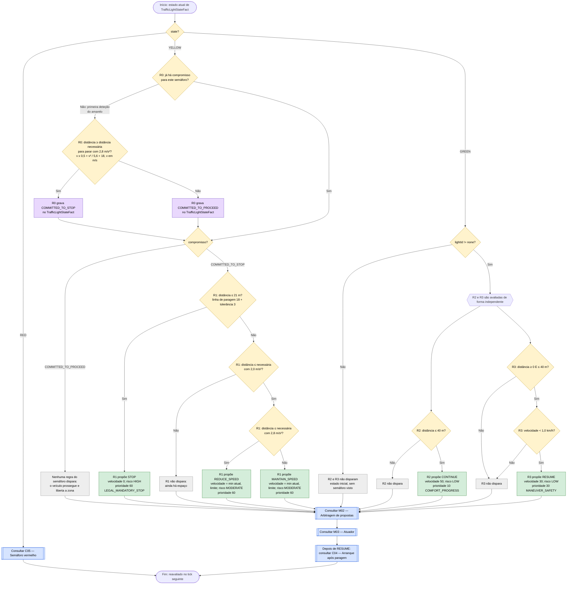
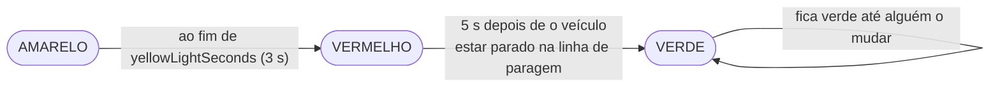

# C06 — Semáforo amarelo e verde

- **Branch / commit:** working tree a 21/10/2026
- **Estado da informação:** confirmado pelo código, por testes e em execução.

## Fluxograma

R0 = `Commit to stop or to proceed at traffic light`; R1 = `Yellow traffic light: stop before the line`; R2 = `Green traffic light allows progression when no higher hazard`; R3 = `Green traffic light releases red-light hold`.

No Prolog (`driving_rules.pl`) R0 tem uma regra por resultado, `(red)`, `(yellow, can stop)` e `(yellow, too close)`, que concluem `light_commitment/2`; o compromisso persiste em `light_track/5` (`driving_state.pl`). R1 tem as variantes `(stop)`, `(brake)` e `(hold speed)`; R2 e R3 têm o mesmo nome.

## Ciclo do semáforo

O ciclo pertence ao mundo simulado, não às regras (`domain/TrafficLight.java`, avançado em `WorldPhysicsEngine.updateWorld` através de `RoadMap.advanceTrafficLights`).

- As durações são parâmetros da simulação: `SimulationConfig.getYellowLightSeconds()` e `getRedHoldAfterStopMillis()` (por omissão `SimulationConfig.RED_HOLD_AFTER_STOP_MS` = 5000).
- O tempo de vermelho não conta a partir do momento em que o semáforo fica vermelho, mas a partir do momento em que o veículo está parado na linha de paragem: velocidade abaixo de 0,1 km/h, antes do semáforo e a 21 m ou menos dele (`WorldPhysicsEngine.updateWorld`). Enquanto o veículo se aproxima ou trava o tempo fica a zero; se voltar a mover-se, recomeça. `TrafficLight.getPhaseElapsedMillis()` dá o tempo já contado.
- Qualquer semáforo vermelho passa a verde 5 s depois de o veículo parar na linha, quer tenha vindo do amarelo quer tenha sido colocado diretamente em vermelho. Um semáforo verde fica verde até ser alterado.
- O elemento mantém o mesmo id durante o ciclo; só o estado e o código da célula do mapa mudam.

## Compromisso no amarelo

Segue o art. 69.º do Regulamento de Sinalização do Trânsito: no amarelo o condutor pára, salvo se já estiver tão perto que não consiga parar em condições de segurança. Como no simulador um semáforo pode nascer já amarelo, a primeira deteção do amarelo vale como o instante em que a luz se acendeu. A decisão é tomada uma vez, pelas regras, nessa primeira deteção (ou quando o semáforo é visto pela primeira vez em vermelho), a qualquer distância, e fica gravada em `TrafficLightStateFact.commitment` (`drools/facts/TrafficLightCommitment.java`).

| Situação quando é visto | Compromisso | Comportamento |
|---|---|---|
| Amarelo, a qualquer distância, com espaço para uma paragem confortável antes da linha | `COMMITTED_TO_STOP` | Aproxima-se de forma progressiva, como no vermelho, e pára antes da linha; continua parado quando passa a vermelho |
| Amarelo, já demasiado perto para parar com conforto, ou já depois da linha de paragem | `COMMITTED_TO_PROCEED` | Prossegue sem travar e liberta a zona, mesmo que o semáforo passe a vermelho antes de o ter ultrapassado |
| Vermelho, ainda à frente do veículo (antes ou depois da linha de paragem) | `COMMITTED_TO_STOP` | C05 |

O compromisso só é reposto quando o semáforo passa a verde, quando a câmara passa a ver outro semáforo, ou quando o semáforo deixa de ser visto. Por isso não oscila entre parar e passar com a variação da velocidade e da distância. O critério é conseguir ou não parar em segurança antes da linha, não conseguir passar antes de o amarelo acabar. O compromisso de prosseguir só impede este semáforo de mandar travar: peões, veículos à frente e emergências continuam a parar o veículo.

## Situações a resolver

Não há nós a vermelho neste cenário. Os dois problemas que estavam assinalados (o amarelo que travava até 0,5 km/h e ficava preso, e o `CONTINUE` 50 depois de passar o semáforo) foram corrigidos; ver `relatorio-validacao.md`, secção 14 (relatório que não está no repositório).

## Tabela de decisões

| Nó | Regra | Condição real | Caminho verdadeiro | Caminho falso | Resultado |
|---|---|---|---|---|---|
| C06_D0 | todas | `state == TrafficLightState.YELLOW` / `GREEN` / `RED` | ramo respetivo | — | Três alternativas |
| C06_D6 | R0 | `lightId != "none"`, `state != TrafficLightState.GREEN`, `commitment == TrafficLightCommitment.NONE` (aqui invertida) | C06_D8 | C06_D7 | Decide uma só vez |
| C06_D7 | R0 | `$distance >= StoppingPolicy.requiredDistanceMeters($speed, StoppingPolicy.COMFORT_DECELERATION_MPS2, StoppingPolicy.RED_LIGHT_STOP_LINE_OFFSET_METERS)` | C06_A1 | C06_A2 | Parar ou prosseguir |
| C06_D8 | R1 | `commitment == TrafficLightCommitment.COMMITTED_TO_STOP` | C06_D1 | C06_X5 | — |
| C06_D1 | R1 | `$distance <= StoppingPolicy.RED_LIGHT_STOP_LINE_OFFSET_METERS + StoppingPolicy.STOP_LINE_TOLERANCE_METERS` | C06_P1 | C06_D9 | Parado na linha |
| C06_D9 | R1 | `$distance <= StoppingPolicy.requiredDistanceMeters($speed, StoppingPolicy.ANTICIPATION_DECELERATION_MPS2, …)` | C06_D10 | C06_X1 | Zona de aproximação |
| C06_D10 | R1 | `$distance <= StoppingPolicy.requiredDistanceMeters($speed, StoppingPolicy.COMFORT_DECELERATION_MPS2, …)` | C06_P4 | C06_P5 | Trava ou segura a velocidade |
| C06_D2 | R2, R3 | `lightId != "none"` | C06_F | C06_X2 | — |
| C06_D3 | R2 | `distanceMeters <= 40.0` | C06_P2 | C06_X3 | `CONTINUE` a 50 km/h |
| C06_D4 | R3 | `distanceMeters >= 0, distanceMeters <= 40.0` | C06_D5 | C06_X4 | — |
| C06_D5 | R3 | `VehicleStateFact(speedKmh < 1.0)` | C06_P3 | C06_X4 | Só liberta um veículo parado |

No vermelho, R0 grava sempre o compromisso de parar: um vermelho ainda à frente nunca fica sem resposta.

R2 não tem guarda: é uma proposta de conforto (10) e a arbitragem (M02) dá-lhe sempre menos peso do que a qualquer teto de velocidade mais baixo, paragem ou libertação do ciclo (comentário em `traffic-lights.drl:193-194`).

## Ficha técnica

**Identificação**

| Campo | Valor |
|---|---|
| ID | C06 |
| Nome | Semáforo amarelo e verde |
| Objetivo | No amarelo, parar antes da linha se ainda for possível em segurança e prosseguir se já não for; no verde, permitir avançar e libertar a paragem |
| Condição de ativação | `TrafficLightStateFact` em `YELLOW`, ou em `GREEN` a 40 m ou menos. O semáforo vale para todas as faixas |
| Dados de entrada | Estado, distância e compromisso do semáforo, `VehicleStateFact.speedKmh`, `CurrentSpeedLimit.limitKmh` |

**Lógica**

| Regra | Ficheiro:linha | Salience | Ação | Prioridade |
|---|---|---|---|---|
| R0 `Commit to stop or to proceed at traffic light` | `traffic-lights.drl:37` | 700 | grava o compromisso no facto | — |
| R1 `Yellow traffic light: stop before the line` | `traffic-lights.drl:162` | 625 | `STOP`, `REDUCE_SPEED` ou `MAINTAIN_SPEED` | 60 |
| R2 `Green traffic light allows progression when no higher hazard` | `traffic-lights.drl:195` | 180 | `CONTINUE` | 10 |
| R3 `Green traffic light releases red-light hold` | `traffic-lights.drl:214` | 610 | `RESUME` | 30 |
| `Update traffic light state` (estado) | `01-state-updates.drl:82` | 1000 | repõe o compromisso com verde ou com outro semáforo | — |
| `Clear stale traffic light perception` (estado) | `01-state-updates.drl:546` | 900 | repõe o facto 400 ms depois da última leitura | — |

**Rastreabilidade**

| Elemento | Local |
|---|---|
| Sensor | `CameraSensor.observe()`: semáforo à frente, em qualquer faixa, a até 120 m × visibilidade: o mais próximo que manda parar (vermelho ou amarelo), ou o mais próximo se nenhum manda parar (`WorldState.nearestTrafficLight`). Assim um verde perto não esconde um vermelho logo a seguir, cuja linha de paragem pode até ficar antes do verde (teste `TwoTrafficLightsE2ETest`, dois vermelhos a 10 m) |
| Estados possíveis | `domain/TrafficLightState.java` (`RED`, `YELLOW`, `GREEN`) |
| Ciclo | `domain/TrafficLight.java`; durações em `config/SimulationConfig.java` |
| Distâncias | `decision/StoppingPolicy.java` (as mesmas do vermelho, ver C05) |
| Códigos do mapa | 6 vermelho, 7 verde (README, secção "Road map"). O amarelo só pode ser criado pela caixa de ferramentas (`frontend/src/app/scenario/element-properties/element-properties.component.html:75`) |
| Testes | `DrivingExpertSystemRulesTest`: `conflictGreenLightAndPedestrianPedestrianWins` (546), `yellowLightWithRoomToStopCommitsToStopAndDoesNotChangeItsMind` (990), `yellowLightTooCloseToStopCommitsToProceedAndDoesNotChangeItsMind` (1021), `yellowLightDetectedFarAwayCommitsToStopAtTheFirstDetection` (1052), `committedToProceedAtYellowStillStopsForAPedestrian` (1084); `PrologRulesTest`: `yellowFarAwayCommitsToStopAndTheCommitmentSurvivesTheRed` (137), `yellowTooCloseCommitsToProceedWithoutBraking` (154), `greenReleasesAStoppedVehicle` (168), `lightIsForgottenOnceNoLongerSeen` (179), `conflictGreenLightAndPedestrianPedestrianWins` (297); `PrologDroolsEquivalenceTest`, casos "yellow, ...", "green, ..." e "green light and pedestrian"; `PrologSimulationE2ETest.drivesOnWhenTheLightTurnsGreen` (112); `TrafficLightCycleE2ETest` e `RedLightHoldTimerE2ETest` (parametrizados nos dois motores): `yellowFarAheadStopsBeforeTheLine` (75), `staysStoppedThroughRedAndDrivesOnAtGreen` (106), `yellowTooCloseIsDrivenThroughWithoutBraking` (153), `keepsDrivingOnWhenTheYellowTurnsRedBeforeItHasPassed` (187), `yellowDetectedFarAwayCommitsToStopFromTheFirstDetectionAndNeverChanges` (222), `commitmentIsClearedOnceTheLightIsBehind` (274); `RedLightHoldTimerE2ETest`: `redTimeStartsWhenTheEgoIsAtRestBeforeTheLine` (95), `redTimeCountsFromTheStopHoweverLongTheApproachTakes` (145), `greenDoesNotMoveTheEgoWhileAPedestrianIsCrossing` (177); `SimulationEngineE2ETest`: `priorityConflictPedestrianOverridesGreenLight` (601), `redTrafficLightStopsAndHoldsThenGreenResumesAndResetClearsFact` (804) |

**Relações**

- O amarelo com compromisso de parar passa para C05 quando o semáforo fica vermelho; o veículo continua parado. Quando fica verde, R3 e depois C04 põem-no em andamento.
- Conflitos (M02): R1 (60) sobrepõe-se a todos os tetos de velocidade; empata com as regras de peão de C08 e ganha a velocidade mais baixa, por isso o peão continua a prevalecer sobre a aproximação. R2 (10) é base de conforto: qualquer teto mais baixo (peão, veículo à frente, limite, tempo) ganha-lhe; confirmado por teste para o peão. Entre bases de conforto fica a de velocidade mais baixa (por exemplo contra `Maintain speed when compliant…` de C01). R3 (30) é uma libertação: com `Move off…` de C04 à mesma velocidade fica R3, proposta primeiro (salience 610).

**Limitações**

- Se nenhum veículo parar na linha (por exemplo, o veículo comprometeu-se a prosseguir), o semáforo fica vermelho até alguém o mudar ou até o veículo voltar a passar por ele e parar.
- O verde não põe o veículo em andamento contra uma regra de segurança: com um peão a atravessar, as regras de C08 (60) ganham a `RESUME` (30).
- A 90 km/h a distância para uma paragem confortável (142 m) é maior do que o alcance da câmara (120 m): o veículo compromete-se sempre a prosseguir, e o semáforo pode ficar vermelho antes de ele o ter ultrapassado.
- Um semáforo verde não volta sozinho a amarelo: o ciclo termina no verde.
- R2 propõe 50 km/h fixos, sem relação com o limite em vigor.

## Exemplos de entradas

Distância necessária para parar a 60 km/h: 75,9 m com 2,8 m/s²; 95,8 m com 2,0 m/s².

| Entrada | Caminho | Resultado |
|---|---|---|
| Amarelo visto a 110 m, 30 km/h | C06_D7 Sim; C06_D9 Não (o semáforo só conta a 40 m) | Compromisso de parar desde a primeira deteção; ainda sem proposta do semáforo |
| Amarelo visto a 90 m, 60 km/h | C06_D7 Sim; C06_D9 Sim, C06_D10 Não | Compromisso de parar; `MAINTAIN_SPEED` 60 (teste da linha 990) |
| O mesmo semáforo a 50 m, ainda a 60 km/h | compromisso mantido; C06_D10 Sim | `REDUCE_SPEED` (teste da linha 990) |
| Amarelo visto a 50 m, 60 km/h | C06_D7 Não | Compromisso de prosseguir; sem proposta do semáforo (teste da linha 1021) |
| O mesmo semáforo depois a 45 m e 20 km/h, e depois vermelho | compromisso mantido | Sem proposta do semáforo (teste da linha 1021) |
| Amarelo a 20 m, parado, compromisso de parar | C06_D1 Sim | `STOP` |
| Verde a 20 m, 50 km/h, sem outros perigos | C06_D3 Sim; C06_D5 Não | `CONTINUE` 50 |
| Verde a 20 m, 50 km/h, peão a 14 m | R2 propõe 10; C08 propõe 70 (`Emergency brake for pedestrian when comfortable braking no longer stops in time`: travar até 6 m do peão pediria 12,1 m/s²) | `EMERGENCY_BRAKE` (teste da linha 546, que aceita `STOP`, `BRAKE` ou `EMERGENCY_BRAKE` de uma regra de peão) |
| Verde a 3 m, parado | C06_D3 Sim; C06_D5 Sim | `RESUME` 30 (prioridade 30 ganha à de R2) |
| Verde a 80 m | C06_D3 Não, C06_D4 Não | Sem proposta de C06 |
