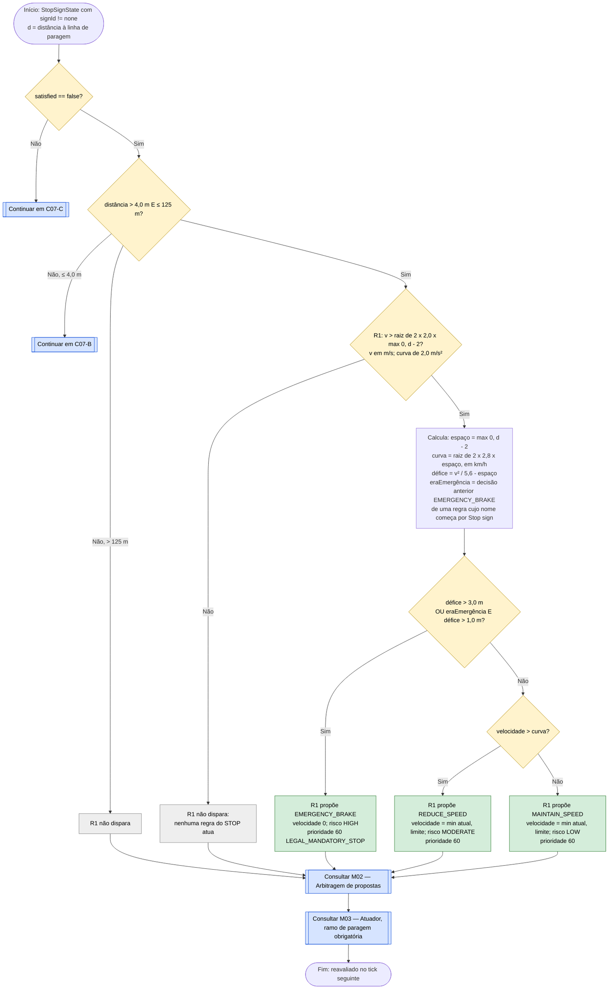
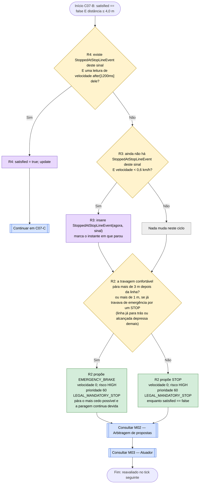
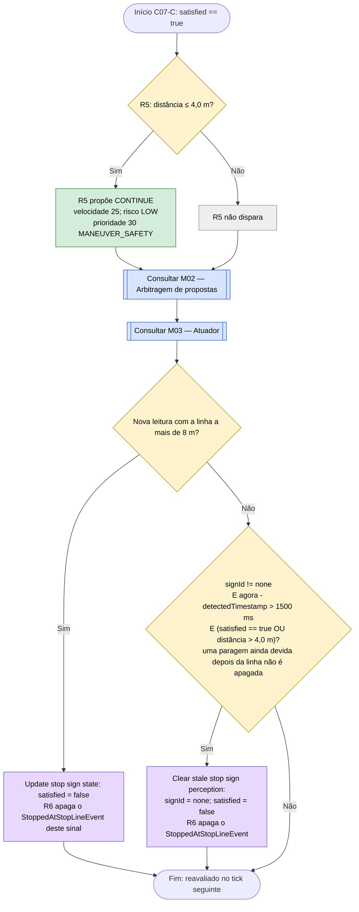

# C07 — Sinal STOP

- **Branch / commit:** `teste_ana` @ `70082b4` + alterações de 18/10 por commitar (working tree)
- **Estado da informação:** confirmado pelo código e por testes.

Dividido em três subfluxogramas: aproximação (C07-A), paragem e contagem de 1,2 s (C07-B), prosseguir (C07-C).

**Tempo da paragem por CEP (operadores de Allen).** A paragem de 1,2 s já não é contada à mão. Quando o carro para na linha, R3 insere um evento derivado, `StoppedAtStopLineEvent`; R4 considera a paragem cumprida quando existe uma leitura de velocidade pelo menos 1,2 s depois desse evento: `VehicleSpeedEvent(this after[1200ms] $stopped)`. No Prolog, o mesmo com `allen_after/3`.

**Distâncias.** O veículo tem de parar na **linha de paragem**, 15 m antes do sinal (`StoppingPolicy.STOP_SIGN_OFFSET_METERS`). A câmara mede a distância ao sinal e `Update stop sign state` guarda no facto a distância **à linha** (distância ao sinal − 15 m). Todas as distâncias deste cenário são à linha de paragem.

**Faixa.** O sinal STOP só vale para a faixa onde está: a câmara só reporta um STOP na faixa do veículo (`WorldState.nearestStopSign`).

## Fluxograma C07-A — Aproximação

## Fluxograma C07-B — Paragem e contagem de 1,2 s

## Fluxograma C07-C — Prosseguir e repor

R1 = `Stop sign requires progressive deceleration`; R2 = `Stop sign requires full stop near line`; R3 = `Start stop timer once vehicle is stopped`; R4 = `Stop sign condition satisfied after full stop hold`; R5 = `Proceed after stop sign condition satisfied`; R6 = `Forget the stop when the stop sign is re-armed`.

Ordem de disparo em C07-B (todas no agenda-group `decision`): R6 (640), R4 (635), R3 (630), R2 (620). Quando R4 dá a paragem por cumprida, `satisfied` passa a `true` antes de R2 ser avaliada, por isso R2 já não propõe `STOP` nesse ciclo.

## Situações a resolver

Os nós a **vermelho** nos fluxogramas acima assinalam passos onde há um problema por resolver.

| Nó | Problema | Confirmação | Como reproduzir |
|---|---|---|---|
| C07_P3 | ~~`MAINTAIN_SPEED` com prioridade 60 ganha à travagem por veículo à frente (50).~~ **Resolvido** (commit `3814b81`): a arbitragem limita a velocidade de uma proposta ≥ 60 ao teto mais baixo do ciclo (`CAPPED`, M02), e o atuador abranda até ela (M03). Para o peão está resolvido pelo mesmo mecanismo do semáforo vermelho (C08 com prioridade 60). | Veículo à frente: confirmado por teste da arbitragem (`DecisionContextTest.mandatoryStopIsCappedByALowerCeiling`); para o peão não há teste com STOP, só com vermelho | Não testado em simulação |
| C07_P1 | ~~Na aproximação, `EMERGENCY_BRAKE` alterna com `REDUCE_SPEED` e `MAINTAIN_SPEED` durante vários ticks.~~ **Resolvido**: a regra mantém-se ativa em toda a aproximação final e a histerese de C07_D3 dá uma única travagem forte | Confirmado por teste (`stopSignApproachBrakesSteadilyInsteadOfPulsingEmergencyBrake`) | Caso B07 | **Repetido a 17/10 (caso A02): no Drools não houve nenhuma travagem de emergência em 3 corridas; no Prolog a alternância `EMERGENCY_BRAKE`/`REDUCE_SPEED` reaparece em todas (2 a 4 vezes). Divergência entre motores, por investigar.**
| C07B_P | ~~A 4 m ou menos da linha só existe `STOP` com travagem confortável (2,8 m/s²), sem travagem de emergência. Um STOP visto pela primeira vez já com a linha a 4 m ou menos (sinal a menos de 19 m) não é respeitado com paragem antes da linha.~~ **Resolvido a 18/10**: com a linha a 4 m ou menos, se a travagem confortável já não chega trava de emergência (mesmo critério da aproximação) e o estado do sinal mantém-se até a paragem ser feita | Confirmado por teste (`StopSignSeenLateE2ETest`, Drools e Prolog) e em execução | Caso A21 | 18/10: pára 6 m depois da linha, 1,2 s parado, e segue, nos dois motores.

Os casos (A01 a A22, B01 a B08) estão descritos em `relatorio-validacao.md`, secção 8.

## Tabela de decisões

| Nó | Regra | Condição real | Caminho verdadeiro | Caminho falso | Resultado |
|---|---|---|---|---|---|
| C07_D0 | R1–R4 / R5 | `satisfied == false` / `satisfied == true` | C07_D1 | C07-C | — |
| C07_D1 | R1 | `distanceMeters > 4.0, distanceMeters <= 125.0` | C07_D2 | C07-B ou sem regra | — |
| C07_D2 | R1 | `$speed / 3.6 > Math.sqrt(2.0 * 2.0 * Math.max(0.0, $distance - 2.0))` | C07_C | C07_X1 | Regra ativa em toda a aproximação final |
| C07_D3 | R1 | `shortfall > 3.0 \|\| (wasEmergency && shortfall > 1.0)` | C07_P1 | C07_D4 | Histerese: emergência mantém-se até défice ≤ 1,0 m |
| C07_D4 | R1 | `$speed > curve` | C07_P2 | C07_P3 | — |
| C07B_D1 | R4 | `$stopped : StoppedAtStopLineEvent(signId == $id)` e `exists VehicleSpeedEvent(this after[1200ms] $stopped) from entry-point "VEHICLE_STREAM"` | C07B_A1 | C07B_D2 | Paragem cumprida |
| C07B_D2 | R3 | `StopSignState(satisfied == false, distanceMeters <= 4.0)`, `not StoppedAtStopLineEvent(signId == $id)` e `$speed < 0.6` | C07B_A2 | C07B_K | Marca o instante da paragem |
| C07B_D3 | R2 | `StopSignState(signId != "none", satisfied == false, distanceMeters <= 4.0)` e `shortfall > 3.0 \|\| (wasEmergency && shortfall > 1.0)`, com `shortfall = v² / (2 × 2,8) − max(0, d − 2)` | C07B_P2 | C07B_P | Mesmo critério de C07_D3 (Prolog: `Stop sign requires full stop near line (emergency)`) |
| C07B_P | R2 | ramo Não de C07B_D3 | — | — | `STOP` |
| C07B_P2 | R2 | ramo Sim de C07B_D3 | — | — | `EMERGENCY_BRAKE` (risco HIGH, prioridade 60) |
| C07C_D1 | R5 | `satisfied == true, distanceMeters <= 4.0` | C07C_P | C07C_X | `CONTINUE` a 25 km/h |
| C07C_D2 | `Update stop sign state` e R6 | `toStopLine > 8`; R6: `StopSignState(signId != $id \|\| distanceMeters > 8.0)` | C07C_A1 | C07C_D3 | Novo sinal repõe o ciclo |
| C07C_D3 | `Clear stale stop sign perception` | `StopSignState(signId != "none", satisfied == true \|\| distanceMeters > 4.0)` e `$now - $timestamp > 1500` | C07C_A2 | fim | Sinal deixou de ser visto; depois da linha, só depois de cumprida a paragem (a câmara perde o sinal ao passar por ele) |

## Ficha técnica

**Identificação**

| Campo | Valor |
|---|---|
| ID | C07 |
| Nome | Sinal STOP |
| Objetivo | Parar por completo a 4 m ou menos da linha de paragem (15 m antes do sinal), manter a paragem 1200 ms e só depois prosseguir |
| Condição de ativação | `StopSignState(signId != "none")`, para um sinal na faixa do veículo |
| Dados de entrada | `StopSignState` (distância, `satisfied`), `StoppedAtStopLineEvent` (evento derivado: o instante da paragem), `VehicleSpeedEvent` (leituras do sensor de velocidade), `VehicleStateFact` (velocidade, `timestamp`), `CurrentSpeedLimit.limitKmh`, `DrivingDecision` do tick anterior |

**Lógica**

| Regra | Ficheiro:linha | Salience | Ação | Prioridade | Factos alterados |
|---|---|---|---|---|---|
| R1 `Stop sign requires progressive deceleration` | `traffic-signs.drl:49` | 610 | `EMERGENCY_BRAKE`, `REDUCE_SPEED` ou `MAINTAIN_SPEED` | 60 | — |
| R2 `Stop sign requires full stop near line` | `traffic-signs.drl:112` | 620 | `STOP` ou `EMERGENCY_BRAKE` | 60 | — |
| R3 `Start stop timer once vehicle is stopped` | `traffic-signs.drl:148` | 630 | — | — | insere `StoppedAtStopLineEvent` |
| R4 `Stop sign condition satisfied after full stop hold` | `traffic-signs.drl:160` | 635 | — | — | `satisfied` |
| R6 `Forget the stop when the stop sign is re-armed` | `traffic-signs.drl:175` | 640 | — | — | apaga `StoppedAtStopLineEvent` |
| R5 `Proceed after stop sign condition satisfied` | `traffic-signs.drl:185` | 200 | `CONTINUE` | 30 | — |
| `Update stop sign state` | `01-state-updates.drl:108` | 1000 | — | — | `StopSignState` |
| `Clear stale stop sign perception` | `01-state-updates.drl:563` | 900 | — | — | `StopSignState` |

**Rastreabilidade**

| Elemento | Local |
|---|---|
| Sensor | `CameraSensor.observe()`: STOP mais próximo à frente **na faixa do veículo**, a até 120 m × visibilidade |
| Factos e eventos | `drools/facts/StopSignState.java`; `drools/events/StoppedAtStopLineEvent.java` (declarado como evento em `00-declarations.drl`, `@expires(30s)`) |
| Prolog | `driving_rules.pl`: as mesmas regras, com `allen_after/3` (`driving_rules.pl:1839`); R2 está partida em duas cláusulas, `Stop sign requires full stop near line` e `… (emergency)`, e a exceção da expiração é `expire_stop_track/2` (`driving_state.pl`), o equivalente ao `after` do Drools sobre os instantes em ms |
| Justificação de desenho | Comentário em `traffic-signs.drl:17-48` |
| Cenário de demonstração | `S4` (Stop sign) |
| Testes | `DrivingExpertSystemRulesTest`: `stopSignTriggersStopSequence` (160), `stopSignTooCloseForComfortableBrakingTriggersEmergencyBrake` (186); `SimulationEngineE2ETest`: `stopSignStopsOnlyTheVehicleDrivingInItsLane` (267), `stopSignFlowBringsVehicleToFullStopThenProceeds` (316), `stopSignApproachBrakesSteadilyInsteadOfPulsingEmergencyBrake` (377); `StopSignSeenLateE2ETest.stopsAsSoonAsPossibleWhenTheLineIsBehind` (Drools e Prolog: sinal visto com a linha já para trás); `PrologSimulationE2ETest.stopSignFlowBringsVehicleToFullStopThenProceeds` (139) |

**Relações**

- Lê o limite de C01. Depois de R5, C04 continua o arranque.
- Conflitos (M02): R1 e R2 (60) sobrepõem-se a todos os tetos de velocidade; só as emergências (70) lhes ganham. R5 (30, 25 km/h) é uma libertação: contra `Move off…` de C04 (30 km/h) fica a de velocidade mais baixa, R5; o comentário em `defaults.drl:84-86` confirma a intenção.

**Limitações**

- Entre 4 e 125 m, com velocidade abaixo da curva de 2,0 m/s² (C07_X1), nenhuma regra do STOP atua.
- R4 conta o tempo pelas leituras do sensor de velocidade (a cada 100 ms): sem leituras de velocidade, a paragem nunca seria dada por cumprida. Na simulação o sensor de velocidade lê em cada tick; nos testes unitários o `DroolsTestHarness` insere a leitura em cada ciclo.
- A histerese de C07_D3 e de C07B_D3 depende do nome da regra de origem da decisão anterior (`startsWith("Stop sign")`).
- Com a linha já para trás, o carro pára depois dela: a paragem é feita o mais cedo possível, mas não antes da linha.
- A câmara só reporta o sinal STOP mais próximo na faixa do veículo; um STOP noutra faixa não é visto (teste `stopSignStopsOnlyTheVehicleDrivingInItsLane`).

## Exemplos de entradas

| Entrada | Cálculo | Caminho | Resultado |
|---|---|---|---|
| 50 km/h, linha a 35 m (sinal a 50 m) | espaço 33; défice 1,45 | C07_D3 Não, C07_D4 Sim | `REDUCE_SPEED` (teste `stopSignTriggersStopSequence`) |
| 50 km/h, linha a 25 m (sinal a 40 m) | espaço 23; défice 11,4 | C07_D3 Sim | `EMERGENCY_BRAKE` (teste `stopSignTooCloseForComfortableBrakingTriggersEmergencyBrake`) |
| 50 km/h, linha a 100 m (sinal a 115 m) | curva de 2,0: 19,8 m/s > 13,9 | C07_D2 Não | Nenhuma regra do STOP |
| 60 km/h, sinal visto pela primeira vez a 8 m (linha 7 m para trás) | espaço 0; défice 49,6 | C07B_D3 Sim | `EMERGENCY_BRAKE`; pára cerca de 6 m depois da linha, cumpre 1,2 s e segue (caso A21, teste `StopSignSeenLateE2ETest`) |
| 4 km/h, linha a 3 m, ainda sem paragem | défice −0,8 | C07B_D2 Não; C07B_D3 Não | `STOP` |
| 0 km/h, linha a 2,5 m, ainda sem paragem | — | R3 insere `StoppedAtStopLineEvent`; R2 propõe | `STOP` |
| 0 km/h, linha a 1 m, 1400 ms depois | leitura de velocidade 1400 ms depois do evento | R4 satisfaz; R5 propõe | `CONTINUE` 25 (teste `stopSignTriggersStopSequence`) |
| Parado na linha: 1100 ms e depois 1200 ms após parar | — | 1100 ms: R2 propõe `STOP`; 1200 ms: R4 satisfaz | `STOP`, depois `CONTINUE` (sequência "stop sign: full stop held 1.2 s, then proceed" de `PrologDroolsEquivalenceTest`, igual nos dois motores) |
