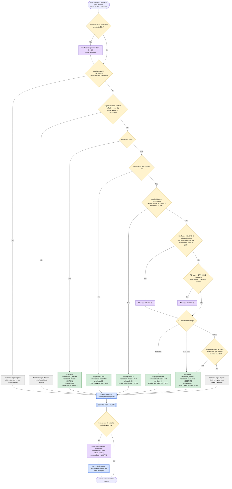

# C08 — Peão na trajetória ou a atravessar

- **Branch / commit:** `teste_ana` @ `70082b4` + alterações de 18/10 por commitar (working tree)
- **Estado da informação:** confirmado pelo código, por testes e em execução.

## Fluxograma

R1 = `Stop for pedestrian in crossing zone`; R2 = `Brake for pedestrian proximity`; R3 = `Emergency stop for pedestrian extremely close`; R4 = `Hold for pedestrian still crossing`; R5 = `Start braking for pedestrian above the braking curve`; R6 = `Hold speed for pedestrian once under the lower curve`; R7 = `End the pedestrian approach once no pedestrian is approached`.

As regras são independentes no motor. R1, R2 e R3 têm intervalos de distância disjuntos; R4 pode disparar no mesmo intervalo de R2, mas só com o veículo parado. R5, R6 e R7 não propõem: guardam a fase da aproximação (`PedestrianBrakingState`: `NONE`, `BRAKING`, `HOLDING`) e disparam antes de R2 (salience 607 contra 605), por isso R2 lê a fase já atualizada no ciclo. O fluxograma mostra-as em sequência apenas por clareza.

## Os três estados do peão

| Estado | Como é percebido | Efeito |
|---|---|---|
| Sem conflito | `inPath == false` e `crossingState == WAITING`: está na faixa de rodagem, fora da trajetória e sem atravessar | Fica só a ser seguido |
| A atravessar | `crossingState == CROSSING`: está a atravessar a via e ainda não chegou ao outro lado, em qualquer faixa | O veículo cede passagem enquanto durar. Sair da faixa do veículo não termina a travessia |
| Travessia terminada | `crossingState == CROSSED`: chegou ao passeio do outro lado | As regras de peão deixam de segurar o veículo |

Um peão na trajetória (`inPath == true`) está em conflito quer esteja a atravessar quer não.

## Situações a resolver

Não há nós a vermelho neste cenário. Ver `relatorio-validacao.md`, secção 12.

## Tabela de decisões

| Nó | Regra | Condição real | Caminho verdadeiro | Caminho falso | Resultado |
|---|---|---|---|---|---|
| C08_D6 | `Update pedestrian state` | `PedestrianDetectedEvent.crossingState == CROSSED` copiado para o facto | C08_X2 | C08_D0 | Travessia livre |
| C08_DR | R7 | `PedestrianBrakingState(phase != NONE)` e `not PedestrianStateFact((inPath == true \|\| crossingState == CROSSING) && distanceMeters > 32.0)` | C08_D6 | C08_AR | A aproximação acaba quando o peão desaparece, deixa de estar em conflito ou entra nos 32 m (decide R1) |
| C08_D0 | R1, R2, R3 | `PedestrianStateFact(inPath == true \|\| crossingState == PedestrianCrossingState.CROSSING)` | C08_D1 | C08_X0 | — |
| C08_D1 | R3 | `distanceMeters <= 6.0` | C08_P1 | C08_D2 | Emergência |
| C08_D2 | R1 | `distanceMeters > 6.0, distanceMeters <= 32.0` | C08_P2 | C08_D7 | Paragem |
| C08_D7 | R4 | `VehicleStateFact(speedKmh < 1.0)` e `PedestrianStateFact(crossingState == PedestrianCrossingState.CROSSING, distanceMeters > 32.0, distanceMeters <= 45.0)` | C08_P5 | C08_D3 | Continua parado |
| C08_D5 | R5 | `PedestrianBrakingState(phase != BRAKING)`, peão em conflito a mais de 32 m e `$speed / 3.6 > Math.sqrt(2.0 * 2.0 * Math.max(0.0, $distance - 18.0))` | C08_A5 | C08_D8 | Começa a travar acima da curva de cima |
| C08_D8 | R6 | `PedestrianBrakingState(phase == BRAKING)`, peão em conflito a mais de 32 m e `$speed / 3.6 <= Math.sqrt(2.0 * 1.4 * Math.max(0.0, $distance - 18.0))` | C08_A6 | C08_D9 | Só deixa de travar abaixo da curva de baixo |
| C08_D9 | R2 | `PedestrianBrakingState($phase : phase)` | C08_P3 (`BRAKING`), C08_P4 (`HOLDING`) | C08_D3 (`NONE`) | — |
| C08_D3 | R2 | `$phase == NONE` e `$speed / 3.6 > Math.sqrt(2.0 * 1.4 * Math.max(0.0, $distance - 18.0))` | C08_P4 | C08_X1 | Um veículo que ainda não travou fica entre as curvas sem acelerar |
| C08_D4 | `Clear stale pedestrian perception` | `pedestrianId != "none"` e `$now - $timestamp > 1000` | C08_A | fim | Peão deixou de ser visto |

## Ficha técnica

**Identificação**

| Campo | Valor |
|---|---|
| ID | C08 |
| Nome | Peão na trajetória ou a atravessar |
| Objetivo | Ceder passagem a um peão que está na trajetória ou a atravessar a via, até a travessia terminar |
| Condição de ativação | `PedestrianStateFact` com `inPath` ou `crossingState == CROSSING`, com a velocidade acima da curva de travagem que termina 18 m antes do peão |
| Dados de entrada | `PedestrianStateFact` (id, distância, `inPath`, `crossingState`); `VehicleStateFact.speedKmh`; `PedestrianBrakingState` (fase da aproximação) |

**Lógica**

| Regra | Ficheiro:linha | Salience | Ação | Prioridade |
|---|---|---|---|---|
| R1 `Stop for pedestrian in crossing zone` | `pedestrian.drl:48` | 600 | `STOP` | 60 |
| R5 `Start braking for pedestrian above the braking curve` | `pedestrian.drl:68` | 607 | — (fase = `BRAKING`) | — |
| R6 `Hold speed for pedestrian once under the lower curve` | `pedestrian.drl:80` | 607 | — (fase = `HOLDING`) | — |
| R7 `End the pedestrian approach once no pedestrian is approached` | `pedestrian.drl:94` | 607 | — (fase = `NONE`) | — |
| R2 `Brake for pedestrian proximity` | `pedestrian.drl:104` | 605 | `BRAKE` ou `MAINTAIN_SPEED` | 60 |
| R4 `Hold for pedestrian still crossing` | `pedestrian.drl:132` | 602 | `STOP` | 60 |
| R3 `Emergency stop for pedestrian extremely close` | `emergency.drl:61` | 880 | `EMERGENCY_BRAKE` | 70 |
| `Update pedestrian state` | `01-state-updates.drl:218` | 1000 | — | — |
| `Clear stale pedestrian perception` | `01-state-updates.drl:523` | 900 | — | — |

**Como a câmara classifica o peão** (`WorldState.nearestPedestrianAhead`, `WorldState.java:219`; evento emitido em `CameraSensor.java:62`). Só contam peões ativos, à frente e dentro do alcance.

- `inPath`: o peão está na mesma faixa que o veículo, ou a 3,5 m ou menos da sua posição lateral.
- `crossingState`: `CROSSING` enquanto o peão anda de um lado ao outro da via (`Pedestrian.isCrossingInProgress`, `Pedestrian.java:74`); `WAITING` se está na faixa de rodagem sem atravessar; `CROSSED` quando chega ao outro lado.

A câmara comunica o peão em conflito mais próximo; se não houver, o peão parado mais próximo; se não houver, o que acabou de atravessar.

**Persistência da travessia.** O estado fica no `PedestrianStateFact` e só muda quando a câmara comunica outro. Enquanto for `CROSSING`, as regras continuam a segurar o veículo, esteja o peão em que faixa estiver. O peão que a câmara está a seguir só é retirado do mundo depois de a câmara o ter comunicado como `CROSSED` (`SimulationEngine.consumePassedRoadElements`), para as regras verem o fim da travessia em vez de o peão desaparecer. A interface desenha os objetos no centro da faixa; se o peão ficasse no mundo, apareceria parado na faixa junto ao passeio.

**Passadeira.** Ao colocar um peão no mundo é pintada uma passadeira no bloco onde ele atravessa (`WorldState.addActor` → `ensureCrosswalkAt`), se o bloco estiver livre. A câmara reporta a passadeira (`CrosswalkDetectedEvent`), mas nenhuma regra a lê: o comportamento depende só do facto do peão.

**Sentido da travessia** (`Pedestrian.java:18`): um peão criado na faixa esquerda atravessa para o passeio direito (+5,5 m); um peão criado na faixa central ou direita atravessa para o passeio esquerdo (−5,5 m).

**Curvas de travagem e fase da aproximação.** A aproximação segue curvas que terminam 18 m antes do peão, como a aproximação ao semáforo vermelho termina antes da linha. Acima da curva de 2,0 m/s² o veículo começa a travar (a 60 km/h, a 87 m ou menos) e continua a travar até ficar abaixo da curva de 1,4 m/s²; daí em diante segura a velocidade, sem voltar a acelerar em direção ao peão, até a curva de cima o apanhar e travar outra vez. Um veículo que ainda não travou segura a velocidade entre as duas curvas (a 60 km/h, entre 87 e 117 m) e não recebe proposta abaixo da curva de 1,4 m/s². Sem esta memória, o veículo seguia a curva de cima a alternar travar e manter em cada ciclo (14 mudanças em 4 s no S7). A 32 m entra R1. Um veículo a 60 km/h pára a cerca de 22 m de um peão que não saia. No Prolog, a fase é `pedestrian_braking/2` em `driving_state.pl`.

**Rastreabilidade**

| Elemento | Local |
|---|---|
| Factos | `drools/facts/PedestrianStateFact.java`, valor inicial em `KnowledgeSession.java:118`; `drools/facts/PedestrianBrakingState.java`, valor inicial `NONE` em `KnowledgeSession.java:127-128` |
| Evento | `drools/events/PedestrianDetectedEvent.java` |
| Modelo do peão | `domain/Pedestrian.java`, `domain/PedestrianCrossingState.java` |
| Cenário de demonstração | `S7` (Pedestrian crossing) |
| Testes | `DrivingExpertSystemRulesTest`: `pedestrianTriggersBraking` (199), `conflictGreenLightAndPedestrianPedestrianWins` (417), `pedestrianAt35MetersPrevailsOverRedLightApproach` (690), `pedestrianBetween10And20MetersStopsTheVehicleBeforeARedLight` (706), `pedestrianWithin6MetersTriggersEmergencyBrake` (724), `pedestrianCrossingIntoThePathIsBrakedForBeforeItIsInThePath` (738), `visiblePedestrianWithoutConflictIsOnlyMonitored` (753), `pedestrianStillCrossingOutsideTheEgoLaneKeepsTheVehicleStopped` (766), `pedestrianThatFinishedCrossingNoLongerHoldsTheVehicle` (789), `crossingPedestrianWithin6MetersTriggersEmergencyBrakeEvenOutsideTheEgoLane` (811), `brakingForAPedestrianContinuesBetweenTheCurvesThenHoldsTheSpeed` (1068), `aVehicleBetweenTheCurvesThatWasNotBrakingHoldsItsSpeed` (1091); `PedestrianConflictE2ETest`: `anticipatesPedestrianCrossingFromLeftTowardsTheEgoLane` (76), `stopsNearAPedestrianStandingInItsLane` (120), `doesNotBrakeForPedestrianInLeftLaneThatWillNotCross` (145), `neverSpeedsUpWhileThePedestrianIsStillOnTheCrossing` (170), `staysStoppedAfterThePedestrianLeavesItsLaneButIsStillCrossing` (214), `afterThePedestrianHasCrossedTheRedLightIsStillRespected` (250); `SimulationEngineE2ETest`: `pedestrianDynamicallyAddedOnlyDetectedWithinRangeAndTriggersSafetyRule` (510), `priorityConflictPedestrianOverridesGreenLight` (601); `RoadLawAndOvertakingE2ETest.pedestrianCrossingBrakesThenResumesAfterCrossingClears` (179) |

**Relações**

- Depois de a travessia terminar, C04 retoma o andamento; se houver um semáforo vermelho ou um STOP mais à frente, C05 ou C07 voltam a decidir (confirmado por teste para o vermelho).
- Um peão em conflito bloqueia C17 e o início das ultrapassagens de C11.
- Os outros veículos também cedem passagem (art. 103.º), mas isso é física do mundo simulado e não uma regra do sistema pericial: em `WorldPhysicsEngine.giveWayToPedestrians()`, um veículo que não é o ego trava para parar 15 m antes de um peão na sua faixa, a 3,5 m ou menos dela, ou a atravessar a via, até 60 m à frente, e retoma a sua velocidade quando o caminho fica livre. Antes atravessava o peão a velocidade constante (S11; teste `OtherVehiclesGiveWayToPedestriansE2ETest`). No S11, o carro e o peão passaram a ser criados a 150 m do ego, fora do ecrã (que mostra até ~144 m à frente), para entrarem pela direita.
- Conflitos (M02): R1, R2 e R4 têm a mesma prioridade (60) que o semáforo vermelho, o amarelo, o STOP e a barreira, e sobrepõem-se a todos os tetos de velocidade. Em empate ganha a velocidade mais baixa, por isso o peão ganha a uma aproximação que ainda permite velocidade e só perde para uma paragem mais forte. Disparam depois das regras do vermelho e do STOP: quando ambas pedem velocidade 0, fica a proposta do sinal (proposta primeiro). R3 (70) ganha a tudo; empata com as emergências de C10 e C13, todas com velocidade 0. Uma mudança de faixa com prioridade inferior é vetada enquanto estas decisões forem uma travagem (`BRAKE`, `STOP`, `EMERGENCY_BRAKE`); com `MAINTAIN_SPEED` não é (M02).

**Limitações**

- R3 não tem limite inferior de distância nem verificação de `pedestrianId`.
- Só é considerado um peão de cada vez: o que está em conflito mais próximo.
- O veículo cede a qualquer peão a atravessar a via à frente, mesmo que este se afaste da sua faixa ou fosse acabar de atravessar antes de o veículo chegar.
- Um peão parado noutra faixa (`WAITING`) não é conflito, mesmo que esteja sobre a passadeira.
- Durante a aproximação a decisão passa de `BRAKE` a `MAINTAIN_SPEED` e de volta a `BRAKE` quando a curva de cima apanha o veículo, mas já não alterna em cada ciclo (fase guardada em `PedestrianBrakingState`); nunca acelera nesse troço.

## Exemplos de entradas

| Entrada | Caminho | Resultado |
|---|---|---|
| Peão na faixa do veículo a 40 m, veículo a 60 km/h | C08_D5 Sim | `BRAKE` 20 |
| Peão na faixa do veículo a 70 m, veículo a 60 km/h | C08_D5 Sim (curva de 2,0 m/s²: 87 m) | `BRAKE` 20 |
| Peão na faixa do veículo a 100 m, veículo a 60 km/h, ainda sem travar | C08_D5 Não (curva de 2,0 m/s²: 65 km/h); fase NONE; C08_D3 Sim (curva de 1,4 m/s²: 54,5 km/h) | `MAINTAIN_SPEED` 60 |
| Peão na faixa do veículo a 70 m, veículo a 40 km/h, ainda sem travar | C08_D3 Não (curva de 1,4 m/s²: 43,4 km/h) | Sem proposta |
| Fase `BRAKING`, peão a 60 m, veículo a 40 km/h | C08_D8 Não (curva de 1,4 m/s²: 39,0 km/h) | `BRAKE` 20 (continua a travar) |
| Fase `BRAKING`, peão a 60 m, veículo a 38 km/h | C08_D8 Sim | Fase `HOLDING`: `MAINTAIN_SPEED` 38 |
| Peão a 18 m | C08_D2 Sim | `STOP` (teste `pedestrianTriggersBraking`) |
| Peão a 32,0 m | C08_D2 Sim (limite incluído) | `STOP` |
| Peão a 6,0 m | C08_D1 Sim (limite incluído) | `EMERGENCY_BRAKE` (teste `pedestrianWithin6MetersTriggersEmergencyBrake`) |
| Peão a atravessar noutra faixa a 70 m, veículo a 60 km/h | C08_D0 Sim por `CROSSING`; C08_D5 Sim | `BRAKE` 20 (teste `pedestrianCrossingIntoThePathIsBrakedForBeforeItIsInThePath`) |
| Peão a atravessar, já fora da faixa do veículo, a 15 m; veículo parado | C08_D0 Sim por `CROSSING`; C08_D2 Sim | `STOP` (teste `pedestrianStillCrossingOutsideTheEgoLaneKeepsTheVehicleStopped`) |
| Peão a atravessar a 35 m; veículo parado | C08_D7 Sim | `STOP` por R4 (teste `pedestrianStillCrossingOutsideTheEgoLaneKeepsTheVehicleStopped`) |
| Peão a atravessar noutra faixa a 5 m | C08_D1 Sim | `EMERGENCY_BRAKE` (teste `crossingPedestrianWithin6MetersTriggersEmergencyBrakeEvenOutsideTheEgoLane`) |
| O mesmo peão comunicado como `CROSSED` | C08_D6 Sim | Sem proposta de peão (teste `pedestrianThatFinishedCrossingNoLongerHoldsTheVehicle`) |
| Peão parado na faixa esquerda, veículo na direita | C08_D0 Não | Sem proposta (teste `PedestrianConflictE2ETest.doesNotBrakeForPedestrianInLeftLaneThatWillNotCross`) |
| Peão a 35 m com semáforo vermelho a 70 m | R2 (60, velocidade 20) contra C05 (60, velocidade atual) | `BRAKE` (teste `pedestrianAt35MetersPrevailsOverRedLightApproach`) |
| Peão a 14 m com semáforo verde a 20 m | R1 (60) contra C06 (10) | `STOP` (teste `conflictGreenLightAndPedestrianPedestrianWins`) |
