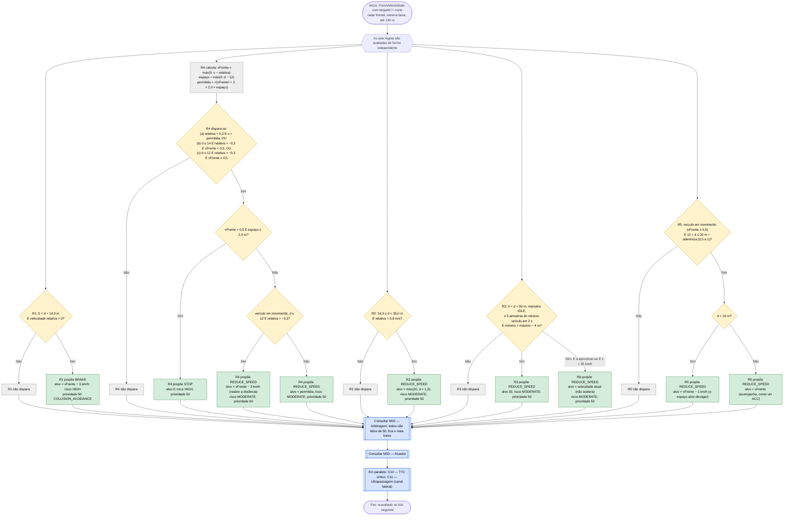

# C09 — Veículo à frente

- **Branch / commit:** working tree a 21/10/2026
- **Estado da informação:** confirmado pelo código, por testes unitários e de integração (Drools e Prolog), e em execução.

## Fluxograma

R1 = `Brake when front vehicle distance low`; R2 = `Reduce speed when closing front vehicle`; R3 = `Approaching trend from sliding distance window`; R4 = `Keep safe following distance behind front vehicle`; R5 = `Follow the front vehicle speed outside the following gap`; R6 = `Hold speed on an approaching trend below its target`.

Nos rótulos, `v` é a velocidade do veículo e `vFrente` a do veículo da frente, em m/s; `d` é a distância medida em metros.

## Situações resolvidas

Este fluxograma não tem nós a vermelho.

| Problema anterior | O que mudou | Confirmação |
|---|---|---|
| Atrás de um veículo parado o carro avançava aos solavancos e o backend bloqueava | R4 trava de forma progressiva e mantém a paragem a cerca de 12 m; o ciclo infinito que bloqueava o backend foi eliminado (ver M04) | `StationaryFrontVehicleE2ETest`; caso A22 em execução |
| As regras de aproximação ganhavam sempre à ultrapassagem | A ultrapassagem é arbitrada no canal lateral (M02): o carro abranda pelo veículo da frente e começa a ultrapassagem no mesmo ciclo | `PrologRulesTest.followingRulesKeepSlowingWhileTheOvertakeStarts`; `LaneChangeManeuverE2ETest` |
| Pára-arranca atrás de um veículo lento entre 12 e 14 m: nenhuma regra atuava, o cruzeiro pedia 60 km/h e a travagem voltava a atuar, em ciclo | R5 acompanha a velocidade do veículo da frente fora dos 12 m; R6 impede que a tendência (R3) faça acelerar a baixa velocidade | `BoxedInTrafficE2ETest.followsTheSlowVehicleWithoutStopAndGo` (Drools e Prolog) |

## Situações a resolver

| Nó | Problema | Confirmação | Como reproduzir |
|---|---|---|---|
| — | Com um veículo parado a 60 m (60 km/h), o Drools pára a cerca de 13 m e, em 2 de 3 corridas, trava de emergência na aproximação (`Emergency brake when persistent TTC is critical`, C10); o Prolog pára a cerca de 9,5 m e nunca trava de emergência. Os dois contornam o veículo e regressam à direita. Divergência entre motores, por investigar. | Confirmado em execução a 17/10 (3 corridas em cada motor) | Caso A22, secção R2 do relatório de validação (não está no repositório) |

## Tabela de decisões

| Nó | Regra | Condição real | Caminho verdadeiro | Caminho falso | Resultado |
|---|---|---|---|---|---|
| C09_D1 | R1 | `distanceMeters > 0, distanceMeters < 14.0, relativeSpeedMps > 0` | C09_P1 | C09_X1 | `BRAKE` até 3 km/h abaixo do veículo da frente |
| C09_D9 | R4 | `($relative > 0.3 && v > permitida) \|\| ($distance <= 14.0 && $relative > -0.3 && vFrente < 0.5) \|\| ($distance <= 12.0 && $relative > -0.3 && vFrente >= 0.5)` | C09_D11 | C09_X4 | Acima da curva, parado atrás de um veículo parado, ou demasiado perto de um veículo em movimento |
| C09_D11 | R4 | `frontStopped && room <= 2.0` | C09_P4a | C09_D12 | `STOP` |
| C09_D12 | R4 | `!frontStopped && $distance <= 12.0 && $relative > -0.3` | C09_P4c | C09_P4b | Reabre a distância ou segue a curva |
| C09_D3 | R2 | `distanceMeters >= 14.0, distanceMeters < 35.0, relativeSpeedMps > 0.8` | C09_P2 | C09_X2 | `REDUCE_SPEED` proporcional à distância |
| C09_D5 | R3 | `0 < d < 50`, `laneChangeState == IDLE`, ≥ 3 `FrontDistanceEvent` do mesmo alvo em `window:time(2s)`, `$min < $max - 4.0` | C09_P3 | C09_X3 | Distância a variar depressa |
| C09_D5 (R6) | R6 | as mesmas condições de R3, mais `relativeSpeedMps > 0` e `speedKmh < 35.0` | C09_P6 | — | Nunca acelera contra o veículo de que se aproxima |
| C09_D13 | R5 | `distanceMeters > 12.0`, `vFrente >= 0.5`, `$distance <= 20.0 / max(0.5, min(1.0, grip))` | C09_D14 | C09_X5 | Fecha a zona morta entre 12 e 14 m |
| C09_D14 | R5 | `$distance < 16.0` | C09_P5a | C09_P5b | O equilíbrio fica longe dos 14 m de R1, para lá do ruído do radar |

Todas as propostas são tetos de 50: quando várias disparam fica a de velocidade mais baixa; em empate, a que foi proposta primeiro (M02).

## Ficha técnica

**Identificação**

| Campo | Valor |
|---|---|
| ID | C09 |
| Nome | Veículo à frente |
| Objetivo | Manter uma distância segura do veículo da frente, reduzir ao aproximar-se, segui-lo à velocidade dele sem pára-arranca e parar atrás dele se estiver parado |
| Condição de ativação | `FrontVehicleState(targetId != "none")` |
| Dados de entrada | `FrontVehicleState` (distância, velocidade relativa), `FrontDistanceEvent` dos últimos 2 s, `VehicleStateFact` (velocidade, `laneChangeState`), `WeatherStateFact.gripFactor` (R5) |

**Lógica**

| Regra | Ficheiro:linha | Salience | Ação | Prioridade |
|---|---|---|---|---|
| R1 `Brake when front vehicle distance low` | `front-vehicle.drl:43` | 520 | `BRAKE` | 50 |
| R4 `Keep safe following distance behind front vehicle` | `front-vehicle.drl:81` | 510 | `REDUCE_SPEED` ou `STOP` | 50 |
| R5 `Follow the front vehicle speed outside the following gap` | `front-vehicle.drl:188` | 508 | `REDUCE_SPEED` | 50 |
| R3 `Approaching trend from sliding distance window` | `front-vehicle.drl:146` | 505 | `REDUCE_SPEED` | 50 |
| R6 `Hold speed on an approaching trend below its target` | `front-vehicle.drl:217` | 504 | `REDUCE_SPEED` | 50 |
| R2 `Reduce speed when closing front vehicle` | `front-vehicle.drl:123` | 500 | `REDUCE_SPEED` | 50 |
| `Update front vehicle from distance` | `01-state-updates.drl:151` | 1000 | — | — |
| `Clear stale front vehicle perception` | `01-state-updates.drl:398` | 900 | — | — |

**Curva de distância segura de R4.** A velocidade permitida é a que ainda deixa igualar a velocidade do veículo da frente 12 m atrás dele, com uma desaceleração de 2,0 m/s², inferior à travagem confortável do atuador (2,8 m/s²). R4 só propõe acima da curva, porque uma recomendação acima da velocidade atual faria o atuador acelerar (M03). Dentro dos 12 m, atrás de um veículo em movimento, a curva já não diz nada e R4 reabre a distância a 3 km/h abaixo dele.

**Seguimento sem pára-arranca (R5, R6).** Fora dos 12 m, sem aproximação rápida, nenhuma das regras originais atuava: a velocidade de cruzeiro (C03) levava o carro contra o veículo da frente e R1 voltava a travar. R5 é um teto à velocidade do veículo da frente (1 km/h abaixo a menos de 16 m); com pouca aderência a janela cresce com a distância de paragem (20 m ÷ aderência, até 40 m), por isso com chuva o carro fica mais atrás. R6 corrige R3 a baixa velocidade: os 35 km/h de R3 fariam o atuador acelerar contra o veículo; R6 propõe a velocidade atual, mais baixa, e ganha.

**Regras do Código da Estrada aplicadas**

| Artigo | Aplicação |
|---|---|
| 18.º | Distância suficiente do veículo da frente: folga de 12 m na paragem; seguimento a 14–20 m (mais com chuva) |
| 24.º | Velocidade que permita parar no espaço livre à frente: curva de travagem progressiva |

O artigo 24.º está citado de memória e deve ser conferido no texto oficial.

**Rastreabilidade**

| Elemento | Local |
|---|---|
| Sensor | `FrontRadarSensor`: distância real mais ruído gaussiano (desvio-padrão 0,7 m, `SimulationConfig.distanceNoiseStdMeters`); velocidade relativa positiva quando o carro se aproxima; 100 ms, 130 m |
| Facto | `drools/facts/FrontVehicleState.java`; valor inicial em `KnowledgeSession.java:115` |
| Seleção do alvo | `WorldState.nearestFrontVehicleInLane()` |
| Cenários | `S8` (veículo a 30 km/h 40 m à frente, ego a 95 km/h), `S14_SLOW_VEHICLE_OVERTAKE` (veículo a 18 km/h 45 m à frente na faixa RIGHT, ego a 50 km/h), `S12_PRESENTATION_DEMO` (aos 11 s, veículo a 12 km/h 175 m à frente na faixa CENTER) |
| Prolog | As mesmas regras, com os mesmos nomes e precedências, em `driving_rules.pl` (R4 dividida em três variantes: `(stop)`, `(reopen gap)`, `(reduce)`); a janela de distâncias e o alvo seguido persistem em `driving_state.pl`, com as leituras dobradas distância primeiro |
| Testes unitários | `DrivingExpertSystemRulesTest`: `closingOnStationaryVehicleFollowsTheSafeDistanceCurve` (635), `brakingBehindACloseFrontVehicleTargetsBelowItsSpeed` (652, R1), `followingTooCloseBehindAMovingVehicleReopensTheGap` (670), `stoppedBehindStationaryVehicleHoldsTheStop` (713), `distanceSamplesOfDifferentVehiclesAreNotCombinedIntoOneTrend` (763), `distanceSamplesOfTheSameVehicleStillFormATrend` (778); `PrologRulesTest`: `frontVehicleTooCloseTriggersBrake` (370, R1), `closingOnStationaryVehicleFollowsTheSafeDistanceCurve` (382), `stoppedBehindStationaryVehicleHoldsTheStop` (396), `relativeSpeedArrivingBeforeTheDistanceStillCounts` (408), `distanceSamplesOfTheSameVehicleStillFormATrend` (420), `distanceSamplesOfDifferentVehiclesAreNotCombinedIntoOneTrend` (432), `frontVehicleIsForgottenAfterMissedRadarReadings` (444), `noTrendWhileChangingLane` (456), `followingRulesKeepSlowingWhileTheOvertakeStarts` (520); `PrologDroolsEquivalenceTest`: "following a slow vehicle at 15 m / 18 m / 13 m", "following at 25 m on low grip", "closing trend at low speed holds the speed" |
| Testes de integração | `StationaryFrontVehicleE2ETest` (parametrizado nos dois motores): `goesAroundStationaryVehicleWhenLeftLaneIsClear` (56), `stopsBehindStationaryVehicleAndGoesAroundOnceLeftLaneClears` (96), `passesFarStationaryVehicleOnTheMove` (144); `BoxedInTrafficE2ETest.followsTheSlowVehicleWithoutStopAndGo` (174, dois motores) |

**Relações**

- Partilha o facto e os eventos do radar com C10 e C11.
- Bloqueia C17 quando há veículo a 80 m ou menos (`road-law.drl:48`).
- A paragem de R4 é um teto de 50 a 0 km/h: o arranque de C04 (libertação de 30) fica abaixo dele e o carro não arranca. Quando o lado esquerdo fica livre, C11 contorna o veículo a partir de parado.
- Conflitos externos: perde contra C10 (70) e contra paragens obrigatórias (60). Com os outros tetos (limite de C01, perigos, tempo de C18) fica o mais baixo.

**Limitações**

- Se o veículo parado aparecer a menos de cerca de 80 m com o carro a 60 km/h, já não há espaço para a curva de 2,0 m/s²: o carro trava a 2,8 m/s² e pode ainda disparar a travagem de emergência de C10.
- A 120 km/h o radar (130 m) não deteta um veículo parado a tempo de uma travagem confortável.
- A regra de origem mostrada na interface alterna entre R2, R3, R4 e R5 durante a aproximação, porque ganha a de velocidade mais baixa em cada ciclo.
- A condição de R3 (`mínimo < máximo − 4`) não distingue uma distância a diminuir de uma a aumentar. R6 só corrige o caso em que o carro se aproxima.
- R2 continua sem teste unitário dedicado (R1 tem `brakingBehindACloseFrontVehicleTargetsBelowItsSpeed` e `frontVehicleTooCloseTriggersBrake`).
- O facto do veículo da frente é limpo ao fim de 250 ms sem amostras do radar.
- Pela API ou pela interface só se coloca um veículo a 6 km/h ou mais (`ApiRequestMapper.MIN_VEHICLE_SPEED_KMH`); um veículo parado (a paragem de R4) só aparece em cenários e testes.

## Exemplos de entradas

| Entrada | Caminho | Resultado |
|---|---|---|
| 60 km/h, veículo parado a 40 m, primeira deteção | R4: espaço 28, permitida 38,1 km/h | `REDUCE_SPEED` 38,1 (teste `closingOnStationaryVehicleFollowsTheSafeDistanceCurve`) |
| Parado, veículo parado a 12 m, lado esquerdo não livre | R4: (b), espaço 0 | `STOP` (teste `stoppedBehindStationaryVehicleHoldsTheStop`) |
| 60 km/h, veículo parado a 125 m | R4: permitida 76,5 km/h; não dispara | Sem proposta de C09; C11 pode iniciar a ultrapassagem |
| Distância 10 m, veículo da frente a 20 km/h, carro a 30 km/h | R1 `BRAKE` 17; R4 (c) reabre a 17 | `BRAKE` 17 (mesma velocidade; R1 foi proposta primeiro) |
| Distância 10 m, velocidade relativa −1 m/s (afasta-se), veículo em movimento | R1 Não; R4 Não | Sem proposta de R1/R4 (R5 só a partir de 12 m) |
| Veículo a 4,5 km/h a 15 m, carro a 5 km/h | R5: d #lt; 16 | `REDUCE_SPEED` ~3,5 km/h (equivalência "following a slow vehicle at 15 m") |
| Veículo a 4,5 km/h a 18 m, carro a 5 km/h | R5: d ≥ 16 | `REDUCE_SPEED` ~4,5 km/h |
| Chuva, aderência 0,65, veículo parado-lento a 25 m | R5: janela 30,8 m | `REDUCE_SPEED` à velocidade do veículo da frente |
| Distância 45 m, janela com 52, 48 e 45 m, carro a 60 km/h | R3 Sim (45 #lt; 52 − 4) | `REDUCE_SPEED` 35, ou menos se outra regra propuser mais baixo |
| A mesma janela com o carro a 20 km/h e a aproximar-se | R3 e R6 | `REDUCE_SPEED` 20 por R6 (não acelera para 35) |
