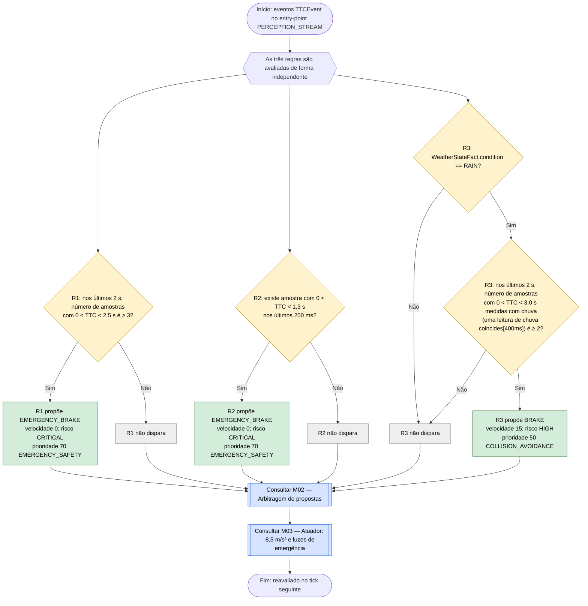

# C10 — TTC crítico

TTC (tempo até colisão) = distância medida ÷ velocidade relativa, quando a velocidade relativa é superior a 0,05 m/s; caso contrário é infinito (`FrontRadarSensor`).

- **Branch / commit:** `teste_ana` @ `70082b4` + alterações de 18/10 por commitar (working tree)
- **Estado da informação:** confirmado pelo código e por testes.

## Fluxograma

R1 = `Emergency brake when persistent TTC is critical`; R2 = `Emergency brake when TTC is immediately critical`; R3 = `Persistent low TTC in rain increases conservatism`.

## Tabela de decisões

| Nó | Regra | Condição real | Caminho verdadeiro | Caminho falso | Resultado |
|---|---|---|---|---|---|
| C10_D1 | R1 | `accumulate( TTCEvent( ttcSeconds > 0.0, ttcSeconds < 2.5 ) over window:time(2s) from entry-point "PERCEPTION_STREAM"; $count : count(1), $ttc : min($sample); $count >= 3 )` | C10_P1 | C10_X1 | Risco persistente |
| C10_D2 | R2 | `TTCEvent( ttcSeconds > 0.0, ttcSeconds < 1.3 ) over window:time(200ms)` | C10_P2 | C10_X2 | Risco imediato; uma ativação por amostra |
| C10_D3 | R3 | `WeatherStateFact(condition == WeatherCondition.RAIN)` | C10_D4 | C10_X3 | — |
| C10_D4 | R3 | `accumulate( $low : TTCEvent( ttcSeconds > 0.0, ttcSeconds < 3.0 ) over window:time(2s) from entry-point "PERCEPTION_STREAM" and exists WeatherEvent( condition == WeatherCondition.RAIN, this coincides[400ms] $low ) from entry-point "ENVIRONMENT_STREAM"; $count >= 2 )` | C10_P3 | C10_X3 | Limiar mais largo com chuva; só contam amostras medidas com chuva |

**Operador de Allen em R3.** Uma amostra de TTC baixo só conta se houver uma leitura de chuva do sensor de ambiente a menos de 400 ms dela (`coincides[400ms]`; 400 ms é o período desse sensor). Assim, amostras de antes de começar a chover deixam de contar. Usa-se `coincides` e não `during` porque os eventos dos sensores são pontuais (sem `@duration`). No Prolog, o mesmo com as leituras de chuva recentes (`rain_sample`) e `allen_coincides/3` (`persistent_low_ttc_in_rain/2`).

## Ficha técnica

**Identificação**

| Campo | Valor |
|---|---|
| ID | C10 |
| Nome | TTC crítico |
| Objetivo | Travar de emergência quando o tempo até colisão é persistentemente ou imediatamente baixo; travar mais cedo com chuva |
| Condição de ativação | Amostras de `TTCEvent` com valor finito abaixo dos limiares |
| Dados de entrada | `TTCEvent.ttcSeconds` (radar frontal, 100 ms), `WeatherStateFact.condition`, `WeatherEvent` (sensor de ambiente, 400 ms) |

**Lógica**

| Regra | Ficheiro:linha | Salience | Ação | Prioridade |
|---|---|---|---|---|
| R1 `Emergency brake when persistent TTC is critical` | `emergency.drl:18` | 900 | `EMERGENCY_BRAKE` | 70 |
| R2 `Emergency brake when TTC is immediately critical` | `emergency.drl:42` | 890 | `EMERGENCY_BRAKE` | 70 |
| R3 `Persistent low TTC in rain increases conservatism` | `temporal.drl:17` | 560 | `BRAKE` | 50 |

Estas regras leem os eventos diretamente do stream, com janelas deslizantes; não dependem de `FrontVehicleState`. O comentário em `emergency.drl:15-17` explica a opção.

**Rastreabilidade**

| Elemento | Local |
|---|---|
| Sensor | `FrontRadarSensor` (100 ms, 130 m) |
| Declaração do evento | `00-declarations.drl` (`TTCEvent`, `@expires(10s)`) |
| Cenário de demonstração | `S8` (Critical TTC) — `scenarios.json:578`: começa em CENTER a 95 km/h, com um veículo a 30 km/h 40 m à frente (TTC ≈ 2,2 s) |
| Testes | `DrivingExpertSystemRulesTest`: `ttcCriticalTriggersEmergency` (212), `isolatedTtcSampleDoesNotTriggerPersistentRule` (227), `repeatedTtcInsideWindowTriggersPersistentEmergency` (240), `conflictAccelerationAndCriticalTtcEmergencyWins` (446), `conflictRainAndTtcRiskConservativeAction` (462), `lowTtcCountsInRainOnlyWhenARainReadingCoincidesWithIt` (477); `PrologDroolsEquivalenceTest`: "low TTC that no rain reading coincides with"; `SimulationEngineE2ETest`: `ttcFlowProducesEmergencyBrakeAndRecoversRisk` (459), `emergencyDecisionAppliesEmergencyDecelerationToWorldState` (666) |

**Relações**

- Usa os mesmos eventos do radar que C09; R3 depende do estado meteorológico de C18.
- Conflitos: R1 e R2 (70) ganham a todas as outras propostas, incluindo semáforo vermelho e STOP (60). R3 (50, 15 km/h) empata com as regras de C09 e ganha por ter a velocidade mais baixa; ganha ao teto difuso do tempo de C18 (40), que nunca desce abaixo de cerca de 25 km/h. Os conflitos com aceleração e com chuva estão confirmados por teste.

**Limitações**

- As janelas contam amostras, não alvos: amostras de veículos diferentes somam-se.
- Deduzido do código: as amostras ficam na janela até 2 s depois de o perigo desaparecer, por isso R1 pode continuar a propor `EMERGENCY_BRAKE` até 2 s após o veículo da frente sair da trajetória.
- Com o radar a 100 ms, três amostras abaixo de 2,5 s acumulam-se em cerca de 300 ms.
- R2 dispara uma vez por amostra dentro da janela de 200 ms; todas propõem o mesmo, sem efeito no resultado.

## Exemplos de entradas

| Entrada | Caminho | Resultado |
|---|---|---|
| TTC 2,3 s, 2,1 s e 1,9 s em 300 ms | C10_D1 Sim | `EMERGENCY_BRAKE` (teste `ttcCriticalTriggersEmergency`) |
| Uma única amostra de 2,2 s | C10_D1 Não, C10_D2 Não | Sem proposta de C10 (teste `isolatedTtcSampleDoesNotTriggerPersistentRule`) |
| 2,4 s, 2,3 s e 2,2 s aos 1000, 1400 e 1700 ms | C10_D1 Sim | `EMERGENCY_BRAKE` (teste `repeatedTtcInsideWindowTriggersPersistentEmergency`) |
| Uma única amostra de 1,1 s | C10_D2 Sim | `EMERGENCY_BRAKE` por R2 |
| Chuva lida aos 1000 ms, amostras de 2,9 s e 2,8 s aos 1200 e 1290 ms | C10_D4 Sim; C10_D1 Não | `BRAKE` 15 (teste `conflictRainAndTtcRiskConservativeAction`) |
| Chuva lida aos 1000 ms, amostras de 2,9 s e 2,8 s aos 1900 e 1990 ms | C10_D4 Não: nenhuma leitura de chuva a menos de 400 ms | Sem proposta de R3; com uma nova leitura de chuva aos 2100 ms passa a `BRAKE` (teste `lowTtcCountsInRainOnlyWhenARainReadingCoincidesWithIt`) |
| Sem chuva, amostras de 2,9 s e 2,8 s | C10_D3 Não | Sem proposta de C10 |
| TTC infinito (não há aproximação) | Nenhuma amostra conta | Sem proposta |
