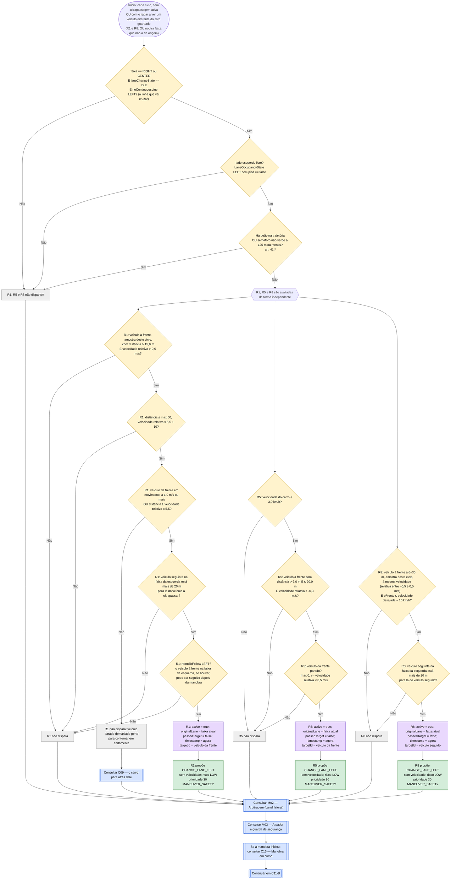
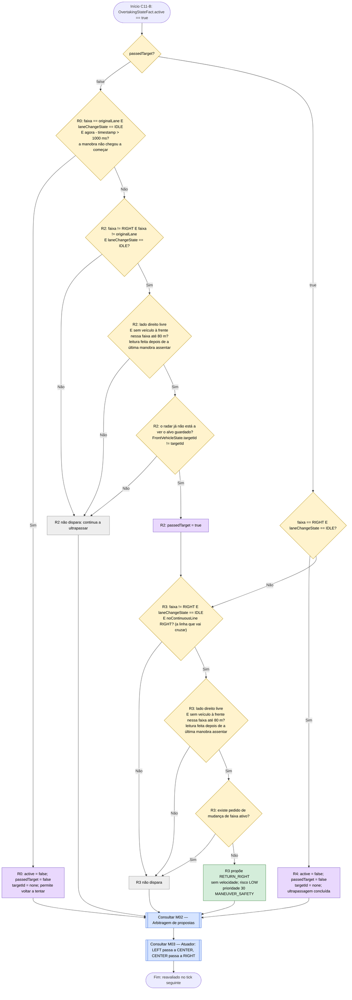
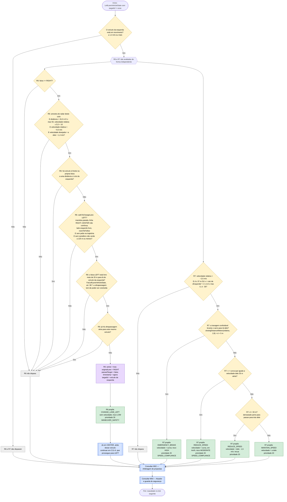
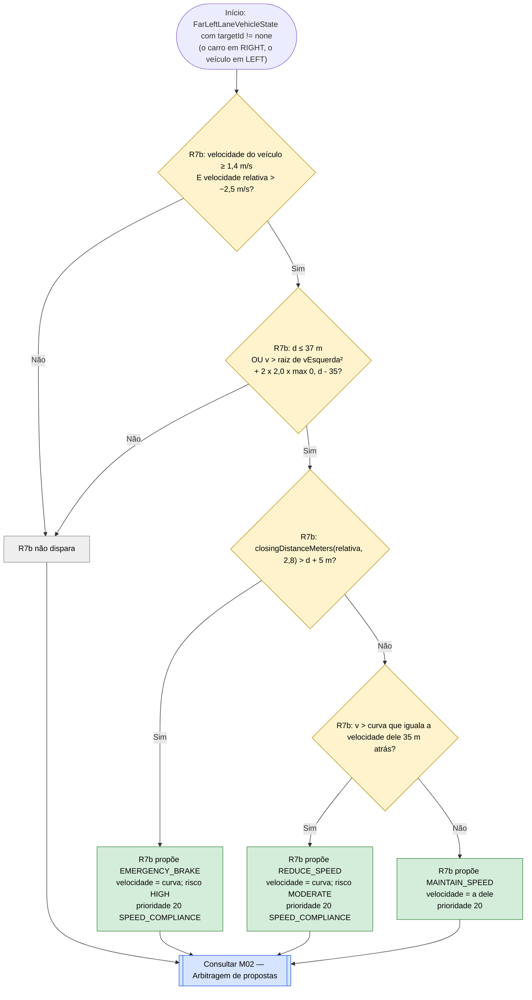
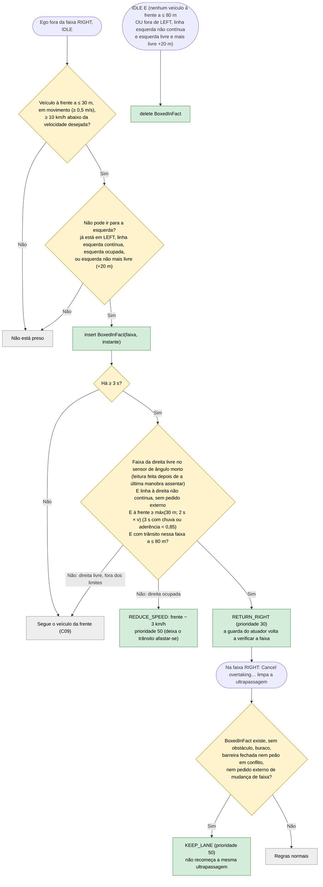

# C11 — Ultrapassagem e regresso à direita

- **Branch / commit:** working tree a 21/10/2026
- **Estado da informação:** confirmado pelo código, por testes unitários e de integração, e por testes em execução.

A ultrapassagem é um processo com memória: o facto `OvertakingStateFact` (`active`, `passedTarget`, `originalLane`, `timestamp`, `targetId`) guarda a fase em que está e **qual o veículo que está a ser ultrapassado**. Uma ultrapassagem ativa não impede outra para um veículo diferente: depois de RIGHT → CENTER, o carro pode continuar CENTER → LEFT. Inclui o contorno de um veículo parado, em andamento ou a partir de parado. No Prolog o estado persiste entre ciclos em `driving_state.pl` (`overtaking_state/5`); as regras concluem o que mudou (`overtake_started/3`, `overtake_cancelled`, `overtake_target_passed`, `overtake_finished`) e `store_conclusions/0` grava o resultado.

Dividido em quatro subfluxogramas: início da manobra (C11-A), conclusão (C11-B), veículo mais lento na faixa da esquerda (C11-C, com C11-C2 para duas faixas à esquerda) e ultrapassagem impossível (C11-D).

As propostas de mudança de faixa são arbitradas no **canal lateral** (M02): não competem com as propostas de velocidade. O carro continua a abrandar pelo veículo da frente (C09) no mesmo ciclo em que começa a ultrapassagem, até sair da faixa.

## Fluxograma C11-A — Início da manobra

## Fluxograma C11-B — Conclusão e regresso

R0 = `Cancel overtaking that never left its original lane`; R1 = `Overtake slow front vehicle via left lane`; R5 = `Go around stationary front vehicle from standstill`; R8 = `Overtake the vehicle being followed`; R2 = `Mark front vehicle passed once it is behind or cleared`; R3 = `Return to right lane after overtaking slow vehicle`; R4 = `Deactivate overtaking state once return right completes`.

**Leitura fresca do sensor (correção 1).** O sensor de ângulo morto lê a cada 200 ms. Logo a seguir a uma mudança de faixa, a última leitura do lado direito ainda pode ser a de antes da manobra, quando o "lado direito" era outra faixa. Por isso R2, R3, `Return right when boxed in…` (C11-D) e `Enforce keep right road law…` (C17) só aceitam uma leitura do lado direito feita depois do instante em que a última manobra assentou (`timestamp > $settled`, com `laneSettledAtMillis`; no Prolog `test(fresh_side_reading(right))`). Antes desta condição havia ciclos de até 10 mudanças de faixa e aproximações de 13,6 m; depois, nenhum ciclo e distância mínima de 23,7 m.

`RETURN_RIGHT` move uma faixa de cada vez: de LEFT para CENTER, depois de CENTER para RIGHT (`DecisionActuator.java:132`).

R8 é a saída do seguimento: as condições de início de R1 exigem que o carro se esteja a aproximar, e isso deixa de acontecer quando C09 já o pôs à velocidade do veículo da frente. Sem R8 o carro seguiria um veículo lento para sempre.

## Fluxograma C11-C — Veículo mais lento na faixa da esquerda

O radar frontal reporta também o veículo mais próximo à frente na faixa imediatamente à esquerda (`LeftLaneVehicleState`). Um veículo mais lento nessa faixa não pode ser passado pela direita (art. 36.º).

R6 = `Move left behind slower left lane vehicle to overtake it on the left`; R7 = `Do not pass a slower left lane vehicle on its right` (no Prolog, quatro cláusulas: `(emergency)`, `(closing in)`, `(fall back)` e `(hold)`).

R6 prova a mudança de faixa com `safeToChangeLane(Lane.LEFT;)` (`lane-safety.drl`), que inclui o `roomToFollow` para o próprio veículo atrás do qual entra: a aproximar-se depressa, o carro abranda primeiro (R7) e entra quando já o consegue seguir. O ramo de emergência de R7 (`StoppingPolicy.closingDistanceMeters` contra a distância mais um comprimento de veículo, 5 m) trava a fundo porque passar pela direita é o que o artigo proíbe; ficar ao lado e recuar não é. O recuo decide-se só pela distância (`d < 33 m`): dependente também da velocidade relativa, alternava com a manutenção a cada tick e nunca abria o intervalo (comentário em `front-vehicle.drl:469-472`).

### C11-C2 — Veículo mais lento duas faixas à esquerda

R7 só vê a faixa imediatamente à esquerda. Depois de contornar pela direita um perigo no centro (C12, C13, C14), um veículo mais lento na faixa LEFT fica duas faixas ao lado e R7 não o vê: o carro voltava à velocidade de cruzeiro e passava-o pela direita, o que o art. 36.º proíbe. R7b aplica o mesmo critério e a mesma curva ao veículo que o radar frontal reporta duas faixas à esquerda (`FarLeftLaneVehicleState`). Não tem o recuo de R7 (`d < 33 m`): daqui não há faixa para onde entrar atrás dele.

R7b = `Do not pass a slower far left lane vehicle on its right` (no Prolog, três cláusulas: `(emergency)`, `(closing in)` e `(hold)`). Atua sempre que o carro está em RIGHT com um veículo mais lento em LEFT, não só depois de um desvio.

Para R1 continuar de CENTER para LEFT pelo mesmo veículo que R6 guardou como alvo, a condição de início de R1 (e de R8) é `!$active || !$target.equals($tracked) || $currentLane != $origin`, e R1 só aceita uma amostra do radar tirada no ciclo atual (`timestamp == $now`; no Prolog `front_read_now/1`). Assim, uma amostra antiga de um veículo que ficou na faixa anterior não reinicia a ultrapassagem.

| Caso | O que acontece |
|---|---|
| CENTER e LEFT livres | R6 leva o carro para CENTER atrás do veículo; R1 continua para LEFT; regresso progressivo por C11-B |
| LEFT sem saída (não mais livre +20 m) | R6 não dispara: o carro fica em RIGHT e R7 adapta a velocidade 35 m atrás dele, sem o passar pela direita |
| Outro veículo lento mais à frente na própria faixa | R6 dispara na mesma, desde que o da esquerda esteja mais próximo; o carro ultrapassa os dois pela esquerda |
| Veículo da esquerda já muito perto (menos de 33 m) | R7 faz o carro recuar até cerca de 35 m, para lá do alcance de 30 m do sensor de ângulo morto, onde a faixa deixa de contar como ocupada; depois R6 dispara |
| A aproximar-se tão depressa que a travagem confortável o levaria para lá dele | R7 propõe `EMERGENCY_BRAKE` (teste `fastEgoBrakesHardRatherThanPassASlowerLeftLaneVehicleOnItsRight`) |
| CENTER não pode ser ocupada (linha contínua, veículo ao lado, sem espaço para seguir) | R6 não dispara; R7 reduz a velocidade e o carro fica 35 m atrás do veículo, na sua faixa |
| Carro em CENTER e veículo mais lento em LEFT | Só R7: LEFT é a última faixa, o carro adapta a velocidade |
| Veículo da esquerda parado (menos de 1,4 m/s) | Nem R6 nem R7: não é uma ultrapassagem em sentido legal |

## Situações resolvidas

Este fluxograma não tem nós a vermelho. Os problemas que estavam assinalados foram resolvidos:

| Problema anterior | O que mudou | Confirmação |
|---|---|---|
| A proposta de ultrapassagem perdia para as regras de aproximação e o facto ficava ativo para sempre | A mudança de faixa passou a ser arbitrada no canal lateral (M02) e não compete com as propostas de velocidade; R0 desliga um facto que ficou ativo sem a manobra começar | `PrologRulesTest.followingRulesKeepSlowingWhileTheOvertakeStarts`; casos A08 e A22 em execução |
| O carro seguia um veículo lento para sempre depois de C09 o pôr à velocidade dele | R8 inicia a ultrapassagem a partir do seguimento | `vehicleFollowedAtItsSpeedIsOvertakenWhenTheLeftLaneIsClear` (Drools e Prolog) |
| Com trânsito lento em todas as faixas o carro ficava preso no centro | C11-D: desiste, recua e volta à direita | `BoxedInTrafficE2ETest` |
| Um veículo parado nunca era contornado | R1 aceita distâncias maiores para aproximações rápidas; R5 contorna a partir de parado | `StationaryFrontVehicleE2ETest`, três testes |
| O carro podia regressar à direita atrás do veículo que ia ultrapassar | R2 exige que o carro tenha saído da faixa de origem e que não haja veículo à frente na faixa da direita até 80 m | Casos A07 e A08 em execução |
| O carro saía para a esquerda a 90 km/h atrás de um veículo parado 100 m à frente nessa faixa e tinha de travar a fundo | R1 exige `roomToFollow(Lane.LEFT;)` | `OvertakeWaitsForRoomInLeftLaneE2ETest.doesNotMoveOutBehindAStoppedVehicleInTheLeftLane` |

## Tabela de decisões

| Nó | Regra | Condição real | Caminho verdadeiro | Caminho falso | Resultado |
|---|---|---|---|---|---|
| C11_D1 | R1, R5, R8 | `lane == Lane.RIGHT \|\| lane == Lane.CENTER`, `laneChangeState == LaneChangeState.IDLE`, `noContinuousLine(Lane.LEFT;)`: de RIGHT a `rightMarking`, de CENTER a `leftMarking` | C11_D2 | C11_X1 | Não ultrapassa a partir da faixa esquerda nem sobre linha contínua |
| C11_S | R1, R5, R8 | `!$active \|\| !$target.equals($tracked)` (R1 e R8 também `\|\| $currentLane != $origin`) | continua | não dispara | Uma ultrapassagem ativa só bloqueia outra para o mesmo veículo |
| C11_D2 | R1, R5, R8 | `LaneOccupancyState(lane == Lane.LEFT, occupied == false)` | C11_D3 | C11_X1 | Art. 35.º e 38.º: só com a faixa verificada livre |
| C11_D3 | R1, R5, R8 | `not PedestrianStateFact(pedestrianId != "none", inPath == true \|\| crossingState == PedestrianCrossingState.CROSSING)` e `not TrafficLightStateFact(lightId != "none", state != TrafficLightState.GREEN, distanceMeters <= 125.0)` (aqui invertidas) | C11_X1 | C11_F | Art. 41.º |
| C11_D4 | R1 | `FrontVehicleState(distanceMeters > 15.0, relativeSpeedMps > 0.5, timestamp == $now)` | C11_D5 | C11_X2 | O da frente é mais lento, numa amostra deste ciclo |
| C11_D5 | R1 | `$distance <= Math.max(50.0, $relative * 5.5 + 10.0)` | C11_D6 | C11_X2 | Janela de início cresce com a velocidade de aproximação |
| C11_D6 | R1 | `$speed / 3.6 - $relative >= 1.0 \|\| $distance >= $relative * 5.5` | C11_D2c | C11_X3 | Veículo parado: só em andamento com 5,5 s de margem |
| C11_D2c | R1 | `$leftFront > $distance + 20.0` (`frontDistanceMeters` do `LaneOccupancyState` esquerdo) | C11_D2d | C11_X2 | Não muda para uma faixa tão lenta como a sua, a partir de CENTER e de RIGHT |
| C11_D2d | R1 | `roomToFollow(Lane.LEFT;)` (`StoppingPolicy.roomToFollow` sobre o `LeftLaneVehicleState`) | C11_A1 | C11_X2 | Não sai para trás de um veículo que não conseguiria seguir |
| C11_D7 | R5 | `VehicleStateFact(speedKmh < 3.0)` | C11_D8 | C11_X5 | Só a partir de parado |
| C11_D8 | R5 | `distanceMeters > 6.0, distanceMeters <= 20.0`, `relativeSpeedMps > -0.3` | C11_D9 | C11_X5 | — |
| C11_D9 | R5 | `Math.max(0.0, $speed / 3.6 - $relative) < 0.5` | C11_A5 | C11_X5 | O da frente está parado |
| C11_D10 | R8 | `FrontVehicleState(distanceMeters > 6.0, distanceMeters <= 30.0, relativeSpeedMps >= -0.5, relativeSpeedMps <= 0.5, timestamp == $now)` e `vFrente × 3,6 <= desejada - 10` | C11_D11 | C11_X8 | Desejada = limite do sinal, ou mín(cruzeiro, limite) sem sinal (C01, C03) |
| C11_D11 | R8 | `$leftFront > $distance + 20.0` | C11_A8 | C11_X8 | Igual a C11_D2c |
| C11C_D1 | R6, R7, R7b | `$speed / 3.6 - $relative >= 1.4` | continua | não dispara | O veículo da esquerda está em movimento |
| C11C_D3 | R6 | `LeftLaneVehicleState(distanceMeters > 15.0, relativeSpeedMps > -0.5, timestamp == $now)`, `$distance <= Math.max(50.0, $relative * 5.5 + 10.0)`, `desejada / 3.6 > vEsquerda + 1.4` | C11C_D4 | C11C_X6 | — |
| C11C_D4 | R6 | `not FrontVehicleState(targetId != "none", distanceMeters <= $distance)` (aqui invertida) | C11C_X6 | C11C_D5 | — |
| C11C_D5 | R6 | `safeToChangeLane(Lane.LEFT;)` e as mesmas condições de peão e semáforo de C11_D3 | C11C_D5b | C11C_X6 | — |
| C11C_D5b | R6 | `FarLeftLaneVehicleState($farLeft)`, `$farLeft > $distance + 20.0` (Prolog: `far_left_clear_beyond/1`) | C11C_D6 | C11C_X6 | Art. 38.º |
| C11C_D7 | R7 | `relativeSpeedMps > -2.5`, `$distance <= 37.0 \|\| v > curva` | C11C_D7e | C11C_X7 | — |
| C11C_D7e | R7, R7b | `StoppingPolicy.closingDistanceMeters($relative, COMFORT_DECELERATION_MPS2) > $distance + HAZARD_LENGTH_METERS` (Prolog: `cannot_stay_behind/2`) | `EMERGENCY_BRAKE` | C11C_D8 | — |
| C11C_D10 | R7 | `$distance < 33.0` | recua | mantém | Decidido só pela distância |
| C11B_D2 | R0 | `VehicleStateFact(lane == $origin, laneChangeState == LaneChangeState.IDLE)` e `$now - $started > 1000` | C11B_A0 | C11B_D3 | Desfaz um início que não avançou |
| C11B_D3 | R2 | `VehicleStateFact(lane != Lane.RIGHT, lane != $origin, laneChangeState == LaneChangeState.IDLE)` | C11B_D4 | C11B_X2 | Só depois de sair da faixa de origem |
| C11B_D4 | R2 | `LaneOccupancyState(lane == Lane.RIGHT, occupied == false, frontDistanceMeters > 80.0, timestamp > $settled)`, com `$settled : laneSettledAtMillis` do `VehicleStateFact` | C11B_D5 | C11B_X2 | O ultrapassado já não está à frente na direita, numa leitura posterior à última manobra (correção 1) |
| C11B_D5 | R2 | `FrontVehicleState(targetId != $tracked)` | C11B_A2 | C11B_X2 | Decide pela identidade do alvo, não pelo veículo que o radar vê na faixa nova |
| C11B_D6 | R4 | `VehicleStateFact(lane == Lane.RIGHT, laneChangeState == LaneChangeState.IDLE)` | C11B_A4 | C11B_D7 | Fim do processo |
| C11B_D7 | R3 | `lane != Lane.RIGHT, laneChangeState == IDLE`, `noContinuousLine(Lane.RIGHT;)`: de CENTER a `rightMarking`, de LEFT a `leftMarking` | C11B_D8 | C11B_X3 | — |
| C11B_D8 | R3 | `LaneOccupancyState(lane == Lane.RIGHT, occupied == false, frontDistanceMeters > 80.0, timestamp > $settled)` | C11B_D9 | C11B_X3 | Cada passo para a direita só com a faixa desimpedida à frente, numa leitura posterior à última manobra |
| C11B_D9 | R3 | `not LaneChangeRequestState(active == true)` (aqui invertida) | C11B_X3 | C11B_P3 | Cede a um pedido externo de mudança de faixa |

R1, R5, R6 e R8 têm ainda uma verificação no lado direito que anula um disparo repetido para o mesmo veículo: em R1 e R8 `if ($state.isActive() && $target.equals($state.getTargetId()) && $state.getOriginalLane() == $currentLane) return;`, em R5 e R6 sem a condição da faixa (ver Limitações). No Prolog o mesmo papel é feito por `may_start_overtaking/2` (R1, R8) e `may_start_overtaking/1` (R5, R6), lidos sobre o estado já atualizado no ciclo (`current_overtaking/5`).

## Ficha técnica

**Identificação**

| Campo | Valor |
|---|---|
| ID | C11 |
| Nome | Ultrapassagem e regresso à direita |
| Objetivo | Ultrapassar pela esquerda um veículo mais lento ou contornar um veículo parado, e regressar à faixa da direita; não passar pela direita um veículo mais lento numa faixa à esquerda; desistir quando todas as faixas estão lentas |
| Condição de ativação | Veículo mais lento à frente com o lado esquerdo livre; ou carro parado atrás de um veículo parado; ou veículo mais lento numa faixa à esquerda |
| Dados de entrada | `LeftLaneVehicleState`, `FarLeftLaneVehicleState`, `OvertakingStateFact`, `BoxedInFact`, `VehicleStateFact` (faixa, velocidade, `laneChangeState`, marcações, `timestamp`, `laneSettledAtMillis`), `FrontVehicleState`, `LaneOccupancyState` esquerda e direita, `CruiseTargetFact`, `CurrentSpeedLimit`, `WeatherStateFact`, `PedestrianStateFact`, `TrafficLightStateFact`, `LaneChangeRequestState` |

**Lógica**

| Regra | Ficheiro:linha | Salience | Ação | Prioridade | Factos alterados |
|---|---|---|---|---|---|
| R0 `Cancel overtaking that never left its original lane` | `front-vehicle.drl:255` | 540 | — | — | `active`, `passedTarget`, `targetId` |
| R1 `Overtake slow front vehicle via left lane` | `front-vehicle.drl:289` | 525 | `CHANGE_LANE_LEFT` | 30 | `OvertakingStateFact` |
| R8 `Overtake the vehicle being followed` | `front-vehicle.drl:335` | 524 | `CHANGE_LANE_LEFT` | 30 | `OvertakingStateFact` |
| R6 `Move left behind slower left lane vehicle to overtake it on the left` | `front-vehicle.drl:394` | 525 | `CHANGE_LANE_LEFT` | 30 | `OvertakingStateFact` |
| R7 `Do not pass a slower left lane vehicle on its right` | `front-vehicle.drl:445` | 508 | `EMERGENCY_BRAKE`, `REDUCE_SPEED` ou `MAINTAIN_SPEED` | 20 | — |
| R7b `Do not pass a slower far left lane vehicle on its right` | `front-vehicle.drl:499` | 508 | `EMERGENCY_BRAKE`, `REDUCE_SPEED` ou `MAINTAIN_SPEED` | 20 | — |
| R5 `Go around stationary front vehicle from standstill` | `front-vehicle.drl:531` | 525 | `CHANGE_LANE_LEFT` | 30 | `OvertakingStateFact` |
| R2 `Mark front vehicle passed once it is behind or cleared` | `front-vehicle.drl:574` | 480 | — | — | `passedTarget` |
| R3 `Return to right lane after overtaking slow vehicle` | `front-vehicle.drl:589` | 480 | `RETURN_RIGHT` | 30 | — |
| R4 `Deactivate overtaking state once return right completes` | `front-vehicle.drl:613` | 455 | — | — | `active`, `passedTarget`, `targetId` |

As regras de C11-D (trânsito lento em todas as faixas) estão na tabela dessa secção.

**Ultrapassagem e abrandamento ao mesmo tempo.** As propostas de mudança de faixa (30) estão no canal lateral e as regras de C09 (50) no canal de velocidade (M02): no mesmo ciclo o carro muda de faixa e abranda pelo veículo da frente. Uma mudança de faixa só é vetada por uma decisão de velocidade de prioridade ≥ 60 (emergência ou paragem obrigatória).

**Regras do Código da Estrada aplicadas**

| Artigo | Aplicação |
|---|---|
| 35.º | Manobra só sem perigo: lado esquerdo verificado livre (C11_D2) e, em R1 e R6, espaço para seguir o veículo da faixa de destino |
| 36.º e 38.º | Ultrapassagem pela esquerda com espaço suficiente (C11_D5, C11_D6, C11C_D5b) e regresso à direita logo que possível (R2, R3); não passar pela direita um veículo mais lento à esquerda (R7, R7b) |
| 41.º | Sem ultrapassagem junto a peões na via nem antes de um semáforo vermelho ou amarelo (C11_D3) |
| 13.º | Circular pela direita depois da manobra (R3, C11-D e C17) |
| Marcas rodoviárias | Linha contínua não é transposta (C11_D1, C11B_D7) |

Estes artigos estão citados de memória e pelas referências que o próprio código já usava; devem ser conferidos no texto oficial antes de serem citados no relatório.

**Rastreabilidade**

| Elemento | Local |
|---|---|
| Facto | `drools/facts/OvertakingStateFact.java`; valor inicial em `KnowledgeSession.java:133`. Prolog: `overtaking_state/5` em `driving_state.pl` |
| Ocupação lateral | `WorldState.sideLaneOccupancy()` — `WorldState.java:428` |
| Cenário de demonstração | `S14_SLOW_VEHICLE_OVERTAKE` — `scenarios.json:827`: começa em RIGHT a 50 km/h, com um veículo a 18 km/h 45 m à frente na mesma faixa |
| Testes com vários veículos | `MultiVehicleOvertakingE2ETest`: `passesVehiclesInRightAndCenterThroughLeftAndReturnsRight`, `continuesFromCenterToLeftWhenCenterVehicleIsSlower`, `staysInRightAndAdaptsSpeedWhenEveryLaneIsSlow`, `overtakenVehicleBehindIsNotTrackedAsFrontVehicle` |
| Testes da faixa da esquerda | `LeftLaneOvertakingE2ETest`: `overtakesOnTheLeftWhenAnotherVehicleIsFurtherAheadInItsOwnLane`, `fallsBackAndOvertakesOnTheLeftWhenTheSlowerVehicleIsAlreadyClose`, `slowerCenterVehicleIsOvertakenOnTheLeft`, `adaptsSpeedBehindCenterVehicleWhenLeftIsOccupied`, `slowsDownInRightLaneWhenCenterCannotBeEntered`, `returnsProgressivelyToRightAfterOvertakingOnTheLeft`; `HazardAppearingCloseE2ETest.fastEgoDoesNotPassSlowerCentreVehicleOnItsRight` |
| Testes unitários | `DrivingExpertSystemRulesTest`: `fastEgoBrakesHardRatherThanPassASlowerLeftLaneVehicleOnItsRight` (439), `vehicleFollowedAtItsSpeedIsOvertakenWhenTheLeftLaneIsClear` (689), `stoppedBehindStationaryVehicleGoesAroundWhenLeftLaneIsClear` (730), `redLightAheadForbidsGoingAroundStationaryVehicle` (746), `slowerVehicleInTheLeftLaneIsNotPassedOnItsRight` (790), `fasterVehicleInTheLeftLaneDoesNotSlowTheEgoDown` (809); `PrologRulesTest`: `vehicleFollowedAtItsSpeedIsOvertakenWhenTheLeftLaneIsClear` (501), `followingRulesKeepSlowingWhileTheOvertakeStarts` (520), `fastEgoBrakesHardRatherThanPassASlowerLeftLaneVehicleOnItsRight` (790) |
| Testes de integração | `CentreAvoidanceNoRoomToFollowE2ETest.slowerVehicleOnTheLeftIsNotPassedOnItsRightAfterTheAvoidance` (R7b, Drools e Prolog); `OvertakeWaitsForRoomInLeftLaneE2ETest.doesNotMoveOutBehindAStoppedVehicleInTheLeftLane`; `LaneChangeLawE2ETest.overtakingFromRightIgnoresTheLineItDoesNotCross`; `StationaryFrontVehicleE2ETest`: `goesAroundStationaryVehicleWhenLeftLaneIsClear` (56), `stopsBehindStationaryVehicleAndGoesAroundOnceLeftLaneClears` (96), `passesFarStationaryVehicleOnTheMove` (144); `RoadLawAndOvertakingE2ETest`: `overtakingSlowVehiclePassesAndReturnsToRightLane` (83), `bug3RegressionRightSlowerVehicleOvertakesLeftIntoCenter` (721), `bug3RegressionCenterSlowerVehicleOvertakesLeftIntoLeft` (761), `bug3RegressionNeverOvertakeSlowerVehicleByInitiatingRight` (802), `bug3RegressionAfterOvertakingProgressivelyReturnsRight` (852). Todos parametrizados sobre os dois motores |

**Relações**

- Usa o facto do veículo à frente de C09 e inicia C16.
- Bloqueia C17 enquanto `active == true` (`road-law.drl:50`).
- O contorno a partir de parado (R5) e o arranque de C04 acontecem ao mesmo tempo: um no canal lateral, o outro no de velocidade.
- Cede a um pedido externo de mudança de faixa (C15) no regresso à direita.
- R7 e R7b (20) são tetos de velocidade: perdem para qualquer proposta de prioridade superior e, entre tetos de 20, ganha a velocidade mais baixa.

**Limitações**

- R1, R5, R6 e R8 têm no lado direito uma guarda contra uma correspondência que sobreviveu a uma alteração do estado feita antes no mesmo ciclo (comentário no código). Foi acrescentada depois de se observar em execução R1 e `Mark front vehicle passed…` a reativarem-se uma à outra; a causa no motor Drools não foi identificada.
- Ao contornar a partir de parado, o carro desloca-se lateralmente sem avançar, porque a física trata o movimento lateral de forma independente da velocidade.
- Um veículo à frente na faixa da direita a menos de 80 m impede o regresso, mesmo que seja mais rápido; o carro só regressa quando ele se afastar.
- A proibição do artigo 41.º só cobre o que o simulador modela (peões e semáforos); não existem cruzamentos nem passagens de nível.
- Só R1 (`roomToFollow`) e R6 (`safeToChangeLane`, que o inclui) verificam se o veículo da faixa de destino pode ser seguido; R5 e R8 verificam a linha, o lado esquerdo livre e (R8) o veículo seguinte na faixa da esquerda mais de 20 m para lá do alvo. R5 não tem esta última condição. O atuador já não verifica o veículo da frente na faixa de destino (M03).
- Deduzido do código: R7 e R7b aceitam um veículo até 2,5 m/s mais rápido do que o carro (`relativeSpeedMps > -2.5`); nesse caso, a 37 m ou menos, `MAINTAIN_SPEED` recomenda a velocidade dele, acima da atual.
- O semáforo deixa de impedir a ultrapassagem 400 ms depois de a câmara o deixar de ver (`Clear stale traffic light perception`, M04).

## Exemplos de entradas

| Entrada | Caminho | Resultado |
|---|---|---|
| RIGHT, 60 km/h, veículo a 30 km/h a 50 m, esquerda livre | R1: janela até 55,8 m; da frente em movimento | `CHANGE_LANE_LEFT` (caso A08) |
| RIGHT, 60 km/h, veículo parado a 125 m, esquerda livre | R1: janela até 101,7 m; começa aos 101 m, com 5,5 s de margem | `CHANGE_LANE_LEFT` em andamento (teste `passesFarStationaryVehicleOnTheMove`) |
| RIGHT, 60 km/h, veículo parado a 60 m, esquerda livre | R1: 60 < 16,7 × 5,5 = 91,7; C11_D6 Não | Sem proposta de R1; C09 pára o carro; depois R5 contorna (caso A22) |
| CENTER, 90 km/h, veículo a 30 km/h a 60 m em CENTER, veículo parado 100 m à frente em LEFT | C11_D2d Não | Não sai enquanto o veículo parado não ficar para trás (teste `doesNotMoveOutBehindAStoppedVehicleInTheLeftLane`) |
| Parado a 12 m de um veículo parado, esquerda livre | R5 | `CHANGE_LANE_LEFT` (teste `stoppedBehindStationaryVehicleGoesAroundWhenLeftLaneIsClear`) |
| Igual, com semáforo vermelho a 30 m | C11_D3 Sim | Sem proposta de C11; `STOP` (teste `redLightAheadForbidsGoingAroundStationaryVehicle`) |
| Igual, com a esquerda ocupada | C11_D2 Não | Sem proposta; o carro mantém a paragem de C09 |
| CENTER, ativo, sem alvo à frente, direita livre e sem veículo à frente nela | R2 marca passado; R3 dispara | `RETURN_RIGHT` |
| CENTER, ativo, veículo ultrapassado ainda 35 m à frente na faixa da direita | C11B_D4 Não | Sem proposta; continua a ultrapassar |
| RIGHT, IDLE, ativo há 2 s e não passado | R0 | Facto reposto; pode voltar a tentar |
| LEFT, veículo lento à frente | C11_D1 Não | R1 não dispara; se continuar preso, C11-D |
| RIGHT, a seguir à mesma velocidade um veículo a 30 km/h a 15 m, cruzeiro 60, esquerda livre | R8 | `CHANGE_LANE_LEFT` (teste `vehicleFollowedAtItsSpeedIsOvertakenWhenTheLeftLaneIsClear`) |
| 60 km/h, veículo a 30 km/h 20 m à frente na faixa da esquerda | R7: d ≤ 37; 30 km/h ≥ curva | `REDUCE_SPEED` 30 km/h (teste `slowerVehicleInTheLeftLaneIsNotPassedOnItsRight`) |
| 90 km/h, veículo a 30 km/h 40 m à frente na faixa da esquerda | R7: 8,3 + 49,6 = 57,9 m > 40 + 5 m | `EMERGENCY_BRAKE` (teste `fastEgoBrakesHardRatherThanPassASlowerLeftLaneVehicleOnItsRight`) |
| 60 km/h, veículo 10 km/h mais rápido na faixa da esquerda | C11C_D7 Não (relativa −2,8 m/s) | Sem proposta de R7 (teste `fasterVehicleInTheLeftLaneDoesNotSlowTheEgoDown`) |

## Fluxograma C11-D — Ultrapassagem impossível: trânsito lento em todas as faixas

- **Branch / commit:** working tree a 21/10/2026.
- **Problema resolvido:** com três veículos lentos lado a lado, o ego saía da direita para ultrapassar e ficava preso para sempre no centro. A ultrapassagem nunca terminava (o veículo da direita nunca era "passado"), `Cancel overtaking…` só atua na faixa de origem e `Enforce keep right…` está bloqueada pela ultrapassagem ativa e pelo veículo a menos de 80 m.
- Quando foram criadas, as regras existentes não foram alteradas: acrescentaram-se seis, no fim de `front-vehicle.drl`, e um facto novo, `BoxedInFact` (`lane`, `since`). Mais tarde, `Return right when boxed in…` passou a exigir a leitura fresca do lado direito (correção 1) e `Forget boxed in once the left lane opens` passou a usar `noContinuousLine(Lane.LEFT;)` para a linha a cruzar.

| Regra | Ficheiro:linha | Salience | Ação | Prioridade |
|---|---|---|---|---|
| `Note the vehicle is boxed in behind slow traffic` | `front-vehicle.drl:633` | 536 | insere `BoxedInFact` | — |
| `Forget boxed in once nothing is ahead` | `front-vehicle.drl:654` | 535 | apaga `BoxedInFact` | — |
| `Forget boxed in once the left lane opens` | `front-vehicle.drl:665` | 535 | apaga `BoxedInFact` | — |
| `Fall back behind slow traffic to return right` | `front-vehicle.drl:682` | 507 | `REDUCE_SPEED` (frente − 3 km/h, só com a direita ocupada) | 50 |
| `Return right when boxed in and the right lane is clear` | `front-vehicle.drl:713` | 470 | `RETURN_RIGHT` (só com trânsito na direita a ≤ 80 m) | 30 |
| `Keep the right lane while the lanes ahead stay blocked` | `front-vehicle.drl:746` | 527 | `KEEP_LANE` | 50 |

- **Sem colisões:** só volta à direita com a faixa livre segundo o sensor de ângulo morto (nada a ≤ 30 m ao lado, nada atrás a aproximar-se com TTC < 3,5 s) e com distância livre à frente pela regra dos 2 s (3 s com chuva ou aderência < 0,85), mínimo 30 m. A guarda de segurança do atuador (`isLaneSafe`) verifica de novo.
- **Sem ciclo:** depois de voltar à direita, `KEEP_LANE` (50) ganha às ultrapassagens (30) no canal lateral enquanto o `BoxedInFact` existir. Não atua com obstáculo, buraco, barreira fechada ou peão em conflito (assim não compete com esses desvios, como o do buraco a 40) nem contra um pedido externo.
- **Mesmo critério das regras existentes:** "≥ 10 km/h abaixo da velocidade desejada" e "+20 m mais livre" são as condições que `Overtake the vehicle being followed` já usa.
- **Prolog:** mesmas regras e nomes em `driving_rules.pl`. O estado persiste entre ciclos em `driving_state.pl` (`boxed_in_state/3`, carregado como `boxed_in/2`); as regras concluem `boxed_in_started/2` ou `boxed_in_cleared` e `current_boxed_in/1` lê o resultado no próprio ciclo.
- **Testes:** `BoxedInTrafficE2ETest`, nos dois motores: `doesNotStartAnImpossibleOvertakeFromTheRightLane`, `givesUpAnImpossibleOvertakeAndReturnsRight`, `givesUpAndReturnsRightInRain` (nunca acima do teto difuso do tempo), `givesUpAndReturnsRightWithReducedVisibility`, `followsTheSlowVehicleWithoutStopAndGo`. Vai ao centro, desiste, volta à direita, fica na direita e nunca fica a menos de 6 m de um veículo da sua faixa.
- **Direita vazia, fica no centro (art. 36.º CE):** só volta à direita se também houver trânsito nessa faixa a 80 m ou menos. Com a direita vazia, ir para lá seria ultrapassar o veículo lento pela direita, por isso o ego fica atrás dele no centro. É o que exige o teste `RoadLawAndOvertakingE2ETest.bug3RegressionNeverOvertakeSlowerVehicleByInitiatingRight`.
