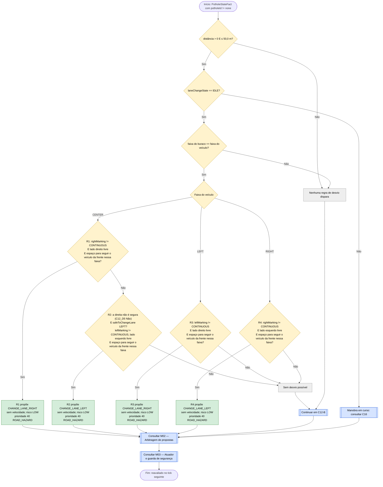
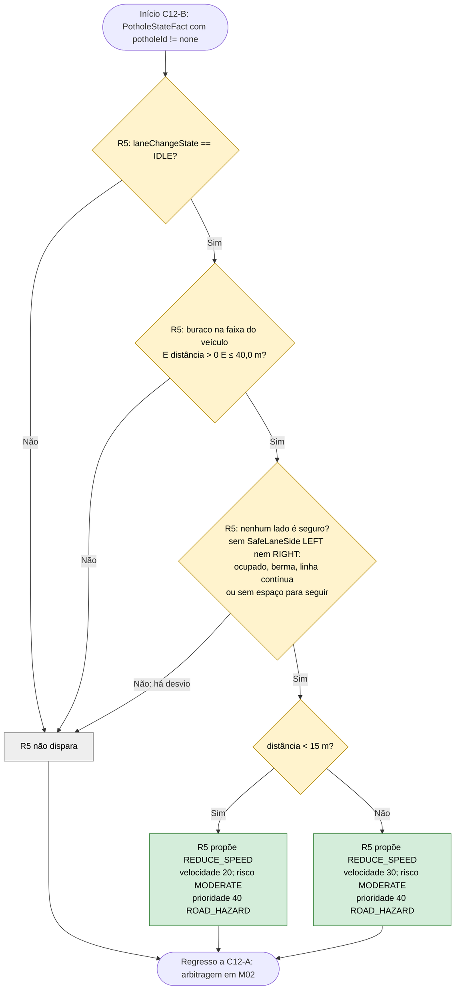

# C12 — Buraco na via

- **Branch / commit:** `teste_ana` @ `70082b4` + alterações de 18/10 por commitar (working tree)
- **Estado da informação:** confirmado pelo código e por testes.

Dividido em dois subfluxogramas: desvio (C12-A, um ramo por faixa do veículo) e redução de velocidade (C12-B).

"Lado esquerdo/direito livre" significa `LaneOccupancyState(lane == LEFT/RIGHT, occupied == false)`. O lado é relativo ao veículo; na berma, o lado sem faixa conta como ocupado.

**Encadeamento inverso (Grupo A).** As condições de segurança da mudança de faixa (sem manobra em curso, a linha a cruzar não é contínua, o lado de destino livre e espaço para seguir o veículo da frente nessa faixa) não são repetidas em cada regra: cada regra pergunta `safeToChangeLane(lado;)` (`lane-safety.drl`), e o motor prova os subobjetivos `maneuverIdle`, `noContinuousLine(lado)`, `sideClear(lado)` e `roomToFollow(lado)`. `roomToFollow` usa o veículo que o radar frontal vê à frente nessa faixa: depois dos 3 s da manobra o carro tem de conseguir baixar à velocidade dele 12 m atrás, a 2,0 m/s² (`StoppingPolicy.roomToFollow`); sem veículo, há sempre espaço. No Prolog, o mesmo com `prove(safe_to_change_lane(Lado))`. Os nós C12_D2 e as condições de linha e de lado livre dos fluxogramas abaixo são esses subobjetivos. Quando nenhuma mudança é possível, o painel de decisão mostra qual subobjetivo falha (bloco "Lane change: safe?").

## Fluxograma C12-A — Desvio

## Fluxograma C12-B — Redução de velocidade

R1 = `Avoid pothole in centre lane by changing right when right is clear`; R2 = `Avoid pothole in centre lane by changing left when right is occupied`; R3 = `Avoid pothole in left lane by changing right`; R4 = `Avoid pothole in right lane by changing left`; R5 = `Pothole ahead reduce speed`.

No motor, R1 a R5 são regras independentes. Os fluxogramas ordenam-nas por faixa porque as condições de faixa e de ocupação as tornam mutuamente exclusivas quando o buraco está na faixa do veículo.

## Situações a resolver

Os nós a **vermelho** nos fluxogramas acima assinalam passos onde há um problema por resolver.

| Nó | Problema | Confirmação | Como reproduzir |
|---|---|---|---|
| C12_P1 | ~~Com chuva (visibilidade ou aderência reduzida) a proposta de desvio perde o empate e o carro passa por cima do buraco.~~ **Resolvido** (canais separados; o tempo passou a teto difuso) | Confirmado por teste (`rainDoesNotBlockPotholeAvoidance`, Drools e Prolog) | Mesmo mecanismo do caso A15 |
| C12_P2 | ~~Idem.~~ **Resolvido** (canais separados; o tempo passou a teto difuso) | Confirmado por teste (`rainDoesNotBlockPotholeAvoidance`, Drools e Prolog) | Mesmo mecanismo do caso A15 |
| C12_P3 | ~~Idem.~~ **Resolvido** (canais separados; o tempo passou a teto difuso) | Confirmado por teste (`rainDoesNotBlockPotholeAvoidance`, Drools e Prolog) | Mesmo mecanismo do caso A15 |
| C12_P4 | ~~Com chuva a proposta de desvio perde o empate e o carro passa por cima do buraco a 51 km/h.~~ **Resolvido** (canais separados; o tempo passou a teto difuso) | Confirmado por teste (`rainDoesNotBlockPotholeAvoidance`, Drools e Prolog) | Caso A15 |
| C12B_D2 | ~~A faixa do buraco não é verificada: o carro trava até 24 km/h por um buraco que está noutra faixa.~~ **Resolvido a 18/10**: a regra só reage a um buraco na faixa do carro (Art. 24.º) | Confirmado por teste (`PotholeOtherLaneE2ETest`, Drools e Prolog) e em execução | Caso B01 | 18/10: mantém 60 km/h, nos dois motores.

Os casos (A01 a A22, B01 a B08) estão descritos em `relatorio-validacao.md`, secção 8.

## Tabela de decisões

| Nó | Regra | Condição real | Caminho verdadeiro | Caminho falso | Resultado |
|---|---|---|---|---|---|
| C12_D1 | R1–R4 | `$distance : distanceMeters > 0, distanceMeters <= 50.0` | C12_D2 | C12_X0 | Janela de desvio |
| C12_D2 | R1–R4 | subobjetivo `maneuverIdle()` de `safeToChangeLane`: `VehicleStateFact(laneChangeState == LaneChangeState.IDLE)` | C12_D3 | C16 | Não inicia segunda manobra |
| C12_D3 | R1–R4 | `PotholeStateFact(lane == <faixa do veículo>)` | C12_D4 | C12_X0 | Só desvia de buraco na própria faixa |
| C12_D5 | R1 | `safeToChangeLane(Lane.RIGHT;)`: de CENTER, `rightMarking != CONTINUOUS`, `LaneOccupancyState(lane == Lane.RIGHT, occupied == false)` e `roomToFollow(Lane.RIGHT;)` | C12_P1 | C12_D6 | Preferência pela direita |
| C12_D6 | R2 | `not SafeLaneSide(side == Lane.RIGHT)` e `safeToChangeLane(Lane.LEFT;)`: de CENTER, `leftMarking != CONTINUOUS`, lado esquerdo livre e `roomToFollow(Lane.LEFT;)` | C12_P2 | C12_X1 | Esquerda quando a direita não é caminho seguro (ocupada, ou livre sem espaço para seguir; art. 35.º e 18.º). Antes exigia a direita ocupada |
| C12_D7 | R3 | `VehicleStateFact(lane == Lane.LEFT)` e `safeToChangeLane(Lane.RIGHT;)`: de LEFT, `leftMarking != CONTINUOUS`, lado direito livre e `roomToFollow(Lane.RIGHT;)` | C12_P3 | C12_X1 | A linha entre LEFT e CENTER é a `leftMarking` |
| C12_D8 | R4 | `VehicleStateFact(lane == Lane.RIGHT)` e `safeToChangeLane(Lane.LEFT;)`: de RIGHT, `rightMarking != CONTINUOUS`, lado esquerdo livre e `roomToFollow(Lane.LEFT;)` | C12_P4 | C12_X1 | A linha entre RIGHT e CENTER é a `rightMarking` |
| C12B_D1 | R5 | `VehicleStateFact(laneChangeState == LaneChangeState.IDLE)` | C12B_D2 | C12B_X | — |
| C12B_D2 | R5 | `VehicleStateFact($lane : lane)` e `PotholeStateFact(potholeId != "none", lane == $lane, distanceMeters > 0, distanceMeters <= 40.0)` | C12B_D3 | C12B_X | Só um buraco na faixa do veículo (Art. 24.º); janela de redução, mais curta que a de desvio |
| C12B_D3 | R5 | `not SafeLaneSide(side == Lane.LEFT)` e `not SafeLaneSide(side == Lane.RIGHT)` | C12B_D7 | C12B_X | Só reduz quando o buraco não pode ser contornado em segurança (art. 24.º). Antes exigia os lados ocupados |
| C12B_D7 | R5 | `if ($distance < 15) target = 20.0` (senão 30.0) | C12B_P1 | C12B_P2 | Dois escalões |

## Ficha técnica

**Identificação**

| Campo | Valor |
|---|---|
| ID | C12 |
| Nome | Buraco na via |
| Objetivo | Contornar um buraco na própria faixa quando há faixa livre; caso contrário reduzir a velocidade |
| Condição de ativação | `PotholeStateFact(potholeId != "none")` a 50 m ou menos |
| Dados de entrada | `PotholeStateFact` (distância, faixa), `VehicleStateFact` (faixa, `laneChangeState`, marcações), `LaneOccupancyState` esquerda e direita |

**Lógica**

| Regra | Ficheiro:linha | Salience | Ação | Prioridade |
|---|---|---|---|---|
| R1 `Avoid pothole in centre lane by changing right when right is clear` | `avoidance.drl:80` | 475 | `CHANGE_LANE_RIGHT` | 40 |
| R2 `Avoid pothole in centre lane by changing left when right is occupied` | `avoidance.drl:102` | 470 | `CHANGE_LANE_LEFT` | 40 |
| R3 `Avoid pothole in left lane by changing right` | `avoidance.drl:127` | 470 | `CHANGE_LANE_RIGHT` | 40 |
| R4 `Avoid pothole in right lane by changing left` | `avoidance.drl:149` | 470 | `CHANGE_LANE_LEFT` | 40 |
| R5 `Pothole ahead reduce speed` | `road-hazards.drl:20` | 460 | `REDUCE_SPEED` | 40 |
| `Update pothole state` / `Clear stale pothole perception` | `01-state-updates.drl:247`, `581` | 1000 / 900 | — | — |

**Rastreabilidade**

| Elemento | Local |
|---|---|
| Sensor | `CameraSensor.observe()` (até 120 m × visibilidade); seleção em `WorldState.nearestPotholeAhead()`, com preferência pela faixa do veículo |
| Ocupação lateral | `BlindSpotSensor`, `WorldState.sideLaneOccupancy()` (perigos fixos na faixa ao lado até 60 m contam como ocupado) |
| Cenário de demonstração | `S5` (Pothole) |
| Pergunta de segurança (encadeamento inverso) | `lane-safety.drl:21` (`safeToChangeLane` e os subobjetivos nas linhas 29, 35, 43 e 51); Prolog `driving_rules.pl:1458` (`safe_to_change_lane/1`) |
| Testes unitários | `DrivingExpertSystemRulesTest`: `potholeAdjustsSpeed` (283), `conflictSpeedLimitAndPotholePotholeWins` (431) |
| Testes de integração | `PotholeOtherLaneE2ETest.ignoresAPotholeInAnotherLane` (Drools e Prolog); `CentreAvoidanceNoRoomToFollowE2ETest`: `potholeIsGoneRoundOnTheLeftWhenTheRightHasNoRoomToFollow`, `potholeWithNoSafeSideIsDrivenOverSlowly` (Drools e Prolog); `SimulationEngineE2ETest`: `dynamicWorldMutationPotholeDuringRunTriggersReaction` (558), `potholeInRightLaneChangesLeftOnlyWhenCenterIsClear` (869), `unsafeCenterTargetBlocksRightLanePotholeManeuverAndBrakes` (895); `LaneChangeManeuverE2ETest`: `potholeAvoidanceMovesVehicleLeft` (95), `blockedLanesPreventLaneChange` (157), `potholeAvoidancePrefersRightWhenLeftOccupied` (191), `doesNotOscillateAfterAvoidance` (214); `RoadLawAndOvertakingE2ETest`: `bug2RegressionCenterPotholeBothLanesFreeChoosesRight` (522), `bug2RegressionCenterPotholeRightBlockedChoosesLeft` (568), `bug2RegressionCenterPotholeBothBlockedNoLaneChange` (626) |

**Relações**

- Inicia C16. Bloqueia C17 enquanto houver buraco à frente (`road-law.drl:45`).
- Conflitos (M02): R5 é um teto (40); com o limite de C01 (20) e outros tetos fica o mais baixo (confirmado por teste). R1–R4 estão no canal lateral (40) e não competem com propostas de velocidade, nem com o teto do tempo de C18: o desvio com chuva está confirmado por `LaneChangeManeuverE2ETest.rainDoesNotBlockPotholeAvoidance`, nos dois motores. No canal lateral ganham às ultrapassagens e ao regresso à direita (30).

**Limitações**

- A gravidade do buraco (`severity`) é copiada para o facto mas nenhuma regra a usa.
- Em Drools, "não é seguro" é a ausência do facto `SafeLaneSide` desse lado, derivado na perceção a partir de `safeToChangeLane` (M04); no Prolog, `not(test(safe_to_change_lane(Lado)))`.
- Um buraco noutra faixa não faz reduzir a velocidade (R5 compara a faixa desde 18/10), mas continua a bloquear o regresso à direita (C17), que não verifica a faixa do buraco.
- Entre 40 e 50 m, sem desvio possível, nenhuma regra atua.
- No arranque os dois lados começam como ocupados (`KnowledgeSession.java:109-110`) até ao primeiro evento do sensor de ângulo morto.

## Exemplos de entradas

| Entrada | Caminho | Resultado |
|---|---|---|
| CENTER, buraco em CENTER a 45 m, ambos os lados livres | C12_D5 Sim | `CHANGE_LANE_RIGHT` (teste `bug2RegressionCenterPotholeBothLanesFreeChoosesRight`) |
| CENTER, buraco em CENTER a 45 m, direita ocupada, esquerda livre | C12_D6 Sim | `CHANGE_LANE_LEFT` (teste `bug2RegressionCenterPotholeRightBlockedChoosesLeft`) |
| CENTER, buraco em CENTER a 25 m, ambos ocupados | C12-B: C12B_D4 Sim, C12B_D7 Não | `REDUCE_SPEED` 30 (teste `potholeAdjustsSpeed`) |
| CENTER, buraco em CENTER a 10 m, ambos ocupados | C12B_D7 Sim | `REDUCE_SPEED` 20 |
| CENTER, buraco em CENTER a 55 m, RIGHT livre mas com um carro parado 90 m à frente, LEFT livre | C12_D5 Não (`roomToFollow` falha); C12_D6 Sim | `CHANGE_LANE_LEFT` (teste `CentreAvoidanceNoRoomToFollowE2ETest.potholeIsGoneRoundOnTheLeftWhenTheRightHasNoRoomToFollow`) |
| RIGHT, buraco em RIGHT a 40 m, CENTER livre mas com um carro parado 90 m à frente | C12_D8 Não; C12B_D3 Sim | `REDUCE_SPEED` 30 (teste `potholeWithNoSafeSideIsDrivenOverSlowly`) |
| RIGHT, buraco em RIGHT a 40 m, esquerda livre | C12_D8 Sim | `CHANGE_LANE_LEFT` (teste `potholeInRightLaneChangesLeftOnlyWhenCenterIsClear`) |
| Chuva (`SET_RAIN`), CENTER, buraco em CENTER a 100 m | Desvio no canal lateral; teto difuso no de velocidade | Desvia e abranda (teste `rainDoesNotBlockPotholeAvoidance`) |
| RIGHT, buraco em RIGHT a 45 m, esquerda ocupada | C12_D8 Não; C12B_D2 Não | Sem proposta (zona entre 40 e 50 m) |
| CENTER, buraco em LEFT a 30 m, ambos os lados ocupados | C12_D3 Não; C12B_D2 Não | Sem proposta: o buraco não está na faixa do veículo (teste `PotholeOtherLaneE2ETest`) |
| Buraco a 80 m | C12_D1 Não | Sem proposta |
