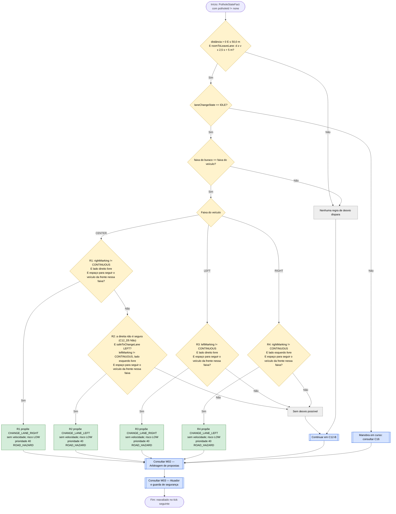
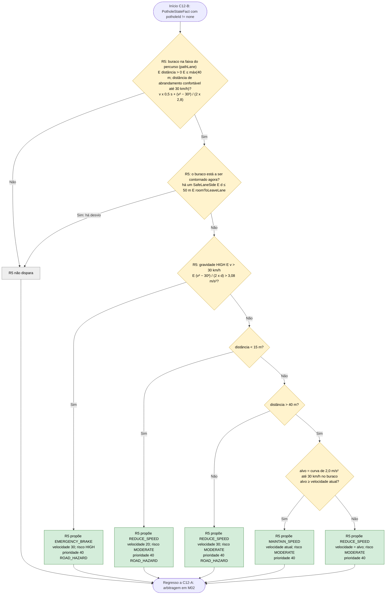

# C12 — Buraco na via

- **Branch / commit:** working tree a 21/10/2026
- **Estado da informação:** confirmado pelo código e por testes (regras no Drools e no Prolog; integração nos dois motores).

Dividido em dois subfluxogramas: desvio (C12-A, um ramo por faixa do veículo) e redução de velocidade (C12-B).

"Lado esquerdo/direito livre" significa `LaneOccupancyState(lane == LEFT/RIGHT, occupied == false)`. O lado é relativo ao veículo; na berma, o lado sem faixa conta como ocupado.

**Encadeamento inverso (Grupo A).** As condições de segurança da mudança de faixa (sem manobra em curso, a linha a cruzar não é contínua, o lado de destino livre e espaço para seguir o veículo da frente nessa faixa) não são repetidas em cada regra: cada regra pergunta `safeToChangeLane(lado;)` (`lane-safety.drl`), e o motor prova os subobjetivos `maneuverIdle`, `noContinuousLine(lado)`, `sideClear(lado)` e `roomToFollow(lado)`. `roomToFollow` usa o veículo que o radar frontal vê à frente nessa faixa: depois dos 3 s da manobra o carro tem de conseguir baixar à velocidade dele 12 m atrás, a 2,0 m/s² (`StoppingPolicy.roomToFollow`); sem veículo, há sempre espaço. No Prolog, o mesmo com `prove(safe_to_change_lane(Lado))`. Os nós C12_D2 e as condições de linha e de lado livre dos fluxogramas abaixo são esses subobjetivos. Quando nenhuma mudança é possível, o painel de decisão mostra qual subobjetivo falha (bloco "Lane change: safe?").

**Espaço para sair da faixa.** Um desvio só conta como caminho quando tira o carro da faixa antes do buraco (`StoppingPolicy.roomToLeaveLane`): distância ≥ v × (0,5 s de reação + 2,0 s até sair da faixa) + 5 m (comprimento do perigo). A 50 km/h são 39,7 m, a 60 km/h 46,7 m; acima de cerca de 65 km/h nenhum desvio cabe nos 50 m, e R5 abranda primeiro.

## Fluxograma C12-A — Desvio

## Fluxograma C12-B — Redução de velocidade

R1 = `Avoid pothole in centre lane by changing right when right is clear`; R2 = `Avoid pothole in centre lane by changing left when right is occupied`; R3 = `Avoid pothole in left lane by changing right`; R4 = `Avoid pothole in right lane by changing left`; R5 = `Pothole ahead reduce speed`.

No motor, R1 a R5 são regras independentes. Os fluxogramas ordenam-nas por faixa porque as condições de faixa e de ocupação as tornam mutuamente exclusivas quando o buraco está na faixa do veículo. R5 é o complemento exato dos desvios: só atua quando nenhum desvio está a ser decidido (C12B_D3). No Prolog, R5 está partida em três regras: `Pothole ahead reduce speed (emergency)`, `Pothole ahead reduce speed` e `Pothole ahead reduce speed (hold)`.

## Situações a resolver

Os nós a **vermelho** nos fluxogramas acima assinalam passos onde há um problema por resolver.

| Nó | Problema | Confirmação | Como reproduzir |
|---|---|---|---|
| C12_P1 | ~~Com chuva (visibilidade ou aderência reduzida) a proposta de desvio perde o empate e o carro passa por cima do buraco.~~ **Resolvido** (canais separados; o tempo passou a teto difuso) | Confirmado por teste (`rainDoesNotBlockPotholeAvoidance`, Drools e Prolog) | Mesmo mecanismo do caso A15 |
| C12_P2 | ~~Idem.~~ **Resolvido** (canais separados; o tempo passou a teto difuso) | Confirmado por teste (`rainDoesNotBlockPotholeAvoidance`, Drools e Prolog) | Mesmo mecanismo do caso A15 |
| C12_P3 | ~~Idem.~~ **Resolvido** (canais separados; o tempo passou a teto difuso) | Confirmado por teste (`rainDoesNotBlockPotholeAvoidance`, Drools e Prolog) | Mesmo mecanismo do caso A15 |
| C12_P4 | ~~Com chuva a proposta de desvio perde o empate e o carro passa por cima do buraco a 51 km/h.~~ **Resolvido** (canais separados; o tempo passou a teto difuso) | Confirmado por teste (`rainDoesNotBlockPotholeAvoidance`, Drools e Prolog) | Caso A15 |
| C12B_D2 | ~~A faixa do buraco não é verificada: o carro trava até 24 km/h por um buraco que está noutra faixa.~~ **Resolvido**: a regra só reage a um buraco na faixa do percurso (Art. 24.º) | Confirmado por teste (`PotholeOtherLaneE2ETest`, Drools e Prolog) e em execução | Caso B01; a 18/10 mantinha 60 km/h, nos dois motores |

Os casos (A01 a A22, B01 a B08) estão descritos em `relatorio-validacao.md`, secção 8.

## Tabela de decisões

| Nó | Regra | Condição real | Caminho verdadeiro | Caminho falso | Resultado |
|---|---|---|---|---|---|
| C12_D1 | R1–R4 | `$distance : distanceMeters > 0, distanceMeters <= 50.0, StoppingPolicy.roomToLeaveLane($speed, distanceMeters)` | C12_D2 | C12_X0 | Janela de desvio; mais perto, o desvio levaria o carro por cima do buraco |
| C12_D2 | R1–R4 | subobjetivo `maneuverIdle()` de `safeToChangeLane`: `VehicleStateFact(laneChangeState == LaneChangeState.IDLE)` | C12_D3 | C16 | Não inicia segunda manobra |
| C12_D3 | R1–R4 | `PotholeStateFact(lane == <faixa do veículo>)` (faixa comprometida, `VehicleStateFact.lane`) | C12_D4 | C12_X0 | Só desvia de buraco na própria faixa |
| C12_D5 | R1 | `safeToChangeLane(Lane.RIGHT;)`: de CENTER, `rightMarking != CONTINUOUS`, `LaneOccupancyState(lane == Lane.RIGHT, occupied == false)` e `roomToFollow(Lane.RIGHT;)` | C12_P1 | C12_D6 | Preferência pela direita (salience 475, acima das outras) |
| C12_D6 | R2 | `not SafeLaneSide(side == Lane.RIGHT)` e `safeToChangeLane(Lane.LEFT;)`: de CENTER, `leftMarking != CONTINUOUS`, lado esquerdo livre e `roomToFollow(Lane.LEFT;)` | C12_P2 | C12_X1 | Esquerda quando a direita não é caminho seguro (ocupada, ou livre sem espaço para seguir; art. 35.º e 18.º) |
| C12_D7 | R3 | `VehicleStateFact(lane == Lane.LEFT)` e `safeToChangeLane(Lane.RIGHT;)`: de LEFT, `leftMarking != CONTINUOUS`, lado direito livre e `roomToFollow(Lane.RIGHT;)` | C12_P3 | C12_X1 | A linha entre LEFT e CENTER é a `leftMarking` |
| C12_D8 | R4 | `VehicleStateFact(lane == Lane.RIGHT)` e `safeToChangeLane(Lane.LEFT;)`: de RIGHT, `rightMarking != CONTINUOUS`, lado esquerdo livre e `roomToFollow(Lane.LEFT;)` | C12_P4 | C12_X1 | A linha entre RIGHT e CENTER é a `rightMarking` |
| C12B_D2 | R5 | `VehicleStateFact($lane : pathLane, $speed : speedKmh)` e `PotholeStateFact(potholeId != "none", lane == $lane, distanceMeters > 0, distanceMeters <= Math.max(40.0, StoppingPolicy.slowingDistanceMeters($speed, POTHOLE_CROSSING_SPEED_KMH, COMFORT_DECELERATION_MPS2)))` | C12B_D3 | C12B_X | `pathLane`: a faixa do veículo, ou a de destino durante uma mudança de faixa. A janela fica nos 40 m até ~57 km/h; a 70 km/h é de ~65 m, a 90 km/h de ~112 m |
| C12B_D3 | R5 | `not ( SafeLaneSide() and PotholeStateFact(this == $pothole, distanceMeters <= 50.0, StoppingPolicy.roomToLeaveLane($speed, distanceMeters)) )` | C12B_X | C12B_D4 | Reduz enquanto o buraco não é contornado: nenhum lado seguro, perto demais para sair da faixa, ou ainda para lá dos 50 m (art. 24.º). Durante uma manobra não há `SafeLaneSide` (`maneuverIdle` falha) |
| C12B_D4 | R5 | `severity == HazardSeverity.HIGH && speedMps > crossingMps && (speedMps² − crossingMps²) / (2 × max(0,1; d)) > COMFORT_DECELERATION_MPS2 × 1,1` | C12B_P0 | C12B_D7 | Só um buraco grave é travado a fundo; um mais leve só abranda o que o conforto permite |
| C12B_D7 | R5 | `$distance < 15` → alvo 20,0 | C12B_P1 | C12B_D8 | — |
| C12B_D8 | R5 | `$distance > 40.0` | C12B_D9 | C12B_P2 | Entre 15 e 40 m pede a velocidade de travessia, 30 km/h (`POTHOLE_CROSSING_SPEED_KMH`) |
| C12B_D9 | R5 | alvo = `max(30, StoppingPolicy.curveSpeedKmh(30, ANTICIPATION_DECELERATION_MPS2, d))`; `target >= $speed` | C12B_P3 | C12B_P4 | Acima da curva segura a velocidade; abaixo dela segue-a |

A razão da proposta diz porque é que o buraco é atravessado e não contornado: "a way round is decided at 50 m" (mais de 50 m), "too close to go round" (sem `roomToLeaveLane`) ou "no free lane to go round it".

## Ficha técnica

**Identificação**

| Campo | Valor |
|---|---|
| ID | C12 |
| Nome | Buraco na via |
| Objetivo | Contornar um buraco na própria faixa quando há faixa livre e espaço para sair dela; caso contrário atravessá-lo devagar (30 km/h; 20 km/h nos últimos 15 m), travando a fundo por um buraco grave visto tarde |
| Condição de ativação | `PotholeStateFact(potholeId != "none")`: desvio a 50 m ou menos (com `roomToLeaveLane`); redução a máx(40 m; distância de abrandamento confortável até 30 km/h) ou menos |
| Dados de entrada | `PotholeStateFact` (distância, faixa, gravidade), `VehicleStateFact` (faixa, `pathLane`, velocidade, `laneChangeState`, marcações), `LaneOccupancyState` esquerda e direita, veículos à frente nas faixas laterais (`roomToFollow`) |

**Lógica**

| Regra | Ficheiro:linha | Salience | Ação | Prioridade |
|---|---|---|---|---|
| R1 `Avoid pothole in centre lane by changing right when right is clear` | `avoidance.drl:86` | 475 | `CHANGE_LANE_RIGHT` | 40 |
| R2 `Avoid pothole in centre lane by changing left when right is occupied` | `avoidance.drl:109` | 470 | `CHANGE_LANE_LEFT` | 40 |
| R3 `Avoid pothole in left lane by changing right` | `avoidance.drl:135` | 470 | `CHANGE_LANE_RIGHT` | 40 |
| R4 `Avoid pothole in right lane by changing left` | `avoidance.drl:158` | 470 | `CHANGE_LANE_LEFT` | 40 |
| R5 `Pothole ahead reduce speed` | `road-hazards.drl:35` | 460 | `REDUCE_SPEED`, `MAINTAIN_SPEED` ou `EMERGENCY_BRAKE` | 40 |
| `Update pothole state` / `Clear stale pothole perception` | `01-state-updates.drl:247`, `581` | 1000 / 900 | — | — |
| `Derive the sides that are safe to change lane to` (`SafeLaneSide`) | `01-state-updates.drl:664` | 800 | — | — |

**Rastreabilidade**

| Elemento | Local |
|---|---|
| Sensor | `CameraSensor.observe()` (até 120 m × visibilidade); seleção em `WorldState.nearestPotholeAhead()`, com preferência pela faixa do percurso (`pathLane`) |
| Ocupação lateral | `BlindSpotSensor`, `WorldState.sideLaneOccupancy()` (perigos fixos na faixa ao lado até 60 m, `HAZARD_LOOKAHEAD_METERS`, contam como ocupado) |
| Código do mapa | 2 = buraco de gravidade alta (`MapLegend.defaults()`); um buraco de cenário sem gravidade é `MEDIUM` |
| Cenário de demonstração | `S5` (Pothole): CENTER a 70 km/h, buraco (código 2) na faixa central |
| Pergunta de segurança (encadeamento inverso) | `lane-safety.drl:21` (`safeToChangeLane` e os subobjetivos nas linhas 29, 35, 43 e 51); Prolog `driving_rules.pl:1667` (`safe_to_change_lane/1`); auxiliares de R5 no Prolog: `pothole_slow_window/2`, `pothole_avoidable_now/2`, `pothole_hard_braking/3`, `pothole_target/2`, `pothole_reason/3` |
| Testes unitários | `DrivingExpertSystemRulesTest`: `potholeAdjustsSpeed` (284), `potholeTooCloseToGoRoundIsCrossedSlowly` (368), `potholeFarAheadIsApproachedOnTheCurveToTheCrossingSpeed` (388), `severePotholeTooCloseForComfortableSlowingIsBrakedHardFor` (405), `lighterPotholeTooCloseForComfortableSlowingIsOnlySlowedFor` (422), `conflictSpeedLimitAndPotholePotholeWins` (562); `PrologRulesTest.severePotholeTooCloseForComfortableSlowingIsBrakedHardFor` (772); `PrologDroolsEquivalenceTest`: casos "pothole ahead, right lane clear", "pothole ahead, only left lane clear", "pothole close, no lane free", "pothole farther, no lane free" |
| Testes de integração | Drools e Prolog: `PotholeOtherLaneE2ETest.ignoresAPotholeInAnotherLane`; `CentreAvoidanceNoRoomToFollowE2ETest`: `potholeIsGoneRoundOnTheLeftWhenTheRightHasNoRoomToFollow`, `potholeWithNoSafeSideIsDrivenOverSlowly`; `HazardAppearingCloseE2ETest`: `potholeAppearingCloseIsCrossedSlowly`, `potholeAppearingTooCloseIsBrakedForNotSwervedAround`, `severePotholesSideBySideAtSpeedAreCrossedSlowly`; `SimulationEngineE2ETest.dynamicWorldMutationPotholeDuringRunTriggersReaction` (558); `LaneChangeManeuverE2ETest`: `rainDoesNotBlockPotholeAvoidance` (73), `potholeAvoidanceMovesVehicleLeft` (95), `blockedLanesPreventLaneChange` (157), `potholeAvoidancePrefersRightWhenLeftOccupied` (191), `doesNotOscillateAfterAvoidance` (214); `RoadLawAndOvertakingE2ETest`: `bug2RegressionCenterPotholeBothLanesFreeChoosesRight` (539), `bug2RegressionCenterPotholeRightBlockedChoosesLeft` (587), `bug2RegressionCenterPotholeBothBlockedNoLaneChange` (647). Só Drools: `SimulationEngineE2ETest`: `potholeInRightLaneChangesLeftOnlyWhenCenterIsClear` (869), `unsafeCenterTargetBlocksRightLanePotholeManeuverAndBrakes` (895) |

**Relações**

- Inicia C16. Bloqueia C17 enquanto houver buraco à frente (`road-law.drl:45`).
- Conflitos (M02): R5 é um teto (40); com o limite de C01 (20) e outros tetos fica o mais baixo (confirmado por teste). R1–R4 estão no canal lateral (40) e não competem com propostas de velocidade, nem com o teto do tempo de C18: o desvio com chuva está confirmado por `LaneChangeManeuverE2ETest.rainDoesNotBlockPotholeAvoidance`, nos dois motores. No canal lateral ganham às ultrapassagens e ao regresso à direita (30) e perdem para os desvios de obstáculo e de barreira (50).

**Limitações**

- Da gravidade só conta `HIGH`, e só para a travagem forte (C12B_D4); `LOW` e `MEDIUM` são tratados da mesma maneira.
- Em Drools, "não é seguro" é a ausência do facto `SafeLaneSide` desse lado, derivado na perceção a partir dos subobjetivos de `safeToChangeLane` (M04); no Prolog, `not(test(safe_to_change_lane(Lado)))` nos desvios e `pothole_avoidable_now/2` em R5.
- Um buraco noutra faixa não faz reduzir a velocidade (R5 compara com `pathLane`), mas continua a bloquear o regresso à direita (C17), que não verifica a faixa do buraco.
- Até ~57 km/h a janela de R5 fica nos 40 m: entre 40 e 50 m, sem desvio possível, nenhuma regra atua.
- Acima de ~65 km/h nenhum desvio cabe nos 50 m (`roomToLeaveLane`): o carro abranda primeiro pela curva de R5 e só depois desvia (testes `bug2Regression…`, a 70 km/h com o buraco a 90 m).
- `EMERGENCY_BRAKE` de R5 tem prioridade 40 e leva alvo 30 km/h, mas o atuador trava a −8,5 m/s² sem seguir o alvo; no ciclo em que a travagem confortável volta a chegar, R5 passa a `REDUCE_SPEED`.
- No arranque os dois lados começam como ocupados (`KnowledgeSession.java:113-114`) até ao primeiro evento do sensor de ângulo morto.

## Exemplos de entradas

| Entrada | Caminho | Resultado |
|---|---|---|
| CENTER, 70 km/h, buraco HIGH em CENTER a 90 m, ambos os lados livres | C12B_D2 a partir de ~65 m (curva); C12_D5 Sim quando `roomToLeaveLane` passa | Abranda e depois `CHANGE_LANE_RIGHT` (teste `bug2RegressionCenterPotholeBothLanesFreeChoosesRight`) |
| Idem, direita ocupada, esquerda livre | C12_D6 Sim | `CHANGE_LANE_LEFT` (teste `bug2RegressionCenterPotholeRightBlockedChoosesLeft`) |
| CENTER, 75 km/h, buraco MEDIUM em CENTER a 25 m, ambos ocupados | C12B_D4 Não; C12B_D7 Não; C12B_D8 Não | `REDUCE_SPEED` 30 (teste `potholeAdjustsSpeed`) |
| CENTER, 60 km/h, buraco MEDIUM em CENTER a 20 m, direita livre | C12_D1 Não (são precisos 46,7 m); C12B_D3 Não | `REDUCE_SPEED` 30, sem desvio (teste `potholeTooCloseToGoRoundIsCrossedSlowly`) |
| CENTER, 90 km/h, buraco HIGH em CENTER a 100 m, sem lado seguro | C12B_D2 Sim (janela ~112 m); C12B_D9 Não | `REDUCE_SPEED` ~78 km/h, na curva (teste `potholeFarAheadIsApproachedOnTheCurveToTheCrossingSpeed`) |
| CENTER, 90 km/h, buraco HIGH a 40 m, sem lado seguro | C12B_D4 Sim (6,9 m/s² > 3,08) | `EMERGENCY_BRAKE` (teste `severePotholeTooCloseForComfortableSlowingIsBrakedHardFor`; Prolog `(emergency)`) |
| Idem, buraco MEDIUM | C12B_D4 Não; C12B_D8 Não | `REDUCE_SPEED` 30, "Pothole too close to go round…" (teste `lighterPotholeTooCloseForComfortableSlowingIsOnlySlowedFor`) |
| CENTER, 40 km/h, buraco MEDIUM em CENTER a 10 m, ambos ocupados | C12B_D7 Sim | `REDUCE_SPEED` 20 |
| CENTER, 50 km/h, buraco em CENTER a 55 m, RIGHT livre mas com um carro parado 90 m à frente, LEFT livre | C12_D5 Não (`roomToFollow` falha); C12_D6 Sim | `CHANGE_LANE_LEFT` (teste `CentreAvoidanceNoRoomToFollowE2ETest.potholeIsGoneRoundOnTheLeftWhenTheRightHasNoRoomToFollow`) |
| RIGHT, 50 km/h, buraco em RIGHT a 45 m, CENTER livre mas com um carro parado 90 m à frente | C12_D8 Não; C12B_D3 Não | `REDUCE_SPEED` 30 a 40 m ou menos (teste `potholeWithNoSafeSideIsDrivenOverSlowly`) |
| RIGHT, 50 km/h, buraco em RIGHT a 40 m, esquerda livre | C12_D8 Sim (39,7 ≤ 40) | `CHANGE_LANE_LEFT` |
| Chuva (`SET_RAIN`), CENTER, buraco em CENTER a 100 m | Desvio no canal lateral; teto difuso no de velocidade | Desvia e abranda (teste `rainDoesNotBlockPotholeAvoidance`) |
| RIGHT, 50 km/h, buraco em RIGHT a 45 m, esquerda ocupada | C12_D8 Não; C12B_D2 Não (janela de 40 m) | Sem proposta |
| CENTER, buraco em LEFT a 30 m, ambos os lados ocupados | C12_D3 Não; C12B_D2 Não | Sem proposta: o buraco não está na faixa do percurso (teste `PotholeOtherLaneE2ETest`) |
| 50 km/h, buraco a 80 m | C12_D1 Não; C12B_D2 Não | Sem proposta |
