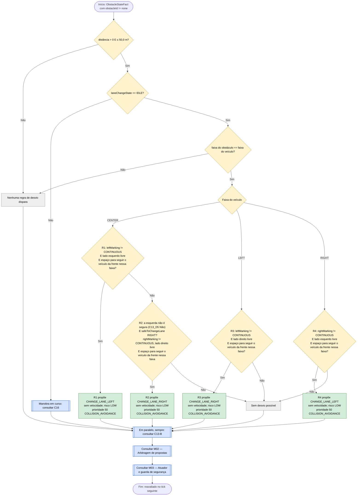
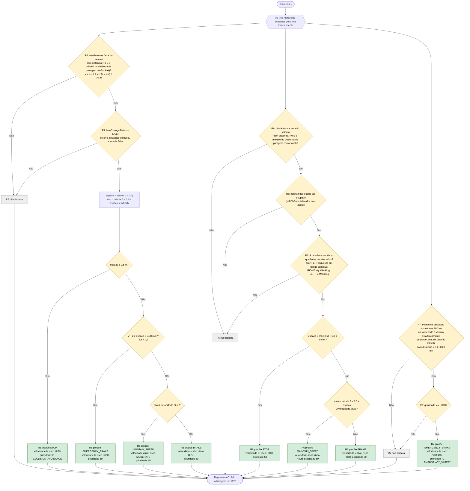

# C13 — Obstáculo na via

- **Branch / commit:** `teste_ana` @ `70082b4` + alterações de 18/10 por commitar (working tree)
- **Estado da informação:** confirmado pelo código e por testes de integração; R7 também por testes de regras (Drools e Prolog).

**Janelas de distância.** O desvio decide-se a 50 m ou menos: dentro dos 60 m em que o sensor de ângulo morto reporta perigos nas faixas laterais (`BlindSpotSensor.HAZARD_LOOKAHEAD_METERS`), para que um lado visto livre o esteja durante toda a manobra. A paragem (R5, R6) começa antes, à distância de que uma paragem confortável precisa à velocidade atual (nunca menos de 60 m), e leva o carro aos 50 m a uma velocidade da qual ainda consegue parar se nenhum lado estiver livre.

Dividido em dois subfluxogramas: desvio (C13-A, um ramo por faixa do veículo) e paragem (C13-B).

"Lado esquerdo/direito livre" significa `LaneOccupancyState(lane == LEFT/RIGHT, occupied == false)`, relativo ao veículo.

**Encadeamento inverso (Grupo A).** As condições de segurança da mudança de faixa (sem manobra em curso, a linha a cruzar não é contínua, o lado de destino livre e espaço para seguir o veículo da frente nessa faixa) não são repetidas em cada regra: cada regra pergunta `safeToChangeLane(lado;)` (`lane-safety.drl`), e o motor prova os subobjetivos `maneuverIdle`, `noContinuousLine(lado)`, `sideClear(lado)` e `roomToFollow(lado)`. `roomToFollow` usa o veículo que o radar frontal vê à frente nessa faixa: depois dos 3 s da manobra o carro tem de conseguir baixar à velocidade dele 12 m atrás, a 2,0 m/s² (`StoppingPolicy.roomToFollow`); sem veículo, há sempre espaço. No Prolog, o mesmo com `prove(safe_to_change_lane(Lado))`. Os nós C13_D2 e as condições de linha e de lado livre dos fluxogramas abaixo são esses subobjetivos. Quando nenhuma mudança é possível, o painel de decisão mostra qual subobjetivo falha (bloco "Lane change: safe?").

## Fluxograma C13-A — Desvio

## Fluxograma C13-B — Paragem e emergência

R1 = `Avoid obstacle in centre lane by changing left`; R2 = `Avoid obstacle in centre lane by changing right when left is occupied`; R3 = `Avoid obstacle in left lane by changing right`; R4 = `Avoid obstacle in right lane by changing left`; R5 = `Stop before obstacle ahead while still in its lane`; R6 = `Stop before obstacle when lane change prohibited by continuous line`; R7 = `Emergency braking for high severity obstacle at critical distance`.

## Situações a resolver

Os nós a **vermelho** nos fluxogramas acima assinalam passos onde há um problema por resolver.

| Nó | Problema | Confirmação | Como reproduzir |
|---|---|---|---|
| C13_P1 | ~~Com chuva a proposta de desvio perde o empate; o carro não se desvia.~~ **Resolvido** (canais separados; o tempo passou a teto difuso) | Confirmado em execução a 17/10 (caso A16, secção R2 do relatório) | Mesmo mecanismo do caso A16 |
| C13_P2 | ~~Idem.~~ **Resolvido** (canais separados; o tempo passou a teto difuso) | Confirmado em execução a 17/10 (caso A16, secção R2 do relatório) | Mesmo mecanismo do caso A16 |
| C13_P3 | ~~Idem.~~ **Resolvido** (canais separados; o tempo passou a teto difuso) | Confirmado em execução a 17/10 (caso A16, secção R2 do relatório) | Mesmo mecanismo do caso A16 |
| C13_P4 | ~~Com chuva a proposta de desvio perde o empate; o carro só trava de emergência a 8 m e passa pelo obstáculo a 42 km/h.~~ **Resolvido** (canais separados; o tempo passou a teto difuso) | Confirmado em execução a 17/10 (caso A16, secção R2 do relatório) | Caso A16 |
| C13B_P7 | ~~Dispara a meio de um desvio já em curso, porque a faixa do veículo só muda quando a manobra termina: travagem de emergência desnecessária de 60 para 45 km/h.~~ **Resolvido** (commit `fd27dc6` da drools: a regra lê a faixa física) | Confirmado em execução a 18/10 | Caso A10 | 18/10: sem `EMERGENCY_BRAKE`, nos dois motores.

Os casos (A01 a A22, B01 a B08) estão descritos em `relatorio-validacao.md`, secção 8.

## Tabela de decisões

| Nó | Regra | Condição real | Caminho verdadeiro | Caminho falso | Resultado |
|---|---|---|---|---|---|
| C13_D1 | R1–R4 | `$distance : distanceMeters > 0, distanceMeters <= 50.0` | C13_D2 | C13_X0 | Janela de desvio |
| C13_D2 | R1–R4 | subobjetivo `maneuverIdle()` de `safeToChangeLane`: `VehicleStateFact(laneChangeState == LaneChangeState.IDLE)` | C13_D3 | C16 | — |
| C13_D3 | R1–R4 | `ObstacleStateFact(lane == <faixa do veículo>)` | C13_D4 | C13_X0 | — |
| C13_D5 | R1 | `safeToChangeLane(Lane.LEFT;)`: de CENTER, `leftMarking != CONTINUOUS`, `LaneOccupancyState(lane == Lane.LEFT, occupied == false)` e `roomToFollow(Lane.LEFT;)` | C13_P1 | C13_D6 | Preferência pela esquerda |
| C13_D6 | R2 | `not SafeLaneSide(side == Lane.LEFT)` e `safeToChangeLane(Lane.RIGHT;)`: de CENTER, `rightMarking != CONTINUOUS`, lado direito livre e `roomToFollow(Lane.RIGHT;)` | C13_P2 | C13_X1 | Direita como alternativa |
| C13_D7 | R3 | `VehicleStateFact(lane == Lane.LEFT)` e `safeToChangeLane(Lane.RIGHT;)`: de LEFT, `leftMarking != CONTINUOUS`, lado direito livre e `roomToFollow(Lane.RIGHT;)` | C13_P3 | C13_X1 | A linha entre LEFT e CENTER é a `leftMarking` |
| C13_D8 | R4 | `VehicleStateFact(lane == Lane.RIGHT)` e `safeToChangeLane(Lane.LEFT;)`: de RIGHT, `rightMarking != CONTINUOUS`, lado esquerdo livre e `roomToFollow(Lane.LEFT;)` | C13_P4 | C13_X1 | A linha entre RIGHT e CENTER é a `rightMarking` |
| C13B_D1 | R5 | `ObstacleStateFact(obstacleId != "none", lane == $lane, distanceMeters > 0, distanceMeters <= Math.max(60.0, StoppingPolicy.requiredDistanceMeters($speed, COMFORT_DECELERATION_MPS2, OBSTACLE_STOP_OFFSET_METERS)))` | C13B_D2 | C13B_X5 | A 70 km/h a janela é de ~87 m; a 50 km/h fica nos 60 m |
| C13B_D2 | R5 | `VehicleStateFact(laneChangeState == LaneChangeState.IDLE)` | C13B_C5 | C13B_X5 | Segura o carro enquanto não começa a sair da faixa: sem lado livre, desvio vetado ou recusado. Já não exige os dois lados ocupados |
| C13B_D3 | R5 | `room <= 0.5` | C13B_P5a | C13B_D4 | Pára 10 m antes |
| C13B_D4 | R5 | `speedMps * speedMps / (2.0 * room) > COMFORT_DECELERATION_MPS2 * 1.1` | C13B_P5b | C13B_D4b | Travagem forte se a confortável não chega |
| C13B_D4b | R5 | `target >= $speed`, com `target = √(2 × ANTICIPATION_DECELERATION_MPS2 (2,0) × room) × 3,6` | C13B_P5d | C13B_P5c | Acima da curva segura a velocidade (não ganha velocidade em direção ao obstáculo); na curva trava até ela |
| C13B_D6 | R6 | `ObstacleStateFact(obstacleId != "none", lane == $lane, distanceMeters > 0, distanceMeters <= Math.max(60.0, requiredDistanceMeters(...)))` (a mesma janela de R5) | C13B_D5 | C13B_X6 | — |
| C13B_D5 | R6 | `!$leftSafe && !$rightSafe` (`LaneOccupancyState.safeToEnter`) | C13B_D7 | C13B_X6 | Nenhum lado pode ser ocupado |
| C13B_D7 | R6 | `($lane == CENTER && (left == CONTINUOUS \|\| right == CONTINUOUS)) \|\| ($lane == RIGHT && right == CONTINUOUS) \|\| ($lane == LEFT && left == CONTINUOUS)` | C13B_D8 | C13B_X6 | A explicação cita a lei (linha contínua), não só o trânsito |
| C13B_D8 | R6 | `room <= 0.5` | C13B_P6a | C13B_D8b | R6 não tem ramo de emergência |
| C13B_D8b | R6 | `target >= $speed`, com a curva de 2,0 m/s² | C13B_P6c | C13B_P6b | — |
| C13B_D9 | R7 | `VehicleStateFact( $lane : physicalLane )` e `ObstacleDetectedEvent( lane == $lane, distanceMeters > 0, distanceMeters <= 8.0, ... ) over window:time(300ms) from entry-point "ROAD_STREAM"` | C13B_D10 | C13B_X7 | Lê o evento, não o facto |
| C13B_D10 | R7 | `severity.toString() == "HIGH"` | C13B_P7 | C13B_X7 | Só gravidade alta |

## Ficha técnica

**Identificação**

| Campo | Valor |
|---|---|
| ID | C13 |
| Nome | Obstáculo na via |
| Objetivo | Contornar um obstáculo na própria faixa; enquanto o carro não começa a sair dela, conseguir sempre parar 10 m antes; travar de emergência a 8 m ou menos na faixa onde o carro está fisicamente |
| Condição de ativação | `ObstacleStateFact(obstacleId != "none")` a máx(60 m; distância de paragem confortável) ou menos |
| Dados de entrada | `ObstacleStateFact` (distância, faixa), `ObstacleDetectedEvent` (gravidade), `VehicleStateFact` (faixa, faixa física, velocidade, `laneChangeState`, marcações), `LaneOccupancyState` esquerda e direita, veículos à frente nas faixas laterais (`roomToFollow`) |

**Lógica**

| Regra | Ficheiro:linha | Salience | Ação | Prioridade |
|---|---|---|---|---|
| R1 `Avoid obstacle in centre lane by changing left` | `avoidance.drl:178` | 470 | `CHANGE_LANE_LEFT` | 50 |
| R2 `Avoid obstacle in centre lane by changing right when left is occupied` | `avoidance.drl:200` | 470 | `CHANGE_LANE_RIGHT` | 50 |
| R3 `Avoid obstacle in left lane by changing right` | `avoidance.drl:225` | 470 | `CHANGE_LANE_RIGHT` | 50 |
| R4 `Avoid obstacle in right lane by changing left` | `avoidance.drl:247` | 470 | `CHANGE_LANE_LEFT` | 50 |
| R5 `Stop before obstacle ahead while still in its lane` | `road-hazards.drl:67` | 465 | `MAINTAIN_SPEED`, `BRAKE`, `STOP` ou `EMERGENCY_BRAKE` | 50 |
| R6 `Stop before obstacle when lane change prohibited by continuous line` | `road-hazards.drl:108` | 466 | `MAINTAIN_SPEED`, `BRAKE` ou `STOP` | 50 |
| R7 `Emergency braking for high severity obstacle at critical distance` | `emergency.drl:85` | 870 | `EMERGENCY_BRAKE` | 70 |
| `Update obstacle state` / `Clear stale obstacle perception` | `01-state-updates.drl:613`, `635` | 1000 / 900 | — | — |

A margem de 10 m de R5 e R6 fica fora da zona de 8 m de R7, para o veículo poder desviar-se quando uma faixa abrir (comentário em `road-hazards.drl:51-68`).

**Rastreabilidade**

| Elemento | Local |
|---|---|
| Sensor | `CameraSensor.observe()` (até 120 m × visibilidade); `WorldState.nearestObstacleAhead()` |
| Código do mapa | 1 = obstáculo de gravidade alta (README, secção "Road map") |
| Cenários de demonstração | `S13_MATRIX_COURSE`, `S15_CONTINUOUS_LINE_BLOCKED` |
| Pergunta de segurança (encadeamento inverso) | `lane-safety.drl:21` (`safeToChangeLane` e os subobjetivos nas linhas 29, 35, 43 e 51); Prolog `driving_rules.pl:1458` (`safe_to_change_lane/1`) |
| Testes | `CentreAvoidanceNoRoomToFollowE2ETest`: `obstacleIsGoneRoundOnTheRightWhenTheLeftHasNoRoomToFollow`, `slowerVehicleOnTheLeftIsNotPassedOnItsRightAfterTheAvoidance` (Drools e Prolog); `RoadMapE2ETest`: `wallOfObstaclesStopsTheCarUntilALaneOpens` (76), `obstacleCourseIsDrivenWithoutCollisions` (120); `RoadLawAndOvertakingE2ETest`: `continuousLineBlocksLaneChangeAndBrakesBeforeObstacle` (140), `regressionTestReturnRightAfterObstacleAvoidance` (288) |

**Relações**

- Inicia C16. Depois de uma paragem, C04 retoma o andamento. Bloqueia C17 (`road-law.drl:44`).
- Conflitos internos: R1–R4 (canal lateral, 50) e R5 (canal de velocidade, 50) disparam juntas a 50 m ou menos quando há lado livre: o carro trava na curva e começa o desvio no mesmo ciclo; R5 deixa de atuar quando a manobra começa. R5 e R6 podem disparar juntas: são tetos de 50 e fica a velocidade mais baixa. R7 (70) ganha a todas no canal de velocidade e, por ser uma travagem, veta uma mudança de faixa de prioridade inferior (M02).
- Conflitos externos: R1–R4 estão no canal lateral a 50: ganham às ultrapassagens e ao regresso à direita (30) e aos desvios de buraco (40). Não competem com o teto difuso do tempo de C18 (canal de velocidade); o mesmo mecanismo está confirmado por teste para o buraco (`rainDoesNotBlockPotholeAvoidance`).

**Limitações**

- Na faixa central o obstáculo é contornado de preferência pela esquerda (R1), ao contrário do buraco (C12), que prefere a direita.
- No centro, R2 desvia para a direita quando a esquerda não é caminho seguro: ocupada, ou livre mas sem espaço para seguir o carro da frente (art. 35.º e 18.º). Antes exigia a esquerda ocupada. Em Drools, "não é seguro" é a ausência do facto `SafeLaneSide` desse lado, derivado na perceção a partir de `safeToChangeLane` (M04); no Prolog, `not(test(safe_to_change_lane(Lado)))`. Depois desse desvio, um veículo mais lento na faixa LEFT não é passado pela direita (C11-C, regra `Do not pass a slower far left lane vehicle on its right`).
- R6 não exige `laneChangeState == IDLE`: pode disparar durante uma manobra; R5 exige.
- `EMERGENCY_BRAKE` de R5 tem prioridade 50, não 70.
- O alvo de `BRAKE` em R5 e R6 é a curva de travagem, que pode ser superior à velocidade atual; como `BRAKE` é uma ação de travagem, o atuador mantém a velocidade em vez de acelerar (M03).
- R7 dispara mesmo que exista faixa livre; não há ramo de desvio a 8 m ou menos. Lê a faixa física (`VehicleStateFact.physicalLane`, da posição lateral; Prolog `ego_physical_lane/1`): a meio de um desvio, quando o carro já saiu da faixa do obstáculo, não trava.
- `Update obstacle state` é a única regra de atualização sem verificação de diferença.
- Testes de regras (Drools e Prolog): `highSeverityObstacleCloseAheadInTheVehiclesLaneIsAnEmergency` e `highSeverityObstacleIsNotAnEmergencyOnceTheVehicleHasPhysicallyLeftItsLane` (faixa física de R7). A janela de paragem de R5 não tem teste de regras dedicado. A paragem com linha contínua (R6) é exercitada por `RoadLawAndOvertakingE2ETest.continuousLineBlocksLaneChangeAndBrakesBeforeObstacle`; o desvio na aproximação a um vermelho por `FarStopNearObstacleE2ETest`.

## Exemplos de entradas

| Entrada | Caminho | Resultado |
|---|---|---|
| CENTER, obstáculo em CENTER a 45 m, esquerda livre | C13_D5 Sim | `CHANGE_LANE_LEFT` |
| CENTER, obstáculo a 45 m, esquerda ocupada, direita livre | C13_D6 Sim | `CHANGE_LANE_RIGHT` |
| CENTER, obstáculo a 55 m, LEFT livre mas com um carro parado 90 m à frente, RIGHT livre | C13_D5 Não (`roomToFollow` falha); C13_D6 Sim | `CHANGE_LANE_RIGHT` (teste `CentreAvoidanceNoRoomToFollowE2ETest.obstacleIsGoneRoundOnTheRightWhenTheLeftHasNoRoomToFollow`) |
| RIGHT, obstáculo em RIGHT a 40 m, esquerda livre | C13_D8 Sim | `CHANGE_LANE_LEFT` |
| RIGHT, 60 km/h, obstáculo em RIGHT a 66 m | R5: janela 67,9 m; espaço 56; 2,48 ≤ 3,08; alvo 53,9 | `BRAKE` 53,9; o desvio só a 50 m |
| CENTER, 30 km/h, obstáculo a 55 m | R5: espaço 45; alvo 48,3 ≥ 30 | `MAINTAIN_SPEED` 30 (não ganha velocidade) |
| CENTER, 60 km/h, obstáculo visto a 55 m | espaço 45; v²/2·espaço = 3,09 > 3,08 | `EMERGENCY_BRAKE` (prioridade 50) |
| CENTER, 50 km/h, obstáculo a 55 m | espaço 45; 2,14 ≤ 3,08; alvo 48,3 | `BRAKE` 48,3 |
| CENTER, 5 km/h, obstáculo a 10,4 m, ambos ocupados | espaço 0,4 | `STOP` |
| RIGHT, linha contínua entre RIGHT e CENTER, 40 km/h, obstáculo a 40 m | R6: espaço 30; alvo 39,4 | `BRAKE` 39,4 |
| Qualquer faixa, obstáculo de gravidade HIGH a 7 m na própria faixa | C13B_D10 Sim | `EMERGENCY_BRAKE` (prioridade 70) |
