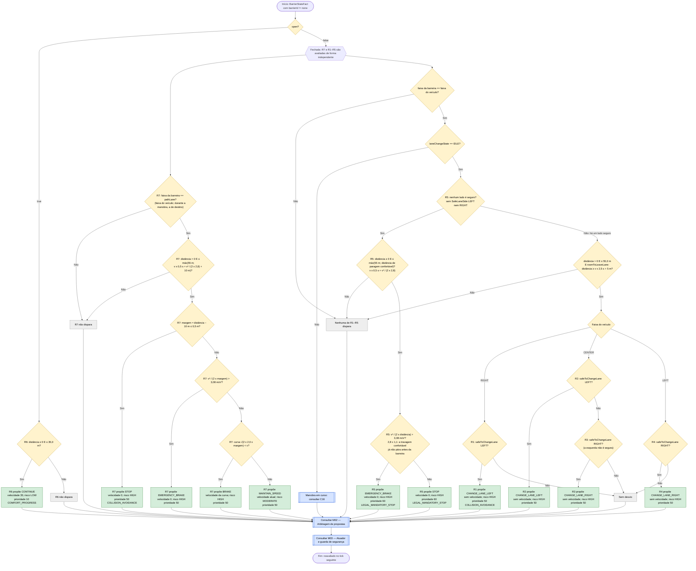

# C14 — Barreira

- **Branch / commit:** working tree a 21/10/2026
- **Estado da informação:** confirmado pelo código e por testes (regras no Drools e no Prolog; integração nos dois motores).

**Desviar ou parar, nunca nenhum dos dois (18/10).** Os desvios e a paragem fazem a mesma pergunta, `safeToChangeLane(lado)`: com a manobra parada, ou há um lado seguro e o carro contorna a barreira, ou não há e pára (Código da Estrada, art. 35.º: só se muda de faixa sem perigo; art. 18.º e 24.º: não se entra numa faixa onde não se consegue manter a distância ao carro da frente). Antes, a paragem exigia os dois lados ocupados no sensor de ângulo morto e R3 exigia a esquerda ocupada: com um lado livre mas sem espaço para seguir o carro da frente (`roomToFollow`), nenhuma regra atuava e o carro seguia contra a barreira.

**Aproximação: `Stop before closed barrier while still in its lane` (R7).** Uma barreira fechada no caminho do veículo (`VehicleStateFact.pathLane`: a sua faixa, ou a faixa para onde está a mudar durante a manobra) é abordada como um obstáculo (C13): a regra liga-se à distância de paragem confortável mais 10 m (nunca menos de 55 m), mantém a velocidade acima da curva de travagem, trava para a curva de antecipação (2,0 m/s²) sobre ela, trava a fundo quando a margem já pede mais do que a travagem confortável e pára 10 m antes da barreira (`StoppingPolicy.BARRIER_STOP_OFFSET_METERS`). É um teto de velocidade (50), não depende de haver um lado seguro e não veta nada: vale enquanto o desvio é decidido e deixa de valer quando a mudança de faixa tira a barreira do caminho. Sem ela, uma barreira que aparecia perto, ou uma na faixa em que o veículo estava a entrar, só era vista por R5 quando nenhum lado era seguro, e o carro chegava-lhe em velocidade (comentário em `barrier.drl:120-131`). Do mesmo modo, os desvios R1–R4 só valem quando a mudança de faixa ainda tira o veículo da faixa antes da barreira (`StoppingPolicy.roomToLeaveLane`: distância ≥ v × (0,5 s + 2,0 s) + 5 m); mais perto, R7 trava.

A segurança das faixas vizinhas vem da perceção, como em C12 e C13: o desvio prova `safeToChangeLane(lado)` (`lane-safety.drl`: manobra parada, linha a cruzar não contínua, esse lado livre no `LaneOccupancyState` do sensor de ângulo morto e espaço para seguir o veículo que o radar vê à frente nessa faixa), e a paragem exige que nenhum lado seja seguro. O sensor de ângulo morto dá um lado como ocupado também quando há um obstáculo, buraco ou barreira fechada nessa faixa entre 5 m atrás e 60 m à frente, quando a linha a cruzar é contínua ou quando esse lado é a berma (`WorldState.sideLaneOccupancy`). Antes usava `VehicleStateFact.leftAdjacentLaneSafe`/`rightAdjacentLaneSafe`, calculados sobre o mundo; passou à perceção porque o condutor só se pode certificar do que vê (art. 35.º e 38.º).

## Fluxograma

R1 = `Avoid closed barrier by changing left when safe`; R2 = `Avoid closed barrier by changing left from centre when safe`; R3 = `Avoid closed barrier by changing right from centre when safe`; R4 = `Avoid closed barrier by changing right when safe`; R5 = `Closed barrier requires stop`; R6 = `Open barrier allows continue if no higher priority`; R7 = `Stop before closed barrier while still in its lane`.

As sete regras são independentes no motor. As condições de faixa e a mesma pergunta `safeToChangeLane` tornam R1–R5 mutuamente exclusivas com a manobra parada, por isso o fluxograma mostra-as em sequência. R7 não é exclusiva de nenhuma: no canal de velocidade convive com um desvio (R1–R4, canal lateral) e com R5, que a vence. No Prolog, R5 está partida em duas cláusulas (`Closed barrier requires stop` e `… (emergency)`) e R7 em quatro (`… (stop)`, `… (emergency)`, `… (brake)`, `… (hold)`), lendo `ego_path_lane/1`; R1–R4 testam `room_to_leave_lane/2`. Em Drools, "não é seguro" é a ausência do facto `SafeLaneSide` desse lado, derivado na perceção a partir de `safeToChangeLane` (M04); no Prolog, `not(test(safe_to_change_lane(Lado)))`.

## Tabela de decisões

| Nó | Regra | Condição real | Caminho verdadeiro | Caminho falso | Resultado |
|---|---|---|---|---|---|
| C14_D0 | R1–R5, R7 / R6 | `open == false` / `open == true` | ramo fechada | ramo aberta | — |
| C14_D1 | R6 | `distanceMeters >= 0, distanceMeters <= 35.0` | C14_P6 | C14_X6 | Não verifica a faixa |
| C14_D10 | R7 | `VehicleStateFact($lane : pathLane)`, `BarrierStateFact(open == false, lane == $lane)` | C14_D11 | C14_X7 | Durante a manobra, `pathLane` é a faixa de destino: trava para uma barreira na faixa em que entra e esquece a da faixa que deixa |
| C14_D11 | R7 | `distanceMeters > 0, distanceMeters <= Math.max(55.0, StoppingPolicy.requiredDistanceMeters($speed, COMFORT_DECELERATION_MPS2, BARRIER_STOP_OFFSET_METERS))` | C14_D12 | C14_X7 | A 90 km/h liga-se a ~134 m; até ~52 km/h fica nos 55 m |
| C14_D12 | R7 | `room = max(0, distância − 10)`; `room <= 0.5` | C14_P7s | C14_D13 | No ponto de paragem |
| C14_D13 | R7 | `speedMps² / (2 × room) > COMFORT_DECELERATION_MPS2 × 1,1` | C14_P7e | C14_D14 | Barreira vista tarde: trava a fundo |
| C14_D14 | R7 | `target = StoppingPolicy.curveSpeedKmh(0, ANTICIPATION_DECELERATION_MPS2, room)`; `target < $speed` | C14_P7b | C14_P7h | Sobre a curva trava para ela; abaixo mantém a velocidade |
| C14_D2 | R1–R5 | `BarrierStateFact(open == false, lane == <faixa do veículo>)` | C14_D4 | C14_X0 | — |
| C14_D4 | R1–R5 | `laneChangeState == LaneChangeState.IDLE` (em R1–R4 através de `maneuverIdle`) | C14_D3 | C16 | Durante o desvio a pergunta falha dos dois lados; sem esta condição R5 travaria a meio da manobra e vetá-la-ia |
| C14_D3 | R5 | `not SafeLaneSide(side == Lane.LEFT)` e `not SafeLaneSide(side == Lane.RIGHT)` | C14_D3b | C14_D2b | Nenhum lado seguro, seja qual for o subobjetivo que falha |
| C14_D3b | R5 | `distanceMeters >= 0, distanceMeters <= Math.max(55.0, StoppingPolicy.requiredDistanceMeters($speed, COMFORT_DECELERATION_MPS2, 0.0))` | C14_D3c | C14_X0 | A 70 km/h a janela é de ~77 m; até ~60 km/h fica nos 55 m |
| C14_D3c | R5 | `speedMps² / (2 × max(0,1; distância)) > COMFORT_DECELERATION_MPS2 × 1,1` | C14_P5b | C14_P5 | Barreira vista tarde: trava a fundo |
| C14_D2b | R1–R4 | `distanceMeters > 0, distanceMeters <= 55.0, StoppingPolicy.roomToLeaveLane($speed, distanceMeters)` | C14_D5 | C14_X0 | Janela de desvio; a 60 km/h só a partir de ~47 m, a 65 km/h de ~50 m |
| C14_D6 | R1 | `lane == Lane.RIGHT`, `safeToChangeLane(Lane.LEFT;)` | C14_P1 | C14_X1 | A linha cruzada (RIGHT–CENTER) é a `rightMarking` |
| C14_D7 | R2 | `lane == Lane.CENTER`, `safeToChangeLane(Lane.LEFT;)` | C14_P2 | C14_D8 | Preferência pela esquerda |
| C14_D8 | R3 | `lane == Lane.CENTER`, `not SafeLaneSide(side == Lane.LEFT)`, `safeToChangeLane(Lane.RIGHT;)` | C14_P3 | C14_X1 | A direita quando a esquerda não é caminho seguro (ocupada, ou livre sem espaço para seguir) |
| C14_D9 | R4 | `lane == Lane.LEFT`, `safeToChangeLane(Lane.RIGHT;)` | C14_P4 | C14_X1 | A linha cruzada (LEFT–CENTER) é a `leftMarking` |

R6 não tem guarda: é uma proposta de conforto (10) e perde para qualquer teto, paragem ou libertação do ciclo (comentário em `barrier.drl:203-204`).

Os ramos C14_X1 são inatingíveis com a manobra parada: só se chega a C14_D5 quando há um lado seguro, e em cada faixa há uma regra de desvio para esse lado (em RIGHT e LEFT o outro lado é a berma, que nunca é seguro). Ficam no diagrama para fechar todas as saídas. Com um lado seguro mas a barreira perto demais para sair da faixa (C14_D2b Não), nem R1–R4 nem R5 disparam: decide R7.

## Ficha técnica

**Identificação**

| Campo | Valor |
|---|---|
| ID | C14 |
| Nome | Barreira |
| Objetivo | Contornar uma barreira fechada na própria faixa quando há faixa segura e ainda há espaço para sair da faixa; travar na aproximação para poder parar 10 m antes dela; parar (a fundo, se for vista tarde) quando nenhum lado é seguro; avançar com barreira aberta |
| Condição de ativação | `BarrierStateFact(barrierId != "none")`: aproximação (R7) a máx(55 m; distância de paragem confortável + 10 m) ou menos; desvio a 55 m ou menos, se `roomToLeaveLane`; paragem obrigatória a máx(55 m; distância de paragem confortável) ou menos; 35 m se aberta |
| Dados de entrada | `BarrierStateFact` (distância, `open`, faixa), `VehicleStateFact` (faixa, `pathLane`, velocidade, `laneChangeState`, marcações), `LaneOccupancyState` (lados esquerdo e direito, do sensor de ângulo morto), veículos à frente nas faixas laterais (`roomToFollow`) |

**Lógica**

| Regra | Ficheiro:linha | Salience | Ação | Prioridade |
|---|---|---|---|---|
| R1 `Avoid closed barrier by changing left when safe` | `barrier.drl:26` | 650 | `CHANGE_LANE_LEFT` | 50 |
| R2 `Avoid closed barrier by changing left from centre when safe` | `barrier.drl:49` | 650 | `CHANGE_LANE_LEFT` | 50 |
| R3 `Avoid closed barrier by changing right from centre when safe` | `barrier.drl:72` | 650 | `CHANGE_LANE_RIGHT` | 50 |
| R4 `Avoid closed barrier by changing right when safe` | `barrier.drl:97` | 650 | `CHANGE_LANE_RIGHT` | 50 |
| R7 `Stop before closed barrier while still in its lane` | `barrier.drl:132` | 645 | `STOP`, `EMERGENCY_BRAKE`, `BRAKE` ou `MAINTAIN_SPEED` | 50 |
| R5 `Closed barrier requires stop` | `barrier.drl:176` | 640 | `STOP` ou `EMERGENCY_BRAKE` | 60 |
| R6 `Open barrier allows continue if no higher priority` | `barrier.drl:205` | 170 | `CONTINUE` | 10 |
| `Update barrier state` / `Clear stale barrier perception` | `01-state-updates.drl:273`, `597` | 1000 / 900 | — | — |

**Rastreabilidade**

| Elemento | Local |
|---|---|
| Sensor | `CameraSensor.observe()` (200 ms, até 120 m × visibilidade); `WorldState.nearestBarrier()`, que reporta uma só barreira: a mais próxima na `pathLane`, senão a mais próxima em qualquer faixa |
| Segurança lateral | `LaneOccupancyState` do sensor de ângulo morto (`BlindSpotSensor`, 200 ms, `WorldState.sideLaneOccupancy()`), lido através de `safeToChangeLane` (`lane-safety.drl:21`) e do facto `SafeLaneSide` (`01-state-updates.drl`, `insertLogical`). `leftAdjacentLaneSafe`/`rightAdjacentLaneSafe` continuam a ser calculados (`WorldState.isLaneSafe()`, `WorldState.java:516`), mas nenhuma regra de barreira os lê |
| Constantes | `StoppingPolicy`: `BARRIER_STOP_OFFSET_METERS` 10, `COMFORT_DECELERATION_MPS2` 2,8, `ANTICIPATION_DECELERATION_MPS2` 2,0, `REACTION_TIME_SECONDS` 0,5, `LANE_EXIT_SECONDS` 2,0, `HAZARD_LENGTH_METERS` 5 |
| Código do mapa | 3 = barreira fechada (README, secção "Road map") |
| Cenário de demonstração | `S6` (Closed barrier) — `scenarios.json:452`: começa em RIGHT (faixa por omissão) a 65 km/h, barreira fechada (código 3) em RIGHT na linha 26 do mapa (130 m), sem outros atores |
| Testes | `DrivingExpertSystemRulesTest`: `barrierClosedTriggersStop` (299), `barrierClosedTooCloseForComfortableBrakingTriggersEmergencyBrake` (313), `closedBarrierFarAheadIsApproachedOnTheBrakingCurve` (328), `closedBarrierTooCloseToGoRoundIsBrakedForInsteadOfAvoided` (350); `PrologRulesTest`: `closedBarrierIsAvoidedThroughALaneTheSensorReportsClear` (722), `closedBarrierFarAheadIsApproachedOnTheBrakingCurve` (738), `closedBarrierTooCloseToGoRoundIsBrakedForInsteadOfAvoided` (756); `PrologDroolsEquivalenceTest`: "closed barrier, no adjacent lane safe", "open barrier"; parametrizados em Drools e Prolog: `BarrierNoRoomToFollowE2ETest` (`goesRoundOnTheRightWhenTheLeftHasNoRoomToFollow`, `holdsForTheBarrierWhileTheFreeSideHasNoRoomToFollow`), `HazardAppearingCloseE2ETest` (`barrierAppearingCloseIsBrakedForNotSwervedAround`, `barrierInTheLaneBeingEnteredIsBrakedFor`, `wallAtNinetyIsStoppedForComfortably`), `LaneChangeLawE2ETest.closedBarrierIsPassedThroughTheLaneTheSensorReportsClear` |

**Relações**

- Inicia C16. Depois de uma paragem, C04 retoma o andamento quando a barreira abrir. Bloqueia C17 enquanto fechada (`road-law.drl:46`).
- Conflitos (M02): R5 (60) sobrepõe-se a todos os tetos de velocidade, incluindo R7, e empata com C05 e C07, todas com velocidade 0. Como R5 só dispara sem nenhum lado seguro e com a manobra parada, nunca veta um desvio desta barreira. R7 (50) é um teto: entre os tetos ganha o de velocidade mais baixa, seja qual for o degrau; não veta manobras (só as propostas de 60 e 70 vetam, e só enquanto travam). R1–R4 estão no canal lateral a 50: ganham às ultrapassagens e ao regresso à direita (30) e não competem com propostas de velocidade. R6 (10, 35 km/h) é base de conforto: qualquer teto mais baixo ganha-lhe; entre bases fica a de velocidade mais baixa.

**Limitações**

- A ocupação lateral vem do sensor de ângulo morto, que lê de 200 em 200 ms: o desvio pode começar até 200 ms depois de a faixa ficar livre.
- Barreira fechada para lá da janela de R7 (55 m, ou a distância de paragem confortável + 10 m a alta velocidade) e até 120 m: nenhuma regra atua.
- Durante uma manobra R1–R5 não disparam (exigem IDLE) e decide C16; R7 continua a valer, mas para a faixa de destino.
- Quando R5 vale, decide a ação (`STOP` executado com a travagem confortável, 60): a margem de 10 m de R7 é o alvo da aproximação, não uma garantia; R5 não tem margem própria. O teste `wallAtNinetyIsStoppedForComfortably` (barreiras nas três faixas a 150 m, 90 km/h) verifica só que o carro pára pelo menos 5 m antes, sem travagem de emergência.
- A câmara reporta uma só barreira por leitura (a do caminho, senão a mais próxima): uma segunda barreira mais à frente na mesma faixa só é vista depois de passar a primeira.
- R6 não verifica a faixa da barreira.
- R2, R4 e R6 não têm teste dedicado.

## Exemplos de entradas

| Entrada | Caminho | Resultado |
|---|---|---|
| CENTER, 30 km/h, barreira fechada em CENTER a 22 m, ambos os lados inseguros | C14_D3 Sim; 1,58 ≤ 3,08 | `STOP` por R5 (teste `barrierClosedTriggersStop`); R7 propõe `BRAKE` 24,9 km/h e perde |
| CENTER, 60 km/h, barreira fechada em CENTER a 22 m, ambos os lados inseguros | C14_D3 Sim; 6,31 > 3,08 | `EMERGENCY_BRAKE` por R5 (teste `barrierClosedTooCloseForComfortableBrakingTriggersEmergencyBrake`) |
| CENTER, 90 km/h, barreira fechada em CENTER a 130 m, ambos os lados livres | C14_D11 Sim (janela ~134 m); C14_D14 Sim; C14_D2b Não (fora dos 55 m) | `BRAKE` 78,9 km/h por R7, sem manobra (teste `closedBarrierFarAheadIsApproachedOnTheBrakingCurve`, nos dois motores) |
| CENTER, 60 km/h, barreira fechada em CENTER a 25 m, direita livre | C14_D3 Não; C14_D2b Não (`roomToLeaveLane` pede ~47 m); C14_D13 Sim (9,26 > 3,08) | `EMERGENCY_BRAKE` por R7, sem manobra (teste `closedBarrierTooCloseToGoRoundIsBrakedForInsteadOfAvoided`, nos dois motores) |
| RIGHT, 50 km/h, barreira em RIGHT a 55 m, CENTER livre mas com um carro parado 90 m à frente | C14_D3 Sim (`roomToFollow` falha) | `STOP` por R5; o teste `holdsForTheBarrierWhileTheFreeSideHasNoRoomToFollow` verifica que a barreira retém o veículo e que ele não lhe bate |
| CENTER, 50 km/h, barreira em CENTER a 55 m, LEFT livre mas com um carro parado 90 m à frente, RIGHT livre | C14_D7 Não; C14_D8 Sim | `CHANGE_LANE_RIGHT`, decidido a mais de 40 m da barreira (teste `goesRoundOnTheRightWhenTheLeftHasNoRoomToFollow`) |
| 70 km/h, barreira fechada na faixa a 70 m, nenhum lado seguro | C14_D3b Sim (janela ~77 m); 2,70 ≤ 3,08 | `STOP` por R5 (60); R7 propõe `EMERGENCY_BRAKE` (3,15 > 3,08 com a margem de 60 m) a 50 e perde |
| RIGHT, 50 km/h, barreira fechada em RIGHT a 50 m, esquerda segura | C14_D6 Sim (`roomToLeaveLane` pede ~40 m); C14_D14 Sim | `CHANGE_LANE_LEFT` por R1; no canal de velocidade, R7 `BRAKE` 45,5 km/h até a manobra mudar a `pathLane` |
| CENTER, 50 km/h, barreira fechada em CENTER a 50 m, esquerda segura | C14_D7 Sim | `CHANGE_LANE_LEFT` por R2 |
| CENTER, 50 km/h, barreira fechada a 50 m, esquerda insegura, direita segura | C14_D8 Sim | `CHANGE_LANE_RIGHT` por R3 |
| LEFT, 50 km/h, barreira fechada em LEFT a 50 m, direita insegura | C14_D3 Sim (a esquerda é berma); 1,93 ≤ 3,08 | `STOP` por R5 |
| Em mudança de RIGHT para CENTER, barreira fechada em CENTER a 70 m | C14_D10 Sim (`pathLane` = CENTER); C14_D4 Não | R7 trava para a barreira da faixa de destino (teste `barrierInTheLaneBeingEnteredIsBrakedFor`) |
| CENTER, barreira fechada em RIGHT a 30 m | C14_D2 Não; C14_D10 Não | Sem proposta de C14 |
| Barreira aberta a 30 m | C14_D1 Sim | `CONTINUE` 35 |
| 50 km/h, barreira fechada na faixa a 80 m | C14_D11 Não e C14_D3b Não (janelas de 55 m) | Sem proposta; a 70 km/h R7 já se ligaria (~87 m) |
