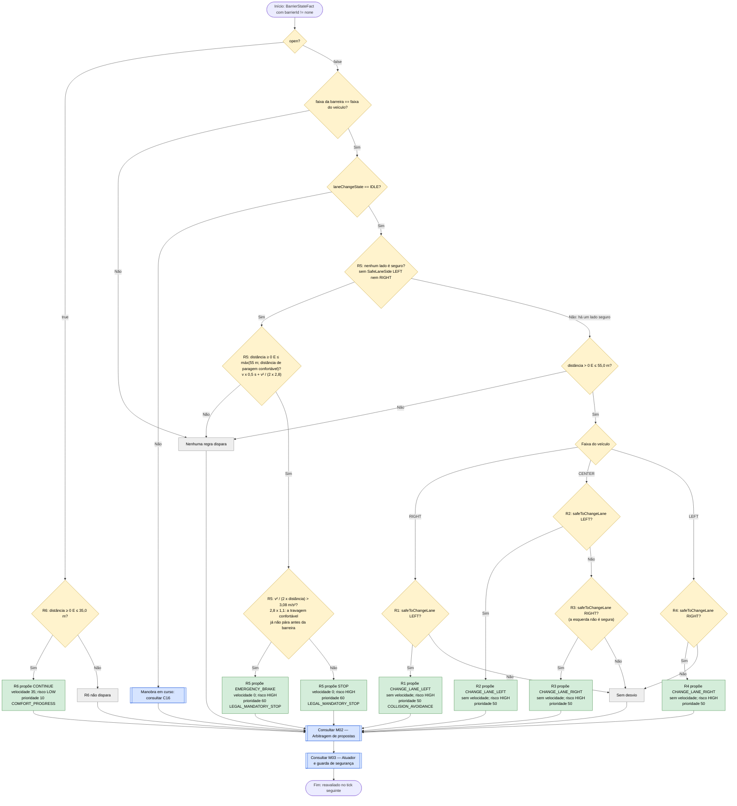

# C14 — Barreira

- **Branch / commit:** `teste_ana` @ `70082b4` + alterações de 18/10 por commitar (working tree)
- **Estado da informação:** confirmado pelo código e por testes (regras no Drools e no Prolog; integração nos dois motores).

**Desviar ou parar, nunca nenhum dos dois (18/10).** Os desvios e a paragem fazem a mesma pergunta, `safeToChangeLane(lado)`: com a manobra parada, ou há um lado seguro e o carro contorna a barreira, ou não há e pára (Código da Estrada, art. 35.º: só se muda de faixa sem perigo; art. 18.º e 24.º: não se entra numa faixa onde não se consegue manter a distância ao carro da frente). Antes, a paragem exigia os dois lados ocupados no sensor de ângulo morto e R3 exigia a esquerda ocupada: com um lado livre mas sem espaço para seguir o carro da frente (`roomToFollow`), nenhuma regra atuava e o carro seguia contra a barreira.

A segurança das faixas vizinhas vem da perceção, como em C12 e C13: o desvio prova `safeToChangeLane(lado)` (`lane-safety.drl`: manobra parada, linha a cruzar não contínua, esse lado livre no `LaneOccupancyState` do sensor de ângulo morto e espaço para seguir o veículo que o radar vê à frente nessa faixa), e a paragem exige que nenhum lado seja seguro. Antes usava `VehicleStateFact.leftAdjacentLaneSafe`/`rightAdjacentLaneSafe`, calculados sobre o mundo; passou à perceção porque o condutor só se pode certificar do que vê (art. 35.º e 38.º).

## Fluxograma

R1 = `Avoid closed barrier by changing left when safe`; R2 = `Avoid closed barrier by changing left from centre when safe`; R3 = `Avoid closed barrier by changing right from centre when safe`; R4 = `Avoid closed barrier by changing right when safe`; R5 = `Closed barrier requires stop`; R6 = `Open barrier allows continue if no higher priority`.

As seis regras são independentes no motor. As condições de faixa e a mesma pergunta `safeToChangeLane` tornam R1–R5 mutuamente exclusivas com a manobra parada, por isso o fluxograma mostra-as em sequência. No Prolog, R5 está partida em duas cláusulas (`Closed barrier requires stop` e `… (emergency)`). Em Drools, "não é seguro" é a ausência do facto `SafeLaneSide` desse lado, derivado na perceção a partir de `safeToChangeLane` (M04); no Prolog, `not(test(safe_to_change_lane(Lado)))`.

## Tabela de decisões

| Nó | Regra | Condição real | Caminho verdadeiro | Caminho falso | Resultado |
|---|---|---|---|---|---|
| C14_D0 | R1–R5 / R6 | `open == false` / `open == true` | ramo fechada | ramo aberta | — |
| C14_D1 | R6 | `distanceMeters >= 0, distanceMeters <= 35.0` | C14_P6 | C14_X6 | Não verifica a faixa |
| C14_D2 | R1–R5 | `BarrierStateFact(open == false, lane == <faixa do veículo>)` | C14_D4 | C14_X0 | — |
| C14_D4 | R1–R5 | `laneChangeState == LaneChangeState.IDLE` (em R1–R4 através de `maneuverIdle`) | C14_D3 | C16 | Durante o desvio a pergunta falha dos dois lados; sem esta condição R5 travaria a meio da manobra e vetá-la-ia |
| C14_D3 | R5 | `not SafeLaneSide(side == Lane.LEFT)` e `not SafeLaneSide(side == Lane.RIGHT)` | C14_D3b | C14_D2b | Nenhum lado seguro, seja qual for o subobjetivo que falha |
| C14_D3b | R5 | `distanceMeters >= 0, distanceMeters <= Math.max(55.0, StoppingPolicy.requiredDistanceMeters($speed, COMFORT_DECELERATION_MPS2, 0.0))` | C14_D3c | C14_X0 | A 70 km/h a janela é de ~77 m; até ~60 km/h fica nos 55 m |
| C14_D3c | R5 | `speedMps² / (2 × max(0,1; distância)) > COMFORT_DECELERATION_MPS2 × 1,1` | C14_P5b | C14_P5 | Barreira vista tarde: trava a fundo |
| C14_D2b | R1–R4 | `distanceMeters > 0, distanceMeters <= 55.0` | C14_D5 | C14_X0 | Janela de desvio |
| C14_D6 | R1 | `lane == Lane.RIGHT`, `safeToChangeLane(Lane.LEFT;)` | C14_P1 | C14_X1 | A linha cruzada (RIGHT–CENTER) é a `rightMarking` |
| C14_D7 | R2 | `lane == Lane.CENTER`, `safeToChangeLane(Lane.LEFT;)` | C14_P2 | C14_D8 | Preferência pela esquerda |
| C14_D8 | R3 | `lane == Lane.CENTER`, `not SafeLaneSide(side == Lane.LEFT)`, `safeToChangeLane(Lane.RIGHT;)` | C14_P3 | C14_X1 | A direita quando a esquerda não é caminho seguro (ocupada, ou livre sem espaço para seguir) |
| C14_D9 | R4 | `lane == Lane.LEFT`, `safeToChangeLane(Lane.RIGHT;)` | C14_P4 | C14_X1 | A linha cruzada (LEFT–CENTER) é a `leftMarking` |

R6 não tem guarda: é uma proposta de conforto (10) e perde para qualquer teto, paragem ou libertação do ciclo (comentário em `barrier.drl:134-135`).

Os ramos C14_X1 são inatingíveis com a manobra parada: só se chega a C14_D5 quando há um lado seguro, e em cada faixa há uma regra de desvio para esse lado (em RIGHT e LEFT o outro lado é a berma, que nunca é seguro). Ficam no diagrama para fechar todas as saídas.

## Ficha técnica

**Identificação**

| Campo | Valor |
|---|---|
| ID | C14 |
| Nome | Barreira |
| Objetivo | Contornar uma barreira fechada na própria faixa quando há faixa segura; caso contrário parar antes dela (a fundo, se for vista tarde); avançar com barreira aberta |
| Condição de ativação | `BarrierStateFact(barrierId != "none")`: desvio a 55 m ou menos; paragem a máx(55 m; distância de paragem confortável) ou menos; 35 m se aberta |
| Dados de entrada | `BarrierStateFact` (distância, `open`, faixa), `VehicleStateFact` (faixa, velocidade, `laneChangeState`, marcações), `LaneOccupancyState` (lados esquerdo e direito, do sensor de ângulo morto), veículos à frente nas faixas laterais (`roomToFollow`) |

**Lógica**

| Regra | Ficheiro:linha | Salience | Ação | Prioridade |
|---|---|---|---|---|
| R1 `Avoid closed barrier by changing left when safe` | `barrier.drl:24` | 650 | `CHANGE_LANE_LEFT` | 50 |
| R2 `Avoid closed barrier by changing left from centre when safe` | `barrier.drl:46` | 650 | `CHANGE_LANE_LEFT` | 50 |
| R3 `Avoid closed barrier by changing right from centre when safe` | `barrier.drl:68` | 650 | `CHANGE_LANE_RIGHT` | 50 |
| R4 `Avoid closed barrier by changing right when safe` | `barrier.drl:92` | 650 | `CHANGE_LANE_RIGHT` | 50 |
| R5 `Closed barrier requires stop` | `barrier.drl:122` | 640 | `STOP` ou `EMERGENCY_BRAKE` | 60 |
| R6 `Open barrier allows continue if no higher priority` | `barrier.drl:151` | 170 | `CONTINUE` | 10 |
| `Update barrier state` / `Clear stale barrier perception` | `01-state-updates.drl:273`, `597` | 1000 / 900 | — | — |

**Rastreabilidade**

| Elemento | Local |
|---|---|
| Sensor | `CameraSensor.observe()` (até 120 m × visibilidade); `WorldState.nearestBarrier()` |
| Segurança lateral | `LaneOccupancyState` do sensor de ângulo morto (`BlindSpotSensor`, `WorldState.sideLaneOccupancy()`), lido através de `safeToChangeLane` (`lane-safety.drl:21`). `leftAdjacentLaneSafe`/`rightAdjacentLaneSafe` continuam a ser calculados (`WorldState.isLaneSafe()`, `WorldState.java:496-503`), mas nenhuma regra os lê |
| Código do mapa | 3 = barreira fechada (README, secção "Road map") |
| Cenário de demonstração | `S6` (Closed barrier) — `scenarios.json:452` |
| Testes | `DrivingExpertSystemRulesTest`: `barrierClosedTriggersStop` (297), `barrierClosedTooCloseForComfortableBrakingTriggersEmergencyBrake` (311); `PrologRulesTest.closedBarrierIsAvoidedThroughALaneTheSensorReportsClear` (697); `BarrierNoRoomToFollowE2ETest` (Drools e Prolog): `holdsForTheBarrierWhileTheFreeSideHasNoRoomToFollow`, `goesRoundOnTheRightWhenTheLeftHasNoRoomToFollow`; `LaneChangeLawE2ETest.closedBarrierIsPassedThroughTheLaneTheSensorReportsClear` |

**Relações**

- Inicia C16. Depois de uma paragem, C04 retoma o andamento quando a barreira abrir. Bloqueia C17 enquanto fechada (`road-law.drl:46`).
- Conflitos (M02): R5 (60) sobrepõe-se a todos os tetos de velocidade e empata com C05 e C07, todas com velocidade 0. Como R5 só dispara sem nenhum lado seguro e com a manobra parada, nunca veta um desvio desta barreira. R1–R4 estão no canal lateral a 50: ganham às ultrapassagens e ao regresso à direita (30) e não competem com propostas de velocidade. R6 (10, 35 km/h) é base de conforto: qualquer teto mais baixo ganha-lhe; entre bases fica a de velocidade mais baixa.

**Limitações**

- A ocupação lateral vem do sensor de ângulo morto, que lê de 200 em 200 ms: o desvio pode começar até 200 ms depois de a faixa ficar livre.
- Barreira fechada para lá da janela de paragem (55 m, ou mais a alta velocidade) e até 120 m: nenhuma regra atua.
- Durante uma manobra nenhuma regra de C14 dispara (R1–R5 exigem IDLE); decide C16.
- A paragem é feita com a travagem confortável a partir do ponto onde R5 começa, sem margem fixa antes da barreira (ao contrário da linha do semáforo, a 18 m, ou dos 10 m do obstáculo).
- R6 não verifica a faixa da barreira.
- R2, R4 e R6 não têm teste dedicado.

## Exemplos de entradas

| Entrada | Caminho | Resultado |
|---|---|---|
| CENTER, 30 km/h, barreira fechada em CENTER a 22 m, ambos os lados inseguros | C14_D3 Sim; 1,58 ≤ 3,08 | `STOP` (teste `barrierClosedTriggersStop`) |
| CENTER, 60 km/h, barreira fechada em CENTER a 22 m, ambos os lados inseguros | C14_D3 Sim; 6,31 > 3,08 | `EMERGENCY_BRAKE` (teste `barrierClosedTooCloseForComfortableBrakingTriggersEmergencyBrake`) |
| RIGHT, 50 km/h, barreira em RIGHT a 55 m, CENTER livre mas com um carro parado 90 m à frente | C14_D3 Sim (`roomToFollow` falha) | `STOP`; a ~40 km/h o `roomToFollow` passa e R1 contorna (teste `holdsForTheBarrierWhileTheFreeSideHasNoRoomToFollow`) |
| CENTER, barreira em CENTER a 55 m, LEFT livre mas com um carro parado 90 m à frente, RIGHT livre | C14_D7 Não; C14_D8 Sim | `CHANGE_LANE_RIGHT` (teste `goesRoundOnTheRightWhenTheLeftHasNoRoomToFollow`) |
| 70 km/h, barreira fechada na faixa a 70 m, nenhum lado seguro | C14_D3b Sim (janela ~77 m); 2,70 ≤ 3,08 | `STOP` |
| RIGHT, barreira fechada em RIGHT a 50 m, esquerda segura | C14_D6 Sim | `CHANGE_LANE_LEFT` |
| CENTER, barreira fechada em CENTER a 50 m, esquerda segura | C14_D7 Sim | `CHANGE_LANE_LEFT` |
| CENTER, barreira fechada a 50 m, esquerda insegura, direita segura | C14_D8 Sim | `CHANGE_LANE_RIGHT` |
| LEFT, barreira fechada em LEFT a 50 m, direita insegura | C14_D3 Sim (a esquerda é berma) | `STOP` |
| CENTER, barreira fechada em RIGHT a 30 m | C14_D2 Não | Sem proposta |
| Barreira aberta a 30 m | C14_D1 Sim | `CONTINUE` 35 |
| Barreira fechada a 80 m | C14_D2 Não | Sem proposta |
