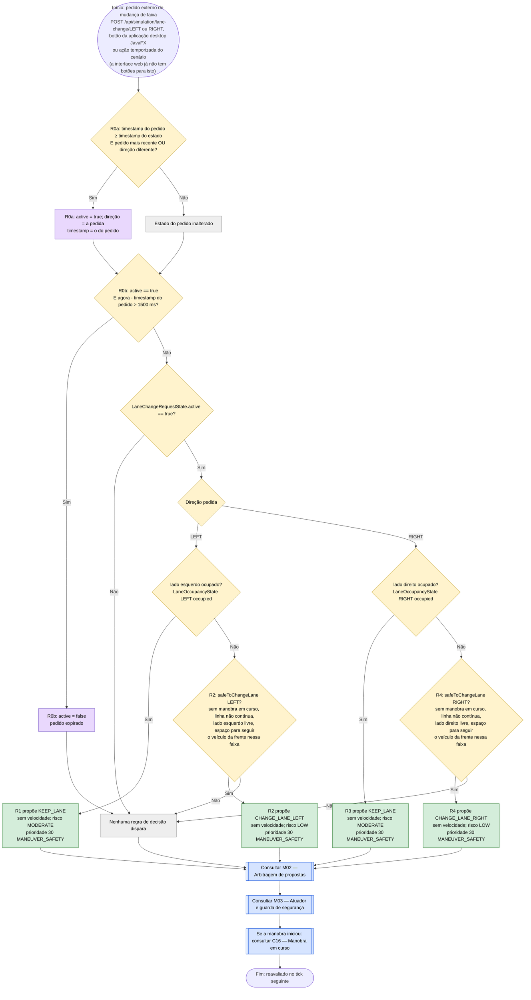

# C15 — Mudança de faixa pedida pelo operador ou pelo cenário

- **Branch / commit:** working tree a 21/10/2026
- **Estado da informação:** confirmado pelo código e por testes (regras no Drools e no Prolog; integração nos dois motores).

## Fluxograma

R0a = `Update lane change request`; R0b = `Expire lane change request`; R1 = `Block lane change when target lane occupied`; R2 = `Allow lane change left when lane safe`; R3 = `Block lane change right when target lane occupied`; R4 = `Allow lane change right when lane safe`.

## Situações a resolver

Os nós a **vermelho** nos fluxogramas acima assinalam passos onde há um problema por resolver.

| Nó | Problema | Confirmação | Como reproduzir |
|---|---|---|---|
| C15_A2 | ~~O pedido expira ao fim de 1,5 s, antes de a manobra (2,9 s) terminar. Logo a seguir a regra de circular pela direita devolve o carro à faixa de origem.~~ **Resolvido a 18/10**: a regra de circular pela direita espera 5 s depois de assentar uma mudança pedida pelo operador ou pelo cenário (C17_P) | Confirmado por teste (`DriverLaneChangeHoldE2ETest`, Drools e Prolog) e em execução | Caso A19: volta a RIGHT 5 s depois de chegar a CENTER, nos dois motores |

Os casos (A01 a A22, B01 a B08) estão descritos em `relatorio-validacao.md`, secção 8 (documento que não está neste repositório).

## Tabela de decisões

| Nó | Regra | Condição real | Caminho verdadeiro | Caminho falso | Resultado |
|---|---|---|---|---|---|
| C15_D1 | R0a | `$e.getTimestamp() >= $state.getTimestamp() && ($e.getTimestamp() > $state.getTimestamp() \|\| $state.getDirection() != $e.getDirection())` | C15_A1 | C15_K | Só um pedido novo reativa o estado; Prolog: `on_event('LaneChangeRequestEvent', _)` em `driving_state.pl`, estado `lane_request/3` |
| C15_D2 | R0b | `LaneChangeRequestState(active == true)` e `$now - $ts > 1500` (`$now` = `VehicleStateFact.timestamp`) | C15_A2 | C15_D3 | Validade de 1,5 s; Prolog: `expire_lane_request/1` com `request_validity_ms(1500)` |
| C15_D3 | R1–R4 | `LaneChangeRequestState(active == true, ...)` | C15_D4 | C15_X0 | — |
| C15_D4 | R1–R4 | `direction == LaneChangeDirection.LEFT` / `RIGHT` | ramo respetivo | — | — |
| C15_D5 | R1 | `LaneOccupancyState(lane == Lane.LEFT, occupied == true)` | C15_P1 | C15_D7 | Lado esquerdo ocupado: recusa |
| C15_D7 | R2 | `safeToChangeLane(Lane.LEFT;)` (`lane-safety.drl:21`): `maneuverIdle()`, `noContinuousLine(Lane.LEFT;)`, `sideClear(Lane.LEFT;)`, `roomToFollow(Lane.LEFT;)` | C15_P2 | C15_X0 | Encadeamento inverso: a pergunta completa, como os desvios |
| C15_D6 | R3 | `LaneOccupancyState(lane == Lane.RIGHT, occupied == true)` | C15_P3 | C15_D8 | Lado direito ocupado: recusa |
| C15_D8 | R4 | `safeToChangeLane(Lane.RIGHT;)`: `maneuverIdle()`, `noContinuousLine(Lane.RIGHT;)`, `sideClear(Lane.RIGHT;)`, `roomToFollow(Lane.RIGHT;)` | C15_P4 | C15_X0 | — |

## Ficha técnica

**Identificação**

| Campo | Valor |
|---|---|
| ID | C15 |
| Nome | Mudança de faixa pedida pelo operador ou pelo cenário |
| Objetivo | Executar o pedido externo se a mudança para o lado pedido for segura; recusá-lo se o lado estiver ocupado |
| Condição de ativação | `LaneChangeRequestState(active == true)`, durante 1,5 s após o pedido |
| Dados de entrada | `LaneChangeRequestEvent` (direção), `LaneChangeRequestState`, `LaneOccupancyState` do lado pedido, veículo à frente na faixa desse lado (`LeftLaneVehicleState` / `RightLaneVehicleState`, do radar frontal), `VehicleStateFact` (`laneChangeState`, faixa, velocidade, marcações, `timestamp`) |
| Origem do pedido | Externa: a API (`POST /api/simulation/lane-change/{direction}`), os botões "Lane Change Left/Right" da aplicação desktop JavaFX (`ui/DrivingExpertSystemApp.java:193-194`) e as ações temporizadas dos cenários. A interface web não tem botões para isto nem chama o endpoint; o resto da cadeia é igual. |

**Lógica**

| Regra | Ficheiro:linha | Salience | Ação | Prioridade |
|---|---|---|---|---|
| R0a `Update lane change request` | `01-state-updates.drl:363` | 1000 | — | — |
| R0b `Expire lane change request` | `01-state-updates.drl:381` | 900 | — | — |
| R1 `Block lane change when target lane occupied` | `lane-change.drl:19` | 430 | `KEEP_LANE` | 30 |
| R2 `Allow lane change left when lane safe` | `lane-change.drl:39` | 420 | `CHANGE_LANE_LEFT` | 30 |
| R3 `Block lane change right when target lane occupied` | `lane-change.drl:59` | 430 | `KEEP_LANE` | 30 |
| R4 `Allow lane change right when lane safe` | `lane-change.drl:79` | 420 | `CHANGE_LANE_RIGHT` | 30 |

Um lado conta como ocupado quando não existe faixa (berma), quando a linha é contínua, ou quando há perigo fixo, peão ou veículo dentro das margens de `WorldState.sideLaneOccupancy()` (ver a tabela em M03).

**Rastreabilidade**

| Elemento | Local |
|---|---|
| Entrada pela API | `api/controller/SimulationController.java:61` (`POST /lane-change/{direction}`); `SimulationEngine.requestLaneChange()` (980). O frontend não chama este endpoint. |
| Pergunta de segurança | `lane-safety.drl:21` (`safeToChangeLane`; `roomToFollow` na linha 51, com `StoppingPolicy.roomToFollow`); Prolog `prove(safe_to_change_lane(Side))`, `room_to_follow/1` |
| Prolog | As quatro regras em `driving_rules.pl` (mesmos nomes e saliences), sobre `lane_change_request/1`, carregado de `lane_request/3` |
| Entrada por cenário | Ações `REQUEST_LANE_CHANGE_LEFT` / `RIGHT` (`SimulationEngine.java:750-751`) |
| Validade do evento | `00-declarations.drl` (`LaneChangeRequestEvent`, `@expires(3s)`) |
| Cenário de demonstração | `S9` (Lane change blocked) — `scenarios.json:594`: começa em CENTER a 75 km/h, com um veículo em LEFT 15 m à frente, e pede LEFT aos 500 ms; o pedido é recusado |
| Testes unitários | `DrivingExpertSystemRulesTest`: `laneChangeBlocked` (252), `laneChangeSafe` (270), `noLaneChangeIntoALaneWhoseVehicleAheadIsTooCloseToFollow` (1282), `laneChangeIntoALaneWhoseVehicleAheadLeavesRoomToFollow` (1292) (os dois últimos também em `PrologRulesTest`); `PrologDroolsEquivalenceTest`: "driver lane change request expires after 1.5 s", "a pending driver request holds back keep right", "a pending driver request holds back moving off" |
| Testes de integração | `LaneChangeManeuverE2ETest` (Drools e Prolog): `driverRequestedLaneChangeLeftIsExecuted` (237), `driverRequestedLaneChangeWhileMovingOff` (264), `driverRequestedLaneChangeIntoOccupiedLaneIsRefused` (292); `SimulationEngineE2ETest.actuatorRejectsLaneChangeIntoOccupiedTargetLane` (926); `DriverLaneChangeHoldE2ETest.holdsTheRequestedLaneBeforeKeepingRight` (C17 espera 5 s, Drools e Prolog); `LaneChangeWhyNotE2ETest` (subobjetivo de `safeToChangeLane` que falha, Drools e Prolog) |

**Relações**

- Inicia C16. A guarda de M03 pode ainda rejeitar a manobra.
- Regras que cedem a um pedido ativo (`not LaneChangeRequestState(active == true)`): `Move off when stopped and nothing holds the vehicle` de C04 (`defaults.drl:97`), `Return to right lane after overtaking slow vehicle` de C11 (`front-vehicle.drl:599`), `Return right when boxed in and the right lane is clear` (`front-vehicle.drl:724`) e `Keep the right lane while the lanes ahead stay blocked` (`front-vehicle.drl:753`) de C11-D, e `Enforce keep right road law when right lane is safe` de C17 (`road-law.drl:49`; e, depois de a mudança pedida assentar, mais 5 s, `road-law.drl:40`).
- Conflitos (M02): as propostas de C15 estão no canal lateral com prioridade 30. Perdem contra os desvios de buraco (40), obstáculo e barreira (50). No mesmo nível, `RETURN_RIGHT` ganha a `CHANGE_LANE_*`, que ganha a `KEEP_LANE`; entre iguais ganha a proposta feita primeiro. Uma decisão de velocidade de prioridade ≥ 60 (paragem obrigatória, emergência) veta a mudança de faixa enquanto for uma travagem (`BRAKE`, `STOP`, `WAIT`, `EMERGENCY_BRAKE`; `DecisionContext.vetoes`).

**Limitações**

- R2 e R4 verificam `laneChangeState` através de `maneuverIdle()`: um pedido feito durante outra manobra já não propõe a mudança. R1 e R3 (recusas) não o verificam: com o lado ocupado continuam a propor `KEEP_LANE`, que perde para `Maintain ongoing lane change…` (C16) no mesmo nível.
- Com o lado livre mas uma manobra em curso, nenhuma das quatro regras propõe nada. O bloco "Lane change: safe?" do painel de decisão mostra então `maneuverIdle` a falhar ("a lane change is already in progress").
- Quando o pedido perde, fica registado com o resultado (`LOST_TO`, `VETOED_BY` ou `REJECTED_BY`) e o painel de decisão mostra-o (M02).
- Depois de executado o pedido, C17 só devolve o veículo à faixa da direita 5 s depois de a mudança assentar (art. 13.º; condição C17_D13).
- Com um veículo à frente na faixa pedida demasiado perto para ser seguido, `roomToFollow` falha: R2/R4 não propõem e, se o lado estiver livre, R1/R3 também não; o painel mostra `roomToFollow` a falhar.
- O evento vive 3 s mas o estado expira aos 1,5 s; o comentário em `01-state-updates.drl:370-371` explica porque R0a não reativa o estado.
- Se a guarda do atuador (M03, `WorldState.isLaneSafe`) recusar a manobra, a decisão regista a recusa (`decision.rejectLane`) e, se a velocidade não estiver já a baixar, reduz 10 km/h (`DecisionActuator.rejectLane`).

## Exemplos de entradas

| Entrada | Caminho | Resultado |
|---|---|---|
| Pedido LEFT, lado esquerdo ocupado a 8 m | C15_D5 Sim | `KEEP_LANE` (teste `laneChangeBlocked`) |
| Pedido RIGHT, lado direito livre | C15_D6 Não | `CHANGE_LANE_RIGHT` (teste `laneChangeSafe`) |
| Pedido LEFT, lado livre, veículo na faixa da esquerda pouco à frente e bem mais lento | C15_D7 Não (`roomToFollow` falha) | Sem proposta (teste `noLaneChangeIntoALaneWhoseVehicleAheadIsTooCloseToFollow`) |
| Pedido LEFT com o veículo já na faixa LEFT | lado esquerdo é berma: ocupado | `KEEP_LANE` |
| Pedido RIGHT feito há 2 s | C15_D2 Sim | Sem proposta |
| Pedido LEFT, lado livre, peão a 14 m na trajetória | R2 (lateral, 30); C08 propõe `STOP` (60) | `STOP`; a mudança de faixa é vetada (`VETOED_BY`) |
| Pedido com o lado livre e o veículo em arranque após paragem | C04 cede ao pedido | Mudança de faixa executada (teste `driverRequestedLaneChangeWhileMovingOff`) |
