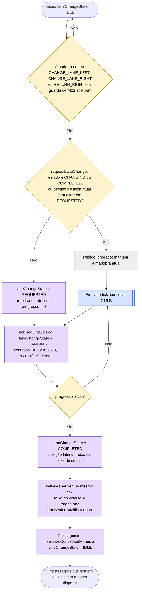
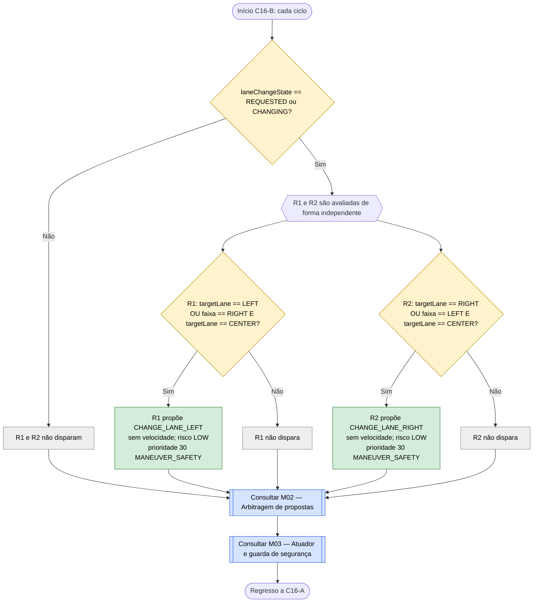

# C16 — Manobra de mudança de faixa em curso

- **Branch / commit:** `teste_ana` @ `70082b4` + alterações de 18/10 por commitar (working tree)
- **Estado da informação:** confirmado pelo código e por testes de integração.

Junta a máquina de estados física da manobra (Java) com as duas regras que mantêm a decisão enquanto o veículo se move.

## Fluxograma C16-A — Máquina de estados da manobra

Com 3,5 m entre eixos de faixa e 1,2 m/s, a manobra demora cerca de 2,9 s (29 a 30 ticks).

## Fluxograma C16-B — Manutenção da decisão

R1 = `Maintain ongoing lane change left avoidance`; R2 = `Maintain ongoing lane change right avoidance`.

## Situações a resolver

Os nós a **vermelho** nos fluxogramas acima assinalam passos onde há um problema por resolver.

| Nó | Problema | Confirmação | Como reproduzir |
|---|---|---|---|
| C16_A4 | ~~A faixa do veículo só é atualizada no fim da manobra. Durante o movimento lateral, as regras continuam a tratar o carro como estando na faixa de origem.~~ **Resolvido onde importava** (commit `fd27dc6`): `VehicleStateFact.physicalLane` dá a faixa onde o carro está fisicamente (da posição lateral) e a emergência por obstáculo (C13, R7) passou a usá-la. As regras sobre a faixa em que o carro circula continuam a usar a faixa comprometida, de propósito | Confirmado em execução a 18/10 | Caso A10 |

Os casos (A01 a A22, B01 a B08) estão descritos em `relatorio-validacao.md`, secção 8.

## Tabela de decisões

| Nó | Origem | Condição real | Caminho verdadeiro | Caminho falso | Resultado |
|---|---|---|---|---|---|
| C16_D1 | `DecisionActuator.applyLaneDecision()` 122-150 | Mudança de faixa com a manobra IDLE, aceite pela guarda (faixa alvo diferente da atual, segura e sem linha contínua). O espaço para seguir o veículo da frente na faixa de destino já não é verificado aqui: é o subobjetivo `roomToFollow` das regras (C15) | C16_D2 | permanece IDLE | Com a manobra em curso o atuador não aceita outra |
| C16_D2 | `DecisionActuator.requestLaneChange()` 234-247 | `state == CHANGING \|\| state == COMPLETED`, ou `target == ego.getLane() && state != REQUESTED` | C16_X | C16_A1 | Não inverte uma manobra em movimento |
| C16_D3 | `WorldPhysicsEngine.advanceLaneChange()` 87-126 | `progress >= 1.0` | C16_A3 | C16-B | Fim do movimento lateral |
| C16B_D1 | R1, R2 | `laneChangeState == LaneChangeState.REQUESTED \|\| laneChangeState == LaneChangeState.CHANGING` | C16B_F | C16B_X | — |
| C16B_D2 | R1 | `targetLane == Lane.LEFT \|\| (lane == Lane.RIGHT && targetLane == Lane.CENTER)` | C16B_P1 | C16B_X1 | Manobra para a esquerda |
| C16B_D3 | R2 | `targetLane == Lane.RIGHT \|\| (lane == Lane.LEFT && targetLane == Lane.CENTER)` | C16B_P2 | C16B_X2 | Manobra para a direita |

## Ficha técnica

**Identificação**

| Campo | Valor |
|---|---|
| ID | C16 |
| Nome | Manobra de mudança de faixa em curso |
| Objetivo | Manter a mudança de faixa como decisão enquanto o veículo se desloca lateralmente e impedir uma segunda manobra |
| Condição de ativação | `laneChangeState` em `REQUESTED` ou `CHANGING` |
| Dados de entrada | `VehicleStateFact` (`laneChangeState`, `lane`, `targetLane`), `EgoVehicleState` (progresso, posição lateral) |

**Lógica**

| Elemento | Ficheiro:linha | Salience | Ação | Prioridade |
|---|---|---|---|---|
| R1 `Maintain ongoing lane change left avoidance` | `avoidance.drl:40` | 475 | `CHANGE_LANE_LEFT` | 30 |
| R2 `Maintain ongoing lane change right avoidance` | `avoidance.drl:60` | 475 | `CHANGE_LANE_RIGHT` | 30 |
| Início da manobra | `DecisionActuator.requestLaneChange()` — `DecisionActuator.java:202-215` | — | — | — |
| Avanço lateral | `WorldPhysicsEngine.advanceLaneChange()` — `WorldPhysicsEngine.java:87-126` (posição com suavização *smoothstep*) | — | — | — |
| Conclusão | `SimulationEngine.settleManeuver()` (615), `normalizeCompletedManeuver()` (543) | — | — | — |

A prioridade 30 é intencional: o comentário em `avoidance.drl:36-38` explica que, com prioridade 40, a manobra contaria como retenção e cancelaria o arranque de C04 (que lê a prioridade da decisão anterior).

**Rastreabilidade**

| Elemento | Local |
|---|---|
| Estados | `domain/LaneChangeState.java` (`IDLE`, `REQUESTED`, `CHANGING`, `COMPLETED`) |
| Velocidade lateral | `SimulationConfig.defaultConfig()`: 1,2 m/s (`laneChangeMetersPerSecond`) |
| Eixos das faixas | `domain/Lane.java:9-11` (−3,5 m, 0, +3,5 m) |
| Testes | `LaneChangeManeuverE2ETest`: `potholeAvoidanceMovesVehicleLeft` (95), `doesNotOscillateAfterAvoidance` (214); `RoadLawAndOvertakingE2ETest`: `regressionTestMultiLaneReturnLeftToCenterToRight` (340), `bug3RegressionAfterOvertakingProgressivelyReturnsRight` (831) |

**Relações**

- Iniciado por C11, C12, C13, C14, C15 e C17.
- Enquanto dura, bloqueia as regras que exigem `laneChangeState == IDLE`: início de ultrapassagem (C11), desvios (C12, C13, C14), `Pothole ahead reduce speed` (C12), `Approaching trend…` (C09), `Start moving off…` (C04) e `Enforce keep right…` (C17).
- Conflitos (M02): R1 e R2 estão no canal lateral (30) e não competem com propostas de velocidade. No canal lateral perdem para os desvios (40, 50); no mesmo nível, como são propostas primeiro (salience 475), ganham às outras mudanças de faixa de 30. Uma decisão de velocidade ≥ 60 veta-as.

**Limitações** (deduzidas do código)

- Quando a decisão de C16 perde ou é vetada, o movimento lateral **não pára**: é a física que o avança enquanto o estado for `REQUESTED` ou `CHANGING`, e o atuador não aceita outra manobra até ao fim. Só a decisão apresentada muda.
- Não existe estado de manobra abortada nem regresso à faixa de origem.
- A guarda de M03 só é avaliada no início da manobra (com a manobra IDLE); durante o movimento lateral não volta a verificar a faixa de destino.
- **Leitura do sensor depois da manobra (correção 1).** `settleManeuver` guarda o instante em que a manobra assentou (`EgoVehicleState.laneSettledAtMillis`, passado às regras em `VehicleStateFact.laneSettledAtMillis` e ao Prolog como `lane_settled_at/1`). As regras de regresso à direita (C11, C17) só aceitam leituras do lado direito feitas depois desse instante, porque o sensor de ângulo morto lê a cada 200 ms e a última leitura ainda pode ser a de antes da manobra.
- A documentação existente (`docs/report-implementation-audit.md`) refere um estado `ABORTED` e uma duração de 2,5 s; nenhum dos dois existe no código desta branch.
- Sem testes unitários de regras para R1 e R2.

## Exemplos de entradas

| Entrada | Caminho | Resultado |
|---|---|---|
| CENTER, `CHANGING`, `targetLane` LEFT | C16B_D2 Sim | `CHANGE_LANE_LEFT` mantido |
| RIGHT, `REQUESTED`, `targetLane` CENTER | C16B_D2 Sim | `CHANGE_LANE_LEFT` mantido |
| LEFT, `CHANGING`, `targetLane` CENTER | C16B_D3 Sim | `CHANGE_LANE_RIGHT` mantido |
| CENTER, `CHANGING` para LEFT, peão a 10 m | R1 (lateral, 30); C08 propõe `STOP` (60) | `STOP`; a mudança de faixa é vetada na decisão, mas o movimento lateral continua |
| `CHANGING`, nova decisão `CHANGE_LANE_RIGHT` | C16_D2 Sim | Pedido ignorado |
| `IDLE` | C16B_D1 Não | Sem proposta de C16 |
