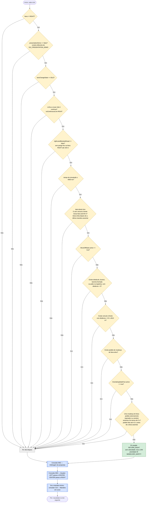

# C17 — Circular pela direita

- **Branch / commit:** working tree a 21/10/2026
- **Estado da informação:** confirmado pelo código e por testes (regra no Drools e no Prolog; integração nos dois motores).

Uma única regra com muitas condições, todas obrigatórias (conjunção). A ordem em que aparecem no fluxograma é a do ficheiro; o motor não garante nenhuma ordem de avaliação e o resultado não depende dela.

## Fluxograma

R1 = `Enforce keep right road law when right lane is safe`.

## Situações a resolver

Os nós a **vermelho** nos fluxogramas acima assinalam passos onde há um problema por resolver.

| Nó | Problema | Confirmação | Como reproduzir |
|---|---|---|---|
| C17_P | ~~Dispara 0,2 s depois de terminar uma mudança de faixa pedida pelo operador ou pelo cenário e desfaz-a.~~ **Resolvido a 18/10**: não dispara nos 5 s seguintes a uma mudança de faixa pedida pelo operador ou pelo cenário (assentou até 4,5 s depois do pedido) | Confirmado por teste (`DriverLaneChangeHoldE2ETest`, Drools e Prolog) e em execução | Caso A19 |

Os casos (A01 a A22, B01 a B08) estão descritos em `relatorio-validacao.md`, secção 8 (documento que não está neste repositório).

## Tabela de decisões

| Nó | Condição real (`road-law.drl:37-50`) | Caminho verdadeiro | Caminho falso | Motivo |
|---|---|---|---|---|
| C17_D1 | `lane != Lane.RIGHT` | C17_D2 | C17_X | Já está na direita |
| C17_D2 | `presentationDemo == false`; Prolog `not(presentation_demo)` | C17_D3 | C17_X | Exceção para a demonstração |
| C17_D3 | `laneChangeState == LaneChangeState.IDLE` | C17_D4 | C17_X | Manobra em curso |
| C17_D4 | `noContinuousLine(Lane.RIGHT;)`: de CENTER a `rightMarking`, de LEFT a `leftMarking` | C17_D5 | C17_X | Linha contínua (antes verificava sempre a `rightMarking`) |
| C17_D5 | `rightLaneBlockedAhead == false`; Prolog `not(right_lane_blocked_ahead)` | C17_D6 | C17_X | Obstáculo, buraco ou barreira fechada na faixa RIGHT a menos de 150 m (`WorldState.hasHazardAheadInLane`) |
| C17_D6 | `timestamp >= 4000` | C17_D7 | C17_X | Não atua nos primeiros 4 s |
| C17_D7 | `LaneOccupancyState(lane == Lane.RIGHT, occupied == false, frontDistanceMeters > 80.0, timestamp > $settled)`, com `$settled : laneSettledAtMillis` | C17_D8 | C17_X | Lado direito ocupado, ou veículo à frente nessa faixa (regressar só para recomeçar a ultrapassagem); a leitura tem de ser posterior à última manobra (correção 1, ver C11 e C16; Prolog `fresh_side_reading(right)`) |
| C17_D8 | `not MoveOffState(active == true)` (aqui invertida) | C17_X | C17_D9 | Arranque em curso (C04) |
| C17_D9 | `not ObstacleStateFact(obstacleId != "none", distanceMeters > 0)`, `not PotholeStateFact(potholeId != "none", distanceMeters > 0)`, `not BarrierStateFact(barrierId != "none", open == false, distanceMeters > 0)`, `not PedestrianStateFact(pedestrianId != "none", inPath == true \|\| crossingState == PedestrianCrossingState.CROSSING, distanceMeters > 0)` (aqui invertidas e agrupadas) | C17_X | C17_D10 | Perigo detetado em qualquer faixa |
| C17_D10 | `not FrontVehicleState(targetId != "none", distanceMeters > 0, distanceMeters <= 80.0)` (aqui invertida) | C17_X | C17_D11 | Veículo à frente |
| C17_D11 | `not LaneChangeRequestState(active == true)` (aqui invertida) | C17_X | C17_D12 | Pedido externo (C15) |
| C17_D12 | `not OvertakingStateFact(active == true)` (aqui invertida) | C17_X | C17_D13 | Ultrapassagem em curso (C11) |
| C17_D13 | `not LaneChangeRequestState(timestamp >= 0, timestamp <= $settled, timestamp >= $settled - 4500, $now - $settled < 5000)` (aqui invertida); Prolog: `driver_lane_change_hold/1` | C17_X | C17_P | Não desfaz logo uma mudança pedida pelo operador ou pelo cenário (C15): espera 5 s |

## Ficha técnica

**Identificação**

| Campo | Valor |
|---|---|
| ID | C17 |
| Nome | Circular pela direita |
| Objetivo | Devolver o veículo à faixa mais à direita quando não há motivo para estar noutra (Código da Estrada, art. 13.º, citado na regra) |
| Condição de ativação | Veículo fora da faixa RIGHT, sem perigos, pedidos nem manobras em curso, e pelo menos 5 s depois de assentar uma mudança de faixa pedida externamente |
| Dados de entrada | `VehicleStateFact` (faixa, `presentationDemo`, `laneChangeState`, marcações através de `noContinuousLine`, `rightLaneBlockedAhead`, `timestamp`, `laneSettledAtMillis`), `LaneOccupancyState` direita, `MoveOffState`, `ObstacleStateFact`, `PotholeStateFact`, `BarrierStateFact`, `PedestrianStateFact`, `FrontVehicleState`, `LaneChangeRequestState` (`active` e o instante do pedido, `timestamp`), `OvertakingStateFact` |

**Lógica**

| Regra | Ficheiro:linha | Salience | Ação | Prioridade |
|---|---|---|---|---|
| R1 `Enforce keep right road law when right lane is safe` | `road-law.drl:31` | 460 | `RETURN_RIGHT` | 30 |

`RETURN_RIGHT` move uma faixa de cada vez (`DecisionActuator.java:132`). De LEFT para RIGHT são duas manobras completas, cada uma com o seu ciclo C16.

**Rastreabilidade**

| Elemento | Local |
|---|---|
| `rightLaneBlockedAhead` | `DroolsBackend.java:164`: `worldState.hasHazardAheadInLane(Lane.RIGHT, 150.0)`; o mesmo em `PrologBackend.java:121` |
| `presentationDemo` | `DroolsBackend.java:167` e `PrologBackend.java:122` (cenário `S12_PRESENTATION_DEMO`) |
| Prolog | A mesma regra em `driving_rules.pl` (precedência 460); C17_D13 é `driver_lane_change_hold/1`, sobre `lane_request_at/1` e `lane_settled_at/1` |
| Testes | `PrologRulesTest`: `keepRightReturnsToTheRightLaneWhenItIsSafe` (927), `keepRightWaitsWhileAHazardBlocksTheRightLaneAhead` (938), `keepRightIsOffDuringThePresentationDemo` (948); `PrologDroolsEquivalenceTest`: casos "keep right: …" e "a pending driver request holds back keep right"; `DriverLaneChangeHoldE2ETest.holdsTheRequestedLaneBeforeKeepingRight` (Drools e Prolog: espera 5 s depois de chegar à faixa pedida); `SideReadingAfterLaneChangeE2ETest.returnRightUsesASideReadingTakenInTheCurrentLane` (Drools e Prolog); `RoadLawAndOvertakingE2ETest` (Drools e Prolog): `regressionTestExactScreenshotStateCenterReturnsToRight` (257), `regressionTestReturnRightAfterObstacleAvoidance` (305), `regressionTestMultiLaneReturnLeftToCenterToRight` (357), `regressionTestBlockedReturnRightWaitsForSafety` (401) |

**Relações**

- Depende de C04, C08, C09, C11, C12, C13, C14, C15 e C16, que a bloqueiam. Inicia C16.
- Conflitos (M02): R1 está no canal lateral (30) e não compete com propostas de velocidade. No canal lateral perde para os desvios (40, 50); no mesmo nível, `RETURN_RIGHT` ganha a `CHANGE_LANE_*`. A regra de regresso de C11 (`Return to right lane after overtaking slow vehicle`) e a de C11-D (`Return right when boxed in and the right lane is clear`) propõem a mesma ação; não disparam juntas com esta por causa de C17_D12 e C17_D10 (o `BoxedInFact` de C11-D é apagado, por `Forget boxed in once nothing is ahead`, quando não há veículo à frente a 80 m ou menos).

**Limitações**

- `rightLaneBlockedAhead` é calculado sobre o mundo, não por um sensor.
- C17_D9 bloqueia o regresso para perigos em qualquer faixa, não só na de destino.
- O limiar de 4000 ms é fixo e não tem justificação no código.
- A espera de C17_D13 conta a partir de quando a faixa assentou e só se aplica se o pedido foi feito até 4,5 s antes (1,5 s de validade do pedido + 3 s de manobra, `StoppingPolicy.LANE_CHANGE_SECONDS`); os 4500 e 5000 ms estão escritos na regra.
- Não tem teste unitário de regras no Drools (`DroolsTestHarness` não tem mundo: `presentationDemo` e `rightLaneBlockedAhead` ficam nos valores por omissão); está coberta pelos testes Prolog e pelos de equivalência acima.

## Exemplos de entradas

| Entrada | Caminho | Resultado |
|---|---|---|
| CENTER, IDLE, 6 s de simulação, direita livre, nada à frente | Todas as condições | `RETURN_RIGHT` (teste `regressionTestExactScreenshotStateCenterReturnsToRight`) |
| LEFT, mesmas condições | Todas as condições | `RETURN_RIGHT`: LEFT para CENTER; repete-se depois para RIGHT (teste `regressionTestMultiLaneReturnLeftToCenterToRight`) |
| CENTER, veículo a 3 m atrás na faixa RIGHT | C17_D7 Não | Sem proposta; espera (teste `regressionTestBlockedReturnRightWaitsForSafety`) |
| CENTER, veículo à frente a 60 m | C17_D10 Sim | Sem proposta |
| CENTER, 2 s de simulação | C17_D6 Não | Sem proposta |
| CENTER, cenário `S12_PRESENTATION_DEMO` | C17_D2 Não | Sem proposta |
| CENTER, ultrapassagem ativa | C17_D12 Sim | Sem proposta de C17; decide C11 |
| CENTER há 2 s, depois de um pedido externo LEFT a partir de RIGHT | C17_D13 Sim | Sem proposta; volta a RIGHT 5 s depois de ter chegado a CENTER (caso A19) |

## Atualização: regresso à direita quando a ultrapassagem é impossível

A regra deste cenário (`Enforce keep right road law…`) não muda. Quando o ego está preso atrás de trânsito lento em todas as faixas, com um veículo à frente a menos de 80 m (C17_D10), esta regra não pode atuar. O regresso à direita (art. 13.º CE) é então feito pelas regras de C11-D: `Note the vehicle is boxed in behind slow traffic` regista o `BoxedInFact`; ao fim de 3 s, `Fall back behind slow traffic to return right` (50) anda 3 km/h abaixo do veículo da frente enquanto a direita estiver ocupada, e `Return right when boxed in and the right lane is clear` (30) volta à direita com o lado direito livre e o veículo da frente nessa faixa entre máx(30 m; 2 s de distância, 3 s com chuva ou aderência < 0,85) e 80 m. Já na direita, `Keep the right lane while the lanes ahead stay blocked` (`KEEP_LANE`, 50) impede recomeçar a mesma ultrapassagem até `Forget boxed in…` apagar o facto. Ver `C11-ultrapassagem-e-regresso-a-direita.md`, secção C11-D.
