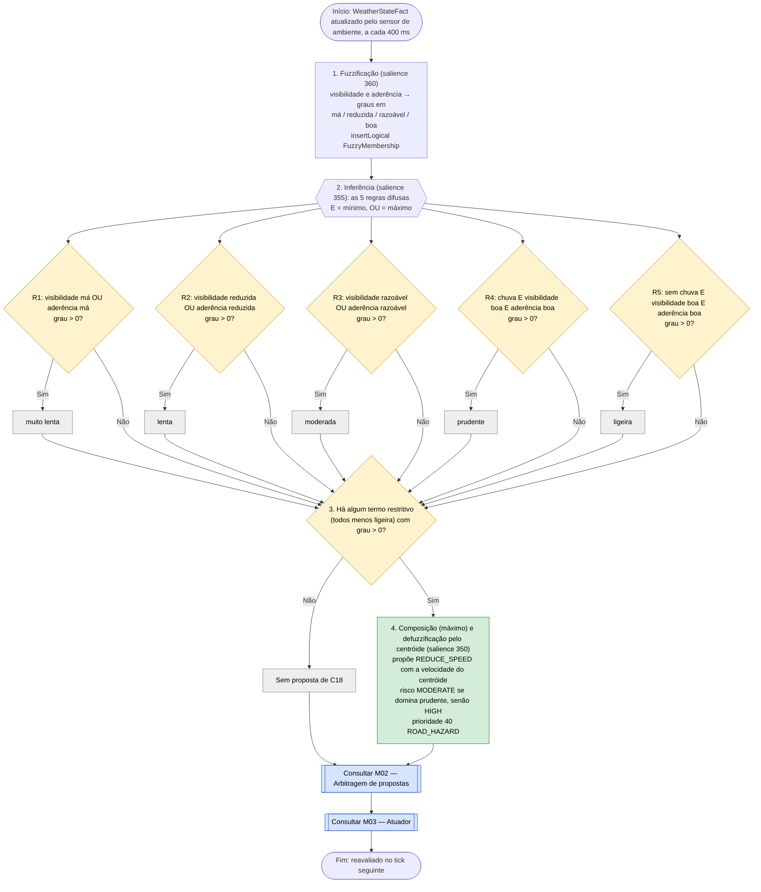

# C18 — Chuva, visibilidade e aderência (lógica difusa)

- **Branch / commit:** working tree a 21/10/2026
- **Estado da informação:** confirmado pelo código e por testes (as mesmas regras, com os mesmos nomes, no Drools e no Prolog).

A visibilidade e a aderência são termos vagos ("visibilidade reduzida", "piso escorregadio"). Em vez de limiares rígidos, um controlador difuso de Mamdani (PDF 07) transforma cada leitura em graus de pertença, combina-os com regras difusas e devolve uma única velocidade recomendada pelo centróide. `fuzzy-weather.drl` substituiu o antigo `weather.drl` e as suas três regras nítidas.

## Fluxograma

R1 = `Fuzzy: poor visibility or poor grip -> very slow`; R2 = `Fuzzy: reduced visibility or reduced grip -> slow`; R3 = `Fuzzy: fair visibility or fair grip -> moderate`; R4 = `Fuzzy: rain with good visibility and good grip -> prudent`; R5 = `Fuzzy: no rain with good visibility and good grip -> light`.

## Conjuntos difusos

**Entradas** (visibilidade e aderência, de 0 a 1; os quatro graus somam sempre 1):

| Termo | Código | Forma | Pontos |
|---|---|---|---|
| má | `poor` | trapézio | 0 · 0 · 0,35 · 0,5 |
| reduzida | `reduced` | triângulo | 0,35 · 0,5 · 0,7 |
| razoável | `fair` | triângulo | 0,5 · 0,7 · 0,85 |
| boa | `good` | trapézio | 0,7 · 0,85 · 1 · 1 |

**Saída** (velocidade recomendada, km/h; todos triângulos):

| Termo | Código | Pontos | Restritivo? |
|---|---|---|---|
| muito lenta | `very_slow` | 15 · 25 · 35 | Sim |
| lenta | `slow` | 30 · 40 · 50 | Sim |
| moderada | `moderate` | 45 · 55 · 65 | Sim |
| prudente | `prudent` | 55 · 65 · 75 | Sim |
| ligeira | `light` | 65 · 75 · 85 | Não: só refina um teto que outro termo já impôs |

A chuva é nítida (o sensor só dá `RAIN` ou `CLEAR`) e entra nas regras com grau 1 ou 0. O centróide é calculado em passos de 0,5 km/h entre 0 e 130 km/h, igual nos dois motores.

## Tabela de decisões

| Nó | Regra | Condição real | Caminho verdadeiro | Caminho falso | Resultado |
|---|---|---|---|---|---|
| C18_F1 | `Fuzzify visibility`, `Fuzzify grip` | `WeatherStateFact($visibility : visibilityFactor)`; quatro `insertLogical(new FuzzyMembership(...))` | C18_F2 | — | Oito graus na memória de trabalho |
| C18_R1 | R1 | `Math.max($v, $g) > 0.0` com os graus `poor` | C18_C1 | C18_D | `FuzzyConclusion("very_slow", max)` |
| C18_R2 | R2 | `Math.max($v, $g) > 0.0` com os graus `reduced` | C18_C2 | C18_D | `FuzzyConclusion("slow", max)` |
| C18_R3 | R3 | `Math.max($v, $g) > 0.0` com os graus `fair` | C18_C3 | C18_D | `FuzzyConclusion("moderate", max)` |
| C18_R4 | R4 | `WeatherStateFact(condition == RAIN)` e `Math.min($v, $g) > 0.0` com os graus `good` | C18_C4 | C18_D | `FuzzyConclusion("prudent", min)` |
| C18_R5 | R5 | `WeatherStateFact(condition != RAIN)` e `Math.min($v, $g) > 0.0` com os graus `good` | C18_C5 | C18_D | `FuzzyConclusion("light", min)` |
| C18_D | `Defuzzify weather speed ceiling` | `eval(FuzzySupport.restricts($conclusions))` | C18_P | C18_X | Uma só proposta por ciclo |

## Ficha técnica

**Identificação**

| Campo | Valor |
|---|---|
| ID | C18 |
| Nome | Chuva, visibilidade e aderência (lógica difusa) |
| Objetivo | Reduzir a velocidade recomendada de forma gradual com chuva, visibilidade reduzida ou piso com pouca aderência |
| Condição de ativação | Um termo restritivo com grau maior que 0: chuva, ou visibilidade ou aderência inferior a 0,85 |
| Dados de entrada | `WeatherStateFact` (condição, visibilidade, aderência) |

**Lógica**

| Regra | Ficheiro:linha | Salience | Ação | Prioridade |
|---|---|---|---|---|
| `Fuzzify visibility` | `fuzzy-weather.drl:33` | 360 | — (factos lógicos) | — |
| `Fuzzify grip` | `fuzzy-weather.drl:44` | 360 | — (factos lógicos) | — |
| R1 `Fuzzy: poor visibility or poor grip -> very slow` | `fuzzy-weather.drl:55` | 355 | — (factos lógicos) | — |
| R2 `Fuzzy: reduced visibility or reduced grip -> slow` | `fuzzy-weather.drl:66` | 355 | — (factos lógicos) | — |
| R3 `Fuzzy: fair visibility or fair grip -> moderate` | `fuzzy-weather.drl:77` | 355 | — (factos lógicos) | — |
| R4 `Fuzzy: rain with good visibility and good grip -> prudent` | `fuzzy-weather.drl:89` | 355 | — (factos lógicos) | — |
| R5 `Fuzzy: no rain with good visibility and good grip -> light` | `fuzzy-weather.drl:102` | 355 | — (factos lógicos) | — |
| `Defuzzify weather speed ceiling` | `fuzzy-weather.drl:114` | 350 | `REDUCE_SPEED` | 40 |
| `Update weather state` | `01-state-updates.drl:131` | 1000 | — | — |

A `salience` só define a ordem de disparo dentro do ciclo (fuzzificação → inferência → defuzzificação). A arbitragem não depende dela.

**Truth maintenance:** os graus (`FuzzyMembership`) e as conclusões (`FuzzyConclusion`) são inseridos com `insertLogical`. Quando chega uma leitura nova, os graus antigos perdem a justificação e o Drools retira-os, e com eles as conclusões que deles dependiam. Não há código de limpeza.

**De onde vêm os valores** (`SimulationEngine.java:954-978`, `ScenarioFactory.toWeatherState`, `EnvironmentSensor.java`)

| Origem | Condição | Visibilidade | Aderência |
|---|---|---|---|
| `setRain(true)` (ação `SET_RAIN`) ou `initialWeather: RAIN` | `RAIN` | 0,70 | 0,65 |
| `setRain(false)` (ação `CLEAR_WEATHER`) ou `initialWeather: CLEAR` | `CLEAR` | 1,00 | 1,00 |
| `setWeatherFactors(v, g)` (`POST /api/environment`, cursores da interface) | `RAIN` se algum fator < 0,95; senão `CLEAR` | limitado a [0,2; 1,0] | limitado a [0,2; 1,0] |

Pela interface, qualquer redução de um cursor abaixo de 0,95 põe a condição em `RAIN`. Por isso o termo `ligeira` (R5, sem chuva) só aparece com eventos meteorológicos diretos, como nos testes.

O sensor de ambiente lê a cada 400 ms e publica um `WeatherEvent` (condição, visibilidade, aderência); publica também `VisibilityEvent`, `RoadGripEvent` e, abaixo de 0,85, `ReducedVisibilityEvent`/`ReducedGripEvent`, que nenhuma regra lê (só estão declarados em `00-declarations.drl`; o Prolog ignora os dois primeiros em `record_event/1` e aceita os outros sem efeito). As regras leem o estado persistente `WeatherStateFact` (Prolog: `weather/3`), por isso o teto não cai entre leituras.

**Rastreabilidade**

| Elemento | Local |
|---|---|
| Regras Drools | `src/main/resources/rules/fuzzy-weather.drl` |
| Regras Prolog (mesmos nomes) | `src/main/prolog/driving_rules.pl:1342-1421` (secção "Condições meteorológicas"); funções de pertença e centróide em "Lógica difusa" (`driving_rules.pl:2186`, `fuzzy_input_degrees/5`, `fuzzy_speed_ceiling/2`) |
| Conjuntos e centróide | `drools/FuzzySupport.java` |
| Factos | `drools/facts/FuzzyMembership.java`, `drools/facts/FuzzyConclusion.java`, `drools/facts/WeatherStateFact.java` |
| Endpoint | `EnvironmentController.java` |
| Cenários | `S10` (Rain low grip, `scenarios.json:615`): começa com chuva (0,70/0,65) a 85 km/h; `S11` (`SET_RAIN` aos 3,5 s); `S12_PRESENTATION_DEMO` (`SET_RAIN` aos 14 s, `CLEAR_WEATHER` aos 65 s) |
| Testes | `FuzzySupportTest` (pertença, centróide, termo dominante); `DrivingExpertSystemRulesTest`: `rainAdjustsSafeSpeed` (455), `reducedVisibilityAndGripTriggerConservativeReduction` (469), `rainAloneIsAModerateFuzzyCeilingOf65` (495), `goodClearWeatherProposesNoFuzzyCeiling` (508), `fuzzyFactsAreRetractedWhenTheWeatherClears` (520); `PrologRulesTest`: `rainAdjustsSafeSpeed` (854, chuva com 0,74/0,90), `reducedVisibilityAndGripTriggerConservativeReduction` (869); `PrologDroolsEquivalenceTest`: "rain", "rain with low visibility and grip" e os casos "fuzzy: …"; `SimulationEngineE2ETest`: `weatherMutationDuringRunChangesRecommendationsAndVehicleBehavior` (638, Drools e Prolog), `rainSpeedSettlesOnTheRecommendedSpeedWithoutHunting` (1134, só Drools, cenário S10) |

**Relações**

- Fornece a condição `RAIN` a `Persistent low TTC in rain increases conservatism` (C10). Essa regra lê também as leituras de chuva (`WeatherEvent`) para só contar as amostras de TTC medidas com chuva (`coincides[400ms]`, ver C10).
- A proposta é um **teto de velocidade** no canal longitudinal: entre `COLLISION_AVOIDANCE`, `ROAD_HAZARD` e `SPEED_COMPLIANCE` ganha o teto mais baixo (M02). Por isso nunca sobe acima do limite legal de C01.
- Os desvios de buraco e obstáculo (C12, C13) são do canal lateral, que é arbitrado à parte. A proposta de C18 não concorre com eles.
- A visibilidade também encurta o alcance da câmara (`CameraSensor.effectiveRangeMeters`: 120 m × visibilidade, 84 m com `SET_RAIN`): sinais, semáforos, peões e perigos na via são vistos mais tarde. Isto é perceção em Java, não uma regra.

**Código da Estrada:** velocidade adequada às condições meteorológicas, de visibilidade e de aderência (art. 24.º; art. 25.º, velocidade moderada com piso molhado ou com pouca aderência). Os artigos estão citados de memória e devem ser conferidos no texto oficial.

**Limitações**

- A regra de defuzzificação não verifica a velocidade atual: propõe `REDUCE_SPEED` mesmo com o veículo abaixo do teto (comportamento igual ao das regras nítidas anteriores). A arbitragem só a escolhe quando fica abaixo da base de velocidade, e o atuador segue a velocidade recomendada (ver M03).
- Os conjuntos difusos são conhecimento de perito e foram calibrados para ficar perto das regras nítidas anteriores. Podem ser afinados em `FuzzySupport.java` e em `driving_rules.pl`, sempre com os mesmos valores nos dois.
- Ao passar de 0,85 para menos, o teto aparece por volta de 75 km/h (73 km/h a 0,84; com chuva, 65 km/h). Acima disso não há proposta, como antes.

## Exemplos de entradas

Valores calculados com os conjuntos acima. A coluna "Antes" é o resultado das três regras nítidas que este cenário substituiu.

| Entrada | Graus concluídos | Antes | Resultado |
|---|---|---|---|
| `SET_RAIN`: chuva, visibilidade 0,70, aderência 0,65 | lenta 0,25 · moderada 1,00 | 52 | `REDUCE_SPEED` 50,6, risco HIGH |
| Tempo limpo, visibilidade 0,55, aderência 0,55 | lenta 0,75 · moderada 0,25 | 41,25 | `REDUCE_SPEED` 44,6, risco HIGH (teste) |
| Chuva, 0,90 e 0,90 (ou 1,00 e 1,00) | prudente 1,00 | 65 | `REDUCE_SPEED` 65, risco MODERATE (teste) |
| Cursor da interface: visibilidade 0,80 (chuva) | moderada 0,33 · prudente 0,67 | 60 | `REDUCE_SPEED` 61,4, risco MODERATE |
| Cursor da interface: visibilidade 0,60 (chuva) | lenta 0,50 · moderada 0,50 | 45 | `REDUCE_SPEED` 47,5, risco HIGH |
| Visibilidade 0,30 (chuva ou não) | muito lenta 1,00 | 30 | `REDUCE_SPEED` 25, risco HIGH |
| Aderência 0,25 (chuva ou não) | muito lenta 1,00 | 25 | `REDUCE_SPEED` 25, risco HIGH |
| Chuva, visibilidade 0,74, aderência 0,90 | moderada 0,73 · prudente 0,27 | 55 | `REDUCE_SPEED` 58,0, risco HIGH (teste) |
| Tempo limpo, 0,85 e 0,90 | ligeira 1,00 (não restritiva) | — | Sem proposta de C18 (teste) |
| Tempo limpo, fatores 1,00 | ligeira 1,00 (não restritiva) | — | Sem proposta de C18 |
