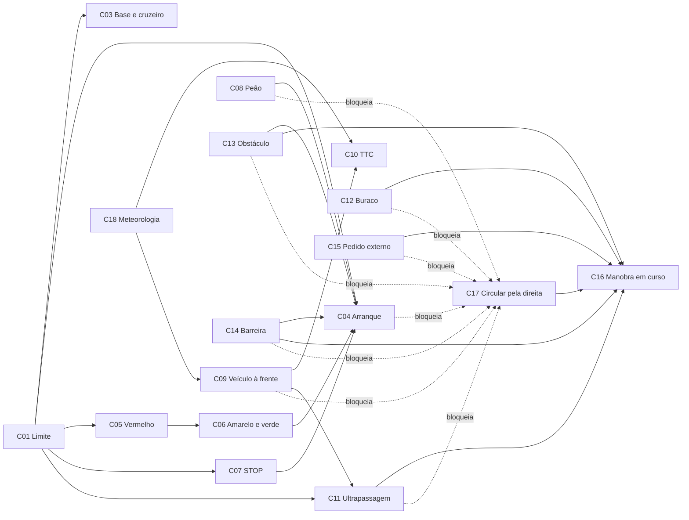

# Catálogo de cenários

- **Branch / commit:** working tree a 21/10/2026
- Detalhe completo de cada cenário no respetivo ficheiro (C01 a C18), incluindo regras, linhas e testes na ficha técnica de cada um.
- Todas as regras de decisão existem nos dois motores (Drools e Prolog), com os mesmos nomes; no Prolog, quando a regra Drools escolhe entre ações, há uma regra por resultado com o nome seguido da variante entre parênteses (por exemplo `Hold at red traffic light (emergency)`). As regras de estado de `01-state-updates.drl` são, no Prolog, o tratamento de eventos de `driving_state.pl`.

## Fichas resumidas

### C01 — Limite de velocidade por sinal

| Campo | Valor |
|---|---|
| Objetivo | Manter o veículo no limite legal em vigor, abrandar a tempo para um limite mais baixo à frente e levá-lo até ao limite quando circula abaixo |
| Ativação | Sempre (existe um limite inicial de 120 km/h); um sinal lido fica pendente até o veículo lá chegar |
| Entradas | Sinal detetado (limite, distância), limite pendente e em vigor, velocidade, posição |
| Regras | 3 de decisão + 3 de estado |
| Resultados | `REDUCE_SPEED`, `MAINTAIN_SPEED` |
| Relações | Fornece o limite a C03, C04, C05, C07 e C11 |
| Origem | `speed.drl`, `01-state-updates.drl` |

### C03 — Velocidade de base, cruzeiro e pedido de aceleração

| Campo | Valor |
|---|---|
| Objetivo | Garantir sempre uma decisão, recuperar a velocidade de cruzeiro, aceitar pedidos de aceleração |
| Ativação | Todos os ciclos |
| Entradas | Velocidade, velocidade de cruzeiro do cenário, origem do limite, pedido de aceleração |
| Regras | 3 de decisão + 1 de estado |
| Resultados | `MAINTAIN_SPEED`, `ACCELERATE` |
| Relações | Depende de C01; o cruzeiro é um teto de 20 e qualquer teto mais baixo lhe ganha |
| Origem | `speed.drl`, `defaults.drl` |

### C04 — Arranque após paragem

| Campo | Valor |
|---|---|
| Objetivo | Pôr em andamento, até 30 km/h, um veículo parado que nada segura |
| Ativação | Velocidade < 3 km/h, sem manobra e com a decisão anterior até à prioridade 30 |
| Entradas | Intenção de arranque, velocidade, estado da manobra, limite, decisão do tick anterior, pedido externo |
| Regras | 3 (2 de estado interno + 1 de decisão) |
| Resultados | `CONTINUE` |
| Relações | Saída de C05, C06, C07, C08, C13; bloqueia C17; cede a C15 |
| Origem | `defaults.drl` |

### C05 — Semáforo vermelho

| Campo | Valor |
|---|---|
| Objetivo | Parar antes da linha de paragem (18 m antes do semáforo) e manter a paragem |
| Ativação | Semáforo vermelho a 125 m ou menos, em qualquer faixa |
| Entradas | Estado, distância e compromisso do semáforo, velocidade, limite |
| Regras | 3 de decisão + 1 de compromisso (partilhada com C06) |
| Resultados | `MAINTAIN_SPEED`, `REDUCE_SPEED`, `EMERGENCY_BRAKE`, `STOP` |
| Relações | Lê C01; sai para C06 e C04 |
| Origem | `traffic-lights.drl` |

### C06 — Semáforo amarelo e verde

| Campo | Valor |
|---|---|
| Objetivo | No amarelo, parar se ainda for possível em segurança e prosseguir se não for; no verde, permitir avançar e libertar a paragem |
| Ativação | Semáforo amarelo, ou verde a 40 m ou menos |
| Entradas | Estado, distância e compromisso do semáforo, velocidade, limite |
| Regras | 3 de decisão + 1 de compromisso |
| Resultados | `STOP`, `REDUCE_SPEED`, `MAINTAIN_SPEED`, `CONTINUE`, `RESUME` |
| Relações | Recebe de C05; sai para C04; perde contra C08 e contra tetos mais baixos |
| Origem | `traffic-lights.drl` |

### C07 — Sinal STOP

| Campo | Valor |
|---|---|
| Objetivo | Parar por completo a 4 m ou menos da linha de paragem (15 m antes do sinal), manter 1200 ms, prosseguir. Se a linha já ficou para trás ou foi alcançada depressa demais, travar a fundo e fazer a paragem assim que possível |
| Ativação | Sinal STOP na faixa do veículo, com a linha a 125 m ou menos |
| Entradas | Estado do STOP (distância à linha, cumprido), o instante em que o carro parou na linha (`StoppedAtStopLineEvent`), leituras de velocidade, limite, decisão anterior |
| Regras | 6 (3 de decisão + 3 de estado interno) + 2 de estado. A paragem de 1,2 s é contada com o operador de Allen `after[1200ms]` |
| Resultados | `MAINTAIN_SPEED`, `REDUCE_SPEED`, `EMERGENCY_BRAKE`, `STOP`, `CONTINUE` |
| Relações | Lê C01; sai para C04 |
| Origem | `traffic-signs.drl` |

### C08 — Peão na trajetória ou a atravessar

| Campo | Valor |
|---|---|
| Objetivo | Travar, parar ou travar de emergência consoante a distância a um peão que está, ou vai estar, na trajetória |
| Ativação | Peão na trajetória, ou ainda a atravessar a via em qualquer faixa: a 32 m ou menos sempre; mais longe, com a velocidade acima da curva de travagem que termina 18 m antes dele (87 m a 60 km/h), ou quando a travagem confortável já não pára 6 m antes dele |
| Entradas | Distância ao peão, indicadores de trajetória e de travessia, velocidade do veículo, fase da aproximação (`PedestrianBrakingState`) |
| Regras | 5 de decisão + 3 da fase da aproximação + 2 de estado |
| Resultados | `BRAKE`, `MAINTAIN_SPEED`, `STOP`, `EMERGENCY_BRAKE` |
| Relações | Sai para C04; bloqueia C11 e C17 |
| Origem | `pedestrian.drl`, `emergency.drl` |

### C09 — Veículo à frente

| Campo | Valor |
|---|---|
| Objetivo | Manter distância segura do veículo da frente, reduzir ao aproximar-se, segui-lo à velocidade dele sem pára-arranca e parar atrás dele se estiver parado |
| Ativação | Veículo na mesma faixa detetado pelo radar frontal (até 130 m); a tendência (janela de distâncias) só a menos de 50 m |
| Entradas | Distância, velocidade relativa, amostras de distância dos últimos 2 s, estado da manobra, aderência |
| Regras | 6 de decisão + 4 de estado |
| Resultados | `BRAKE`, `REDUCE_SPEED`, `STOP` |
| Relações | Partilha dados com C10 e C11; bloqueia C17; segura C04 enquanto parado |
| Origem | `front-vehicle.drl` |

### C10 — TTC crítico

| Campo | Valor |
|---|---|
| Objetivo | Travagem de emergência por tempo até colisão baixo; travagem antecipada com chuva |
| Ativação | Amostras de TTC abaixo de 2,5 s (persistente), 1,3 s (imediato) ou 3,0 s com chuva |
| Entradas | Eventos de TTC do radar, condição meteorológica, leituras de chuva (`coincides[400ms]` na regra com chuva) |
| Regras | 3 de decisão |
| Resultados | `EMERGENCY_BRAKE`, `BRAKE` |
| Relações | Usa dados de C09; depende de C18 |
| Origem | `emergency.drl`, `temporal.drl` |

### C11 — Ultrapassagem e regresso à direita

| Campo | Valor |
|---|---|
| Objetivo | Ultrapassar pela esquerda um veículo mais lento, contornar um veículo parado e regressar à direita; com trânsito lento em todas as faixas, desistir e voltar à direita |
| Ativação | Veículo mais lento à frente com o lado esquerdo livre; veículo seguido à mesma velocidade e mais lento do que o desejado; carro parado atrás de um veículo parado; ou preso atrás de trânsito lento (C11-D) |
| Entradas | Estado da ultrapassagem, faixa, marcações, veículo à frente, veículo na faixa da esquerda e duas faixas à esquerda, ocupação lateral (com o instante da leitura), instante em que a última manobra assentou, pedido externo, `BoxedInFact` |
| Regras | 10 (7 de decisão + 3 de estado interno) + 6 de C11-D (3 de decisão + 3 de estado) |
| Resultados | `CHANGE_LANE_LEFT`, `RETURN_RIGHT`, `REDUCE_SPEED`, `MAINTAIN_SPEED`, `KEEP_LANE` |
| Relações | Usa C09; inicia C16; bloqueia C17; cede a C15 |
| Origem | `front-vehicle.drl` |

### C12 — Buraco na via

| Campo | Valor |
|---|---|
| Objetivo | Contornar o buraco na própria faixa se houver um lado seguro; senão reduzir a velocidade. Um buraco noutra faixa não faz reduzir |
| Ativação | Buraco na trajetória do veículo: desvio a 50 m ou menos; redução a máx(40 m; distância para abrandar até 30 km/h) ou menos |
| Entradas | Distância e faixa do buraco, faixa do veículo, marcações, ocupação lateral e veículos à frente nas faixas laterais (lados seguros) |
| Regras | 5 de decisão + 2 de estado |
| Resultados | `CHANGE_LANE_LEFT`, `CHANGE_LANE_RIGHT`, `REDUCE_SPEED`, `MAINTAIN_SPEED`, `EMERGENCY_BRAKE` (buraco grave sem espaço para abrandar com conforto) |
| Relações | Inicia C16; bloqueia C17 |
| Origem | `avoidance.drl`, `road-hazards.drl` |

### C13 — Obstáculo na via

| Campo | Valor |
|---|---|
| Objetivo | Contornar o obstáculo; enquanto não sai da faixa, conseguir sempre parar 10 m antes; emergência a 8 m ou menos na faixa onde o carro está fisicamente |
| Ativação | Obstáculo na faixa a máx(60 m; distância de paragem confortável) ou menos; desvio a 50 m ou menos |
| Entradas | Distância, faixa e gravidade do obstáculo, faixa (comprometida e física) e velocidade do veículo, marcações, ocupação lateral, veículos à frente nas faixas laterais |
| Regras | 7 de decisão + 2 de estado |
| Resultados | `CHANGE_LANE_LEFT`, `CHANGE_LANE_RIGHT`, `MAINTAIN_SPEED`, `BRAKE`, `STOP`, `EMERGENCY_BRAKE` |
| Relações | Inicia C16; sai para C04; bloqueia C17 |
| Origem | `avoidance.drl`, `road-hazards.drl`, `emergency.drl` |

### C14 — Barreira

| Campo | Valor |
|---|---|
| Objetivo | Contornar a barreira fechada se houver um lado seguro; senão parar antes dela (a fundo, se vista tarde); avançar se aberta |
| Ativação | Barreira fechada na faixa: desvio a 55 m ou menos, paragem a máx(55 m; distância de paragem confortável) ou menos; 35 m se aberta |
| Entradas | Distância, estado e faixa da barreira, faixa e velocidade do veículo, marcações, ocupação lateral e veículos à frente nas faixas laterais (através de `safeToChangeLane`) |
| Regras | 7 de decisão + 2 de estado |
| Resultados | `CHANGE_LANE_LEFT`, `CHANGE_LANE_RIGHT`, `MAINTAIN_SPEED`, `BRAKE`, `STOP`, `EMERGENCY_BRAKE`, `CONTINUE` |
| Relações | Inicia C16; sai para C04; bloqueia C17 |
| Origem | `barrier.drl` |

### C15 — Mudança de faixa pedida pelo operador ou pelo cenário

| Campo | Valor |
|---|---|
| Objetivo | Executar o pedido se `safeToChangeLane` o permitir; recusar se o lado estiver ocupado. O pedido é externo: API, botões da aplicação desktop JavaFX ou ações dos cenários (a interface web já não tem botões) |
| Ativação | Pedido ativo, durante 1,5 s |
| Entradas | Direção pedida, estado da manobra, marcações, ocupação do lado pedido, veículo à frente nessa faixa (`roomToFollow`) |
| Regras | 4 de decisão + 2 de estado |
| Resultados | `CHANGE_LANE_LEFT`, `CHANGE_LANE_RIGHT`, `KEEP_LANE` |
| Relações | Inicia C16; C04, C11 (incluindo C11-D) e C17 cedem-lhe |
| Origem | `lane-change.drl` |

### C16 — Manobra de mudança de faixa em curso

| Campo | Valor |
|---|---|
| Objetivo | Manter a decisão durante o movimento lateral e impedir uma segunda manobra |
| Ativação | Estado da manobra `REQUESTED` ou `CHANGING` |
| Entradas | Estado da manobra, faixa atual, faixa de destino, progresso |
| Regras | 2 de decisão, mais máquina de estados em Java |
| Resultados | `CHANGE_LANE_LEFT` ou `CHANGE_LANE_RIGHT` mantido |
| Relações | Iniciado por C11, C12, C13, C14, C15, C17 |
| Origem | `avoidance.drl`, `DecisionActuator.java`, `WorldPhysicsEngine.java` |

### C17 — Circular pela direita

| Campo | Valor |
|---|---|
| Objetivo | Devolver o veículo à faixa da direita quando não há motivo para estar noutra |
| Ativação | Fora da faixa RIGHT, sem perigos, pedidos, manobras nem veículo à frente a 80 m ou menos, após 4 s de simulação e 5 s depois de uma mudança de faixa pedida externamente |
| Entradas | Faixa, estado da manobra, a linha a cruzar (`noContinuousLine`), ocupação e distância livre à direita numa leitura posterior à última manobra, e os factos de todos os perigos |
| Regras | 1 de decisão |
| Resultados | `RETURN_RIGHT` |
| Relações | Bloqueado por C04, C08, C09, C11, C12, C13, C14, C15, C16; inicia C16 |
| Origem | `road-law.drl` |

### C18 — Chuva, visibilidade e aderência

| Campo | Valor |
|---|---|
| Objetivo | Reduzir a velocidade recomendada com mau tempo, de forma gradual (lógica difusa) |
| Ativação | Algum termo difuso restritivo com grau > 0: condição `RAIN`, ou visibilidade ou aderência inferior a 0,85 |
| Entradas | Condição meteorológica, fator de visibilidade, fator de aderência |
| Regras | 1 de decisão (defuzzificação) + 7 de inferência difusa (factos lógicos) + 1 de estado |
| Resultados | `REDUCE_SPEED` com a velocidade do centróide, prioridade 40 |
| Relações | Fornece a condição de chuva a C10; teto de velocidade no canal longitudinal, não concorre com os desvios de C12 e C13 (canal lateral) |
| Origem | `fuzzy-weather.drl` |

## Dependências entre cenários

Seta cheia: o cenário de origem fornece dados ou passa o controlo ao de destino (C18 → C09: a aderência alarga a janela de seguimento). Seta tracejada: enquanto o cenário de origem estiver ativo, o de destino não dispara. Este diagrama mostra apenas dependências; não é o fluxograma global.

## Resultados possíveis por prioridade

A arbitragem é feita por canal (M02).

**Canal de velocidade**

| Prioridade | Papel | Cenários e ações |
|---|---|---|
| 70 | Sobrepõe-se a tudo (um teto mais baixo limita só a velocidade, `CAPPED`) | C08 `EMERGENCY_BRAKE` (peão a 6 m ou menos, ou já sem espaço para a travagem confortável); C10 `EMERGENCY_BRAKE`; C13 `EMERGENCY_BRAKE` (obstáculo a 8 m ou menos) |
| 60 | Sobrepõe-se a tudo abaixo de 70 (um teto mais baixo limita só a velocidade, `CAPPED`) | C05 todas as ações; C06 amarelo (`STOP`, `REDUCE_SPEED`, `MAINTAIN_SPEED`); C07 aproximação, `STOP` e `EMERGENCY_BRAKE` (linha já para trás); C08 `STOP`, `BRAKE`, `MAINTAIN_SPEED`; C14 `STOP`, `EMERGENCY_BRAKE` (barreira fechada sem lado seguro) |
| 50 | Teto | C09 `BRAKE`, `REDUCE_SPEED`, `STOP`; C10 `BRAKE` (chuva); C11-D recuar; C13 `MAINTAIN_SPEED`, `BRAKE`, `STOP`, `EMERGENCY_BRAKE` (paragem 10 m antes, enquanto não sai da faixa); C14 `MAINTAIN_SPEED`, `BRAKE`, `STOP`, `EMERGENCY_BRAKE` (paragem 10 m antes da barreira, enquanto não sai da faixa); guarda do atuador (M03) |
| 40 | Teto | C12 `REDUCE_SPEED`, `MAINTAIN_SPEED`, `EMERGENCY_BRAKE`; C18 teto difuso |
| 30 | Libertação (base) | C04 `CONTINUE`; C06 `RESUME`; C07 `CONTINUE` |
| 20 | Teto | C01 `REDUCE_SPEED`, `MAINTAIN_SPEED` (aproximação a um limite); C03 cruzeiro; C11 não passar pela direita (veículo na faixa ao lado ou duas faixas ao lado) |
| 10 | Conforto (base) | C01 `MAINTAIN_SPEED`; C03 base e aceleração; C06 `CONTINUE` (verde); C14 `CONTINUE` (barreira aberta) |

**Canal de faixa**

| Prioridade | Cenários e ações |
|---|---|
| 50 | C13 desvios; C14 desvios; C11-D `KEEP_LANE` |
| 40 | C12 desvios |
| 30 | C11 ultrapassagens e regresso; C11-D regresso; C15; C16; C17 |

## Ações definidas e não utilizadas

`DrivingAction.java` define 13 ações. `WAIT` não é proposta por nenhuma regra; o atuador trata-a como `STOP` (`DecisionActuator.java:45`, `58`, `69`, `104`).
