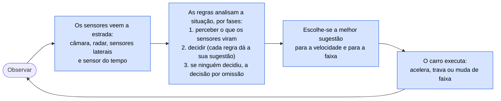
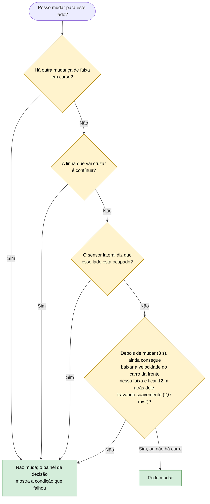
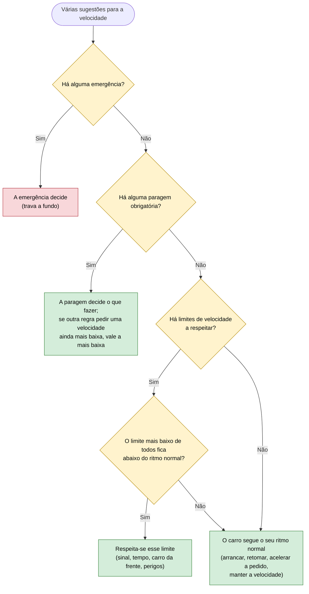

# Como o carro decide

O carro funciona como um condutor experiente que segue um conjunto de regras de condução. Dez vezes por segundo repete o mesmo ciclo: **observa** a estrada, **pensa** com as regras que conhece, **escolhe** o que fazer e **age**.

## Regras sobre as regras

Além das regras de condução, o sistema tem conhecimento sobre as próprias regras (metaconhecimento):

- **Que regras correm primeiro.** No motor Drools, uma regra de controlo põe as regras por fases em cada ciclo: primeiro as que percebem o que os sensores viram, depois as que decidem, por fim a decisão por omissão. No motor Prolog a mesma ordem vem da precedência de cada regra.
- **Que regras vale a pena voltar a avaliar.** No motor Prolog, cada regra sabe que tipos de informação lê. Quando aparece uma informação nova, só voltam a ser avaliadas as regras que a leem. Numa medição feita nos 14 cenários que existiam então: 81% menos trabalho, com exatamente as mesmas decisões.

## A pergunta "posso mudar para este lado?"

Antes de mudar de faixa para contornar um perigo ou para atender um pedido, o carro faz sempre a mesma pergunta. Parte dela e verifica cada condição, uma a uma (raciocínio para trás):

Quando a resposta é não, o painel de decisão diz qual das quatro condições falhou, por exemplo "linha contínua entre RIGHT e CENTER", "lado esquerdo ocupado" ou "sem espaço para seguir o carro da frente nessa faixa".

## As duas decisões de cada momento

Em cada instante o carro toma **duas decisões independentes**, como um condutor que controla os pedais e o volante ao mesmo tempo:

| Decisão | Exemplos |
|---|---|
| **Velocidade** (pedais) | manter, abrandar, travar, parar, travar de emergência, arrancar |
| **Faixa** (volante) | manter a faixa, mudar para a esquerda ou para a direita, voltar à direita |

Por isso o carro pode, por exemplo, abrandar por causa do carro da frente e começar uma ultrapassagem no mesmo instante.

## Como se escolhe entre várias sugestões

Várias regras podem dar sugestões ao mesmo tempo. A escolha segue o bom senso de um condutor prudente:

| Nível | O que inclui |
|---|---|
| Emergência | Risco iminente de colisão, peão a 6 m ou menos (ou já impossível de evitar travando com conforto), obstáculo grave a 8 m ou menos |
| Paragem obrigatória | Semáforo vermelho ou amarelo, sinal STOP, peão no caminho ou a atravessar, barreira fechada sem alternativa |
| Limites de velocidade | Carro da frente, carro mais lento na faixa da esquerda, obstáculos, barreiras e buracos no caminho, mau tempo, sinais de limite, velocidade de cruzeiro |
| Ritmo normal | Arrancar ou retomar depois de parar, acelerar a pedido do operador, seguir no verde ou numa barreira aberta, manter a velocidade |

Para a faixa ganha sempre a sugestão mais importante: desviar de um obstáculo vale mais do que ultrapassar. Enquanto uma paragem obrigatória ou uma emergência estiver a travar o carro para o parar, ele não começa uma mudança de faixa menos importante do que ela; na aproximação, ainda sem travar, pode mudar (por exemplo para contornar um obstáculo antes de um semáforo vermelho).

## Segurança antes de executar

Antes de começar a mudar de faixa, o carro confirma mais uma vez, com o que está realmente na estrada, que a faixa de destino está livre e que não há linha contínua. Se não, cancela a manobra e, se ainda não estiver a travar, abranda 10 km/h. A velocidade é ajustada de forma suave, sem acelerações e travagens bruscas desnecessárias.

## Quem pode pedir uma mudança de faixa ou uma aceleração

Além das regras, há pedidos externos: o operador (pela API ou pelos botões da aplicação desktop) e as ações programadas de cada cenário. O carro atende-os só se for seguro (ver 03 e 15).

## Dois motores de regras

As mesmas regras estão escritas em dois sistemas diferentes (Drools e Prolog). Os testes garantem que os dois tomam sempre as mesmas decisões.
