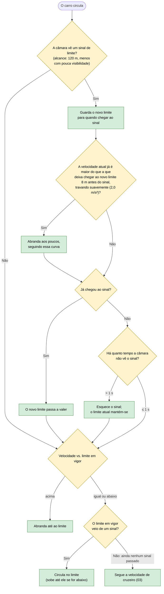

# 01 — Limites de velocidade

**Objetivo:** circular sempre dentro do limite legal e abrandar a tempo quando se aproxima de um limite mais baixo.

O sinal de limite vale para todas as faixas. A câmara lê-o ao longe, mas, tal como no Código da Estrada, o novo limite **só começa no sinal**. Até lá o carro prepara-se: se o novo limite for mais baixo, abranda gradualmente para chegar ao sinal já à velocidade certa.

## Em resumo

| Situação | O que o carro faz |
|---|---|
| Vai a 90 km/h e vê um sinal de 50 | Começa a abrandar a cerca de 116 m do sinal e chega lá a 50 km/h |
| Vê um sinal de 90 e vai a 60 km/h | Quando passa o sinal, acelera até 90 km/h |
| O sinal deixa de ser visto antes de lá chegar (por exemplo com chuva) | Esquece-o ao fim de 1 segundo; o limite atual mantém-se |
| Ainda não passou nenhum sinal | O limite é 120 km/h e o carro segue a velocidade de cruzeiro |

O limite de velocidade nunca é ultrapassado por causa de outras regras: perigos, tempo ou trânsito só podem baixar a velocidade.
