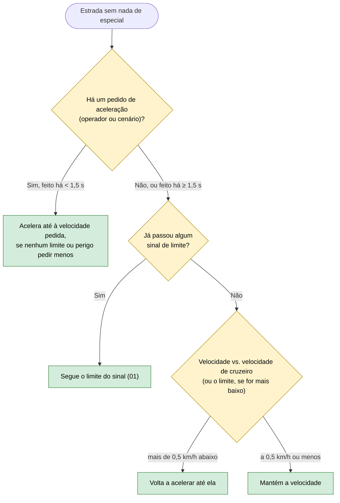

# 03 — Velocidade de cruzeiro e aceleração

**Objetivo:** depois de abrandar ou parar, voltar à velocidade normal da estrada; e ter sempre uma decisão, mesmo quando nada de especial acontece.

Cada cenário tem uma **velocidade de cruzeiro** (a velocidade inicial). Enquanto nenhum sinal de limite tiver sido passado, é a ela que o carro regressa. Um pedido de aceleração não vem de um condutor: vem de uma ação programada do cenário ou de um botão da aplicação desktop.

## Em resumo

| Situação | O que o carro faz |
|---|---|
| Travou por causa de um obstáculo e a estrada ficou livre | Volta à velocidade de cruzeiro |
| Há um carro lento à frente, chuva ou um perigo | A velocidade de cruzeiro cede: o carro respeita sempre o limite mais baixo |
| Um cenário pede para acelerar | Acelera, desde que nada mais importante o impeça |
| Nenhuma regra tem nada a dizer | Mantém a velocidade atual |
