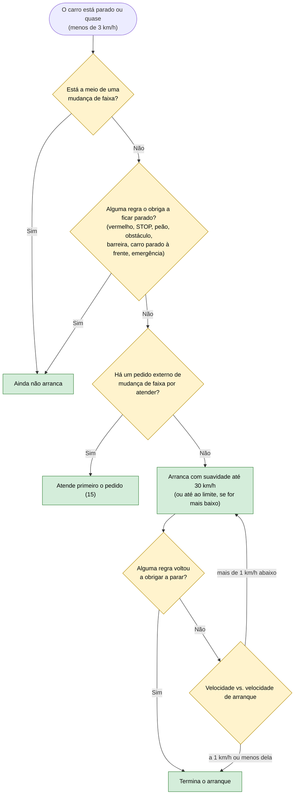

# 04 — Arrancar depois de parar

**Objetivo:** quando o carro está parado e já nada o obriga a ficar parado, arrancar com suavidade.

Depois de terminado o arranque, as outras regras voltam a decidir a velocidade (01, 03).

## Em resumo

| Situação | O que o carro faz |
|---|---|
| O semáforo ficou verde | Arranca |
| O peão acabou de atravessar | Arranca |
| Abriu-se uma faixa ao lado de um obstáculo | Contorna o obstáculo e arranca ao mesmo tempo |
| Ainda está vermelho | Fica parado |
