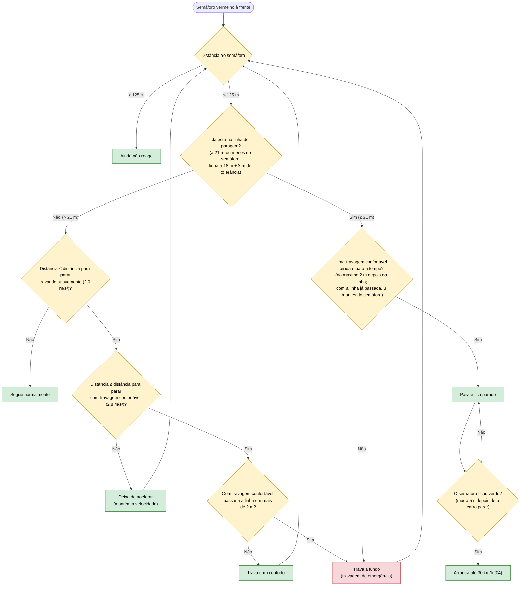

# 05 — Semáforo vermelho

**Objetivo:** parar sempre antes da linha de paragem e esperar pelo verde.

O semáforo vale para todas as faixas. A linha de paragem fica 18 m antes do semáforo. O carro calcula a distância de que precisa para parar a partir da velocidade atual (0,5 s de reação + a travagem + os 18 m até à linha) e começa a agir a tempo. Quando vê o vermelho, decide logo que vai parar e não muda de ideias.

## Em resumo

| Situação | O que o carro faz |
|---|---|
| A 60 km/h, vê o vermelho a 100 m | Segue até cerca de 96 m, deixa de acelerar, a cerca de 76 m trava com conforto e pára antes da linha |
| O vermelho aparece já muito perto | Trava a fundo para perder o máximo de velocidade |
| Está parado na linha | Espera; o semáforo passa a verde 5 segundos depois de o carro parar |
| Há um carro mais lento à frente durante a aproximação | Vale a velocidade mais baixa: o semáforo decide que tem de parar e o carro da frente pode obrigar a ir ainda mais devagar |
