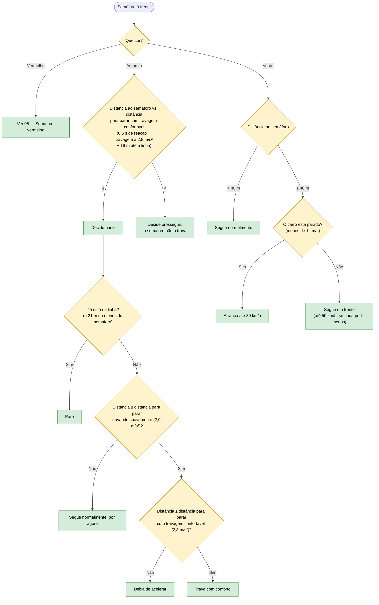

# 06 — Semáforo amarelo e verde

**Objetivo:** no amarelo, parar se ainda for seguro; se já não for, prosseguir sem travar a meio. No verde, seguir ou arrancar.

Segue o Regulamento de Sinalização do Trânsito (art. 69.º): no amarelo o condutor pára, a menos que já esteja tão perto que não consiga parar em segurança. A decisão é tomada **uma única vez**, quando o carro vê o amarelo, e não muda depois.

Se o amarelo passar a vermelho, a decisão mantém-se: quem decidiu parar continua a parar (05); quem decidiu prosseguir passa.

## Em resumo

| Situação | O que o carro faz |
|---|---|
| Amarelo visto a 90 m, a 60 km/h (precisa de ~76 m) | Decide parar; abranda e pára antes da linha |
| Amarelo visto a 50 m, a 60 km/h | Decide prosseguir; passa sem travar, mesmo que fique vermelho entretanto |
| Verde com o carro parado | Arranca |
| Decidiu prosseguir mas aparece um peão | Pára pelo peão: a decisão do semáforo nunca se sobrepõe à segurança |

O semáforo muda sozinho: o amarelo passa a vermelho ao fim de 3 segundos e o vermelho passa a verde 5 segundos depois de o carro parar.
