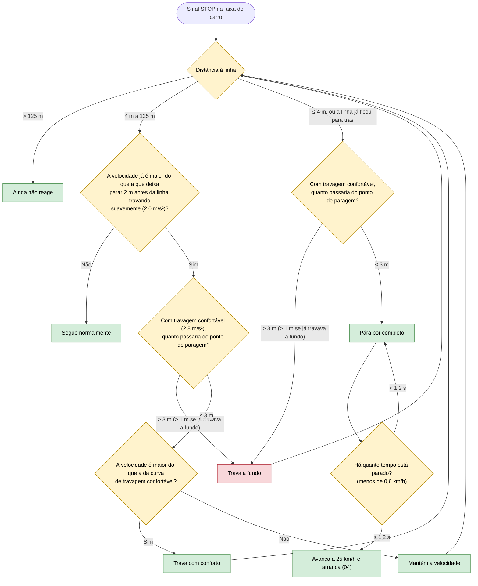

# 07 — Sinal STOP

**Objetivo:** parar por completo na linha de paragem, esperar um momento e só depois avançar (sinal B2, Código da Estrada).

O sinal STOP vale apenas para a faixa onde está. A linha de paragem fica 15 m antes do sinal; o carro procura parar 2 m antes da linha. As distâncias abaixo são à linha.

## Em resumo

| Situação | O que o carro faz |
|---|---|
| STOP à frente, a 50 km/h | A cerca de 50 m da linha começa a abrandar de forma progressiva e pára na linha |
| STOP visto já perto, depressa demais | Trava a fundo, numa só travagem contínua |
| STOP visto só depois de a linha ter ficado para trás (a 60 km/h, a 8 m do sinal) | Trava a fundo, pára assim que consegue (cerca de 6 m depois da linha), cumpre a paragem e só então segue |
| Parou na linha | Espera 1,2 segundos e avança a 25 km/h |
| STOP noutra faixa | Não se aplica ao carro |

**Como conta os 1,2 segundos.** Quando o carro para na linha, o sistema regista esse instante como um acontecimento ("parei aqui"). A paragem fica cumprida quando chega uma leitura do sensor de velocidade pelo menos 1,2 segundos depois desse acontecimento. É raciocínio temporal com um operador de Allen ("depois de", `after`), em vez de um cronómetro feito à mão.

**Não esquece o STOP.** A câmara deixa de ver o sinal quando o carro passa por ele. Enquanto a paragem estiver por fazer, o carro não esquece o sinal: só o esquece depois de ter parado.
