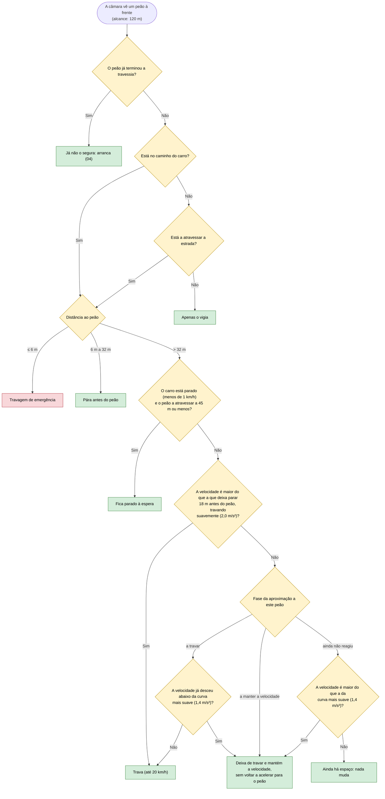

# 08 — Peões

**Objetivo:** dar sempre prioridade a um peão que está no caminho do carro ou a atravessar a estrada, e só voltar a andar quando a travessia terminar.

Um peão conta quando está na faixa do carro (ou a 3,5 m ou menos da sua trajetória) ou quando está a atravessar a estrada, em qualquer faixa. Um peão parado noutra faixa ou no passeio é só vigiado.

O carro lembra-se de que já começou a travar por um peão: trava até ficar abaixo da curva mais suave e, a partir daí, mantém a velocidade até a curva de 2,0 m/s² o voltar a apanhar. Assim não alterna entre travar e manter em cada instante.

## Em resumo

| Situação | O que o carro faz |
|---|---|
| Peão parado na faixa do carro, a 80 m, a 60 km/h | Abranda e pára a cerca de 20 m do peão |
| Peão a atravessar noutra faixa, em direção ao carro | Abranda e cede passagem, mesmo antes de o peão chegar à sua faixa |
| Peão que saiu da faixa do carro mas ainda está a atravessar | Continua parado até ele chegar ao passeio |
| Peão parado no passeio ou noutra faixa, sem atravessar | Apenas o vigia |
| Peão a 6 m ou menos | Travagem de emergência |
| Peão a atravessar à frente de outro carro | O outro carro também pára e espera; depois retoma (comportamento dos outros veículos na simulação) |

O peão tem prioridade sobre o semáforo verde e sobre a aproximação a um semáforo ou STOP.
