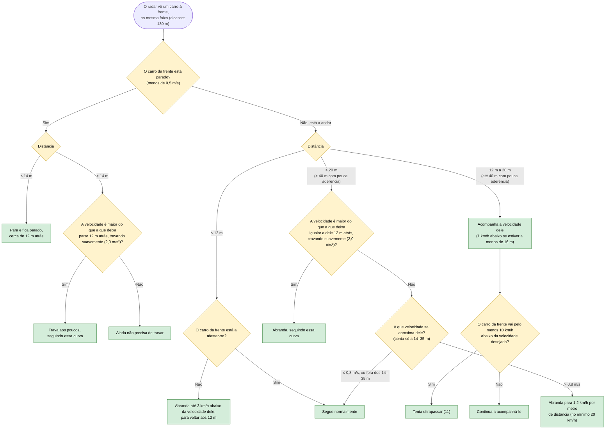

# 09 — Seguir o carro da frente

**Objetivo:** manter sempre uma distância segura do carro da frente (Código da Estrada, art. 18.º e 24.º), acompanhá-lo sem pára-arranca e parar atrás dele se estiver parado.

A distância de referência é uma folga de **12 m** atrás do carro da frente. As várias verificações são independentes; quando mais do que uma pede para abrandar, vale a velocidade mais baixa.

Além disto, se a distância encolher mais de 4 m em 2 segundos (a menos de 50 m), o carro abranda para 35 km/h, ou não acelera se já for abaixo disso. A menos de 14 m e a aproximar-se, trava até 3 km/h abaixo da velocidade do carro da frente.

## Em resumo

| Situação | O que o carro faz |
|---|---|
| Carro parado à frente, a 60 km/h | Trava aos poucos e pára cerca de 12 m atrás dele |
| Carro lento à frente (por exemplo a 5 km/h) | Acompanha-o suavemente, sem travar e acelerar repetidamente |
| Chuva, piso molhado | Acompanha a uma distância maior (a janela de 20 m cresce até 40 m) |
| Carro da frente afasta-se | Volta a acelerar até ao ritmo normal |
| Carro da frente muito mais lento e a faixa da esquerda livre | Ultrapassa (11) |
