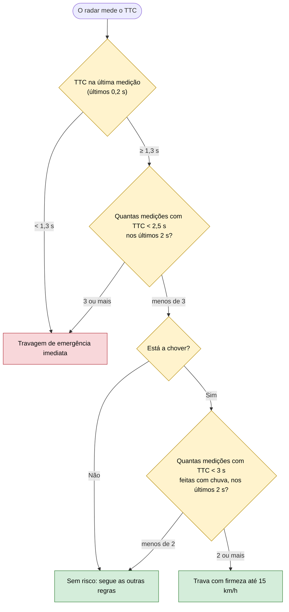

# 10 — Risco de colisão

**Objetivo:** travar de emergência quando o choque com o carro da frente está iminente, e travar mais cedo quando chove.

O radar mede o **tempo até colisão** (TTC): a distância ao carro da frente a dividir pela velocidade a que o carro se aproxima dele. Mede dez vezes por segundo.

## Em resumo

| Situação | O que o carro faz |
|---|---|
| Risco iminente de colisão (TTC < 1,3 s) | Travagem de emergência, com luzes de emergência; nenhuma outra regra se sobrepõe |
| Risco persistente (3 medições abaixo de 2,5 s em 2 s) | Travagem de emergência |
| Chuva com risco moderado (2 medições abaixo de 3 s em 2 s) | Trava mais cedo do que com tempo seco. Só contam as medições feitas com chuva: uma leitura de chuva a menos de 0,4 segundos de cada medição (operador de Allen "coincide com", `coincides`) |
| Uma medição isolada entre 1,3 e 2,5 s | Não reage por uma só medição, para evitar travagens falsas |
