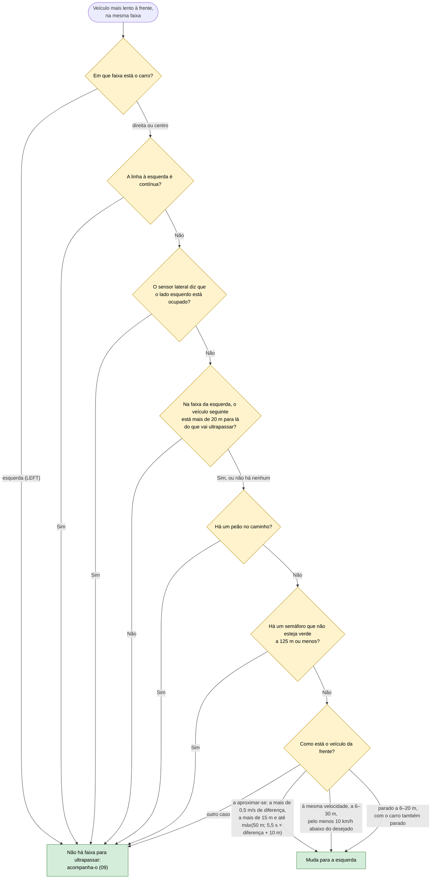
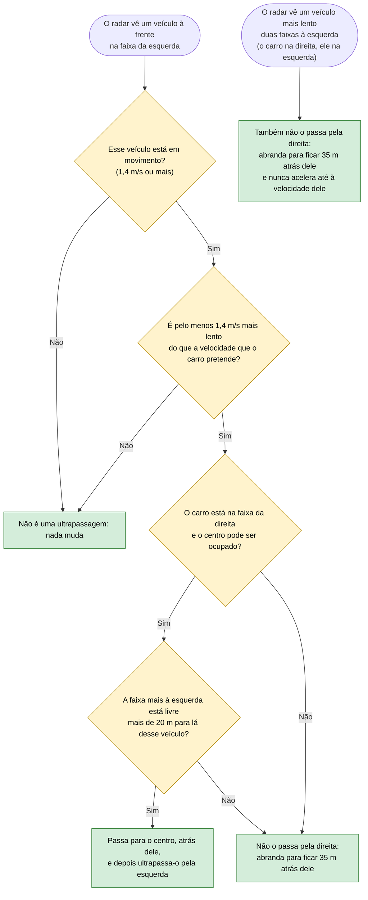
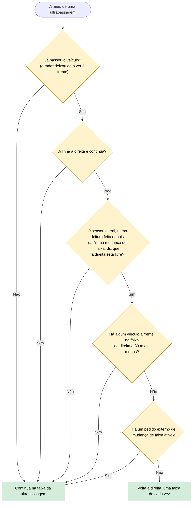
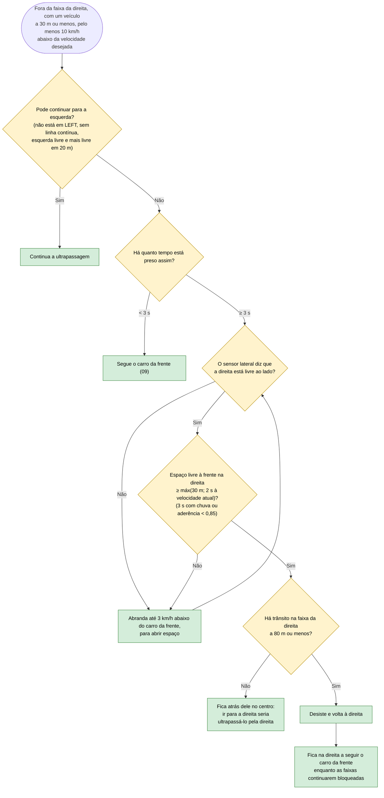

# 11 — Ultrapassagens e regresso à direita

**Objetivo:** ultrapassar pela esquerda um veículo mais lento, sem nunca passar alguém pela direita, e voltar à direita logo que possível (Código da Estrada, art. 13.º, 36.º, 38.º e 41.º). Se as faixas à frente estiverem todas lentas, desistir em segurança.

## Começar a ultrapassagem

Se o veículo de que se aproxima está parado e perto demais para o contornar em andamento (a menos de 5,5 s à velocidade de aproximação), o carro pára atrás dele (09) e contorna-o depois de parado.

## Veículo mais lento na faixa da esquerda

## Voltar à direita

## Quando a ultrapassagem é impossível

## Em resumo

| Situação | O que o carro faz |
|---|---|
| Carro lento à frente, esquerda livre | Ultrapassa pela esquerda e volta à direita |
| Carro parado à frente | Pára atrás e contorna-o quando a esquerda fica livre |
| Carro lento na faixa da esquerda, faixa seguinte livre | Põe-se atrás dele e ultrapassa-o pela esquerda |
| Carro lento na faixa da esquerda, faixa seguinte também lenta | Fica na direita, abranda e não o passa pela direita |
| Trânsito lento em todas as faixas, o carro na direita | Fica na direita e segue o carro da frente |
| Trânsito lento em todas as faixas, o carro já fora da direita | Desiste, volta à direita com distância segura (maior com chuva) e segue o trânsito |
| Acabou de mudar de faixa | Só decide voltar à direita com uma leitura nova do sensor lateral; a anterior ainda podia ser de antes da manobra |
| Faixa da direita vazia mas carro lento no centro | Fica atrás dele no centro: ir para a direita seria ultrapassar pela direita |
| Contornou um obstáculo pela direita e há um carro mais lento na faixa da esquerda | Não o passa pela direita (art. 36.º): fica atrás dele |
