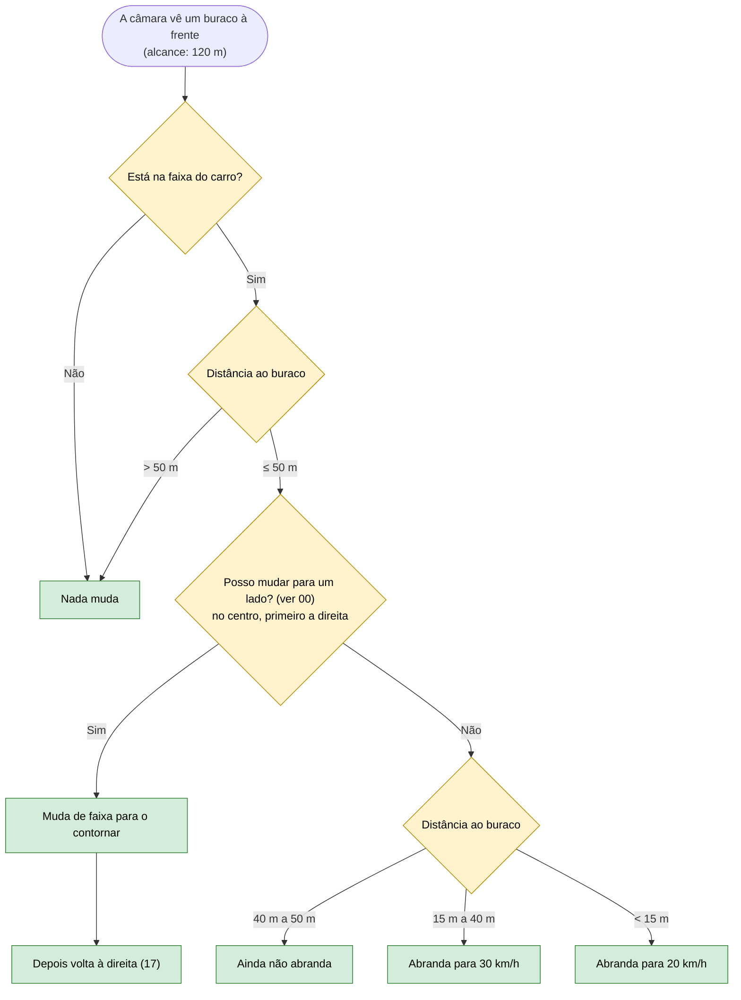

# 12 — Buracos na estrada

**Objetivo:** contornar um buraco na faixa do carro quando há uma faixa para onde ir; se não houver, passar devagar. Um buraco noutra faixa não obriga a abrandar (Código da Estrada, art. 24.º: a velocidade adapta-se aos perigos da via por onde se circula).

## Em resumo

| Situação | O que o carro faz |
|---|---|
| Buraco no centro, direita livre | Desvia para a direita |
| Buraco no centro, direita ocupada, esquerda livre | Desvia para a esquerda |
| Sem lado seguro (ocupado, ou livre mas sem espaço para seguir o carro da frente) | Passa devagar (30 km/h, 20 km/h nos últimos 15 m) |
| Buraco noutra faixa | Mantém a velocidade |
| Com chuva | Desvia na mesma, e abranda por causa do tempo |

A pergunta "posso mudar para este lado?" é a mesma em todas as mudanças de faixa (ver 00): sem outra manobra em curso, sem linha contínua a cruzar, com o sensor lateral a dizer que esse lado está livre e com espaço para seguir o carro da frente nessa faixa.
