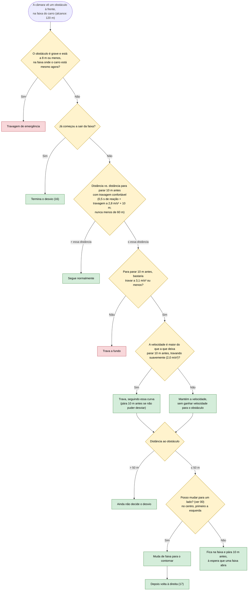

# 13 — Obstáculos na estrada

**Objetivo:** contornar um obstáculo na faixa do carro; enquanto não sai da faixa, ser sempre capaz de parar 10 m antes dele; se estiver perigosamente perto, travar de emergência.

São duas decisões ao mesmo tempo: a do volante (contornar) e a dos pedais (a que velocidade se aproxima). Por isso o carro pode travar e começar a desviar-se no mesmo instante.

O desvio só se decide a 50 m ou menos porque o sensor lateral só vê os perigos das faixas ao lado até 60 m: um lado visto livre fica livre durante toda a manobra. A travagem começa antes, para o carro chegar aos 50 m a uma velocidade da qual ainda consegue parar.

## Em resumo

| Situação | O que o carro faz |
|---|---|
| A 60 km/h, obstáculo a 100 m na faixa | A cerca de 68 m começa a travar suavemente; a 50 m desvia-se, sem travagem de emergência |
| Obstáculo no centro, esquerda livre | Contorna pela esquerda |
| Esquerda ocupada, direita livre | Contorna pela direita |
| Nenhuma faixa livre, ou linha contínua | Pára 10 m antes do obstáculo e explica que a linha contínua impede a manobra |
| Obstáculo grave a 8 m ou menos | Travagem de emergência |
| A meio do desvio, já fora da faixa do obstáculo | Não trava de emergência: a regra olha para a faixa onde o carro está mesmo |
| No centro, esquerda livre mas com um carro demasiado perto para o seguir, direita segura | Contorna pela direita; depois não passa pela direita um carro mais lento na faixa da esquerda (11) |

A pergunta "posso mudar para este lado?" é a mesma em todas as mudanças de faixa (ver 00): sem outra manobra em curso, sem linha contínua a cruzar, com o sensor lateral a dizer que esse lado está livre e com espaço para seguir o carro da frente nessa faixa.
