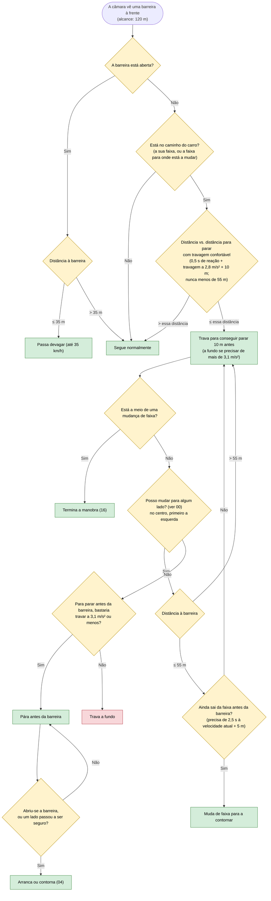

# 14 — Barreiras

**Objetivo:** contornar uma barreira fechada quando há uma faixa segura; se não houver, parar antes dela; com a barreira aberta, passar devagar.

Para contornar a barreira e para decidir parar, o carro faz a mesma pergunta: "posso mudar para este lado?" (ver 00). Por isso faz sempre uma das duas coisas: ou contorna, ou pára. Nunca segue contra a barreira (Código da Estrada, art. 35.º: só se muda de faixa sem perigo).

Enquanto a barreira estiver no caminho do carro (a sua faixa, ou a faixa para onde está a mudar), o carro trava como para um obstáculo, de modo a conseguir parar 10 m antes, mesmo quando vai contorná-la: só deixa de travar quando a mudança de faixa o tira do caminho. Assim nunca chega à barreira depressa demais, se o lado deixar de estar livre.

## Em resumo

| Situação | O que o carro faz |
|---|---|
| Barreira fechada, faixa ao lado segura | Trava enquanto ela está no caminho e contorna-a |
| Barreira fechada, sem alternativa | Pára e espera |
| Faixa ao lado livre, mas com um carro à frente demasiado perto para ser seguido | Trava pela barreira; quando já vai devagar o suficiente para o seguir, contorna-a |
| Barreira fechada vista tarde, a 60 km/h a 22 m | Trava a fundo |
| Barreira aberta | Passa devagar |

O carro decide pelo que **vê**: a faixa ao lado conta como livre quando o sensor lateral o diz, como um condutor que só se pode certificar do que observa (Código da Estrada, art. 35.º e 38.º).
