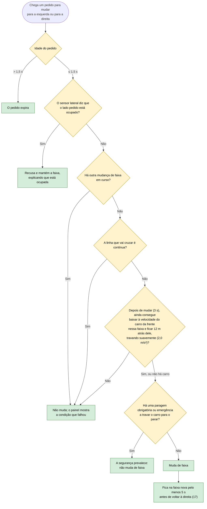

# 15 — Mudança de faixa pedida externamente

**Objetivo:** atender um pedido para mudar de faixa, mas só se for seguro.

O pedido não vem de um condutor dentro do carro: vem do operador (pela API ou pelos botões da aplicação desktop) ou de uma ação programada do cenário. A interface web deixou de ter os botões LANE LEFT e LANE RIGHT.

## Em resumo

| Situação | O que o carro faz |
|---|---|
| Faixa pedida livre, sem outra manobra nem linha contínua | Muda de faixa |
| Outra mudança de faixa ainda em curso | Não muda; o painel mostra "a lane change is already in progress" |
| Faixa pedida ocupada | Mantém a faixa e informa |
| Carro lento pouco à frente na faixa pedida | Não muda: depois da manobra já não o conseguiria seguir a distância segura |
| Há um peão ou uma paragem obrigatória a travar o carro | A segurança prevalece: não muda de faixa |
| O carro estava a arrancar | Atende primeiro o pedido |
| Mudou de faixa a pedido | Fica lá pelo menos 5 segundos; depois, se nada o impedir, volta à direita (17) |

Antes de executar, o carro confirma mais uma vez que a faixa está livre e que não há linha contínua.
