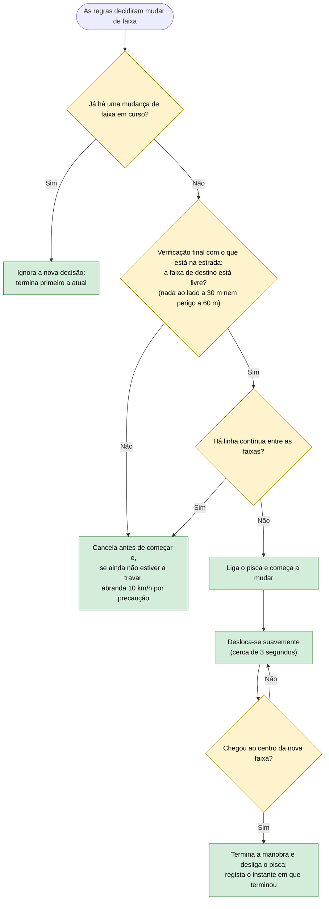

# 16 — Mudança de faixa em curso

**Objetivo:** fazer cada mudança de faixa de forma suave e completa, sem hesitar nem voltar atrás a meio.

## Em resumo

| Situação | O que o carro faz |
|---|---|
| Mudança de faixa normal | Pisca, desloca-se em cerca de 3 segundos e endireita |
| Carro lento perto demais à frente na faixa de destino | Nem chega a decidir mudar: as regras já o verificam antes ("posso mudar para este lado?", ver 00) |
| Durante a manobra surge outra sugestão | Termina primeiro a manobra atual; não começa outra a meio |
| Surge uma emergência durante a manobra | Trava; o movimento lateral termina |
| Acabou a manobra | As regras de voltar à direita só usam leituras do sensor lateral feitas depois deste instante |
