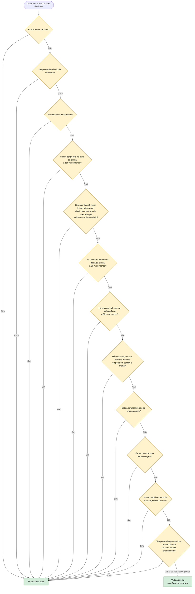

# 17 — Circular pela direita

**Objetivo:** voltar à faixa da direita sempre que não houver motivo para estar noutra, como manda o Código da Estrada (art. 13.º).

Cada pergunta abaixo é um motivo diferente para o carro ficar onde está. Só volta à direita quando nenhum se aplica.

## Em resumo

| Situação | O que o carro faz |
|---|---|
| Acabou de contornar um obstáculo | Volta à direita quando a faixa está livre |
| Está na faixa da esquerda | Passa para o centro e depois para a direita |
| Há um carro na faixa da direita ao lado | Espera que fique livre |
| Mudou de faixa a pedido (operador ou cenário) | Fica lá 5 segundos antes de voltar à direita |
| Ultrapassagem impossível com trânsito lento | Volta à direita pelas regras da ultrapassagem (11) |
| Acabou de mudar de faixa | Espera por uma leitura nova do sensor lateral antes de decidir voltar: a anterior ainda podia ser de antes da manobra |
