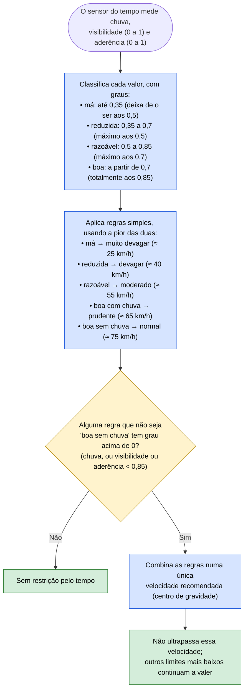

# 18 — Chuva, visibilidade e aderência

**Objetivo:** adaptar a velocidade ao tempo de forma gradual, como faria um bom condutor.

Visibilidade e aderência não são "sim ou não": vão de 0 (péssimas) a 1 (perfeitas), e cada valor pertence, em maior ou menor grau, a uma de quatro categorias. O carro usa **lógica difusa**: avalia em que medida as condições são boas ou más e combina essas avaliações numa velocidade, sem mudanças bruscas.

## Em resumo

| Condições | Velocidade máxima recomendada |
|---|---|
| Bom tempo (visibilidade e aderência ≥ 0,85, sem chuva) | Sem restrição |
| Só chuva, boa visibilidade e bom piso | Cerca de 65 km/h |
| Chuva com visibilidade e piso reduzidos (botão "Rain") | Cerca de 51 km/h |
| Visibilidade a 0,5 | Cerca de 40 km/h |
| Visibilidade ou piso muito maus | Cerca de 25 km/h |

O mau tempo só pode baixar a velocidade, nunca a faz ultrapassar o limite legal. Com chuva o carro também mantém mais distância do carro da frente (09), trava mais cedo perante um risco de colisão medido com chuva (10) e exige mais espaço para voltar à direita (11).
