# 99 — Todos os comportamentos num só fluxograma

Junta num único fluxograma as perguntas e as ações dos fluxogramas 01 a 18. Em cada ciclo (10 vezes por segundo) o carro primeiro percebe o que os sensores viram e depois decide ao mesmo tempo os **pedais** (velocidade, à esquerda) e o **volante** (faixa, à direita), percorrendo as perguntas pela ordem de importância. Os números indicam o fluxograma com o pormenor de cada comportamento.

```mermaid
flowchart TD
    INI(["Novo ciclo<br/>(10 vezes por segundo)"]) --> OBS["Observa a estrada:<br/>câmara, radar, sensores laterais, sensor do tempo<br/>e pedidos externos (operador ou cenário)"]
    OBS --> PER["Fase 1 · Perceber: o que os sensores viram<br/>passa a ser o estado do mundo<br/>(uma regra de controlo põe esta fase primeiro)"]
    PER --> V0
    PER --> F0

    %% ═════════════ PEDAIS — VELOCIDADE ═════════════
    subgraph PED ["PEDAIS — que velocidade?"]
        V0(["Velocidade"]) --> V10{"10 · TTC (tempo até colisão)<br/>na última medição"}
        V10 -- "< 1,3 s" --> EMERG["TRAVAGEM DE EMERGÊNCIA<br/>com luzes de emergência"]
        V10 -- "≥ 1,3 s" --> V10B{"3 ou mais medições com TTC < 2,5 s<br/>nos últimos 2 s?"}
        V10B -- "Sim" --> EMERG
        V10B -- "Não" --> V08A{"08 · Há um peão no caminho do carro?"}
        V08A -- "Sim" --> V08D
        V08A -- "Não" --> V08B{"Há um peão a atravessar a estrada?"}
        V08B -- "Sim" --> V08D{"Distância ao peão"}
        V08D -- "≤ 6 m" --> EMERG
        V08D -- "6 m a 32 m" --> V08P["Pára antes do peão e espera<br/>que ele termine a travessia"]
        V08D -- "> 32 m" --> V08L["Abranda a tempo para parar 18 m antes,<br/>sem voltar a acelerar"]
        V08B -- "Não" --> V13G{"13 · Obstáculo grave a 8 m ou menos,<br/>na faixa onde o carro está mesmo agora?"}
        V13G -- "Sim" --> EMERG
        V13G -- "Não" --> VS{"05/06 · Cor do semáforo à frente"}

        VS -- "Vermelho" --> VR{"Distância ao semáforo vs. distância para parar<br/>(0,5 s de reação + travagem + 18 m até à linha)"}
        VR -- "maior do que a necessária a 2,0 m/s²<br/>(ou > 125 m)" --> V07
        VR -- "entre a necessária a 2,0 e a 2,8 m/s²" --> VRM["Deixa de acelerar"]
        VR -- "dentro da necessária a 2,8 m/s²" --> VR3{"Com travagem confortável (2,8 m/s²),<br/>passaria a linha em mais de 2 m?"}
        VR3 -- "Não" --> VRS["Trava com conforto e pára na linha;<br/>espera pelo verde"]
        VR3 -- "Sim" --> VRF["Trava a fundo"]
        VS -- "Amarelo" --> VA{"Distância vs. distância para parar<br/>com travagem confortável (decide uma só vez)"}
        VA -- "≥" --> VRS
        VA -- "<" --> VAP["Prossegue sem travar a meio"]
        VAP --> V07
        VS -- "Verde ou nenhum" --> V07

        V07{"07 · Sinal STOP na faixa do carro?"}
        V07 -- "Sim" --> V07Q{"Há quanto tempo está parado na linha?"}
        V07Q -- "< 1,2 s, ou ainda não parou" --> V07S["Abranda e pára na linha;<br/>trava a fundo se a travagem confortável<br/>passasse mais de 3 m (mesmo com a linha já para trás)"]
        V07Q -- "≥ 1,2 s" --> V14
        V07 -- "Não" --> V14{"14 · Barreira fechada na faixa, dentro da distância<br/>de paragem confortável (mín. 55 m)?"}
        V14 -- "Sim" --> V14B{"Posso mudar para algum lado? (00)"}
        V14B -- "Não" --> V14S["Pára antes da barreira<br/>(a fundo se precisar de mais de 3,1 m/s²)"]
        V14B -- "Sim: contorna" --> V13
        V14 -- "Não" --> V13{"13 · Obstáculo na faixa, dentro da distância<br/>de paragem confortável (mín. 60 m)?"}
        V13 -- "Sim" --> V13B{"Já começou a sair da faixa?"}
        V13B -- "Não" --> V13S["Trava para conseguir parar 10 m antes<br/>(a fundo se precisar de mais de 3,1 m/s²)"]
        V13B -- "Sim" --> L01
        V13 -- "Não" --> L01

        L01{"01 · Velocidade acima do limite em vigor?"}
        L01 -- "Sim" --> L01A["Abranda até ao limite"]
        L01A --> L01B
        L01 -- "Não" --> L01B{"Um limite mais baixo à frente já obriga a abrandar?<br/>(para lá chegar travando a 2,0 m/s²)"}
        L01B -- "Sim" --> L01C["Abranda aos poucos até ao sinal"]
        L01C --> L09
        L01B -- "Não" --> L09{"09 · Há um carro à frente,<br/>na mesma faixa?"}
        L09 -- "Sim" --> L09Q{"Como está o carro da frente?"}
        L09Q -- "parado" --> L09P["Pára cerca de 12 m atrás"]
        L09Q -- "a andar, a 12 m ou menos" --> L09A["Abranda até 3 km/h abaixo dele"]
        L09Q -- "a andar, a 12–20 m<br/>(até 40 m com pouca aderência)" --> L09B["Acompanha a velocidade dele"]
        L09Q -- "a andar, a mais de 20 m<br/>(40 m com pouca aderência)" --> L09C["Abranda só se for preciso para<br/>igualar a velocidade dele 12 m atrás"]
        L09P --> L10
        L09A --> L10
        L09B --> L10
        L09C --> L10
        L09 -- "Não" --> L10{"10 · Está a chover?"}
        L10 -- "Sim" --> L10B{"2 ou mais medições com TTC < 3 s,<br/>feitas com chuva, nos últimos 2 s?"}
        L10B -- "Sim" --> L10A["Trava até 15 km/h"]
        L10B -- "Não" --> L12
        L10A --> L12
        L10 -- "Não" --> L12{"12 · Buraco na faixa do carro,<br/>a 40 m ou menos?"}
        L12 -- "Sim" --> L12B{"Pode desviar-se para um lado?"}
        L12B -- "Não" --> L12A["Até 30 km/h<br/>(20 km/h nos últimos 15 m)"]
        L12B -- "Sim" --> L14
        L12A --> L14
        L12 -- "Não" --> L14{"14 · Barreira aberta a 35 m ou menos?"}
        L14 -- "Sim" --> L14A["Até 35 km/h"]
        L14A --> L18
        L14 -- "Não" --> L18{"18 · O tempo restringe?<br/>(chuva, ou visibilidade ou aderência < 0,85)"}
        L18 -- "Sim" --> L18A["Lógica difusa: velocidade<br/>máxima recomendada<br/>(≈ 25 a 65 km/h)"]
        L18A --> R04
        L18 -- "Não" --> R04{"04 · Está parado? (< 3 km/h)"}
        R04 -- "Sim" --> R04B{"Alguma regra acima o obriga<br/>a ficar parado?"}
        R04B -- "Não" --> R04A["Arranca com suavidade<br/>até 30 km/h"]
        R04B -- "Sim" --> R00
        R04 -- "Não" --> R03{"03 · Há um pedido de aceleração<br/>com menos de 1,5 s?"}
        R03 -- "Sim" --> R03A["Acelera até à velocidade pedida"]
        R03 -- "Não" --> R03B{"Já passou algum sinal de limite?"}
        R03B -- "Sim" --> R00
        R03B -- "Não" --> R03C{"Velocidade abaixo da de cruzeiro<br/>(mais de 0,5 km/h)?"}
        R03C -- "Sim" --> R03D["Acelera até à de cruzeiro"]
        R03C -- "Não" --> R00["Fase 3 · Decisão por omissão:<br/>mantém a velocidade"]
        R04A --> VMIN
        R03A --> VMIN
        R03D --> VMIN
        R00 --> VMIN
        VMIN["Fica com a velocidade mais baixa<br/>entre esta e todos os limites encontrados<br/>(nunca acima do limite legal)"]

        EMERG --> DV
        V08P --> DV
        V08L --> DV
        VRM --> DV
        VRS --> DV
        VRF --> DV
        V07S --> DV
        V14S --> DV
        V13S --> DV
        VMIN --> DV
        DV(["Decisão de velocidade<br/>(uma paragem obrigatória decide a ação;<br/>um limite mais baixo pode reduzir a velocidade)"])
    end

    %% ═════════════ VOLANTE — FAIXA ═════════════
    subgraph VOL ["VOLANTE — que faixa?"]
        F0(["Faixa"]) --> FE{"Uma emergência ou paragem obrigatória<br/>está a travar o carro para o parar?"}
        FE -- "Sim" --> FK["Mantém a faixa"]
        FE -- "Não" --> F16{"16 · Está a meio de<br/>uma mudança de faixa?"}
        F16 -- "Sim" --> F16A["Termina a manobra;<br/>não começa outra a meio"]
        F16 -- "Não" --> F13{"13 · Obstáculo na faixa,<br/>a 50 m ou menos?"}
        F13 -- "Sim" --> F13Q{"Posso mudar para um lado? (00)"}
        F13Q -- "Sim" --> F13A["Contorna<br/>(no centro, de preferência pela esquerda)"]
        F13Q -- "Não: o carro pára" --> FK
        F13 -- "Não" --> F14{"14 · Barreira fechada na faixa,<br/>a 55 m ou menos?"}
        F14 -- "Sim" --> F14Q{"Posso mudar para um lado? (00)"}
        F14Q -- "Sim" --> F14A["Contorna<br/>(no centro, de preferência pela esquerda)"]
        F14Q -- "Não: o carro pára" --> FK
        F14 -- "Não" --> F12{"12 · Buraco na faixa,<br/>a 50 m ou menos?"}
        F12 -- "Sim" --> F12Q{"Posso mudar para um lado? (00)"}
        F12Q -- "Sim" --> F12A["Contorna<br/>(no centro, de preferência pela direita)"]
        F12Q -- "Não: passa devagar" --> FK
        F12 -- "Não" --> F11{"11 · Veículo mais lento à frente,<br/>na mesma faixa?"}
        F11 -- "Sim" --> F11Q{"Pode ultrapassar pela esquerda? (11)"}
        F11Q -- "Sim" --> F11A["Ultrapassa pela esquerda<br/>(nunca pela direita)"]
        F11Q -- "Não" --> F11B{"Está fora da direita com as faixas<br/>à frente todas lentas há 3 s ou mais?"}
        F11B -- "Sim" --> F11C["Desiste e volta à direita<br/>com distância segura"]
        F11B -- "Não: fica atrás (09)" --> F15
        F11 -- "Não" --> F15{"15 · Há um pedido externo de mudança de faixa<br/>com 1,5 s ou menos?"}
        F15 -- "Sim" --> F15Q{"Posso mudar para esse lado? (00)"}
        F15Q -- "Sim" --> F15A["Muda para a faixa pedida"]
        F15Q -- "Não: recusa e explica" --> FK
        F15 -- "Não" --> F17{"17 · Está fora da faixa da direita?"}
        F17 -- "Sim" --> F17Q{"Há algum motivo para ficar? (17)<br/>por exemplo, mudou a pedido há menos de 5 s"}
        F17Q -- "Não" --> F17A["Volta à direita,<br/>uma faixa de cada vez"]
        F17Q -- "Sim" --> FK
        F17 -- "Não" --> FK

        FK --> DF
        F16A --> DF
        F13A --> DF
        F14A --> DF
        F12A --> DF
        F11A --> DF
        F11C --> DF
        F15A --> DF
        F17A --> DF
        DF(["Decisão de faixa<br/>(se não muda, o painel mostra<br/>qual condição falhou)"])
    end

    %% ═════════════ AGIR ═════════════
    DV --> G1
    DF --> G1
    G1{"16 · Vai começar uma mudança de faixa?"}
    G1 -- "Sim" --> G2{"Confirma no mundo: a faixa de destino<br/>está livre?"}
    G2 -- "Sim" --> G2B{"Há linha contínua entre as faixas?"}
    G2B -- "Não" --> G4["Liga o pisca e muda suavemente<br/>(cerca de 3 s)"]
    G2B -- "Sim" --> G3
    G2 -- "Não" --> G3["Cancela a manobra<br/>e abranda 10 km/h por precaução"]
    G1 -- "Não" --> G5
    G3 --> G5
    G4 --> G5
    G5["Ajusta a velocidade com suavidade:<br/>acelera, trava ou trava a fundo"] --> NEXT(["↻ Próximo ciclo"])

    %% ═════════════ Estilos ═════════════
    classDef passo fill:#d6e4ff,stroke:#1a56db,color:#000
    classDef dec fill:#fff3cd,stroke:#b58900,color:#000
    classDef acao fill:#d4edda,stroke:#2e7d32,color:#000
    classDef forte fill:#f8d7da,stroke:#b02a37,color:#000
    classDef fim fill:#e8dff5,stroke:#6f42c1,color:#000

    class OBS,PER passo
    class V10,V10B,V08A,V08B,V08D,V13G,VS,VR,VR3,VA,V07,V07Q,V14,V14B,V13,V13B,L01,L01B,L09,L09Q,L10,L10B,L12,L12B,L14,L18,R04,R04B,R03,R03B,R03C dec
    class FE,F16,F13,F13Q,F14,F14Q,F12,F12Q,F11,F11Q,F11B,F15,F15Q,F17,F17Q,G1,G2,G2B dec
    class V08P,V08L,VRM,VRS,VAP,V07S,V14S,V13S,L01A,L01C,L09P,L09A,L09B,L09C,L10A,L12A,L14A,L18A,R04A,R03A,R03D,R00,VMIN acao
    class FK,F16A,F13A,F14A,F12A,F11A,F11C,F15A,F17A,G4,G5 acao
    class EMERG,VRF,G3 forte
    class INI,V0,F0,DV,DF,NEXT fim
```

## Como ler

| Elemento | Significado |
|---|---|
| Losango amarelo | Uma pergunta que o carro faz a si próprio |
| Retângulo verde | O que o carro faz |
| Retângulo vermelho claro | Travagem forte, de emergência, ou manobra cancelada |
| Retângulo azul | Observação da estrada e fase de perceção |
| Forma lilás | Início, fim e as duas decisões de cada ciclo |

## Regras de ouro

- **Pedais e volante decidem-se ao mesmo tempo:** o carro pode abrandar pelo carro da frente e começar uma ultrapassagem no mesmo instante.
- **Primeiro a segurança:** emergência › paragem obrigatória › o limite mais baixo › o ritmo normal. Uma paragem obrigatória decide o que fazer, mas se outra regra pedir uma velocidade ainda mais baixa, vale a mais baixa. Enquanto uma emergência ou paragem obrigatória está a travar o carro para o parar, ele não muda de faixa.
- **Os limites somam-se:** sinal, carro da frente, buracos, barreira aberta e tempo podem aplicar-se todos ao mesmo tempo; vale sempre o mais baixo.
- **Última verificação:** uma mudança de faixa só começa se, nesse instante, a faixa de destino estiver livre e não houver linha contínua.
- **Por fases:** em cada ciclo uma regra de controlo põe primeiro as regras que percebem o que os sensores viram, depois as que decidem, por fim a decisão por omissão.
- **Uma só pergunta para mudar de faixa:** "posso mudar para este lado?" — sem outra manobra, sem linha contínua, lado livre e espaço para seguir o carro da frente nessa faixa (ver 00). Quando a resposta é não, o painel mostra qual destas condições falhou.
